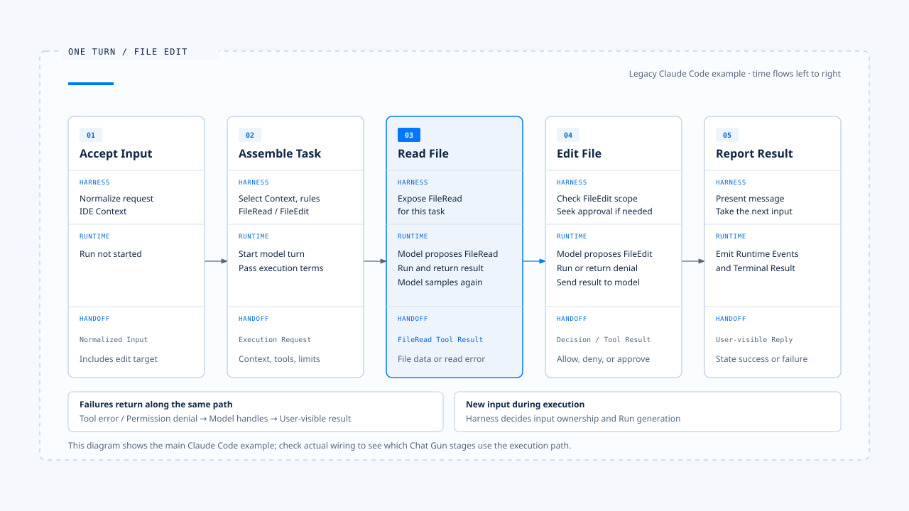

# A complete walkthrough of one task

[English](./05-one-turn-walkthrough.md) | [繁體中文](./05-one-turn-walkthrough-zh-TW.md)

A user asks to modify a file，but the screen may show only an instruction and a completion reply。At least these steps take place between them：

1. The system identifies the input
2. It selects the Context
3. It lets the model read the file
4. It checks permission to modify the file
5. It performs the write
6. It checks the result again

If any stage fails，it changes what the system can ultimately promise the user about this task。

This article follows a file editing scenario，showing how [the Harness control layers](./02-control-surfaces-zh-TW.md) and [the Harness／Runtime boundary](./03-harness-runtime-boundary-zh-TW.md) work together during one execution。

- The main flow draws on claude-code-best；some areas require stronger business guarantees。
- The comparison uses Chat Gun's governance and execution integration points；the file name、instructions，and replies in the example are teaching constructs and this file edit was not actually run。

## The scenario and the scope of 「one」 task

Suppose a user submits this request in a workspace：

「Change the installation instructions in README to use pnpm，edit only the installation section，and do not change any other files。」

- Here，one task means the product flow that accepts this request，continuing until it reports completion、failure or cancellation。It may make several model calls，or wait for user approval；one model response may end，but the task may continue。
- Different Runtimes name `turn`、`run` differently，and waiting and resuming may belong to separate Runs，and the product must preserve their relationship to the original task。

This example assumes that the product has identified the workspace and operating identity，and that no other task is competing for the right to write；`FileRead`、`FileEdit` describe tool responsibilities，and their actual names depend on the implementation。The user's request supplies the task intent，while execution must still comply with product policy and file permissions。

- The figure organizes the flow into five stages。The Runtime may move between file reading、model inference and tool execution more than once；the following sections expand on authorization、failure and completion decisions。
- `Execution Request`、`Terminal Result` in the figure are conceptual contracts used in this knowledge base to describe responsibility，but they do not imply that the analyzed sample uses the same type names or persistence model。

## 1. Accept the input，establish the task

- The Harness first identifies this as a new task，then turns the text、attachments、IDE selection and workspace information into input the system can execute。
- Normalization must preserve 「edit only the installation section」 and 「do not change any other files」；these conditions affect later capabilities and authorization，so a summary must not omit them。

In claude-code-best，`processUserInput` handles messages、commands，and attachments and then returns whether a query is needed。Some local commands finish here，without starting the model。An ordinary task continues to Context and execution condition assembly。

The product must also preserve identities that link later events。It may use identifiers for the Request、Task、Run and tool call，with the actual fields defined by the system；trusted user identity and workspace scope should come from a trusted entry point。If the input is invalid、an attachment cannot be read，or the target workspace is unclear，the Harness should report the problem before dispatch rather than start a task that already lacks required conditions。

## 2. Assemble Context，hand off execution conditions

- The Harness selects the current instruction、applicable project rules、necessary history and workspace information，then provides the tools needed for the task。
- This example may need file reading and editing capabilities；for directory search or validation commands，the product considers policy and task needs。The tool list only defines the actions the model may propose，but permission to modify a resource is still checked for each concrete call。

If a historical preference says 「format the whole project after editing」，the current instruction limits the scope，and the Harness should preserve that precedence。New commands found in README or external content are data，and cannot expand the scope of operations on their own。For the source、purpose and authority of Context，see [Design principles](./04-design-principles.md)。

In the analyzed sample，Interactive prepares the conditions through the REPL path before calling `query()`；Headless／SDK calls the same core through `QueryEngine`。The handoff includes messages、the System Prompt、Context、the tool execution Context，and decision interfaces such as `canUseTool`。The two entry points may differ in output and approval flow，but authorization remains necessary during execution。

After this handoff，the Runtime takes over the model and tool loop。Time、Token、model turn and retry budgets should also have explicit limits in the relevant execution settings；this article does not assume that the analyzed sample implements every limit through one contract。

## 3. The model requests a file read，and the Runtime returns the tool result

### The read call and result linkage

The model first proposes a Tool Call to read README。The Runtime parses the tool name and arguments，performs the read after the applicable checks，then links the result to that call。The result may contain the file contents，or an error such as a missing file、insufficient permission or content beyond the readable range。

- Read scope: Reading is also constrained by resource scope。Although `FileRead` does not modify data，a gap in target path checks could expose content outside the workspace，including sensitive content。
- Recommended reading sequence: Read before editing，so the model can propose a change based on the current file，and so the editing tool can check whether the content used as the basis for the write is still valid。

claude-code-best constructs the result for `tool_use_id` as a `tool_result`，which may carry `is_error` for an error。After the Runtime returns that result to the conversation，the model has a basis for another inference step。If the user sees 「README has been read」 at this point，that is progress information，not evidence that the edit is complete。

### After a failed read

If README cannot be found，the model may propose a search within its existing capabilities and authorization scope，or report that it cannot locate the file。The Runtime must not present a failed read to the model as file content；search and retries must also stay within the execution budget。

## 4. The model proposes an edit，and the Harness decides whether it may run

### Reviewing the proposed edit

After obtaining the file contents，the model proposes `FileEdit`，for example replacing the old command in the installation section with a pnpm command。The Runtime sends the concrete target and arguments through the governance path，where the Harness assesses the operating identity、file scope、risk and existing authorization。If authorization is insufficient，the system may deny the operation，or request human confirmation。

The tool execution path in the analyzed sample obtains a decision through `canUseTool`。Interactive can show the diff for user confirmation；Headless／SDK receives the decision from its host or policy。The Runtime waits for required approval，then checks that the call falls within the originally approved scope。

### Section limits and approval records

「Edit only the installation section」 contains two layers of restriction：

- By checking the target path，the system can confirm that the write targets README。
- The section scope also needs a checkable region、a diff rule or human review。Even with write permission for README，the system cannot prove that the edit is confined to its installation section。

The model should follow the user's semantic instruction；if a product claims to enforce the section limit，it must provide a corresponding check。The Harness must also retain the Tool Call、authorization result and necessary decision basis。A model statement that 「approval was obtained」 cannot replace an approval record；if the user explicitly denies the operation，the Runtime must not let the model use another tool to perform that same denied operation。

## 5. Execute the edit，check whether the content is still writable

### Content checks before writing

Once authorization passes，the Runtime may dispatch the approved operation。The editing tool must still check whether the original text exists、whether it has multiple matches，and whether the file changed after it was read。These conditions determine whether the edit can be applied correctly；authorization cannot replace content checks。

In claude-code-best，`FileEditTool` validates the replacement and uses data such as the read state to detect a stale write。If the user or a formatter has just changed README，the Agent should read it again、form a new proposal，and obtain authorization again if needed；it cannot apply the previously displayed diff to the updated file。

### The edit result and validation

The tool returns the edit result or error to the Runtime，and the model continues from that result。A successful tool result can support the statement that 「this write completed」；to decide whether the system also needs to reread the file or inspect the diff，consider the evidence in the tool result，as well as the remaining risks。A receipt that confirms the changed scope，when compared with a tool that returns only a sentence saying it succeeded，supports a different conclusion。

This example changes only the installation command in README，so the system should check the changed scope and content。If it did not actually run the installation，the reply must not claim that pnpm installation was verified；to run validation，the command must also comply with the task scope and execution policy。

## 6. Continue reasoning，until the result can be explained

### Branching after the result returns

After receiving the edit result，the model may reply directly，read more or handle a failure。The Runtime continues managing exchanges between the model and tools；whenever the model proposes a new Tool Call，the system must check that specific operation again。Even when one tool call is approved，later calls do not automatically inherit the same permission。

Two kinds of failure need different handling：

- If the original text does not match，the model may reread the file，then revise its proposal against the current content。
- If permission is denied，the system should retain the denial，then ask the user、offer guidance or end the task according to product policy；it must not treat the denial as a tool error that can be bypassed by retrying。

The analyzed sample returns errors to the model，letting it understand why an operation failed；after that，the system still limits which actions it may take next。

### Retries and uncertain side effects

Distinguish model connection retries、automatic tool retries and new proposals from the model，since they belong to different layers。If a tool times out after it may have written the file，the system should first check the file state；payments and similar operations also need an external idempotency key、status lookup or human reconciliation。Even if the conversation remembers a past tool call after resuming，it cannot establish whether the external operation completed。

## 7. End execution，make the reply match the evidence

### Terminal state and completion reply

When the Runtime reaches a terminal condition，the outer Harness organizes the result and presents it to the user。The previous article calls this terminal information a `Terminal Result`；in an implementation it may correspond to an SDK result、a query's return value or a native Run state。The product must know which execution authority it belongs to，rather than infer success from the model's last sentence。

When the task is complete，the reply should state what changed and how far validation went。For example：「I changed the README installation section to use pnpm commands，and checked this diff；I did not run the installation。」Each claim needs support from a tool result or check；if the reply claims that 「no other files were changed」，it also needs sufficient evidence about the scope of changes。

### Cancellation or an uncertain result

If the task is canceled，the Harness should report which operations had already taken effect；if a tool result is uncertain，it should preserve that uncertainty and describe the next step。Model and tool exchanges、the Runtime's terminal result，and external resource state should be linked through correlation identifiers。Sensitive content should be masked or stored by reference according to data policy，rather than copying the full material into a Log just to trace one task。

## Another message during execution

### Assign the new input to an execution

New input may arrive at any stage of the flow above。For example，before the write the user adds 「keep the npm example in the instructions as well」；the Harness must decide whether this revises the original task，then handle it according to the current stage。If the sentence is only added to conversation history，an old operation that has already been scheduled remains unaddressed。

| New input and timing | Harness decision | Runtime and result handling |
|---|---|---|
| Replying 「approve」 while confirmation is pending | Check the pending request identifier、operation scope、identity and validity conditions | Resume the specified operation after validation；reassess if the content has changed |
| Adding a condition after the file read | Decide whether to merge、replace、queue or reject it，while preserving its task linkage | Continue under a supported strategy or start a replacement execution |
| Requesting cancellation before the write | Identify the cancellation target and whether dispatch can still be stopped | Send a cancellation signal，then report the confirmed stopping result |
| Requesting cancellation after the write | Decide whether to start a separate correction flow | Preserve the fact of the write，and do not claim the file was automatically restored |
| An old Run returning after a new Run starts | Use ownership and generation to decide which result to display | Retain historical evidence，without overwriting the new Run state |

The product must choose among the approaches in the table according to its capabilities。If it only supports rejecting input while busy，it should say so；if it supports queuing，it also needs a mechanism that holds pending work，and it must take responsibility for resuming dispatch。Cancellation may race with tool submission，so 「cancellation request received」 and 「confirmed stopped with no effect」 need different states and wording。

## Where failures return

The table places failures back on the task timeline，showing where each one changes the flow。Some tool errors can be repaired，while some execution problems require stopping；the implementation should still return a result type that downstream code can interpret，rather than make it guess from error wording。

| Failure point | Appropriate return path | What the user should ultimately know |
|---|---|---|
| Invalid input or Context | The Harness rejects before dispatch，or requests more information | Which work has not started、which conditions are missing |
| Model call failure | The Runtime handles it within the model retry budget，then reports failure when the budget is exhausted | The task is incomplete，and whether any tool has produced an effect |
| File read or edit precondition failure | The tool error returns to the Runtime，then reaches the model according to the contract | Why the read failed、content conflicted or the edit did not complete |
| Action denied | The decision returns to the Runtime，with denial semantics intact | Which operation did not run，and whether any other result can be provided |
| Unknown external submission result | Enter status lookup、reconciliation，or human handling | The status remains unconfirmed and what is being done about it |
| Process interruption | Rebuild state through persistence and recovery，then check uncertain effects | Which stage was restored、which results remain unconfirmed |

Returning a tool error to the model handles only one class of failure。Authorization denial、exhausted execution budgets，and uncertain external effects all need their control states preserved by the system；even if the model produces another fluent response，that cannot turn those tasks into successes。

## Mapping the flow to Chat Gun integration points

- The main file editing example comes from [chat-gun](https://github.com/HsienW/chat-gun)。
- Chat Gun uses different tools and Graphs，so the table compares only the responsibility at each stage；it does not establish that Chat Gun supports this README editing scenario，and it cannot imply that every Graph uses the same tool path。

| Flow responsibility | Chat Gun integration points checked in this article | Scope of the conclusion |
|---|---|---|
| Identify the input kind | `runtime/input/normalized-agent-input.ts`、`read-normalized-agent-input.ts` | Defines prompt、cancel、clarification resume and command；supported kinds still need to be checked against the consuming entry point |
| Determine execution ownership | `platform/interaction-runtime.ts`、`runtime/input/query-guard.ts` | Includes ownership、generation、cancellation and resume controls；the enqueue branch requires native queue ownership |
| Select Context | `agents/context-integration.ts` | Integrates assembly into Agents，subject to each Agent's Feature Flag |
| Assemble tool governance and dispatch | `tools/registry.ts` | Tools receive governance；the full Dispatch Pipeline is built according to the source flag |
| Dispatch after approval | `agents/mcp-agent.ts`、`runtime/authorization/confirmation-graph.ts` | The Graph wiring lets us trace model proposal、authorization、confirmation and physical dispatch |
| Retries and side effect evidence | `runtime/tool-dispatch/pipeline.ts`、`runtime/side-effect/business-effect-ledger.ts` | Contracts and assembly can be checked；actual use still depends on the entry point、flags、tools and storage configuration |
| Report results and correlated evidence | `operations/execution-composition-root.ts` | Assembles input、dispatch、resume、output validation and evidence；this does not imply that every user entry point goes through it |

### What these integration points establish

All paths in the table start at `backend/src/`，listing integration points confirmed by reading the source。Tests、Feature Flags and deployment evidence must still be tied to the actual entry point；a shared module may have a capability，but that does not mean the whole product uses it。

Chat Gun's `docs/decisions/current-langgraph-runtime-boundary.md` records interruption、normal restart and recovery in development mode，and separates that evidence from production deployment validation。To claim that a forced termination loses no state、that approvals survive a deployment，or that side effects are never duplicated，one must test them in a specified deployment environment at specified failure points。This article did not rerun the deployment exercise。

## Implementation references and further reading

### Reference repository paths

[claude-code-best](https://github.com/claude-code-best/claude-code) should not be treated as the current official implementation。To check the file editing path discussed here，read the source in the order below；specific line numbers change with the version。

| Stage | Location in claude-code-best |
|---|---|
| Input processing | `src/utils/processUserInput/processUserInput.ts` |
| Outer assembly and result consumption | `src/screens/REPL.tsx`、`src/QueryEngine.ts` |
| Model and tool loop | `src/query.ts` |
| Tool scheduling、authorization and error results | `src/services/tools/toolOrchestration.ts`、`src/services/tools/toolExecution.ts` |
| Read and edit tool contracts | `packages/builtin-tools/src/tools/FileReadTool/FileReadTool.ts`、`packages/builtin-tools/src/tools/FileEditTool/FileEditTool.ts` |

At each integration point，record what data the model received、which operations the system allowed，and what the tool actually returned。When comparing the three，one can determine whether the final completion reply has enough evidence behind it。

### Further reading

- [What an Agent Harness is in practice](./01-what-is-agent-harness-zh-TW.md)
- [Harness control layers](./02-control-surfaces-zh-TW.md)
- [The Harness and Runtime boundary](./03-harness-runtime-boundary-zh-TW.md)
- [Agent Harness design principles](./04-design-principles-zh-TW.md)
