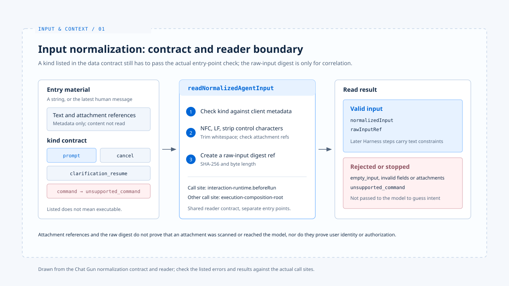

# 输入规范化

[English](./01-input-normalization.md) | [繁體中文](./01-input-normalization-zh-TW.md) | [简体中文](./01-input-normalization-zh-CN.md)

> 用户说「只修改 README 的安装段落」，系统收到的却可能是一段文字、一组消息、附件参照，或带有取消意图的请求。

**若入口不先分清这些类型，后面的模型循环便得自行猜测：这是新任务、对执行中任务的补话，还是一个根本不该送进模型的命令。**

[基础篇](../foundations/README-zh-CN.md) 已说明 Harness 在一次任务中持有哪些决策。

**本篇从第一个决策开始：把入口材料转成可检查的任务输入，并在这一步保留限制与来源线索。**

- 本篇停在规范化结果与它的来源；模型可见材料如何选取，留给下一篇 [Context 组装](./02-context-assembly-zh-CN.md)。
- Chat Gun 的接点来自源代码阅读；claude-code-best 的入口流程只作对照，不能用来推论 Chat Gun 的能力。

## 1. 入口先决定输入种类

> Chat Gun 的 `NormalizedAgentInput` 契约列出 `prompt`、`clarification_resume`、`cancel`、`command` 四种 `kind`。契约列出某个种类，不代表正式入口已能执行它。

- 图依 Chat Gun 的规范化契约与读取器绘制；列出的错误与结果，仍应按实际调用接点核对。

### 附件参照与错误分类

- `prompt` 有文字及最多二十个附件参照；附件参照包含 ID、名称、媒体类型与大小，`securityValidatedAt` 则是选填字段。
- 这个字段存在，不能反推附件内容已通过安全扫描，更不能反推附件已进入模型。
- 空白文字若也没有附件，会以 `empty_input` 拒绝；未知种类、无效附件与不合契约的字段也各有错误分类。

### `command` 目前不支持

**`command` 虽在数据契约中，`readNormalizedAgentInput` 目前返回 `unsupported_command`，因此不能把「可解析」写成「可执行」。**

## 2. 文字规范化与原始输入摘要

`readNormalizedAgentInput` 在交出规范化输入前，会处理以下几件事：

- 从字串或消息集合取出最近的人类消息。
- 核对原始 `kind` 与客户端 metadata 是否冲突。
- 文字采用 Unicode NFC、将换行统一成 LF、移除部分控制字符并去除前后空白。
- 为原始输入计算 SHA-256 摘要及字节长度，供后续关联使用。

**摘要是原始数据参照，不是用户身份、授权或内容可信度的证明。**

## 3. 规范化结果如何进入执行

> 同一份输入契约可以有不止一个消费者。追踪输入时，要指出是哪一条路径接住这次请求。

- 在参考的库中
  - Chat Gun 的 `interaction-runtime.ts` 在 `beforeRun` 调用 `readNormalizedAgentInput`，遇到无效输入便在派送前拒绝，并把有效的规范化输入放入互动 Context。
  - Chat Gun 的 `execution-composition-root.ts` 路径也读取同一契约，非有效结果会停止执行。

两处共用输入格式，仍是不同的正式接点；撰写分析时，不能把其中一处的行为套用到另一处。

claude-code-best 的既有[基础篇分析](../foundations/02-control-surfaces-zh-CN.md)则把 `processUserInput` 放在 `query()` 之前：一般消息、Slash Command、附件与 Hook 补充内容在入口处分流，有些命令不需启动模型。

- 这是另一个产品的控制流程，不能拿它推论 Chat Gun 已有相同的命令或多模态能力。

## 4. 保留限制，也保留边界

> 规范化应让「只修改 README 安装段落」在后续组装与授权时仍可辨认。

- 目前的 `NormalizedAgentInput` 主要保存 `kind`、文字与附件参照，没有独立的「允许修改文件」字段。
- 将自然语言限制变成可执行条件，仍须由后续 Harness 决策与工具授权承接。

**附件内容、Repository 文字或工具结果即使经过格式转换，也不能因此取得高于本次用户要求的权威。这是设计要求；要声称某入口已执行该规则，还需指出实际检查点。**

## 实现参照与适用范围

[chat-gun](https://github.com/HsienW/chat-gun) 部分以本篇核对的程序接点为范围，实际启用条件仍需对应入口的证据。

| 参照 | 可核对的落点 |
|---|---|
| 输入契约 | `backend/src/runtime/input/normalized-agent-input.ts` |
| 读取与规范化 | `backend/src/runtime/input/read-normalized-agent-input.ts` |
| 派送前检查 | `backend/src/platform/interaction-runtime.ts` |
| 执行组装 | `backend/src/operations/execution-composition-root.ts` |

[claude-code-best](https://github.com/claude-code-best/claude-code) 部分沿用[基础篇](../foundations/01-what-is-agent-harness-zh-CN.md)的入口参照，不代表官方现行版本的完整行为。

| 参照 | 可核对的落点 |
|---|---|
| 输入处理 | `src/utils/processUserInput/processUserInput.ts` |

## 接续阅读

- [Context 组装](./02-context-assembly-zh-CN.md)：追踪有效输入如何成为模型可见材料。
- [Input and Context 导览](./README-zh-CN.md)
- [Harness 的控制层](../foundations/02-control-surfaces-zh-CN.md)
