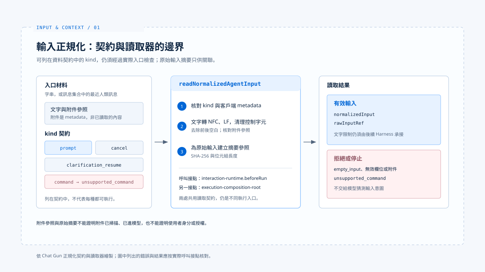

# 輸入正規化

[English](./01-input-normalization.md) | [繁體中文](./01-input-normalization-zh-TW.md)

> 使用者說「只修改 README 的安裝段落」，系統收到的卻可能是一段文字、一組訊息、附件參照，或帶有取消意圖的請求。

**若入口不先分清這些型態，後面的模型迴圈便得自行猜測：這是新任務、對執行中任務的補話，還是一個根本不該送進模型的命令。**

[基礎篇](../foundations/README-zh-TW.md) 已說明 Harness 在一次任務中持有哪些決策。

**本篇從第一個決策開始：把入口材料轉成可檢查的任務輸入，並在這一步保留限制與來源線索。**

- 本篇停在正規化結果與它的來源；模型可見材料如何選取，留給下一篇 [Context 組裝](./02-context-assembly-zh-TW.md)。
- Chat Gun 的接點來自原始碼閱讀；claude-code-best 的入口流程只作對照，不能用來推論 Chat Gun 的能力。

## 1. 入口先決定輸入種類

> Chat Gun 的 `NormalizedAgentInput` 契約列出 `prompt`、`clarification_resume`、`cancel`、`command` 四種 `kind`。契約列出某個種類，不代表正式入口已能執行它。

- 圖依 Chat Gun 的正規化契約與讀取器繪製；列出的錯誤與結果，仍應按實際呼叫接點核對。

### 附件參照與錯誤分類

- `prompt` 有文字及最多二十個附件參照；附件參照包含 ID、名稱、媒體型別與大小，`securityValidatedAt` 則是選填欄位。
- 這個欄位存在，不能反推附件內容已通過安全掃描，更不能反推附件已進入模型。
- 空白文字若也沒有附件，會以 `empty_input` 拒絕；未知種類、無效附件與不合契約的欄位也各有錯誤分類。

### `command` 目前不支援

**`command` 雖在資料契約中，`readNormalizedAgentInput` 目前回傳 `unsupported_command`，因此不能把「可解析」寫成「可執行」。**

## 2. 文字正規化與原始輸入摘要

`readNormalizedAgentInput` 在交出正規化輸入前，會處理以下幾件事：

- 從字串或訊息集合取出最近的人類訊息。
- 核對原始 `kind` 與客戶端 metadata 是否衝突。
- 文字採用 Unicode NFC、將換行統一成 LF、移除部分控制字元並去除前後空白。
- 為原始輸入計算 SHA-256 摘要及位元組長度，供後續關聯使用。

**摘要是原始資料參照，不是使用者身分、授權或內容可信度的證明。**

## 3. 正規化結果如何進入執行

> 同一份輸入契約可以有不止一個消費者。追蹤輸入時，要指出是哪一條路徑接住這次請求。

- 在參考的庫中
  - Chat Gun 的 `interaction-runtime.ts` 在 `beforeRun` 呼叫 `readNormalizedAgentInput`，遇到無效輸入便在派送前拒絕，並把有效的正規化輸入放入互動 Context。
  - Chat Gun 的 `execution-composition-root.ts` 路徑也讀取同一契約，非有效結果會停止執行。

兩處共用輸入格式，仍是不同的正式接點；撰寫分析時，不能把其中一處的行為套用到另一處。

claude-code-best 的既有[基礎篇分析](../foundations/02-control-surfaces-zh-TW.md)則把 `processUserInput` 放在 `query()` 之前：一般訊息、Slash Command、附件與 Hook 補充內容在入口處分流，有些命令不需啟動模型。

- 這是另一個產品的控制流程，不能拿它推論 Chat Gun 已有相同的命令或多模態能力。

## 4. 保留限制，也保留邊界

> 正規化應讓「只修改 README 安裝段落」在後續組裝與授權時仍可辨認。

- 目前的 `NormalizedAgentInput` 主要保存 `kind`、文字與附件參照，沒有獨立的「允許修改檔案」欄位。
- 將自然語言限制變成可執行條件，仍須由後續 Harness 決策與工具授權承接。

**附件內容、Repository 文字或工具結果即使經過格式轉換，也不能因此取得高於本次使用者要求的權威。這是設計要求；要聲稱某入口已執行該規則，還需指出實際檢查點。**

## 實作參照與適用範圍

[chat-gun](https://github.com/HsienW/chat-gun) 部分以本篇核對的程式接點為範圍，實際啟用條件仍需對應入口的證據。

| 參照 | 可核對的落點 |
|---|---|
| 輸入契約 | `backend/src/runtime/input/normalized-agent-input.ts` |
| 讀取與正規化 | `backend/src/runtime/input/read-normalized-agent-input.ts` |
| 派送前檢查 | `backend/src/platform/interaction-runtime.ts` |
| 執行組裝 | `backend/src/operations/execution-composition-root.ts` |

[claude-code-best](https://github.com/claude-code-best/claude-code) 部分沿用[基礎篇](../foundations/01-what-is-agent-harness-zh-TW.md)的入口參照，不代表官方現行版本的完整行為。

| 參照 | 可核對的落點 |
|---|---|
| 輸入處理 | `src/utils/processUserInput/processUserInput.ts` |

## 接續閱讀

- [Context 組裝](./02-context-assembly-zh-TW.md)：追蹤有效輸入如何成為模型可見材料。
- [Input and Context 導覽](./README-zh-TW.md)
- [Harness 的控制層](../foundations/02-control-surfaces-zh-TW.md)
