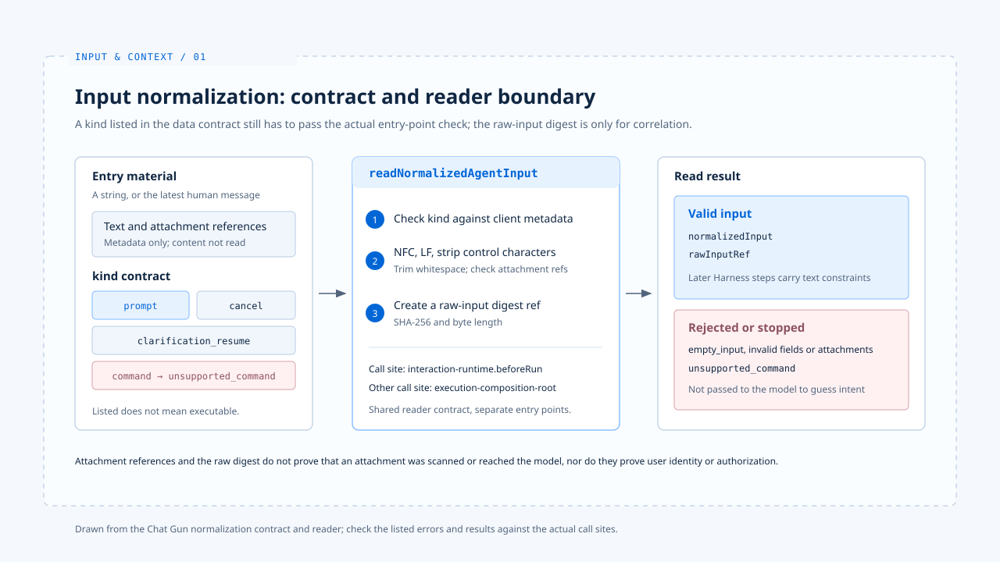

# Input normalization

[English](./01-input-normalization.md) | [繁體中文](./01-input-normalization-zh-TW.md)

> A user says, "modify only the installation section of the README," but the system may receive a block of text, a set of messages, attachment references, or a request that carries an intent to cancel.

**If the entry point does not distinguish these forms first, the model loop must guess later: is this a new task, an addition to a task already running, or a command that should never reach the model?**

[The foundations](../foundations/README.md) explain which decisions the Harness holds during one task.

**This article starts with the first decision: turning entry-point material into a task input the system can inspect, while preserving constraints and source information at this step.**

- This article stops at the normalized result and its source; how the system selects model-visible material is left to the next article, [Context assembly](./02-context-assembly.md).
- The Chat Gun integration points come from reading its source code. The claude-code-best entry flow serves only as a comparison and cannot be used to infer Chat Gun's capabilities.

## 1. The entry point decides the input kind first

> Chat Gun's `NormalizedAgentInput` contract lists four values of `kind`: `prompt`, `clarification_resume`, `cancel`, and `command`. A kind listed in the contract is not necessarily one the production entry point can execute.

- The diagram follows Chat Gun's normalization contract and reader. Check the listed errors and results against the actual call sites.

### Attachment references and error categories

- A `prompt` carries text and up to twenty attachment references. Each reference includes an ID, name, media type, and size; `securityValidatedAt` is optional.
- The presence of this field does not show that the attachment content passed a security scan, and it does not show that the attachment reached the model.
- Blank text with no attachments is rejected as `empty_input`. Unknown kinds, invalid attachments, and fields that violate the contract each have their own error category.

### `command` is currently unsupported

**Although `command` appears in the data contract, `readNormalizedAgentInput` currently returns `unsupported_command`. "Parseable" must not be described as "executable."**

## 2. Text normalization and the raw-input digest

Before it returns a normalized input, `readNormalizedAgentInput` handles the following:

- It extracts the latest human message from a string or a set of messages.
- It checks whether the original `kind` conflicts with client metadata.
- It applies Unicode NFC to the text, converts line breaks to LF, removes some control characters, and trims leading and trailing whitespace.
- It computes a SHA-256 digest and the byte length of the raw input for later correlation.

**The digest is a reference to the raw data. It does not prove user identity, authorization, or the trustworthiness of the content.**

## 3. How the normalized result enters execution

> One input contract can have more than one consumer. When tracing an input, identify which path received the request.

- In the reference repositories
  - Chat Gun's `interaction-runtime.ts` calls `readNormalizedAgentInput` in `beforeRun`. It rejects an invalid input before dispatch and places a valid normalized input in the interaction Context.
  - Chat Gun's `execution-composition-root.ts` path reads the same contract and stops execution on any result that is not valid.

The two paths share an input format but remain separate production integration points. An analysis must not apply the behavior of one to the other.

The existing [foundations analysis](../foundations/02-control-surfaces.md) places claude-code-best's `processUserInput` before `query()`: ordinary messages, Slash Commands, attachments, and content added by Hooks are routed at the entry point, and some commands do not need to start the model.

- This is the control flow of a different product. It cannot be used to infer that Chat Gun has the same commands or multimodal capabilities.

## 4. Preserve constraints and boundaries

> Normalization should keep "modify only the installation section of the README" recognizable during later assembly and authorization.

- The current `NormalizedAgentInput` mainly stores `kind`, text, and attachment references. It has no separate field such as "files allowed to change."
- Turning a natural-language constraint into an enforceable condition still depends on later Harness decisions and tool authorization.

**Attachment content, repository text, or tool results do not gain authority above the current user request because they went through format conversion. This is a design requirement; claiming that an entry point enforces it requires identifying the actual check.**

## Implementation references and scope

The [chat-gun](https://github.com/HsienW/chat-gun) discussion is limited to the code integration points checked for this article. Actual enablement conditions still require evidence from the corresponding entry point.

| Reference | Implementation points to inspect |
|---|---|
| Input contract | `backend/src/runtime/input/normalized-agent-input.ts` |
| Reading and normalization | `backend/src/runtime/input/read-normalized-agent-input.ts` |
| Pre-dispatch check | `backend/src/platform/interaction-runtime.ts` |
| Execution assembly | `backend/src/operations/execution-composition-root.ts` |

The [claude-code-best](https://github.com/claude-code-best/claude-code) discussion reuses the entry-point references from [the foundations](../foundations/01-what-is-agent-harness.md). It does not represent the complete behavior of the current official version.

| Reference | Implementation points to inspect |
|---|---|
| Input handling | `src/utils/processUserInput/processUserInput.ts` |

## Further reading

- [Context assembly](./02-context-assembly.md): trace how a valid input becomes model-visible material.
- [Input and Context overview](./README.md)
- [Harness control surfaces](../foundations/02-control-surfaces.md)
