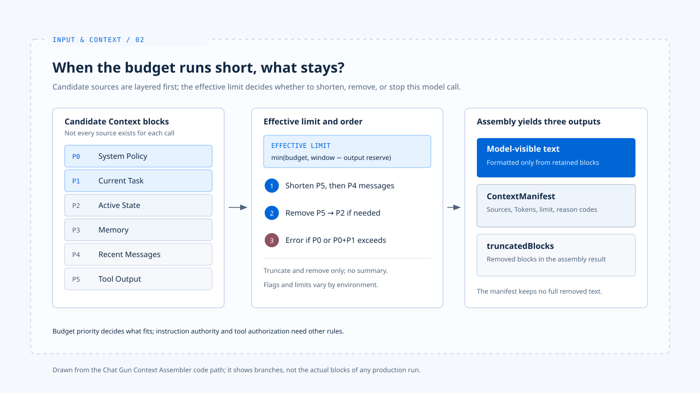

# Context 组装

[English](./02-context-assembly.md) | [繁體中文](./02-context-assembly-zh-TW.md) | [简体中文](./02-context-assembly-zh-CN.md)

> 同一项任务不会只调用模型一次。用户补充要求、工具返回数据或长对话挤满窗口时，模型下一次看到的内容可能已经不同。

**Harness 因而需要在每次调用前决定材料的来源、容量与去留，并留下足以说明取舍的纪录。这件事与允许哪个工具修改资源，是相邻而不同的决策。**

[前篇](./01-input-normalization-zh-CN.md) 说明入口材料如何成为可检查的任务输入。

**本篇接着追踪：一次模型调用前，哪些来源被选入、排序、截短或排除。**

- 本篇以 Chat Gun 的可读程序路径说明 Context 细节；claude-code-best 只作入口结构的对照。
- 工具能否执行属于行动治理，不在本篇范围。

## 1. 从消息到来源区块

> Chat Gun 的 `chatbot.ts` 在 `CONTEXT_ASSEMBLY_ENABLED_CHATBOT` 启用时调用 `assembleAgentContext`，关闭时改走 `legacyChatbotPrompt`。

- 程序给 feature flag 的预设值为启用，但某个部署是否真的采用新路径，仍取决于环境设置。
- `assembleAgentContext` 从 `state.messages` 找最近的 `HumanMessage` 作为 `current_task`，其余消息依类型列为 `recent_messages` 或 `tool_output`。
- 调用者也可另外提供 `active_state` 与工具输出。

**这里读的是 Graph 消息状态，不能直接宣称它等于[前篇](./01-input-normalization-zh-CN.md)产生的 `normalizedInput.text`。**

### 来源与容量优先序

`context-source.ts` 将来源对应到容量优先序：

| 优先序 | 来源 | 主要用途 |
|---|---|---|
| P0 | `system_policy` | 产品政策 |
| P1 | `current_task` | 本次要求 |
| P2 | `active_state` | 执行中的状态 |
| P3 | `memory` | 符合范围的历史记忆 |
| P4 | `recent_messages` | 近期对话 |
| P5 | `tool_output` | 工具返回材料 |

- 这张表说明容量不足时的取舍顺序，不是完整的指令权威表。
- 将工具结果标成 P5，并不能保证模型不会受其文字影响；[信任边界篇](./03-context-trust-boundary-zh-CN.md)另谈这个问题。

## 2. 容量不足时发生什麽事

> `buildAgentContext` 先把来源转成区块并估算 Token，再结合产品预算、模型 Context Window 与输出预留量计算有效上限。

### 截短与移除的顺序

1. 预设压缩策略先截短 P5 工具结果
2. 再截短 P4 对话
3. 仍放不下时移除这些低优先材料
4. 组装器接着可依 P5 到 P2 的顺序移除整类区块

### 硬上限

**若 P0 本身超出上限，或 P0 加 P1 仍放不下，便抛出 `ContextHardLimitError`，而非悄悄删掉政策或本次任务。**

- `chatbot.ts` 会把这类错误转成回复消息，正常模型调用不会在该分支继续。

## 3. 组装结果与 manifest

> 成功组装后，模型收到的是由保留区块格式化成的文字。

- `ContextManifest` 记录保留来源的种类、参照、估算 Token、有效上限、压缩动作与原因码；非 Memory 参照会先做杂凑。
- 组装结果另有 `truncatedBlocks` 可供检查，manifest 本身没有列出每段被移除的原文。

**若要重建一次取舍，需同时保留请求、组装结果与对应的执行关联，不能只看一笔 manifest 就宣称已掌握模型看到的全部内容。**

## 4. 对照 claude-code-best 的入口

[基础篇](../foundations/03-harness-runtime-boundary-zh-CN.md)指出 claude-code-best 的 Interactive 与 Headless／SDK 各有外层准备入口，但都将组装后的条件交给核心 `query()`。

- 两个产品的数据结构与压缩机制不可直接视为相同。

## 实现参照与适用范围

[chat-gun](https://github.com/HsienW/chat-gun) 部分以本篇核对的程序接点为范围，各 Agent 的 feature flag 与实际调用点仍需对应环境的证据。

| 参照 | 可核对的落点 |
|---|---|
| Chatbot 分支与错误回复 | `backend/src/agents/chatbot.ts` |
| Agent 接入 | `backend/src/agents/context-integration.ts` |
| 来源与优先序 | `backend/src/context/context-source.ts` |
| 区块组装与移除 | `backend/src/context/agent-context-assembler.ts` |
| 有效上限 | `backend/src/context/context-limit.ts` |
| 取舍纪录 | `backend/src/context/context-manifest.ts` |

[claude-code-best](https://github.com/claude-code-best/claude-code) 部分沿用[基础篇](../foundations/03-harness-runtime-boundary-zh-CN.md)的入口参照，不代表官方现行版本的完整行为。

## 接续阅读

- [Context 信任边界](./03-context-trust-boundary-zh-CN.md)：区分容量优先序与指令权威。
- [输入规范化](./01-input-normalization-zh-CN.md)
- [Input and Context 导览](./README-zh-CN.md)
