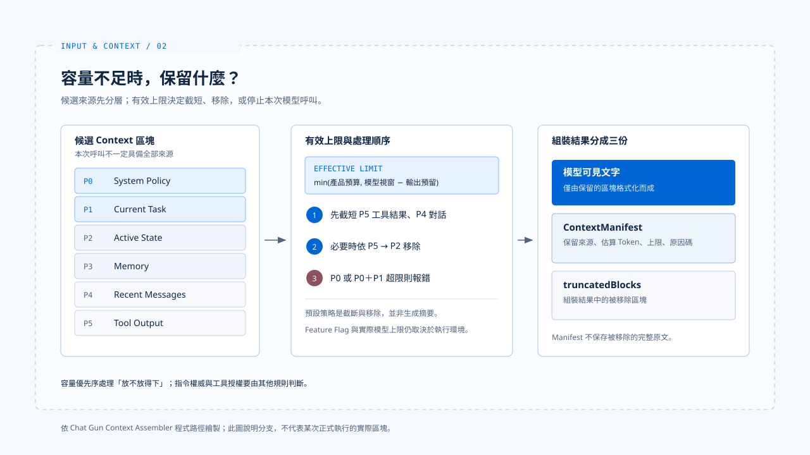

# Context 組裝

[English](./02-context-assembly.md) | [繁體中文](./02-context-assembly-zh-TW.md)

> 同一項任務不會只呼叫模型一次。使用者補充要求、工具回傳資料或長對話擠滿視窗時，模型下一次看到的內容可能已經不同。

**Harness 因而需要在每次呼叫前決定材料的來源、容量與去留，並留下足以說明取捨的紀錄。這件事與允許哪個工具修改資源，是相鄰而不同的決策。**

[前篇](./01-input-normalization-zh-TW.md) 說明入口材料如何成為可檢查的任務輸入。

**本篇接著追蹤：一次模型呼叫前，哪些來源被選入、排序、截短或排除。**

- 本篇以 Chat Gun 的可讀程式路徑說明 Context 細節；claude-code-best 只作入口結構的對照。
- 工具能否執行屬於行動治理，不在本篇範圍。

## 1. 從訊息到來源區塊

> Chat Gun 的 `chatbot.ts` 在 `CONTEXT_ASSEMBLY_ENABLED_CHATBOT` 啟用時呼叫 `assembleAgentContext`，關閉時改走 `legacyChatbotPrompt`。

- 程式給 feature flag 的預設值為啟用，但某個部署是否真的採用新路徑，仍取決於環境設定。
- `assembleAgentContext` 從 `state.messages` 找最近的 `HumanMessage` 作為 `current_task`，其餘訊息依型別列為 `recent_messages` 或 `tool_output`。
- 呼叫者也可另外提供 `active_state` 與工具輸出。

**這裡讀的是 Graph 訊息狀態，不能直接宣稱它等於[前篇](./01-input-normalization-zh-TW.md)產生的 `normalizedInput.text`。**

### 來源與容量優先序

`context-source.ts` 將來源對應到容量優先序：

| 優先序 | 來源 | 主要用途 |
|---|---|---|
| P0 | `system_policy` | 產品政策 |
| P1 | `current_task` | 本次要求 |
| P2 | `active_state` | 執行中的狀態 |
| P3 | `memory` | 符合範圍的歷史記憶 |
| P4 | `recent_messages` | 近期對話 |
| P5 | `tool_output` | 工具回傳材料 |

- 這張表說明容量不足時的取捨順序，不是完整的指令權威表。
- 將工具結果標成 P5，並不能保證模型不會受其文字影響；[信任邊界篇](./03-context-trust-boundary-zh-TW.md)另談這個問題。

## 2. 容量不足時發生什麼事

> `buildAgentContext` 先把來源轉成區塊並估算 Token，再結合產品預算、模型 Context Window 與輸出預留量計算有效上限。

### 截短與移除的順序

1. 預設壓縮策略先截短 P5 工具結果
2. 再截短 P4 對話
3. 仍放不下時移除這些低優先材料
4. 組裝器接著可依 P5 到 P2 的順序移除整類區塊

### 硬上限

**若 P0 本身超出上限，或 P0 加 P1 仍放不下，便拋出 `ContextHardLimitError`，而非悄悄刪掉政策或本次任務。**

- `chatbot.ts` 會把這類錯誤轉成回覆訊息，正常模型呼叫不會在該分支繼續。

## 3. 組裝結果與 manifest

> 成功組裝後，模型收到的是由保留區塊格式化成的文字。

- `ContextManifest` 記錄保留來源的種類、參照、估算 Token、有效上限、壓縮動作與原因碼；非 Memory 參照會先做雜湊。
- 組裝結果另有 `truncatedBlocks` 可供檢查，manifest 本身沒有列出每段被移除的原文。

**若要重建一次取捨，需同時保留請求、組裝結果與對應的執行關聯，不能只看一筆 manifest 就宣稱已掌握模型看到的全部內容。**

## 4. 對照 claude-code-best 的入口

[基礎篇](../foundations/03-harness-runtime-boundary-zh-TW.md)指出 claude-code-best 的 Interactive 與 Headless／SDK 各有外層準備入口，但都將組裝後的條件交給核心 `query()`。

- 兩個產品的資料結構與壓縮機制不可直接視為相同。

## 實作參照與適用範圍

[chat-gun](https://github.com/HsienW/chat-gun) 部分以本篇核對的程式接點為範圍，各 Agent 的 feature flag 與實際呼叫點仍需對應環境的證據。

| 參照 | 可核對的落點 |
|---|---|
| Chatbot 分支與錯誤回覆 | `backend/src/agents/chatbot.ts` |
| Agent 接入 | `backend/src/agents/context-integration.ts` |
| 來源與優先序 | `backend/src/context/context-source.ts` |
| 區塊組裝與移除 | `backend/src/context/agent-context-assembler.ts` |
| 有效上限 | `backend/src/context/context-limit.ts` |
| 取捨紀錄 | `backend/src/context/context-manifest.ts` |

[claude-code-best](https://github.com/claude-code-best/claude-code) 部分沿用[基礎篇](../foundations/03-harness-runtime-boundary-zh-TW.md)的入口參照，不代表官方現行版本的完整行為。

## 接續閱讀

- [Context 信任邊界](./03-context-trust-boundary-zh-TW.md)：區分容量優先序與指令權威。
- [輸入正規化](./01-input-normalization-zh-TW.md)
- [Input and Context 導覽](./README-zh-TW.md)
