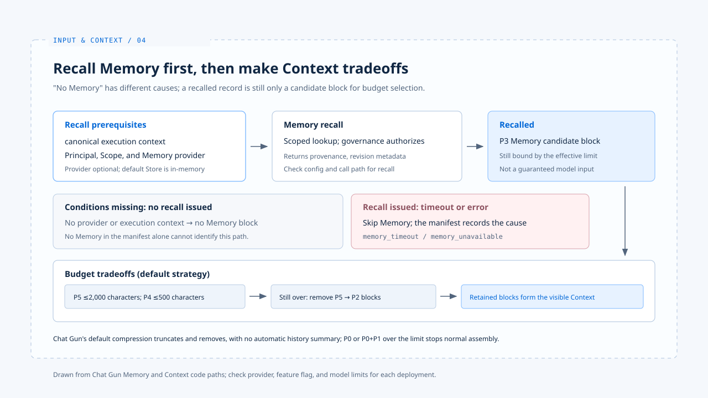

# Memory 与压缩

[English](./04-memory-and-compaction.md) | [繁體中文](./04-memory-and-compaction-zh-TW.md) | [简体中文](./04-memory-and-compaction-zh-CN.md)

> 对话长了以后，「以前说过」至少可能指四种东西：Graph 里近期的消息、执行中的 active state、跨任务提取的 Memory，或为了节省容量而生成的摘要。

**它们的生命周期与可信范围不同。把它们混成一段无来源的 Prompt，模型或许仍能回答，系统却很难解释究竟保留了什麽。**

[前篇](./03-context-trust-boundary-zh-CN.md) 说明 Memory 属于历史数据，不能改写本次任务。

**本篇追踪两件事：历史信息何时能回到本次 Context，以及 Context 放不下时哪些材料会消失。**

- 文中的 Chat Gun 行为以程序路径为准；预设 Store 与 provider 设置仍需对照实际部署。
- claude-code-best 的压缩机制只作对照，不能用来推论 Chat Gun 的做法。

## 1. Memory 何时能进入本次 Context

> Chat Gun 的 `context-integration.ts` 从 canonical execution context 读取 Principal 与 Scope；只有这些条件及 Memory provider 可用时，才组成 recall 请求。

### provider 与 Store

- `memory-composition.ts` 可依设置停用 Memory，或在 Store 无法建立时不提供 provider。
- 预设 Store 是 in-memory，不能由「长期 Memory」这个名称推论数据在重启后仍持久。
- 当 provider 存在，`MemoryContextProvider` 经治理服务检索并授权纪录，再把结果转成 P3 区块，附带 Memory ID、namespace、provenance、confidence 与 revision 等 metadata。

### 读取失败与未启用不同

- `buildAgentContext` 在已发出 recall、却遇到 timeout 或其他错误时，会略过 Memory 并在 manifest 记录 `memory_timeout` 或 `memory_unavailable`。
- 若根本没有 provider 或 recall 条件，组装器直接没有 Memory 区块。

**不能仅凭「manifest 无记忆」判定是哪种原因；观察执行路径时，必须一起看设置与 Context manifest。**

## 2. 压缩是取舍，不是凭空补全历史

> Chat Gun 先依产品预算、模型窗口与输出预留量决定有效上限，再依序截短或移除低优先材料。

### 预设策略的顺序

1. 把 P5 工具结果截到最多约 2,000 字符
2. 把 P4 近期消息截到最多约 500 字符
3. 还不够时移除 P5、P4
4. 组装器再依序考虑 P3 Memory 与 P2 active state

**这条路径主要是截断与移除，不能写成模型已替整段历史产生摘要。P0 政策或 P0 加 P1 本次任务超限时，系统以 hard-limit 错误停止正常组装，而不是默默舍弃这两类材料。**

### 降级的原因码

- 预设压缩策略若抛错，组装器会走 `fallback_truncate` 并标记 `compression_invalid`。
- Token 估算器失效也有 `estimator_unavailable`。
- 这些原因码说明降级发生了什麽，并不保证模型回复品质不受影响。

### 对照 claude-code-best

claude-code-best 的[控制层分析](../foundations/02-control-surfaces-zh-CN.md)另外提及 Tool Result Budget、Microcompact 与 Autocompact。

- 它们是另一个实现的不同机制，不能与 Chat Gun 的截断策略画上等号。

## 3. 历史偏好与本次要求冲突

> 历史偏好「简短回答」若撞上本次「请完整说明」，Memory 可以被保留作背景，本次任务仍应决定回答目标。

- P1 高于 P3 是容量上的条件。
- 是否真的处理对了语意冲突，还需从模型输出及产品规则核对。

[下一篇案例](./05-case-input-to-context-zh-CN.md)会沿着一笔请求检查这个分界。

## 实现参照与适用范围

[chat-gun](https://github.com/HsienW/chat-gun) 部分以本篇核对的程序接点为范围，Memory provider 与 Store 的实际设置仍需对应环境的证据。

| 参照 | 可核对的落点 |
|---|---|
| recall 条件 | `backend/src/agents/context-integration.ts` |
| Memory 启用与 Store | `backend/src/platform/memory-composition.ts` |
| Memory 转为 P3 区块 | `backend/src/memory/context/memory-context-provider.ts` |
| 组装与移除 | `backend/src/context/agent-context-assembler.ts` |
| 压缩策略 | `backend/src/context/compression-strategy.ts` |
| 原因码纪录 | `backend/src/context/context-manifest.ts` |

[claude-code-best](https://github.com/claude-code-best/claude-code) 部分沿用[基础篇](../foundations/02-control-surfaces-zh-CN.md)的压缩机制参照，不代表官方现行版本的完整行为。

## 接续阅读

- [从输入到 Context：一次请求的走法](./05-case-input-to-context-zh-CN.md)：沿一笔请求核对前文的接点。
- [Context 信任边界](./03-context-trust-boundary-zh-CN.md)
- [Input and Context 导览](./README-zh-CN.md)
