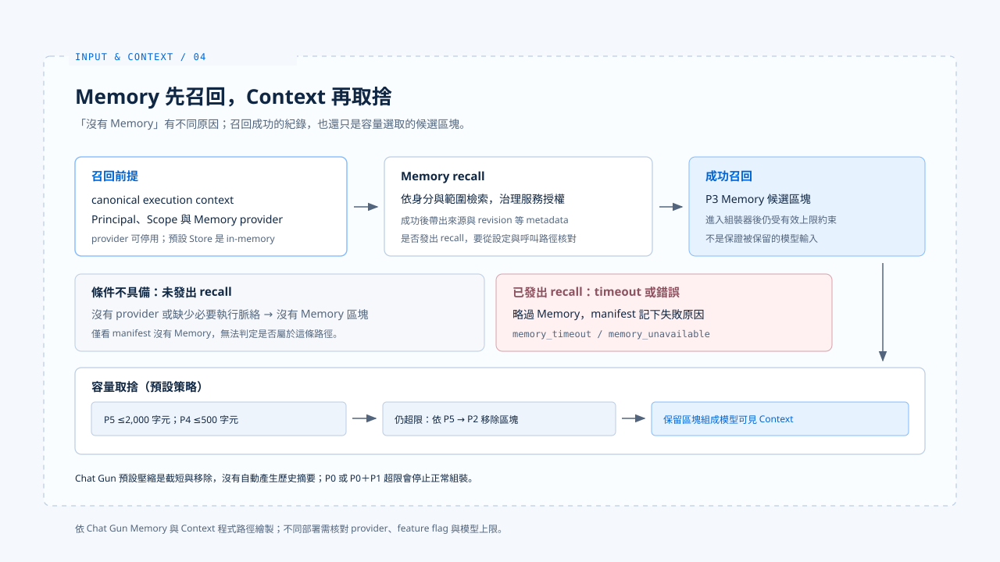

# Memory 與壓縮

[English](./04-memory-and-compaction.md) | [繁體中文](./04-memory-and-compaction-zh-TW.md)

> 對話長了以後，「以前說過」至少可能指四種東西：Graph 裡近期的訊息、執行中的 active state、跨任務提取的 Memory，或為了節省容量而生成的摘要。

**它們的生命週期與可信範圍不同。把它們混成一段無來源的 Prompt，模型或許仍能回答，系統卻很難解釋究竟保留了什麼。**

[前篇](./03-context-trust-boundary-zh-TW.md) 說明 Memory 屬於歷史資料，不能改寫本次任務。

**本篇追蹤兩件事：歷史資訊何時能回到本次 Context，以及 Context 放不下時哪些材料會消失。**

- 文中的 Chat Gun 行為以程式路徑為準；預設 Store 與 provider 設定仍需對照實際部署。
- claude-code-best 的壓縮機制只作對照，不能用來推論 Chat Gun 的做法。

## 1. Memory 何時能進入本次 Context

> Chat Gun 的 `context-integration.ts` 從 canonical execution context 讀取 Principal 與 Scope；只有這些條件及 Memory provider 可用時，才組成 recall 請求。

### provider 與 Store

- `memory-composition.ts` 可依設定停用 Memory，或在 Store 無法建立時不提供 provider。
- 預設 Store 是 in-memory，不能由「長期 Memory」這個名稱推論資料在重啟後仍持久。
- 當 provider 存在，`MemoryContextProvider` 經治理服務檢索並授權紀錄，再把結果轉成 P3 區塊，附帶 Memory ID、namespace、provenance、confidence 與 revision 等 metadata。

### 讀取失敗與未啟用不同

- `buildAgentContext` 在已發出 recall、卻遇到 timeout 或其他錯誤時，會略過 Memory 並在 manifest 記錄 `memory_timeout` 或 `memory_unavailable`。
- 若根本沒有 provider 或 recall 條件，組裝器直接沒有 Memory 區塊。

**不能僅憑「manifest 無記憶」判定是哪種原因；觀察執行路徑時，必須一起看設定與 Context manifest。**

## 2. 壓縮是取捨，不是憑空補全歷史

> Chat Gun 先依產品預算、模型視窗與輸出預留量決定有效上限，再依序截短或移除低優先材料。

### 預設策略的順序

1. 把 P5 工具結果截到最多約 2,000 字元
2. 把 P4 近期訊息截到最多約 500 字元
3. 還不夠時移除 P5、P4
4. 組裝器再依序考慮 P3 Memory 與 P2 active state

**這條路徑主要是截斷與移除，不能寫成模型已替整段歷史產生摘要。P0 政策或 P0 加 P1 本次任務超限時，系統以 hard-limit 錯誤停止正常組裝，而不是默默捨棄這兩類材料。**

### 降級的原因碼

- 預設壓縮策略若拋錯，組裝器會走 `fallback_truncate` 並標記 `compression_invalid`。
- Token 估算器失效也有 `estimator_unavailable`。
- 這些原因碼說明降級發生了什麼，並不保證模型回覆品質不受影響。

### 對照 claude-code-best

claude-code-best 的[控制層分析](../foundations/02-control-surfaces-zh-TW.md)另外提及 Tool Result Budget、Microcompact 與 Autocompact。

- 它們是另一個實作的不同機制，不能與 Chat Gun 的截斷策略畫上等號。

## 3. 歷史偏好與本次要求衝突

> 歷史偏好「簡短回答」若撞上本次「請完整說明」，Memory 可以被保留作背景，本次任務仍應決定回答目標。

- P1 高於 P3 是容量上的條件。
- 是否真的處理對了語意衝突，還需從模型輸出及產品規則核對。

[下一篇案例](./05-case-input-to-context-zh-TW.md)會沿著一筆請求檢查這個分界。

## 實作參照與適用範圍

[chat-gun](https://github.com/HsienW/chat-gun) 部分以本篇核對的程式接點為範圍，Memory provider 與 Store 的實際設定仍需對應環境的證據。

| 參照 | 可核對的落點 |
|---|---|
| recall 條件 | `backend/src/agents/context-integration.ts` |
| Memory 啟用與 Store | `backend/src/platform/memory-composition.ts` |
| Memory 轉為 P3 區塊 | `backend/src/memory/context/memory-context-provider.ts` |
| 組裝與移除 | `backend/src/context/agent-context-assembler.ts` |
| 壓縮策略 | `backend/src/context/compression-strategy.ts` |
| 原因碼紀錄 | `backend/src/context/context-manifest.ts` |

[claude-code-best](https://github.com/claude-code-best/claude-code) 部分沿用[基礎篇](../foundations/02-control-surfaces-zh-TW.md)的壓縮機制參照，不代表官方現行版本的完整行為。

## 接續閱讀

- [從輸入到 Context：一次請求的走法](./05-case-input-to-context-zh-TW.md)：沿一筆請求核對前四篇的接點。
- [Context 信任邊界](./03-context-trust-boundary-zh-TW.md)
- [Input and Context 導覽](./README-zh-TW.md)
