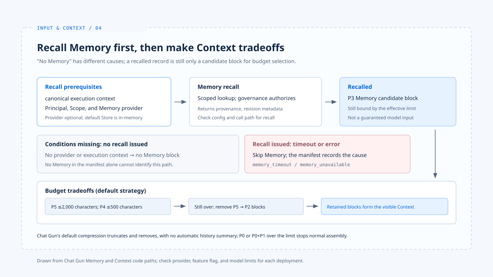

# Memory and compaction

[English](./04-memory-and-compaction.md) | [繁體中文](./04-memory-and-compaction-zh-TW.md)

> Once a conversation grows long, "something said earlier" can refer to at least four things: recent messages in the Graph, the active state of a running execution, Memory recalled across tasks, or a summary generated to save space.

**They have different lifecycles and trust scopes. If they are blended into one Prompt without sources, the model may still answer, but the system will struggle to explain what it actually kept.**

[The previous article](./03-context-trust-boundary.md) explains that Memory is historical data and cannot rewrite the current task.

**This article traces two things: when historical information can return to the current Context, and which material disappears when the Context does not fit.**

- The Chat Gun behavior described here follows the code path; the default Store and provider configuration still need to be checked against the actual deployment.
- claude-code-best's compression mechanisms serve only as a comparison and cannot be used to infer Chat Gun's approach.

## 1. When Memory can enter the current Context

> Chat Gun's `context-integration.ts` reads Principal and Scope from the canonical execution context, and builds a recall request only when these conditions and a Memory provider are available.

### Provider and Store

- `memory-composition.ts` can disable Memory through configuration, or provide no provider when the Store cannot be created.
- The default Store is in-memory. The name "long-term Memory" does not imply that data persists after a restart.
- When a provider exists, `MemoryContextProvider` retrieves and authorizes records through the governance service, then turns the results into P3 blocks with metadata such as Memory ID, namespace, provenance, confidence, and revision.

### A failed read differs from a disabled feature

- When a recall has been issued but hits a timeout or another error, `buildAgentContext` skips Memory and records `memory_timeout` or `memory_unavailable` in the manifest.
- If there is no provider or no recall condition at all, the assembler simply produces no Memory block.

**"No memory in the manifest" alone cannot tell you which cause applies. When observing an execution path, read the configuration and the Context manifest together.**

## 2. Compression is a tradeoff, not a reconstruction of history

> Chat Gun first determines the effective limit from the product budget, the model window, and the output reserve, then shortens or removes lower-priority material in order.

### Order of the default strategy

1. Shorten P5 tool results to about 2,000 characters at most
2. Shorten P4 recent messages to about 500 characters at most
3. If that is still not enough, remove P5 and P4
4. The assembler then considers P3 Memory and P2 active state in order

**This path mainly truncates and removes. It must not be described as the model producing a summary of the entire history. When P0 policy, or P0 plus the P1 current task, exceeds the limit, the system stops normal assembly with a hard-limit error instead of silently discarding either kind of material.**

### Reason codes for degradation

- If the default compression strategy throws, the assembler uses `fallback_truncate` and marks `compression_invalid`.
- A failed Token estimator is recorded as `estimator_unavailable`.
- These reason codes describe what degradation occurred. They do not guarantee that reply quality is unaffected.

### Comparing claude-code-best

The [control surfaces analysis](../foundations/02-control-surfaces.md) also covers claude-code-best's Tool Result Budget, Microcompact, and Autocompact.

- These are different mechanisms in a different implementation and cannot be equated with Chat Gun's truncation strategy.

## 3. A past preference conflicts with the current request

> If a past preference for "short answers" collides with the current request for "a full explanation," Memory can remain as background while the current task still decides the goal of the answer.

- P1 ranking above P3 is a budget condition.
- Whether the semantic conflict was actually handled correctly still needs to be checked against model output and product rules.

[The next case study](./05-case-input-to-context.md) follows one request to check this boundary.

## Implementation references and scope

The [chat-gun](https://github.com/HsienW/chat-gun) discussion is limited to the code integration points checked for this article. The actual Memory provider and Store configuration still require evidence from the corresponding environment.

| Reference | Implementation points to inspect |
|---|---|
| Recall conditions | `backend/src/agents/context-integration.ts` |
| Memory enablement and Store | `backend/src/platform/memory-composition.ts` |
| Memory as P3 blocks | `backend/src/memory/context/memory-context-provider.ts` |
| Assembly and removal | `backend/src/context/agent-context-assembler.ts` |
| Compression strategy | `backend/src/context/compression-strategy.ts` |
| Reason code record | `backend/src/context/context-manifest.ts` |

The [claude-code-best](https://github.com/claude-code-best/claude-code) discussion reuses the compression references from [the foundations](../foundations/02-control-surfaces.md). It does not represent the complete behavior of the current official version.

## Further reading

- [Input to Context: one request end to end](./05-case-input-to-context.md): check the integration points from the previous four articles along one request.
- [Context trust boundary](./03-context-trust-boundary.md)
- [Input and Context overview](./README.md)
