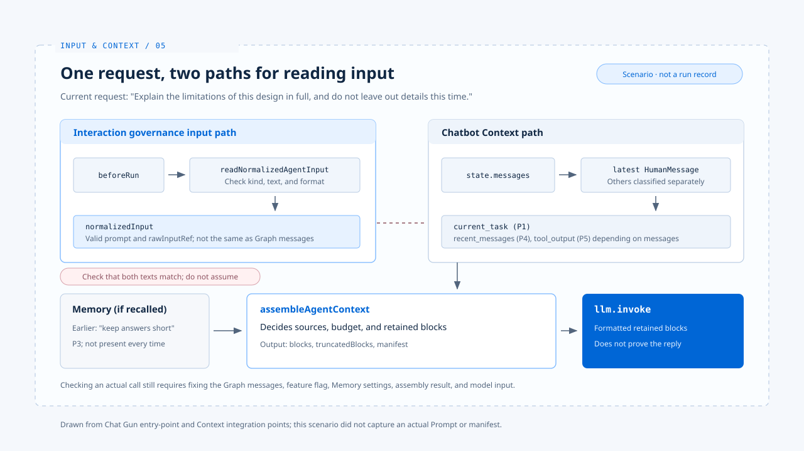

# 从输入到 Context：一次请求的走法

[English](./05-case-input-to-context.md) | [繁體中文](./05-case-input-to-context-zh-TW.md) | [简体中文](./05-case-input-to-context-zh-CN.md)

> 假设用户先前说过「回答请简短」，这次对 Chat Gun chatbot 说：「请完整说明这个设计的限制，这次不要省略细节。」

**这句话从入口走到模型之前，会经过输入治理、Graph 消息与 Context 组装三个接点；每个接点各自能证明的事情不同。**

本篇用这个教学情境，把 [输入规范化](./01-input-normalization-zh-CN.md)、[Context 组装](./02-context-assembly-zh-CN.md)、[信任边界](./03-context-trust-boundary-zh-CN.md) 与 [Memory](./04-memory-and-compaction-zh-CN.md) 放进同一条路径。

**本篇核对的是：一笔请求能否追到模型实际可见的材料，并说明每一项省略。**

- 这不是一笔已执行的正式请求。
- 下文描述程序会经过的接点，以及要核对的数据，不宣称已取得该次模型 Prompt 或 manifest。

## 1. 入口：先辨认这是一笔新 Prompt

> `chatbotGraph` 由 `applyInteractionGovernance` 包住。

- `interaction-runtime.ts` 的 `beforeRun` 会调用 `readNormalizedAgentInput`，把有效文字转成 `prompt` 输入，或在派送前拒绝空白、格式错误及冲突的 `kind`。
- 原始输入另产生摘要参照。
- 若入口收到的是 `command`，目前读取器返回 `unsupported_command`，不能把它当作模型任务继续描述。

### 两个字段的交界

**互动治理保存 `normalizedInput`，但 chatbot 的 Context 组装从 Graph 的 `state.messages` 找最近的 `HumanMessage`。**

教学情境要成立，得核对入口送进 Graph 的消息确实包含这次要求，且与规范化文字相符。两个字段名称相近，不代表程序已自动保证它们逐字一致。

## 2. 组装：本次要求与过去偏好分开

> 若 chatbot 的 Context feature flag 启用，`chatbot.ts` 调用 `assembleAgentContext`。

- System Policy 是 P0。
- 最近的用户消息成为 P1 current task。
- 先前对话成为 P4 recent messages。
- 只有取得 canonical execution context、Memory provider 并成功召回相关纪录时，「回答请简短」才可能另以 P3 Memory 出现。没有召回结果，就不能在案例表格中假设它一定存在。

### 各接点应保留的证据

| 接点 | 本例应检查的证据 | 不能直接推论 |
|---|---|---|
| 输入治理 | `kind`、规范化文字、原始输入参照 | 附件或命令已进模型 |
| Graph 消息 | 最新 `HumanMessage` 与先前消息 | 必然等同规范化文字 |
| Context 组装 | 保留区块、`truncatedBlocks`、manifest | 每份 Memory 都被选入 |
| 模型调用 | 传给 `llm.invoke` 的组装文字 | 回复一定遵守本次要求 |

### 本次要求应主导回答

容量足够时，模型可能同时看见本次详细说明的要求和过去简短回答的偏好。

**正确的任务判断应让本次明确要求主导回答，历史偏好只作背景；P1、P3 的排序能让前者在容量不足时先被保留，却不是模型服从规则的证明。**

### 两种失败分开处理

- Context 超过硬上限时，`chatbot.ts` 会把 `ContextHardLimitError` 转成错误回复。
- Memory recall 失败时，组装器可继续处理本次任务并在 manifest 记下原因。

## 3. 怎样把教学情境变成可核对纪录

> 下一步需要固定一笔请求、Graph 消息、feature flag、Memory provider 设置与模型能力上限，再获取 `AssembledAgentContext` 的 `blocks`、`truncatedBlocks`、`manifest` 及实际传给模型的文字。

- Manifest 只保留来源参照和容量信息，非 Memory 参照还会杂凑；它本身不足以重建完整 Prompt。
- 若只拿到单元测试中的组装结果，最多能证明组装器在该 fixture 下的行为，不能宣称正式 chatbot 入口已跑出相同内容。

## 4. 这笔请求停在 Context 边界

模型后续若提出工具行动，是否执行仍应交由 [行动治理](../foundations/04-design-principles-zh-CN.md) 处理。

**Context 的来源排序不能代替授权。**

## 实现参照与适用范围

[chat-gun](https://github.com/HsienW/chat-gun) 部分以本篇核对的程序接点为范围；本篇没有获取正式 chatbot 入口的组装结果。

| 参照 | 可核对的落点 |
|---|---|
| 互动治理与派送前检查 | `backend/src/platform/interaction-runtime.ts` |
| 输入读取与规范化 | `backend/src/runtime/input/read-normalized-agent-input.ts` |
| Chatbot 分支与错误回复 | `backend/src/agents/chatbot.ts` |
| Agent 接入与 Memory recall | `backend/src/agents/context-integration.ts` |
| 区块组装与 manifest | `backend/src/context/agent-context-assembler.ts` |

## 接续阅读

- [输入规范化](./01-input-normalization-zh-CN.md)
- [Context 组装](./02-context-assembly-zh-CN.md)
- [Context 信任边界](./03-context-trust-boundary-zh-CN.md)
- [Memory 与压缩](./04-memory-and-compaction-zh-CN.md)
- [Agent Harness 设计原则](../foundations/04-design-principles-zh-CN.md)
