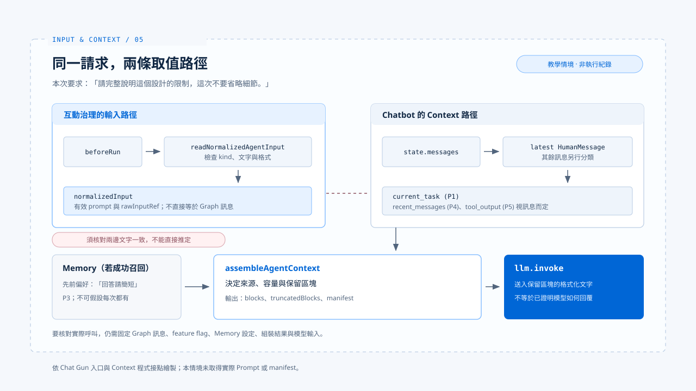

# 從輸入到 Context：一次請求的走法

[English](./05-case-input-to-context.md) | [繁體中文](./05-case-input-to-context-zh-TW.md)

> 假設使用者先前說過「回答請簡短」，這次對 Chat Gun chatbot 說：「請完整說明這個設計的限制，這次不要省略細節。」

**這句話從入口走到模型之前，會經過輸入治理、Graph 訊息與 Context 組裝三個接點；每個接點各自能證明的事情不同。**

本篇用這個教學情境，把 [輸入正規化](./01-input-normalization-zh-TW.md)、[Context 組裝](./02-context-assembly-zh-TW.md)、[信任邊界](./03-context-trust-boundary-zh-TW.md) 與 [Memory](./04-memory-and-compaction-zh-TW.md) 放進同一條路徑。

**本篇核對的是：一筆請求能否追到模型實際可見的材料，並說明每一項省略。**

- 這不是一筆已執行的正式請求。
- 下文描述程式會經過的接點，以及要核對的資料，不宣稱已取得該次模型 Prompt 或 manifest。

## 1. 入口：先辨認這是一筆新 Prompt

> `chatbotGraph` 由 `applyInteractionGovernance` 包住。

- `interaction-runtime.ts` 的 `beforeRun` 會呼叫 `readNormalizedAgentInput`，把有效文字轉成 `prompt` 輸入，或在派送前拒絕空白、格式錯誤及衝突的 `kind`。
- 原始輸入另產生摘要參照。
- 若入口收到的是 `command`，目前讀取器回傳 `unsupported_command`，不能把它當作模型任務繼續描述。

### 兩個欄位的交界

**互動治理保存 `normalizedInput`，但 chatbot 的 Context 組裝從 Graph 的 `state.messages` 找最近的 `HumanMessage`。**

教學情境要成立，得核對入口送進 Graph 的訊息確實包含這次要求，且與正規化文字相符。兩個欄位名稱相近，不代表程式已自動保證它們逐字一致。

## 2. 組裝：本次要求與過去偏好分開

> 若 chatbot 的 Context feature flag 啟用，`chatbot.ts` 呼叫 `assembleAgentContext`。

- System Policy 是 P0。
- 最近的使用者訊息成為 P1 current task。
- 先前對話成為 P4 recent messages。
- 只有取得 canonical execution context、Memory provider 並成功召回相關紀錄時，「回答請簡短」才可能另以 P3 Memory 出現。沒有召回結果，就不能在案例表格中假設它一定存在。

### 各接點應保留的證據

| 接點 | 本例應檢查的證據 | 不能直接推論 |
|---|---|---|
| 輸入治理 | `kind`、正規化文字、原始輸入參照 | 附件或命令已進模型 |
| Graph 訊息 | 最新 `HumanMessage` 與先前訊息 | 必然等同正規化文字 |
| Context 組裝 | 保留區塊、`truncatedBlocks`、manifest | 每份 Memory 都被選入 |
| 模型呼叫 | 傳給 `llm.invoke` 的組裝文字 | 回覆一定遵守本次要求 |

### 本次要求應主導回答

容量足夠時，模型可能同時看見本次詳細說明的要求和過去簡短回答的偏好。

**正確的任務判斷應讓本次明確要求主導回答，歷史偏好只作背景；P1、P3 的排序能讓前者在容量不足時先被保留，卻不是模型服從規則的證明。**

### 兩種失敗分開處理

- Context 超過硬上限時，`chatbot.ts` 會把 `ContextHardLimitError` 轉成錯誤回覆。
- Memory recall 失敗時，組裝器可繼續處理本次任務並在 manifest 記下原因。

## 3. 怎樣把教學情境變成可核對紀錄

> 下一步需要固定一筆請求、Graph 訊息、feature flag、Memory provider 設定與模型能力上限，再擷取 `AssembledAgentContext` 的 `blocks`、`truncatedBlocks`、`manifest` 及實際傳給模型的文字。

- Manifest 只保留來源參照和容量資訊，非 Memory 參照還會雜湊；它本身不足以重建完整 Prompt。
- 若只拿到單元測試中的組裝結果，最多能證明組裝器在該 fixture 下的行為，不能宣稱正式 chatbot 入口已跑出相同內容。

## 4. 這筆請求停在 Context 邊界

模型後續若提出工具行動，是否執行仍應交由 [行動治理](../foundations/04-design-principles-zh-TW.md) 處理。

**Context 的來源排序不能代替授權。**

## 實作參照與適用範圍

[chat-gun](https://github.com/HsienW/chat-gun) 部分以本篇核對的程式接點為範圍；本篇沒有擷取正式 chatbot 入口的組裝結果。

| 參照 | 可核對的落點 |
|---|---|
| 互動治理與派送前檢查 | `backend/src/platform/interaction-runtime.ts` |
| 輸入讀取與正規化 | `backend/src/runtime/input/read-normalized-agent-input.ts` |
| Chatbot 分支與錯誤回覆 | `backend/src/agents/chatbot.ts` |
| Agent 接入與 Memory recall | `backend/src/agents/context-integration.ts` |
| 區塊組裝與 manifest | `backend/src/context/agent-context-assembler.ts` |

## 接續閱讀

- [輸入正規化](./01-input-normalization-zh-TW.md)
- [Context 組裝](./02-context-assembly-zh-TW.md)
- [Context 信任邊界](./03-context-trust-boundary-zh-TW.md)
- [Memory 與壓縮](./04-memory-and-compaction-zh-TW.md)
- [Agent Harness 設計原則](../foundations/04-design-principles-zh-TW.md)
