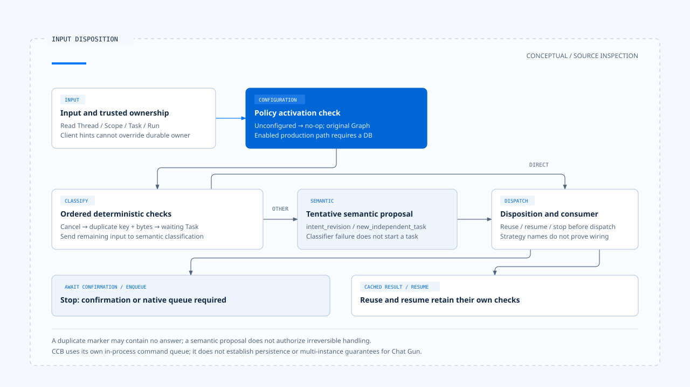

# 执行中新输入与互动策略

[English](./01-in-flight-input-policy.md) | [繁體中文](./01-in-flight-input-policy-zh-TW.md) | [简体中文](./01-in-flight-input-policy-zh-CN.md)

[回到导览](./README-zh-CN.md) · 下一篇：[Run 归属与可见状态](./02-run-ownership-and-visible-state-zh-CN.md)

用户在查询还没结束时补上一句「只看台北」，产品可能把它当成原任务的补充，也可能另开任务。两种选择都会影响原本的执行、等待中的批准，以及最后显示哪份结果。先收到消息，并不等于已决定它属于哪一次工作。

本篇依[固定版本与证据范围](./README-zh-CN.md#来源与查证状态)，追踪 Chat Gun 的输入分类与互动 orchestrator，并对照第三方 Claude Code Best（CCB）的提交入口。情境文字用来说明问题；本轮没有送出模型请求或执行测试。

## 1. 输入形状与任务归属分开处理

[Input and Context](../input-and-context/README-zh-CN.md) 已整理输入如何规范化。这里从可解析的 `prompt`、`clarification_resume`、`cancel` 开始，追问它们应如何影响活动任务。

[`readNormalizedAgentInput()`][g-reader] 保留输入种类与来源参照。互动入口还会读取 Thread、Scope、Task、Run 与 idempotency 数据，再透过 Query Guard 查询是否已有权威 ownership。只有知道目前谁持有执行权，才有条件决定新输入如何处置。[入口见 orchestrator][g-runtime]。

前端送来的 active-run hint 可以补充关联信息，但不是权威身份。若它与持久化 ownership 不一致，不能由浏览器提示覆盖数据库中的活动 Run。

## 2. 先辨认可确定的输入种类

### Deterministic 分支

[`classifyInteractionInput()`][g-classify] 先检查不需要模型猜测的条件：

| 条件 | 分类 | 所保留的依据 |
|---|---|---|
| 明确的 business cancel signal | `cancel_request` | 取消信号来自指定入口。 |
| 相同 idempotency key，且序列化后的 input payload bytes 相同 | `duplicate_input` | 识别与内容同时匹配。 |
| 已知厘清等待，回复指向该 Task | `clarification_answer` | Waiting Task 与 reply-to 关联。 |

顺序也有意义：这个函数先处理明确取消，再检查重复输入与厘清回答。不能因文字中有「取消」两个字，就宣称走到了第一个分支；该分支接受的是结构化信号。

重复输入也不等于相似句子。两句语义近似的文字，未必有相同 bytes；相同 idempotency key 但内容不同，也不能拿来重用先前操作。

### 语义建议仍需决策

其他输入交给 `SemanticInputClassifier`，建议 `intent_revision` 或 `new_independent_task`。结果带有 classifier version、摘要与 `awaiting_confirmation`，不因模型做了分类就取得不可逆处置权。

Classifier 抛错或返回不合契约的 reason code 时，helper 产生 `CLASSIFIER_UNAVAILABLE` 的 tentative 新任务建议。它仍是待确认结果，不能把 fallback 名称理解成已开始新任务。

## 3. Policy 决定系统接受哪些互动

[`InteractionPolicy`][g-policy] 将几组选择分开：

- `strategy`：`reject`、`enqueue`、`interrupt`、`supersede` 或 `rollback`。
- `clarificationReplyMode`：恢复同 Task，或建立新 Task。
- `cancellationMode`：依只读、补偿或已提交后修正处理取消。
- `allowIntentRevision`：是否接受意图修订。

这些是配置契约，还需要实际 consumer 才能成立。例如 `resolveClassificationDisposition()` 会把重复输入映射为重用、把指定厘清回答映射为恢复，也会在已有等待时要求先处理 HITL；orchestrator 接着判断自己能否执行对应处置。

### 未配置时不介入

Default policy 内的策略是 `enqueue`，但 `loadInteractionPolicy()` 同时保留 `configured`。未配置 `INTERACTION_POLICY` 时，`createInteractionOrchestrator()` 返回 no-op，`applyInteractionGovernance()` 直接交回原 Graph。

因此，类型中的默认值、环境设置存在与正式入口已启用，是三件需要分别确认的事。配置启用后，production 组装还要求数据库，不能在缺少必要依赖时假装治理照常运作。

## 4. Disposition 到派送仍有停止点

### 需要分类确认时

分类模块提供建立 pending、确认 tentative 结果与处理到期的 helper；但目前所读 orchestrator 对 `await_confirmation` 会记录拒绝并抛出 `INPUT_CLASSIFICATION_CONFIRMATION_REQUIRED`。

这能指出「没有直接派送」的接点，却不能推出完整确认 UI、持久化与返回入口都已接上。新增产品能力时，需要把这几段一起补齐。

### Enqueue 尚需原生所有权

当有效策略是 `enqueue`，现有入口回报 `NATIVE_QUEUE_OWNERSHIP_REQUIRED`，并在派送前停止。这个分支没有建立本地持久队列，也没有背景 worker 负责稍后取出工作。

产品若要提供排队体验，必须查到 native Run／queue 的实际入口、所有权与取消方式，不能只把画面显示成 queued。这与 CCB 使用自己命令队列的作法有不同边界。

### 重用不只一种结果

Orchestrator 可能从可信 idempotency storage 取得已完成结果，也可能仅在分类为重复输入时返回 `duplicate_input` 标记。前者是 cached result，后者未必含有原先答案。

[`interaction-runtime.test.ts`][g-runtime-test] 分别定义已完成 key、locked key、storage 失败与 unsupported command 的案例。这些是已读测试安排，本轮没有重新执行。

[开启 HTML 图解](../../assets/agent-harness/interaction-and-feedback/01-in-flight-input-policy/01-input-disposition-en.html)

## 5. CCB 如何承接忙碌时的提交

CCB 的 [`handlePromptSubmit()`][c-submit] 先看同步 QueryGuard 与外部 loading。忙碌时，prompt／bash 可以 enqueue，其他模式有自己的分支；若有可中断工具，入口才另外发出 `abort('interrupt')`。

原始文字与贴上内容先入列，图像及其他输入处理留到执行时。开始执行前建立新的 AbortController，并在异步 `processUserInput()` 之前保留 guard，避免准备输入的空窗又开始第二次执行。

[`QueryGuard`][c-guard] 在这里是进程内同步状态机，并非 Chat Gun 的 PostgreSQL ownership repository。两者都处理 dispatch gap，却不能互相借用持久化与多实例保证。

## 6. 前端送出与后端策略并不等宽

Chat Gun 的 [App][g-app] 在天气厘清画面存在时阻挡一般提交，改走专用 resume；一般提交也先经过 `beginDispatch()`。后端支持分类契约，不表示 UI 已提供所有执行中改意、排队与替换操作。

阅读一项互动能力时，可以沿以下位置核对：

1. UI 实际送出哪种 input 与 metadata。
2. Backend 是否启用 policy，并取得可信 ownership。
3. Classification 是确定结果还是 tentative 建议。
4. Disposition 是否有可用 consumer，或在派送前停止。
5. 用户最后收到的是拒绝、等待、重用结果，还是新执行已开始。

下一篇会沿 ownership 与 generation 说明：即使新 Run 已取得执行权，旧 Run 的回调与输出仍需要自己的归属检查。

[g-reader]: https://github.com/HsienW/chat-gun/blob/92a5673003e4ac4ec09be8b1b350f42dbf4a5e69/backend/src/runtime/input/read-normalized-agent-input.ts
[g-runtime]: https://github.com/HsienW/chat-gun/blob/92a5673003e4ac4ec09be8b1b350f42dbf4a5e69/backend/src/platform/interaction-runtime.ts
[g-classify]: https://github.com/HsienW/chat-gun/blob/92a5673003e4ac4ec09be8b1b350f42dbf4a5e69/backend/src/runtime/interaction/classify.ts
[g-policy]: https://github.com/HsienW/chat-gun/blob/92a5673003e4ac4ec09be8b1b350f42dbf4a5e69/backend/src/runtime/interaction/policy.ts
[g-runtime-test]: https://github.com/HsienW/chat-gun/blob/92a5673003e4ac4ec09be8b1b350f42dbf4a5e69/backend/src/platform/interaction-runtime.test.ts
[c-submit]: https://github.com/claude-code-best/claude-code/blob/77a7934e15d69da13879112ed7db695c9ee7a52a/src/utils/handlePromptSubmit.ts
[c-guard]: https://github.com/claude-code-best/claude-code/blob/77a7934e15d69da13879112ed7db695c9ee7a52a/src/utils/QueryGuard.ts
[g-app]: https://github.com/HsienW/chat-gun/blob/92a5673003e4ac4ec09be8b1b350f42dbf4a5e69/frontend/src/App.tsx
