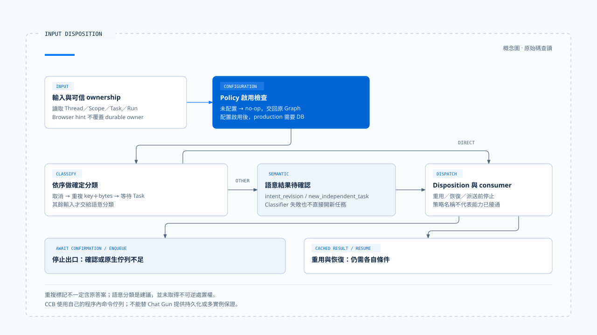

# 執行中新輸入與互動策略

[English](./01-in-flight-input-policy.md) | [繁體中文](./01-in-flight-input-policy-zh-TW.md)

[回到導覽](./README-zh-TW.md) · 下一篇：[Run 歸屬與可見狀態](./02-run-ownership-and-visible-state-zh-TW.md)

使用者在查詢還沒結束時補上一句「只看臺北」，產品可能把它當成原任務的補充，也可能另開任務。兩種選擇都會影響原本的執行、等待中的批准，以及最後顯示哪份結果。先收到訊息，並不等於已決定它屬於哪一次工作。

本篇依[固定版本與證據範圍](./README-zh-TW.md#來源與查證狀態)，追蹤 Chat Gun 的輸入分類與互動 orchestrator，並對照第三方 Claude Code Best（CCB）的提交入口。情境文字用來說明問題；本輪沒有送出模型請求或執行測試。

## 1. 輸入形狀與任務歸屬分開處理

[Input and Context](../input-and-context/README-zh-TW.md) 已整理輸入如何正規化。這裡從可解析的 `prompt`、`clarification_resume`、`cancel` 開始，追問它們應如何影響活動任務。

[`readNormalizedAgentInput()`][g-reader] 保留輸入種類與來源參照。互動入口還會讀取 Thread、Scope、Task、Run 與 idempotency 資料，再透過 Query Guard 查詢是否已有權威 ownership。只有知道目前誰持有執行權，才有條件決定新輸入如何處置。[入口見 orchestrator][g-runtime]。

前端送來的 active-run hint 可以補充關聯資訊，但不是權威身分。若它與持久化 ownership 不一致，不能由瀏覽器提示覆蓋資料庫中的活動 Run。

## 2. 先辨認可確定的輸入種類

### Deterministic 分支

[`classifyInteractionInput()`][g-classify] 先檢查不需要模型猜測的條件：

| 條件 | 分類 | 所保留的依據 |
|---|---|---|
| 明確的 business cancel signal | `cancel_request` | 取消訊號來自指定入口。 |
| 相同 idempotency key，且序列化後的 input payload bytes 相同 | `duplicate_input` | 識別與內容同時匹配。 |
| 已知釐清等待，回覆指向該 Task | `clarification_answer` | Waiting Task 與 reply-to 關聯。 |

順序也有意義：這個函式先處理明確取消，再檢查重複輸入與釐清回答。不能因文字中有「取消」兩個字，就宣稱走到了第一個分支；該分支接受的是結構化訊號。

重複輸入也不等於相似句子。兩句語意近似的文字，未必有相同 bytes；相同 idempotency key 但內容不同，也不能拿來重用先前操作。

### 語意建議仍需決策

其他輸入交給 `SemanticInputClassifier`，建議 `intent_revision` 或 `new_independent_task`。結果帶有 classifier version、摘要與 `awaiting_confirmation`，不因模型做了分類就取得不可逆處置權。

Classifier 拋錯或回傳不合契約的 reason code 時，helper 產生 `CLASSIFIER_UNAVAILABLE` 的 tentative 新任務建議。它仍是待確認結果，不能把 fallback 名稱理解成已開始新任務。

## 3. Policy 決定系統接受哪些互動

[`InteractionPolicy`][g-policy] 將幾組選擇分開：

- `strategy`：`reject`、`enqueue`、`interrupt`、`supersede` 或 `rollback`。
- `clarificationReplyMode`：恢復同 Task，或建立新 Task。
- `cancellationMode`：依唯讀、補償或已提交後修正處理取消。
- `allowIntentRevision`：是否接受意圖修訂。

這些是配置契約，還需要實際 consumer 才能成立。例如 `resolveClassificationDisposition()` 會把重複輸入映射為重用、把指定釐清回答映射為恢復，也會在已有等待時要求先處理 HITL；orchestrator 接著判斷自己能否執行對應處置。

### 未配置時不介入

Default policy 內的策略是 `enqueue`，但 `loadInteractionPolicy()` 同時保留 `configured`。未配置 `INTERACTION_POLICY` 時，`createInteractionOrchestrator()` 回傳 no-op，`applyInteractionGovernance()` 直接交回原 Graph。

因此，型別中的預設值、環境設定存在與正式入口已啟用，是三件需要分別確認的事。配置啟用後，production 組裝還要求資料庫，不能在缺少必要依賴時假裝治理照常運作。

## 4. Disposition 到派送仍有停止點

### 需要分類確認時

分類模組提供建立 pending、確認 tentative 結果與處理到期的 helper；但目前所讀 orchestrator 對 `await_confirmation` 會記錄拒絕並拋出 `INPUT_CLASSIFICATION_CONFIRMATION_REQUIRED`。

這能指出「沒有直接派送」的接點，卻不能推出完整確認 UI、持久化與回傳入口都已接上。新增產品能力時，需要把這幾段一起補齊。

### Enqueue 尚需原生所有權

當有效策略是 `enqueue`，現有入口回報 `NATIVE_QUEUE_OWNERSHIP_REQUIRED`，並在派送前停止。這個分支沒有建立本地持久佇列，也沒有背景 worker 負責稍後取出工作。

產品若要提供排隊體驗，必須查到 native Run／queue 的實際入口、所有權與取消方式，不能只把畫面顯示成 queued。這與 CCB 使用自己命令佇列的作法有不同邊界。

### 重用不只一種結果

Orchestrator 可能從可信 idempotency storage 取得已完成結果，也可能僅在分類為重複輸入時回傳 `duplicate_input` 標記。前者是 cached result，後者未必含有原先答案。

[`interaction-runtime.test.ts`][g-runtime-test] 分別定義已完成 key、locked key、storage 失敗與 unsupported command 的案例。這些是已讀測試安排，本輪沒有重新執行。

[開啟 HTML 圖解](../../assets/agent-harness/interaction-and-feedback/01-in-flight-input-policy/01-input-disposition.html)

## 5. CCB 如何承接忙碌時的提交

CCB 的 [`handlePromptSubmit()`][c-submit] 先看同步 QueryGuard 與外部 loading。忙碌時，prompt／bash 可以 enqueue，其他模式有自己的分支；若有可中斷工具，入口才另外發出 `abort('interrupt')`。

原始文字與貼上內容先入列，影像及其他輸入處理留到執行時。開始執行前建立新的 AbortController，並在非同步 `processUserInput()` 之前保留 guard，避免準備輸入的空窗又開始第二次執行。

[`QueryGuard`][c-guard] 在這裡是程序內同步狀態機，並非 Chat Gun 的 PostgreSQL ownership repository。兩者都處理 dispatch gap，卻不能互相借用持久化與多實例保證。

## 6. 前端送出與後端策略並不等寬

Chat Gun 的 [App][g-app] 在天氣釐清畫面存在時阻擋一般提交，改走專用 resume；一般提交也先經過 `beginDispatch()`。後端支援分類契約，不表示 UI 已提供所有執行中改意、排隊與替換操作。

閱讀一項互動能力時，可以沿以下位置核對：

1. UI 實際送出哪種 input 與 metadata。
2. Backend 是否啟用 policy，並取得可信 ownership。
3. Classification 是確定結果還是 tentative 建議。
4. Disposition 是否有可用 consumer，或在派送前停止。
5. 使用者最後收到的是拒絕、等待、重用結果，還是新執行已開始。

下一篇會沿 ownership 與 generation 說明：即使新 Run 已取得執行權，舊 Run 的回呼與輸出仍需要自己的歸屬檢查。

[g-reader]: https://github.com/HsienW/chat-gun/blob/92a5673003e4ac4ec09be8b1b350f42dbf4a5e69/backend/src/runtime/input/read-normalized-agent-input.ts
[g-runtime]: https://github.com/HsienW/chat-gun/blob/92a5673003e4ac4ec09be8b1b350f42dbf4a5e69/backend/src/platform/interaction-runtime.ts
[g-classify]: https://github.com/HsienW/chat-gun/blob/92a5673003e4ac4ec09be8b1b350f42dbf4a5e69/backend/src/runtime/interaction/classify.ts
[g-policy]: https://github.com/HsienW/chat-gun/blob/92a5673003e4ac4ec09be8b1b350f42dbf4a5e69/backend/src/runtime/interaction/policy.ts
[g-runtime-test]: https://github.com/HsienW/chat-gun/blob/92a5673003e4ac4ec09be8b1b350f42dbf4a5e69/backend/src/platform/interaction-runtime.test.ts
[c-submit]: https://github.com/claude-code-best/claude-code/blob/77a7934e15d69da13879112ed7db695c9ee7a52a/src/utils/handlePromptSubmit.ts
[c-guard]: https://github.com/claude-code-best/claude-code/blob/77a7934e15d69da13879112ed7db695c9ee7a52a/src/utils/QueryGuard.ts
[g-app]: https://github.com/HsienW/chat-gun/blob/92a5673003e4ac4ec09be8b1b350f42dbf4a5e69/frontend/src/App.tsx
