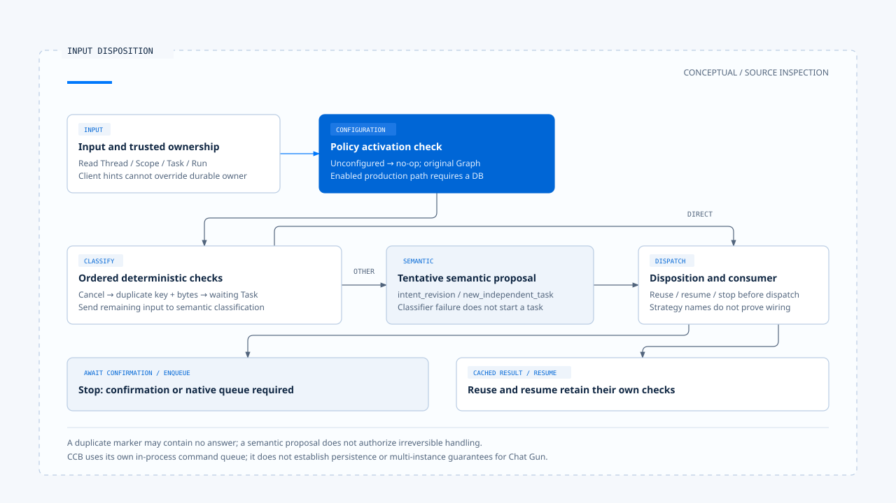

# In-flight input and interaction policy

[English](./01-in-flight-input-policy.md) | [繁體中文](./01-in-flight-input-policy-zh-TW.md)

[Back to overview](./README.md) · Next: [Run ownership and visible state](./02-run-ownership-and-visible-state.md)

A user adds "Taipei only" before a query finishes. The product might treat this as a supplement to the original task or start a separate task. Either choice affects the current execution, pending approvals, and which result ultimately appears. Receiving the message does not yet determine which work it belongs to.

Using the [pinned versions and evidence scope](./README.md#sources-and-verification-status), this article traces Chat Gun's input classification and interaction orchestrator, then compares the submission entry point in the third-party Claude Code Best (CCB). The scenario illustrates the problem; no model requests or tests were run during this work.

## 1. Handle input shape and task ownership separately

[Input and Context](../input-and-context/README.md) explains input normalization. Here, the starting point is a parseable `prompt`, `clarification_resume`, or `cancel`, and the question is how it should affect an active task.

[`readNormalizedAgentInput()`][g-reader] preserves the input kind and source references. The interaction entry point also reads Thread, Scope, Task, Run, and idempotency data, then uses Query Guard to look up authoritative ownership. Deciding how to handle new input requires knowing who currently holds execution authority. [See the orchestrator entry point][g-runtime].

An active-run hint from the frontend can supply correlation information, but it is not an authoritative identity. If it conflicts with durable ownership, the browser hint cannot override the active Run in the database.

## 2. Identify input kinds that can be determined directly

### Deterministic branches

[`classifyInteractionInput()`][g-classify] first checks conditions that require no model inference:

| Condition | Classification | Retained evidence |
|---|---|---|
| An explicit business cancel signal | `cancel_request` | The cancel signal comes from the designated entry point. |
| The same idempotency key and identical serialized input payload bytes | `duplicate_input` | Both identity and content match. |
| A known clarification wait, with the reply targeting that Task | `clarification_answer` | The waiting Task and reply-to relationship. |

Order matters: the function handles explicit cancellation first, then checks duplicate input and clarification answers. The word "cancel" in a message does not establish that the first branch ran; that branch accepts a structured signal.

Duplicate input also requires more than similar wording. Two messages with similar meanings may have different bytes; the same idempotency key with different content cannot justify reusing a previous operation either.

### Semantic proposals still require a decision

Other input goes to `SemanticInputClassifier`, which proposes `intent_revision` or `new_independent_task`. The result includes a classifier version, summary, and `awaiting_confirmation`. A model classification does not grant authority to make an irreversible disposition.

If the classifier throws or returns a reason code outside the contract, the helper produces a tentative new-task proposal with `CLASSIFIER_UNAVAILABLE`. That result still awaits confirmation; the fallback name does not mean a new task has started.

## 3. Policy determines which interactions the system accepts

[`InteractionPolicy`][g-policy] separates several choices:

- `strategy`: `reject`, `enqueue`, `interrupt`, `supersede`, or `rollback`.
- `clarificationReplyMode`: resume the same Task or create a new Task.
- `cancellationMode`: handle cancellation through read-only interruption, compensation, or correction after commit.
- `allowIntentRevision`: whether to accept intent revisions.

These configuration contracts require actual consumers. For example, `resolveClassificationDisposition()` maps duplicates to reuse and targeted clarification answers to resume, and can require handling existing HITL waits first. The orchestrator then determines whether it can carry out the disposition.

### No intervention when unconfigured

The default policy uses `enqueue`, but `loadInteractionPolicy()` also retains `configured`. Without `INTERACTION_POLICY` configured, `createInteractionOrchestrator()` returns a no-op, and `applyInteractionGovernance()` returns the original Graph directly.

The type's default value, the presence of environment configuration, and an enabled production entry point therefore need separate checks. Once configured, the production assembly also requires a database; it cannot treat governance as operational when required dependencies are missing.

## 4. Dispatch can still stop after disposition

### When classification confirmation is required

The classification module provides helpers to create pending records, confirm tentative results, and handle expiry. However, the inspected orchestrator records a rejection for `await_confirmation` and throws `INPUT_CLASSIFICATION_CONFIRMATION_REQUIRED`.

This identifies where dispatch stops, but does not establish that the full confirmation UI, persistence, and return entry point are connected. Adding this product capability requires completing those pieces together.

### Enqueue still requires native ownership

When the effective strategy is `enqueue`, the current entry point reports `NATIVE_QUEUE_OWNERSHIP_REQUIRED` and stops before dispatch. This branch creates neither a local durable queue nor a background worker to retrieve work later.

A product offering a queued experience needs the actual native Run / queue entry point, ownership, and cancellation mechanism. Displaying "queued" alone is insufficient. This boundary differs from CCB's use of its own command queue.

### Reuse can return different things

The orchestrator may retrieve a completed result from trusted idempotency storage, or merely return a `duplicate_input` marker when it classifies the input as a duplicate. The former is a cached result; the latter may contain no original answer.

[`interaction-runtime.test.ts`][g-runtime-test] defines separate cases for completed keys, locked keys, storage failures, and unsupported commands. These test arrangements were inspected, not rerun during this work.

[Open the HTML diagram](../../assets/agent-harness/interaction-and-feedback/01-in-flight-input-policy/01-input-disposition-en.html)

## 5. How CCB handles submissions while busy

CCB's [`handlePromptSubmit()`][c-submit] first checks the synchronous QueryGuard and external loading state. While busy, prompt / bash input can enqueue, with separate branches for other modes. The entry point additionally issues `abort('interrupt')` only if an interruptible tool is available.

Raw text and pasted content enter the queue first; images and other input processing wait until execution. Before execution starts, it creates a new AbortController and reserves the guard before the asynchronous `processUserInput()`, preventing a second execution from starting during input preparation.

[`QueryGuard`][c-guard] here is an in-process synchronous state machine, separate from Chat Gun's PostgreSQL ownership repository. Both address the dispatch gap, but neither inherits the other's persistence or multi-instance guarantees.

## 6. Frontend submissions do not cover every backend policy

Chat Gun's [App][g-app] blocks ordinary submission while the weather clarification UI is present and uses the dedicated resume path instead. Ordinary submission also passes through `beginDispatch()` first. Backend classification contracts do not establish that the UI exposes every in-flight revision, queue, or replacement operation.

An interaction capability can be checked at these points:

1. Which input and metadata the UI actually submits.
2. Whether the backend enables the policy and acquires trusted ownership.
3. Whether classification is a definite result or a tentative proposal.
4. Whether disposition has an available consumer or stops before dispatch.
5. Whether the user receives a rejection, a wait, a reused result, or a newly started execution.

The next article follows ownership and generation: even after a new Run acquires execution authority, callbacks and output from the old Run still need their own ownership checks.

[g-reader]: https://github.com/HsienW/chat-gun/blob/92a5673003e4ac4ec09be8b1b350f42dbf4a5e69/backend/src/runtime/input/read-normalized-agent-input.ts
[g-runtime]: https://github.com/HsienW/chat-gun/blob/92a5673003e4ac4ec09be8b1b350f42dbf4a5e69/backend/src/platform/interaction-runtime.ts
[g-classify]: https://github.com/HsienW/chat-gun/blob/92a5673003e4ac4ec09be8b1b350f42dbf4a5e69/backend/src/runtime/interaction/classify.ts
[g-policy]: https://github.com/HsienW/chat-gun/blob/92a5673003e4ac4ec09be8b1b350f42dbf4a5e69/backend/src/runtime/interaction/policy.ts
[g-runtime-test]: https://github.com/HsienW/chat-gun/blob/92a5673003e4ac4ec09be8b1b350f42dbf4a5e69/backend/src/platform/interaction-runtime.test.ts
[c-submit]: https://github.com/claude-code-best/claude-code/blob/77a7934e15d69da13879112ed7db695c9ee7a52a/src/utils/handlePromptSubmit.ts
[c-guard]: https://github.com/claude-code-best/claude-code/blob/77a7934e15d69da13879112ed7db695c9ee7a52a/src/utils/QueryGuard.ts
[g-app]: https://github.com/HsienW/chat-gun/blob/92a5673003e4ac4ec09be8b1b350f42dbf4a5e69/frontend/src/App.tsx
