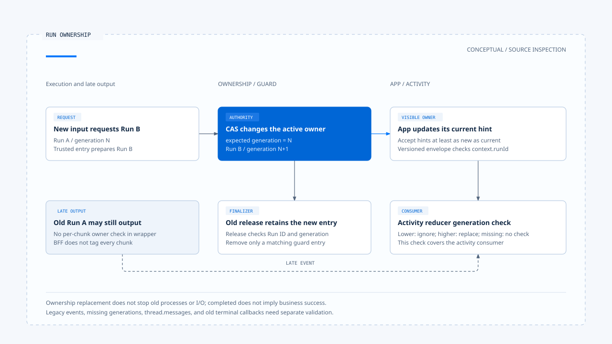

# Run 归属与可见状态

[English](./02-run-ownership-and-visible-state.md) | [繁體中文](./02-run-ownership-and-visible-state-zh-TW.md) | [简体中文](./02-run-ownership-and-visible-state-zh-CN.md)

[回到导览](./README-zh-CN.md) · 上一篇：[执行中新输入与互动策略](./01-in-flight-input-policy-zh-CN.md) · 下一篇：[厘清提问与任务恢复](./03-clarification-and-resume-zh-CN.md)

用户已开始新的查询，上一个 Run 才返回结果。旧结果可以保留为历史，却不应重新取得目前画面的控制权。这个问题同时涉及数据库中的活动归属、进程内保留状态与前端事件消费，单一识别码不足以包办全部责任。

本篇依[固定版本与证据范围](./README-zh-CN.md#来源与查证状态)，追踪 Chat Gun 的 ownership、Query Guard 与活动显示，并对照第三方 CCB。以下是源代码与测试案例的查读，未执行跨服务或数据库竞态验证。

## 1. 哪个状态由谁持有

| 识别或状态 | 此处用途 | 不能直接替代的事 |
|---|---|---|
| Thread／Scope | 定位活动 ownership 的范围。 | 任意外部资源的逐笔授权。 |
| Task | 业务工作与等待的关联。 | Native Run 的实际执行状态。 |
| Run | 一次执行的识别。 | 用户整项任务必然已完成。 |
| Generation | 区分这个范围的新旧权威执行。 | 全球唯一事件顺序或外部提交真相。 |
| UI lifecycle | 目前流式传输与活动显示状态。 | 工具效果已成功或已还原。 |

[Runtime boundary 文件][g-boundary] 另把 native Run／Thread API、业务 Task／Step 与 effect Ledger 分开。文件中的 dev 观察有自己的环境范围，不能改写成正式部署的所有状态都已验证一致。

## 2. 数据库中的活动归属

### Claim 与 supersede

[`PgActiveRunOwnershipRepository`][g-ownership] 以 Thread／Scope 查找 active ownership。Claim 会根据该范围既有 generation 建立下一笔；冲突时不直接取得第二个活动位置。

Supersede 则在 transaction 中，先以预期 generation 及 active 状态更新旧列，再建立新 Run 的 ownership。若条件更新没有取得旧列，就回报 CAS 冲突，不继续假设自己已成功替换。

这里取得的是业务上的权威归属。旧 Run 在其他程序里是否已停止、外部 I/O 是否完成，仍有各自 consumer 与取消条件。

### Terminal 更新的范围

`markTerminal()` 以 Thread、Scope、Run 及 active 状态更新。旧 Run 收尾不能只靠相同 Thread，就把另一个 Run 的 active ownership 关掉。

[Repository 测试][g-ownership-test] 定义 generation 递增与竞态 CAS 的安排；查询及 transaction 是测试环境的替身，不等同正式 PostgreSQL 多连接压测。

## 3. Query Guard 保护哪个异步空窗

[`GenerationQueryGuard`][g-guard] 在进程内保留 `dispatching`／`running` 状态，reserve 同时查持久化 ownership。它不是另建一个 worker queue，而是避免准备输入期间又盲目取得第二次派送。

若已有 pending reservation，第二个调用先等待该保留完成，再依 durable owner 决定后续处置。不能只看本机 Map 暂时有没有数据，就推论整个服务群没有活动 Run。

### 旧 finalizer 不能释放新保留

`release(scope, generation)` 同时核对 runId 与 generation。只有仍匹配的项目才从 Map 移除，旧 Run 的 finally 不应清除新 Run 的保留。

[Query Guard 测试][g-guard-test] 分开覆盖 dispatch gap、durable owner 冲突与 stale finalizer。这些案例说明应核对的条件，没有证明所有跨进程竞态都已消失。

## 4. 从 backend 事件到前端活动

### Wrapper 先发送关联事件

[互动 wrapper][g-runtime] 在开始 governed stream 后先 yield 互动事件，再转送底层 chunks。它没有在每一个 chunk 上重新查一次 ownership，因此仍需要消费端判断可见归属。

[BFF][g-bff] 验证并转送 active-run hint，透过 response body pipe 传递上游流式传输。这条代理路径没有替每段内容自动补上 generation，也不能代替模型消息的归属检查。

### App 与 reducer 的两道检查

[事件 parser][g-parser] 从互动事件提取 generation 与 Run hint。[App][g-app] 只用不低于目前 generation 的新 hint 更新参照；对 versioned Runtime envelope，还会检查 `context.runId` 是否匹配当前权威提示，再交给事件 buffer。

活动事件进入 `streamActivityReducer` 时，App 会带入可提取的 generation。[Reducer][g-ui] 对已知且较低 generation 的活动不更新画面，较高 generation 则替换 live activity。

这些检查有明确边界：

- Versioned envelope 的 Run 检查，不等于所有 legacy 事件都具有相同识别。
- Generation 缺少时，不能靠比较数值自然排除旧内容。
- `thread.messages` 的文字显示由流式传输 hook 管理，不能将活动时间轴的过滤直接延伸成全部文字已被保护。

[开启 HTML 图解](../../assets/agent-harness/interaction-and-feedback/02-run-ownership-and-visible-state/02-run-generation-and-stale-output-en.html)

## 5. 终止与活动封存

[`streamActivityReducer`][g-ui] 对 finished、error、cancelled 等终止状态保留幂等收敛，晚到进度不会把它自然改回 running。活动可依 assistant message ID 封存；重新送出则重设 live state，保留或清除历史由 action 决定。

[`taskEventReducer`][g-reducer] 另对已终止 Task 忽略晚到事件。这是 Task 状态的规则，与活动 reducer 分属不同 consumer。

App 的 finish／error 回调及活动 terminal action 没有逐一携带 generation。故本篇只描述已指出的检查；若要保证旧终止回调绝不影响新流式传输，还需核对 hook 隔离与每次订阅的生命周期。

### Completed 不一定是业务成功

互动 wrapper 对部分非取消例外，会以 ownership `completed` 做收尾，同时将 idempotency 记为 failed。这个 completed 表达该 ownership 不再活动，不能单看它就向用户宣称模型、工具或整个 Task 成功。

## 6. CCB 的进程内 generation

CCB 的 [`QueryGuard`][c-guard] 同样区分 idle、dispatching、running。`tryStart()` 递增 generation，`end(generation)` 只允许目前世代清理；`forceEnd()` 再递增 generation，使先前 Promise 的晚到 finally 失效。

这个 guard 服务于进程内 query 生命周期。它没有因此取得 Chat Gun 的数据库 scope CAS，也不保证外部副作用已停止。

## 7. 如何验证「没有被旧输出覆盖」

[App 测试][g-app-test] 有一个明确案例：先告知新的 replacement Run，再送入旧 Run 的 versioned event，核对 live activity 没有出现旧活动。[活动 reducer 测试][g-ui-test] 则检查低 generation、终止后进度与封存。

若要把这些案例扩成一次跨服务验收，需要另外保存：

1. 新旧 Run 的 ownership、generation 与实际事件封套。
2. BFF 传入及转出的 metadata，而非只看画面上的 Run 名称。
3. 活动与文字各自的 consumer，以及缺少 generation 的处置。
4. 旧 finalizer、旧 finish 回调与目前流式传输的收敛结果。

下一篇将其中一种等待拆开：用户的厘清回答，究竟如何对回原 Task，又如何与新的 Run 关联。

[g-boundary]: https://github.com/HsienW/chat-gun/blob/92a5673003e4ac4ec09be8b1b350f42dbf4a5e69/docs/decisions/current-langgraph-runtime-boundary.md
[g-ownership]: https://github.com/HsienW/chat-gun/blob/92a5673003e4ac4ec09be8b1b350f42dbf4a5e69/backend/src/runtime/interaction/ownership.ts
[g-ownership-test]: https://github.com/HsienW/chat-gun/blob/92a5673003e4ac4ec09be8b1b350f42dbf4a5e69/backend/src/runtime/interaction/ownership.test.ts
[g-guard]: https://github.com/HsienW/chat-gun/blob/92a5673003e4ac4ec09be8b1b350f42dbf4a5e69/backend/src/runtime/input/query-guard.ts
[g-guard-test]: https://github.com/HsienW/chat-gun/blob/92a5673003e4ac4ec09be8b1b350f42dbf4a5e69/backend/src/runtime/input/query-guard.test.ts
[g-runtime]: https://github.com/HsienW/chat-gun/blob/92a5673003e4ac4ec09be8b1b350f42dbf4a5e69/backend/src/platform/interaction-runtime.ts
[g-bff]: https://github.com/HsienW/chat-gun/blob/92a5673003e4ac4ec09be8b1b350f42dbf4a5e69/bff/src/server.ts
[g-parser]: https://github.com/HsienW/chat-gun/blob/92a5673003e4ac4ec09be8b1b350f42dbf4a5e69/frontend/src/lib/agent-runtime-events.ts
[g-app]: https://github.com/HsienW/chat-gun/blob/92a5673003e4ac4ec09be8b1b350f42dbf4a5e69/frontend/src/App.tsx
[g-ui]: https://github.com/HsienW/chat-gun/blob/92a5673003e4ac4ec09be8b1b350f42dbf4a5e69/frontend/src/lib/stream-activity-state.ts
[g-reducer]: https://github.com/HsienW/chat-gun/blob/92a5673003e4ac4ec09be8b1b350f42dbf4a5e69/frontend/src/lib/task-event-reducer.ts
[c-guard]: https://github.com/claude-code-best/claude-code/blob/77a7934e15d69da13879112ed7db695c9ee7a52a/src/utils/QueryGuard.ts
[g-app-test]: https://github.com/HsienW/chat-gun/blob/92a5673003e4ac4ec09be8b1b350f42dbf4a5e69/frontend/src/App.stream-activity.test.tsx
[g-ui-test]: https://github.com/HsienW/chat-gun/blob/92a5673003e4ac4ec09be8b1b350f42dbf4a5e69/frontend/src/lib/stream-activity-state.test.ts
