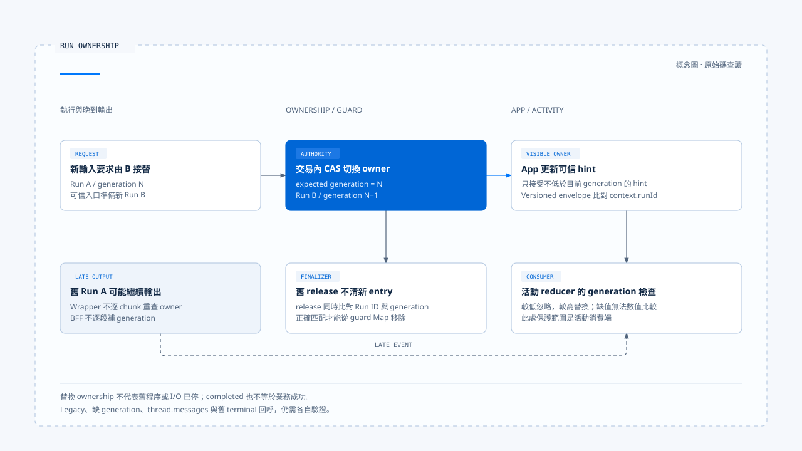

# Run 歸屬與可見狀態

[English](./02-run-ownership-and-visible-state.md) | [繁體中文](./02-run-ownership-and-visible-state-zh-TW.md)

[回到導覽](./README-zh-TW.md) · 上一篇：[執行中新輸入與互動策略](./01-in-flight-input-policy-zh-TW.md) · 下一篇：[釐清提問與任務恢復](./03-clarification-and-resume-zh-TW.md)

使用者已開始新的查詢，上一個 Run 才回傳結果。舊結果可以保留為歷史，卻不應重新取得目前畫面的控制權。這個問題同時涉及資料庫中的活動歸屬、程序內保留狀態與前端事件消費，單一識別碼不足以包辦全部責任。

本篇依[固定版本與證據範圍](./README-zh-TW.md#來源與查證狀態)，追蹤 Chat Gun 的 ownership、Query Guard 與活動顯示，並對照第三方 CCB。以下是原始碼與測試案例的查讀，未執行跨服務或資料庫競態驗證。

## 1. 哪個狀態由誰持有

| 識別或狀態 | 此處用途 | 不能直接替代的事 |
|---|---|---|
| Thread／Scope | 定位活動 ownership 的範圍。 | 任意外部資源的逐筆授權。 |
| Task | 業務工作與等待的關聯。 | Native Run 的實際執行狀態。 |
| Run | 一次執行的識別。 | 使用者整項任務必然已完成。 |
| Generation | 區分這個範圍的新舊權威執行。 | 全球唯一事件順序或外部提交真相。 |
| UI lifecycle | 目前串流與活動顯示狀態。 | 工具效果已成功或已還原。 |

[Runtime boundary 文件][g-boundary] 另把 native Run／Thread API、業務 Task／Step 與 effect Ledger 分開。文件中的 dev 觀察有自己的環境範圍，不能改寫成正式部署的所有狀態都已驗證一致。

## 2. 資料庫中的活動歸屬

### Claim 與 supersede

[`PgActiveRunOwnershipRepository`][g-ownership] 以 Thread／Scope 查找 active ownership。Claim 會根據該範圍既有 generation 建立下一筆；衝突時不直接取得第二個活動位置。

Supersede 則在 transaction 中，先以預期 generation 及 active 狀態更新舊列，再建立新 Run 的 ownership。若條件更新沒有取得舊列，就回報 CAS 衝突，不繼續假設自己已成功替換。

這裡取得的是業務上的權威歸屬。舊 Run 在其他程序裡是否已停止、外部 I/O 是否完成，仍有各自 consumer 與取消條件。

### Terminal 更新的範圍

`markTerminal()` 以 Thread、Scope、Run 及 active 狀態更新。舊 Run 收尾不能只靠相同 Thread，就把另一個 Run 的 active ownership 關掉。

[Repository 測試][g-ownership-test] 定義 generation 遞增與競態 CAS 的安排；查詢及 transaction 是測試環境的替身，不等同正式 PostgreSQL 多連線壓測。

## 3. Query Guard 保護哪個非同步空窗

[`GenerationQueryGuard`][g-guard] 在程序內保留 `dispatching`／`running` 狀態，reserve 同時查持久化 ownership。它不是另建一個 worker queue，而是避免準備輸入期間又盲目取得第二次派送。

若已有 pending reservation，第二個呼叫先等待該保留完成，再依 durable owner 決定後續處置。不能只看本機 Map 暫時有沒有資料，就推論整個服務群沒有活動 Run。

### 舊 finalizer 不能釋放新保留

`release(scope, generation)` 同時核對 runId 與 generation。只有仍匹配的項目才從 Map 移除，舊 Run 的 finally 不應清除新 Run 的保留。

[Query Guard 測試][g-guard-test] 分開覆蓋 dispatch gap、durable owner 衝突與 stale finalizer。這些案例說明應核對的條件，沒有證明所有跨程序競態都已消失。

## 4. 從 backend 事件到前端活動

### Wrapper 先發送關聯事件

[互動 wrapper][g-runtime] 在開始 governed stream 後先 yield 互動事件，再轉送底層 chunks。它沒有在每一個 chunk 上重新查一次 ownership，因此仍需要消費端判斷可見歸屬。

[BFF][g-bff] 驗證並轉送 active-run hint，透過 response body pipe 傳遞上游串流。這條代理路徑沒有替每段內容自動補上 generation，也不能代替模型訊息的歸屬檢查。

### App 與 reducer 的兩道檢查

[事件 parser][g-parser] 從互動事件提取 generation 與 Run hint。[App][g-app] 只用不低於目前 generation 的新 hint 更新參照；對 versioned Runtime envelope，還會檢查 `context.runId` 是否匹配當前權威提示，再交給事件 buffer。

活動事件進入 `streamActivityReducer` 時，App 會帶入可提取的 generation。[Reducer][g-ui] 對已知且較低 generation 的活動不更新畫面，較高 generation 則替換 live activity。

這些檢查有明確邊界：

- Versioned envelope 的 Run 檢查，不等於所有 legacy 事件都具有相同識別。
- Generation 缺少時，不能靠比較數值自然排除舊內容。
- `thread.messages` 的文字顯示由串流 hook 管理，不能將活動時間軸的過濾直接延伸成全部文字已被保護。

[開啟 HTML 圖解](../../assets/agent-harness/interaction-and-feedback/02-run-ownership-and-visible-state/02-run-generation-and-stale-output.html)

## 5. 終止與活動封存

[`streamActivityReducer`][g-ui] 對 finished、error、cancelled 等終止狀態保留冪等收斂，晚到進度不會把它自然改回 running。活動可依 assistant message ID 封存；重新送出則重設 live state，保留或清除歷史由 action 決定。

[`taskEventReducer`][g-reducer] 另對已終止 Task 忽略晚到事件。這是 Task 狀態的規則，與活動 reducer 分屬不同 consumer。

App 的 finish／error 回呼及活動 terminal action 沒有逐一攜帶 generation。故本篇只描述已指出的檢查；若要保證舊終止回呼絕不影響新串流，還需核對 hook 隔離與每次訂閱的生命週期。

### Completed 不一定是業務成功

互動 wrapper 對部分非取消例外，會以 ownership `completed` 做收尾，同時將 idempotency 記為 failed。這個 completed 表達該 ownership 不再活動，不能單看它就向使用者宣稱模型、工具或整個 Task 成功。

## 6. CCB 的程序內 generation

CCB 的 [`QueryGuard`][c-guard] 同樣區分 idle、dispatching、running。`tryStart()` 遞增 generation，`end(generation)` 只允許目前世代清理；`forceEnd()` 再遞增 generation，使先前 Promise 的晚到 finally 失效。

這個 guard 服務於程序內 query 生命週期。它沒有因此取得 Chat Gun 的資料庫 scope CAS，也不保證外部副作用已停止。

## 7. 如何驗證「沒有被舊輸出覆蓋」

[App 測試][g-app-test] 有一個明確案例：先告知新的 replacement Run，再送入舊 Run 的 versioned event，核對 live activity 沒有出現舊活動。[活動 reducer 測試][g-ui-test] 則檢查低 generation、終止後進度與封存。

若要把這些案例擴成一次跨服務驗收，需要另外保存：

1. 新舊 Run 的 ownership、generation 與實際事件封套。
2. BFF 傳入及轉出的 metadata，而非只看畫面上的 Run 名稱。
3. 活動與文字各自的 consumer，以及缺少 generation 的處置。
4. 舊 finalizer、舊 finish 回呼與目前串流的收斂結果。

下一篇將其中一種等待拆開：使用者的釐清回答，究竟如何對回原 Task，又如何與新的 Run 關聯。

[g-boundary]: https://github.com/HsienW/chat-gun/blob/92a5673003e4ac4ec09be8b1b350f42dbf4a5e69/docs/decisions/current-langgraph-runtime-boundary.md
[g-ownership]: https://github.com/HsienW/chat-gun/blob/92a5673003e4ac4ec09be8b1b350f42dbf4a5e69/backend/src/runtime/interaction/ownership.ts
[g-ownership-test]: https://github.com/HsienW/chat-gun/blob/92a5673003e4ac4ec09be8b1b350f42dbf4a5e69/backend/src/runtime/interaction/ownership.test.ts
[g-guard]: https://github.com/HsienW/chat-gun/blob/92a5673003e4ac4ec09be8b1b350f42dbf4a5e69/backend/src/runtime/input/query-guard.ts
[g-guard-test]: https://github.com/HsienW/chat-gun/blob/92a5673003e4ac4ec09be8b1b350f42dbf4a5e69/backend/src/runtime/input/query-guard.test.ts
[g-runtime]: https://github.com/HsienW/chat-gun/blob/92a5673003e4ac4ec09be8b1b350f42dbf4a5e69/backend/src/platform/interaction-runtime.ts
[g-bff]: https://github.com/HsienW/chat-gun/blob/92a5673003e4ac4ec09be8b1b350f42dbf4a5e69/bff/src/server.ts
[g-parser]: https://github.com/HsienW/chat-gun/blob/92a5673003e4ac4ec09be8b1b350f42dbf4a5e69/frontend/src/lib/agent-runtime-events.ts
[g-app]: https://github.com/HsienW/chat-gun/blob/92a5673003e4ac4ec09be8b1b350f42dbf4a5e69/frontend/src/App.tsx
[g-ui]: https://github.com/HsienW/chat-gun/blob/92a5673003e4ac4ec09be8b1b350f42dbf4a5e69/frontend/src/lib/stream-activity-state.ts
[g-reducer]: https://github.com/HsienW/chat-gun/blob/92a5673003e4ac4ec09be8b1b350f42dbf4a5e69/frontend/src/lib/task-event-reducer.ts
[c-guard]: https://github.com/claude-code-best/claude-code/blob/77a7934e15d69da13879112ed7db695c9ee7a52a/src/utils/QueryGuard.ts
[g-app-test]: https://github.com/HsienW/chat-gun/blob/92a5673003e4ac4ec09be8b1b350f42dbf4a5e69/frontend/src/App.stream-activity.test.tsx
[g-ui-test]: https://github.com/HsienW/chat-gun/blob/92a5673003e4ac4ec09be8b1b350f42dbf4a5e69/frontend/src/lib/stream-activity-state.test.ts
