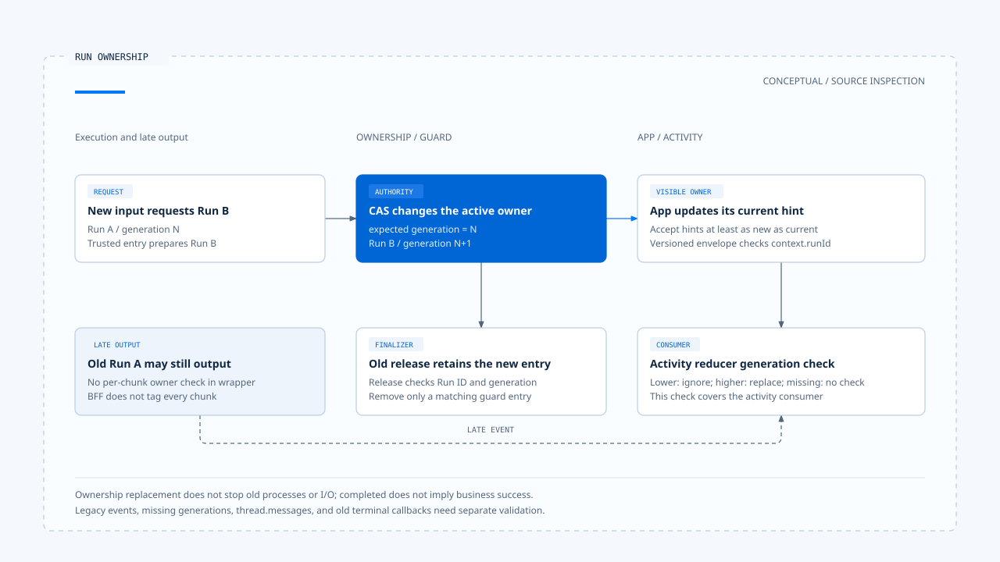

# Run ownership and visible state

[English](./02-run-ownership-and-visible-state.md) | [繁體中文](./02-run-ownership-and-visible-state-zh-TW.md)

[Back to overview](./README.md) · Previous: [In-flight input and interaction policy](./01-in-flight-input-policy.md) · Next: [Clarification and task resumption](./03-clarification-and-resume.md)

A user has started a new query when the previous Run finally returns. Its result can remain in history, but should not regain control of the current view. This involves active ownership in the database, in-process reservations, and frontend event consumption; a single identifier cannot cover all those responsibilities.

Using the [pinned versions and evidence scope](./README.md#sources-and-verification-status), this article traces Chat Gun's ownership, Query Guard, and activity display, with a comparison to the third-party CCB. The following is an inspection of source and test cases; no cross-service or database concurrency validation was performed.

## 1. Who holds each state?

| Identity or state | Purpose here | What it cannot directly replace |
|---|---|---|
| Thread / Scope | Locate the scope of active ownership. | Authorization for each arbitrary external resource. |
| Task | Correlate business work and waits. | The actual execution state of a native Run. |
| Run | Identify one execution. | Proof that the user's entire task has completed. |
| Generation | Distinguish older and newer authoritative executions within this scope. | A globally unique event order or the truth of an external commit. |
| UI lifecycle | Track the current stream and activity display state. | Proof that tool effects succeeded or were reversed. |

The [runtime boundary document][g-boundary] also separates native Run / Thread APIs, business Task / Step, and the effect Ledger. Its development observations have their own environment scope; they do not establish verified consistency across all production states.

## 2. Active ownership in the database

### Claim and supersede

[`PgActiveRunOwnershipRepository`][g-ownership] looks up active ownership by Thread / Scope. Claim creates the next record from the scope's existing generation; a conflict does not grant a second active position.

Within a transaction, supersede first updates the old row using the expected generation and active status, then creates ownership for the new Run. If the conditional update does not acquire the old row, it reports a CAS conflict rather than assuming replacement succeeded.

This grants authoritative business ownership. Whether the old Run has stopped in another process, or external I/O has finished, depends on the relevant consumers and cancellation conditions.

### Scope of terminal updates

`markTerminal()` updates by Thread, Scope, Run, and active status. Cleanup for an old Run cannot close another Run's active ownership merely because they share a Thread.

[Repository tests][g-ownership-test] define arrangements for generation increments and competing CAS operations. Their queries and transactions use test doubles; these are not production PostgreSQL load tests with multiple connections.

## 3. Which asynchronous gap does Query Guard protect?

[`GenerationQueryGuard`][g-guard] retains `dispatching` / `running` state within the process and checks durable ownership during reservation. It prevents blindly acquiring a second dispatch during input preparation, rather than creating another worker queue.

If a pending reservation exists, the second call first waits for it to complete, then decides what to do based on the durable owner. An empty local Map at a given moment does not establish that the entire service cluster has no active Run.

### An old finalizer cannot release a new reservation

`release(scope, generation)` checks both runId and generation. It removes only entries that still match, so an old Run's finally should not clear the new Run's reservation.

[Query Guard tests][g-guard-test] separately cover the dispatch gap, durable owner conflicts, and stale finalizers. They identify conditions to check without proving that all races across processes have disappeared.

## 4. From backend events to frontend activity

### The wrapper emits correlation events first

After starting a governed stream, the [interaction wrapper][g-runtime] yields interaction events before forwarding underlying chunks. It does not recheck ownership on every chunk, so consumers still need to determine visible ownership.

The [BFF][g-bff] validates and forwards the active-run hint, piping the upstream stream through the response body. This proxy path does not automatically add a generation to every piece of content or replace ownership checks for model messages.

### Two checks in App and the reducer

The [event parser][g-parser] extracts generation and Run hints from interaction events. [App][g-app] updates its reference only with hints whose generation is at least the current one. For versioned Runtime envelopes, it also checks whether `context.runId` matches the current authoritative hint before passing them to the event buffer.

When activity events enter `streamActivityReducer`, App includes any generation it can extract. The [reducer][g-ui] does not update the view for activity with a known lower generation; a higher generation replaces live activity.

These checks have specific boundaries:

- Run checks on versioned envelopes do not give all legacy events the same identity information.
- Without a generation, numeric comparison cannot exclude old content.
- The stream hook manages text display from `thread.messages`; activity timeline filtering does not establish protection for all text.

[Open the HTML diagram](../../assets/agent-harness/interaction-and-feedback/02-run-ownership-and-visible-state/02-run-generation-and-stale-output-en.html)

## 5. Termination and activity archiving

[`streamActivityReducer`][g-ui] converges idempotently on terminal states such as finished, error, and cancelled. Late progress does not simply turn them back into running. Activity can be archived by assistant message ID; resubmission resets live state, while the action determines whether history remains or is cleared.

[`taskEventReducer`][g-reducer] separately ignores late events for terminated Tasks. This Task state rule belongs to a different consumer from the activity reducer.

App's finish / error callbacks and activity terminal actions do not each carry a generation. This article therefore describes only the identified checks. Guaranteeing that old terminal callbacks cannot affect a new stream also requires checking hook isolation and each subscription's lifecycle.

### Completed does not necessarily mean business success

For some exceptions other than cancellation, the interaction wrapper closes ownership as `completed` while marking idempotency as failed. Here, completed means the ownership is no longer active; it does not by itself establish success for the model, tools, or entire Task.

## 6. CCB's in-process generation

CCB's [`QueryGuard`][c-guard] also distinguishes idle, dispatching, and running. `tryStart()` increments generation, and `end(generation)` permits cleanup only for the current generation. `forceEnd()` increments generation again, invalidating late finally callbacks from earlier Promises.

This guard serves the in-process query lifecycle. It does not acquire Chat Gun's database scope CAS or guarantee that external side effects have stopped.

## 7. How to verify that old output did not overwrite new state

An [App test][g-app-test] defines a concrete case: announce a new replacement Run, send a versioned event from the old Run, then check that live activity contains none of the old activity. [Activity reducer tests][g-ui-test] check lower generations, progress after termination, and archiving.

Extending these cases into acceptance across services requires retaining:

1. Ownership, generation, and actual event envelopes for the old and new Runs.
2. Metadata entering and leaving the BFF, beyond the Run name displayed in the UI.
3. Separate consumers for activity and text, including handling of missing generations.
4. Convergence results for old finalizers, old finish callbacks, and the current stream.

The next article examines one kind of wait: how a user's clarification answer maps back to the original Task and relates to a new Run.

[g-boundary]: https://github.com/HsienW/chat-gun/blob/92a5673003e4ac4ec09be8b1b350f42dbf4a5e69/docs/decisions/current-langgraph-runtime-boundary.md
[g-ownership]: https://github.com/HsienW/chat-gun/blob/92a5673003e4ac4ec09be8b1b350f42dbf4a5e69/backend/src/runtime/interaction/ownership.ts
[g-ownership-test]: https://github.com/HsienW/chat-gun/blob/92a5673003e4ac4ec09be8b1b350f42dbf4a5e69/backend/src/runtime/interaction/ownership.test.ts
[g-guard]: https://github.com/HsienW/chat-gun/blob/92a5673003e4ac4ec09be8b1b350f42dbf4a5e69/backend/src/runtime/input/query-guard.ts
[g-guard-test]: https://github.com/HsienW/chat-gun/blob/92a5673003e4ac4ec09be8b1b350f42dbf4a5e69/backend/src/runtime/input/query-guard.test.ts
[g-runtime]: https://github.com/HsienW/chat-gun/blob/92a5673003e4ac4ec09be8b1b350f42dbf4a5e69/backend/src/platform/interaction-runtime.ts
[g-bff]: https://github.com/HsienW/chat-gun/blob/92a5673003e4ac4ec09be8b1b350f42dbf4a5e69/bff/src/server.ts
[g-parser]: https://github.com/HsienW/chat-gun/blob/92a5673003e4ac4ec09be8b1b350f42dbf4a5e69/frontend/src/lib/agent-runtime-events.ts
[g-app]: https://github.com/HsienW/chat-gun/blob/92a5673003e4ac4ec09be8b1b350f42dbf4a5e69/frontend/src/App.tsx
[g-ui]: https://github.com/HsienW/chat-gun/blob/92a5673003e4ac4ec09be8b1b350f42dbf4a5e69/frontend/src/lib/stream-activity-state.ts
[g-reducer]: https://github.com/HsienW/chat-gun/blob/92a5673003e4ac4ec09be8b1b350f42dbf4a5e69/frontend/src/lib/task-event-reducer.ts
[c-guard]: https://github.com/claude-code-best/claude-code/blob/77a7934e15d69da13879112ed7db695c9ee7a52a/src/utils/QueryGuard.ts
[g-app-test]: https://github.com/HsienW/chat-gun/blob/92a5673003e4ac4ec09be8b1b350f42dbf4a5e69/frontend/src/App.stream-activity.test.tsx
[g-ui-test]: https://github.com/HsienW/chat-gun/blob/92a5673003e4ac4ec09be8b1b350f42dbf4a5e69/frontend/src/lib/stream-activity-state.test.ts
