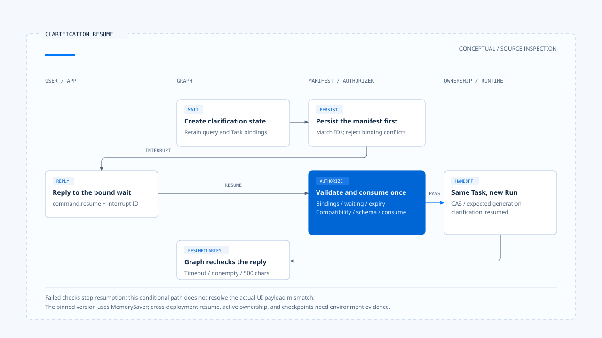
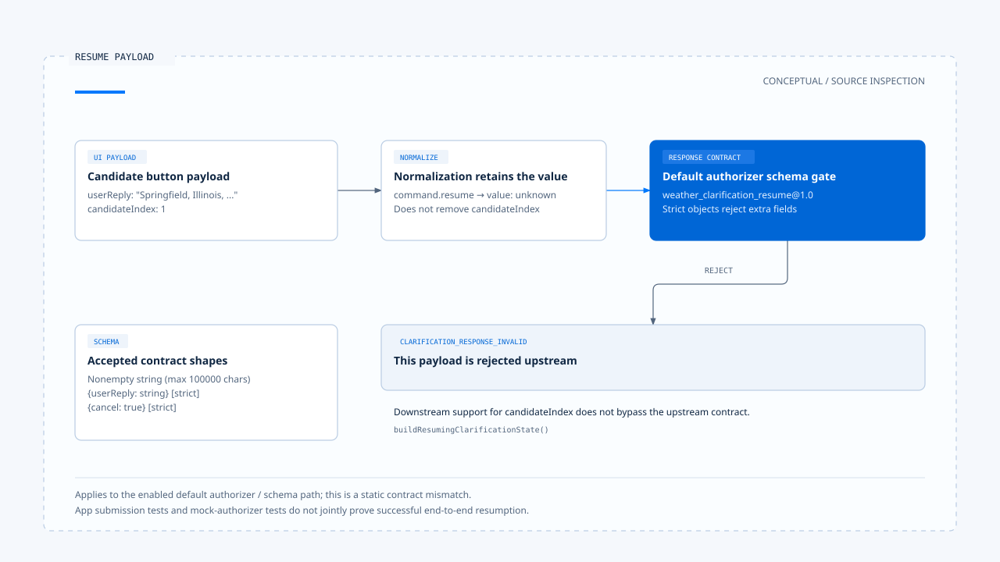

# 厘清提问与任务恢复

[English](./03-clarification-and-resume.md) | [繁體中文](./03-clarification-and-resume-zh-TW.md) | [简体中文](./03-clarification-and-resume-zh-CN.md)

[回到导览](./README-zh-CN.md) · 上一篇：[Run 归属与可见状态](./02-run-ownership-and-visible-state-zh-CN.md) · 下一篇：[取消、修正与已生效操作](./04-cancellation-and-correction-zh-CN.md)

查天气时只提供「Springfield」，服务可能找到多个地点。用户选完其中一个，系统要把答案交回原本的等待，并保留原查询的时间与能力条件。若只是把城市名称当作新的普通 prompt，后续回答未必还在处理同一件事。

本篇依[固定版本与证据范围](./README-zh-CN.md#来源与查证状态)，从 Chat Gun 的天气厘清走到 manifest、前端回复与恢复检查。已查读源代码及测试，未实际调用天气服务或验证跨部署恢复。

## 1. 先区分三种等待

| 等待种类 | 用户需要补充什么 | 主要契约 |
|---|---|---|
| 任务厘清 | 地点、条件或缺少的任务数据。 | 指定 interrupt、回答 Schema 与 Task 关联。 |
| 输入分类确认 | 新输入是改意还是独立任务。 | Tentative classification 与确认结果。 |
| 工具批准 | 是否同意一项已提出的操作。 | Action Governance 的 approval 与 decision 绑定。 |

三者都可能要求用户回应，但同一句「同意」不能在这些入口间任意流用。工具批准已在[前区](../action-governance/03-human-confirmation-zh-CN.md)展开，这里只处理任务信息的厘清。

## 2. Deep Researcher 如何建立厘清等待

### 从候选地点形成状态

[Deep Researcher][g-deep] 在 weather execution 回报需要厘清，且有至少两个候选时，建立 `WeatherClarificationState`。其中保留原地点查询、weather capability、time range、候选、回合与时间条件。

状态也带入 Thread、Run、Task，以及可用时的 Scope／Step。`createClarificationInterruptId()` 使用指定关联与回合形成识别，避免只凭显示问题的文字寻找等待。

### 保存 manifest 之后才 interrupt

`clarifyInterrupt()` 建立显示 payload 与 durable manifest，核对两者 interrupt ID 一致，先保存 manifest，再调用 `interrupt()`。缺少必要 Scope 关联时会失败，不把缺少的绑定当成可忽略数据。

[`persistClarificationInterruptManifest()`][g-manifest] 允许相同识别与相同绑定重入；已存在但绑定不同时则抛出冲突。这处理节点重新进入时的保存问题，不等于重新批准任何一份回复。

## 3. 前端如何回复指定等待

[App][g-app] 读取 interrupt ID 并显示候选。厘清画面存在时，一般提交会被阻挡，专用入口改以 `command.resume` 与 `inputKind: clarification_resume` 送出回答。

[`readNormalizedAgentInput()`][g-reader] 从 request 或 command 取出 resume 值，连同 interrupt ID 形成规范化输入。这里的 [`value` 是 unknown][g-normalized]，之后仍须由该等待的 response Schema 决定是否有效。

对默认 authorizer 而言，一个回答对象可以是：

```json
{
  "userReply": "Springfield, Illinois, United States"
}
```

这只是 response Schema 可接受的数据形状，不代表整个 resume 已获准；manifest、身份关联、期限与执行兼容性仍在后面。

## 4. 回答进入恢复前的检查

[`createClarificationResumeAuthorizer()`][g-resume] 依序核对：

1. Interrupt manifest 存在，种类是 clarification。
2. Thread、Scope、Run、Task 与活动 ownership 相符。
3. Manifest 仍是 waiting，且尚未到期。
4. Current execution manifest 存在，与等待时的 manifest 兼容。
5. 回答符合已注册的 response Schema。
6. Repository 的单次 consume 成功。

每一层都有自己的拒绝原因。例如过期会转移 manifest 状态后返回；consume 失败则保留 `CLARIFICATION_RESUME_CONSUME_REJECTED`，不应直接交回 Graph。

### 同 Task 不一定同 Run

Policy 选择 `resume_same_task` 且 authorizer 通过后，[orchestrator][g-runtime] 使用等待中的 Task ID，搭配此次请求的 Run ID，对 ownership 执行条件式 supersede。新的 generation 将与 `clarification_resumed` 事件一起交给后续消费端。

因此，同一项工作可以延续，同时使用新 Run。不能把「同任务恢复」简写成所有执行识别都保持不变。

Production resolver 在所读组装中只提供 Deep Researcher 的 current execution manifest。要推广到其他 Graph，需要其自己的 manifest 与兼容性接线。



[开启 HTML 图解](../../assets/agent-harness/interaction-and-feedback/03-clarification-and-resume/03-clarification-resume-swimlane-en.html)

## 5. 固定版本有一个回答契约差异

### 候选按钮送出的字段

[App 测试][g-app-test] 检查候选选择送出以下形状：

```json
{
  "userReply": "Springfield, Illinois, United States",
  "candidateIndex": 1
}
```

Deep Researcher 的 `buildResumingClarificationState()` 也认得 candidateIndex，并核对对应候选的 display name，之后才建立直接选取的 resolution。

### 默认 response Schema 不接受该附加字段

但默认 [Schema Registry][g-schema] 的 `weather_clarification_resume@1.0` 只接受：

- 非空字符串。
- 严格的 `{ userReply: string }` 对象。
- 严格的 `{ cancel: true }` 对象。

由于对象是 strict，带 `candidateIndex` 的 payload 不符合这份默认 Schema；normalized reader 也没有先将该字段移除。沿上述配置启用 authorizer 时，这会成为 `CLARIFICATION_RESPONSE_INVALID` 的静态契约缺口。

这个结论限于读到的接口组合，不是本轮执行出的错误报告。App 测试验证送出数据，wrapper 测试则使用返回成功的 mock authorizer，两者都不足以证明候选按钮已通过真实 Schema 与完整恢复。

若要修正，需让 UI payload、Schema 与 Graph consumer 共同采用一份契约，再补整合测试；本文不直接修改来源代码库。



[开启 HTML 图解](../../assets/agent-harness/interaction-and-feedback/03-clarification-and-resume/03-resume-payload-contract-en.html)

## 6. 回到 Graph 仍有自己的条件

`interrupt()` 返回后，Deep Researcher 建立 resuming clarification state，转往 `resumeClarify()`。这个节点还会检查 timeout、非空回答与 500 字符上限，再解析候选选择、筛选、改地点或取消。

Schema 允许的文字长度与节点采用的长度上限也不同。通过外层 Schema，不代表语义解析与工具执行一定成功。

若选择成功，Graph 更新 weather plan 并重新进入相应工具流程；若仍然模糊，会依回合条件再次提问或返回错误结果。这是信息补全，不是授予新的资源权限。

## 7. 哪些恢复保证还需要环境证据

Deep Researcher 在固定版本明确以 `MemorySaver` 编译，再包入 execution Context 与 interaction governance。这是源代码组装事实，不能由此推论正式服务器上的 checkpoint 一定写入 PostgreSQL。

[Boundary 文件][g-boundary] 记录过 dev 的正常停止、重启及 resume 观察，并保留正式 Server、强制 kill、manifest 与 checkpoint 联合持久化的未验证范围。本轮没有重跑这些流程。

另外，厘清等待是否仍有 active ownership，与 wrapper 在 stream／invoke 收尾时如何标记 terminal，需要结合实际 native 调用方式核对。单独 mock 一笔活动 ownership，不能替代等待跨请求后仍可被查到的证据。

下一篇将用户回应中的另一种要求拆开：想停止任务时，如何区分取消等待、替换 Run 与处理已生效操作。

[g-deep]: https://github.com/HsienW/chat-gun/blob/92a5673003e4ac4ec09be8b1b350f42dbf4a5e69/backend/src/agents/deep-researcher.ts
[g-manifest]: https://github.com/HsienW/chat-gun/blob/92a5673003e4ac4ec09be8b1b350f42dbf4a5e69/backend/src/runtime/recovery/clarification-manifest.ts
[g-app]: https://github.com/HsienW/chat-gun/blob/92a5673003e4ac4ec09be8b1b350f42dbf4a5e69/frontend/src/App.tsx
[g-reader]: https://github.com/HsienW/chat-gun/blob/92a5673003e4ac4ec09be8b1b350f42dbf4a5e69/backend/src/runtime/input/read-normalized-agent-input.ts
[g-normalized]: https://github.com/HsienW/chat-gun/blob/92a5673003e4ac4ec09be8b1b350f42dbf4a5e69/backend/src/runtime/input/normalized-agent-input.ts
[g-resume]: https://github.com/HsienW/chat-gun/blob/92a5673003e4ac4ec09be8b1b350f42dbf4a5e69/backend/src/runtime/recovery/clarification-resume-authorization.ts
[g-runtime]: https://github.com/HsienW/chat-gun/blob/92a5673003e4ac4ec09be8b1b350f42dbf4a5e69/backend/src/platform/interaction-runtime.ts
[g-app-test]: https://github.com/HsienW/chat-gun/blob/92a5673003e4ac4ec09be8b1b350f42dbf4a5e69/frontend/src/App.stream-activity.test.tsx
[g-schema]: https://github.com/HsienW/chat-gun/blob/92a5673003e4ac4ec09be8b1b350f42dbf4a5e69/backend/src/runtime/recovery/resume-response-schema-registry.ts
[g-boundary]: https://github.com/HsienW/chat-gun/blob/92a5673003e4ac4ec09be8b1b350f42dbf4a5e69/docs/decisions/current-langgraph-runtime-boundary.md
