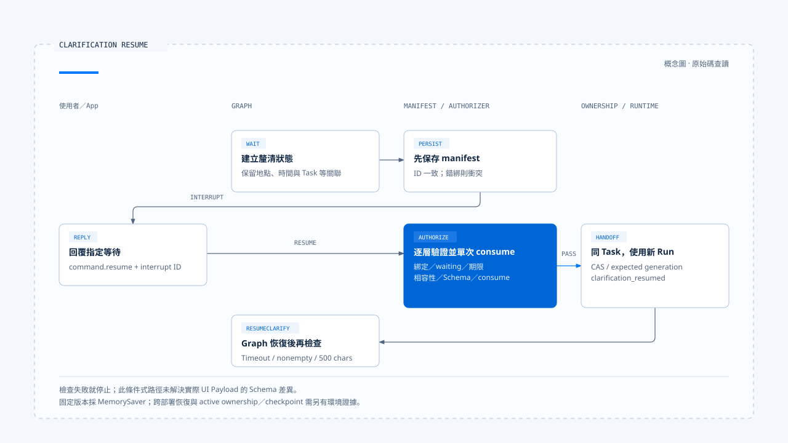
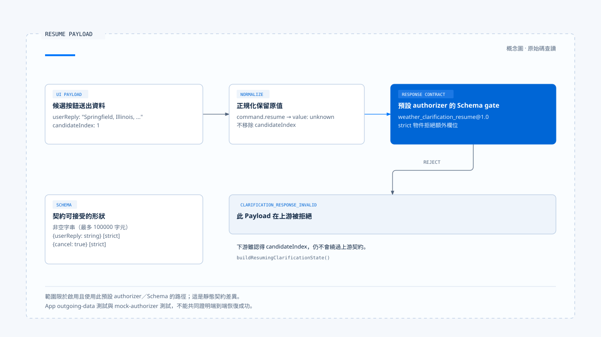

# 釐清提問與任務恢復

[English](./03-clarification-and-resume.md) | [繁體中文](./03-clarification-and-resume-zh-TW.md)

[回到導覽](./README-zh-TW.md) · 上一篇：[Run 歸屬與可見狀態](./02-run-ownership-and-visible-state-zh-TW.md) · 下一篇：[取消、修正與已生效操作](./04-cancellation-and-correction-zh-TW.md)

查天氣時只提供「Springfield」，服務可能找到多個地點。使用者選完其中一個，系統要把答案交回原本的等待，並保留原查詢的時間與能力條件。若只是把城市名稱當作新的普通 prompt，後續回答未必還在處理同一件事。

本篇依[固定版本與證據範圍](./README-zh-TW.md#來源與查證狀態)，從 Chat Gun 的天氣釐清走到 manifest、前端回覆與恢復檢查。已查讀原始碼及測試，未實際呼叫天氣服務或驗證跨部署恢復。

## 1. 先區分三種等待

| 等待種類 | 使用者需要補充什麼 | 主要契約 |
|---|---|---|
| 任務釐清 | 地點、條件或缺少的任務資料。 | 指定 interrupt、回答 Schema 與 Task 關聯。 |
| 輸入分類確認 | 新輸入是改意還是獨立任務。 | Tentative classification 與確認結果。 |
| 工具批准 | 是否同意一項已提出的操作。 | Action Governance 的 approval 與 decision 綁定。 |

三者都可能要求使用者回應，但同一句「同意」不能在這些入口間任意流用。工具批准已在[前區](../action-governance/03-human-confirmation-zh-TW.md)展開，這裡只處理任務資訊的釐清。

## 2. Deep Researcher 如何建立釐清等待

### 從候選地點形成狀態

[Deep Researcher][g-deep] 在 weather execution 回報需要釐清，且有至少兩個候選時，建立 `WeatherClarificationState`。其中保留原地點查詢、weather capability、time range、候選、回合與時間條件。

狀態也帶入 Thread、Run、Task，以及可用時的 Scope／Step。`createClarificationInterruptId()` 使用指定關聯與回合形成識別，避免只憑顯示問題的文字尋找等待。

### 保存 manifest 之後才 interrupt

`clarifyInterrupt()` 建立顯示 payload 與 durable manifest，核對兩者 interrupt ID 一致，先保存 manifest，再呼叫 `interrupt()`。缺少必要 Scope 關聯時會失敗，不把缺少的綁定當成可忽略資料。

[`persistClarificationInterruptManifest()`][g-manifest] 允許相同識別與相同綁定重入；已存在但綁定不同時則拋出衝突。這處理節點重新進入時的保存問題，不等於重新批准任何一份回覆。

## 3. 前端如何回覆指定等待

[App][g-app] 讀取 interrupt ID 並顯示候選。釐清畫面存在時，一般提交會被阻擋，專用入口改以 `command.resume` 與 `inputKind: clarification_resume` 送出回答。

[`readNormalizedAgentInput()`][g-reader] 從 request 或 command 取出 resume 值，連同 interrupt ID 形成正規化輸入。這裡的 [`value` 是 unknown][g-normalized]，之後仍須由該等待的 response Schema 決定是否有效。

對預設 authorizer 而言，一個回答物件可以是：

```json
{
  "userReply": "Springfield, Illinois, United States"
}
```

這只是 response Schema 可接受的資料形狀，不代表整個 resume 已獲准；manifest、身分關聯、期限與執行相容性仍在後面。

## 4. 回答進入恢復前的檢查

[`createClarificationResumeAuthorizer()`][g-resume] 依序核對：

1. Interrupt manifest 存在，種類是 clarification。
2. Thread、Scope、Run、Task 與活動 ownership 相符。
3. Manifest 仍是 waiting，且尚未到期。
4. Current execution manifest 存在，與等待時的 manifest 相容。
5. 回答符合已註冊的 response Schema。
6. Repository 的單次 consume 成功。

每一層都有自己的拒絕原因。例如過期會轉移 manifest 狀態後返回；consume 失敗則保留 `CLARIFICATION_RESUME_CONSUME_REJECTED`，不應直接交回 Graph。

### 同 Task 不一定同 Run

Policy 選擇 `resume_same_task` 且 authorizer 通過後，[orchestrator][g-runtime] 使用等待中的 Task ID，搭配此次請求的 Run ID，對 ownership 執行條件式 supersede。新的 generation 將與 `clarification_resumed` 事件一起交給後續消費端。

因此，同一項工作可以延續，同時使用新 Run。不能把「同任務恢復」簡寫成所有執行識別都保持不變。

Production resolver 在所讀組裝中只提供 Deep Researcher 的 current execution manifest。要推廣到其他 Graph，需要其自己的 manifest 與相容性接線。



[開啟 HTML 圖解](../../assets/agent-harness/interaction-and-feedback/03-clarification-and-resume/03-clarification-resume-swimlane.html)

## 5. 固定版本有一個回答契約差異

### 候選按鈕送出的欄位

[App 測試][g-app-test] 檢查候選選擇送出以下形狀：

```json
{
  "userReply": "Springfield, Illinois, United States",
  "candidateIndex": 1
}
```

Deep Researcher 的 `buildResumingClarificationState()` 也認得 candidateIndex，並核對對應候選的 display name，之後才建立直接選取的 resolution。

### 預設 response Schema 不接受該附加欄位

但預設 [Schema Registry][g-schema] 的 `weather_clarification_resume@1.0` 只接受：

- 非空字串。
- 嚴格的 `{ userReply: string }` 物件。
- 嚴格的 `{ cancel: true }` 物件。

由於物件是 strict，帶 `candidateIndex` 的 payload 不符合這份預設 Schema；normalized reader 也沒有先將該欄位移除。沿上述配置啟用 authorizer 時，這會成為 `CLARIFICATION_RESPONSE_INVALID` 的靜態契約缺口。

這個結論限於讀到的介面組合，不是本輪執行出的錯誤報告。App 測試驗證送出資料，wrapper 測試則使用回傳成功的 mock authorizer，兩者都不足以證明候選按鈕已通過真實 Schema 與完整恢復。

若要修正，需讓 UI payload、Schema 與 Graph consumer 共同採用一份契約，再補整合測試；本文不直接修改來源程式庫。



[開啟 HTML 圖解](../../assets/agent-harness/interaction-and-feedback/03-clarification-and-resume/03-resume-payload-contract.html)

## 6. 回到 Graph 仍有自己的條件

`interrupt()` 返回後，Deep Researcher 建立 resuming clarification state，轉往 `resumeClarify()`。這個節點還會檢查 timeout、非空回答與 500 字元上限，再解析候選選擇、篩選、改地點或取消。

Schema 允許的文字長度與節點採用的長度上限也不同。通過外層 Schema，不代表語意解析與工具執行一定成功。

若選擇成功，Graph 更新 weather plan 並重新進入相應工具流程；若仍然模糊，會依回合條件再次提問或返回錯誤結果。這是資訊補全，不是授予新的資源權限。

## 7. 哪些恢復保證還需要環境證據

Deep Researcher 在固定版本明確以 `MemorySaver` 編譯，再包入 execution Context 與 interaction governance。這是原始碼組裝事實，不能由此推論正式伺服器上的 checkpoint 一定寫入 PostgreSQL。

[Boundary 文件][g-boundary] 記錄過 dev 的正常停止、重啟及 resume 觀察，並保留正式 Server、強制 kill、manifest 與 checkpoint 聯合持久化的未驗證範圍。本輪沒有重跑這些流程。

另外，釐清等待是否仍有 active ownership，與 wrapper 在 stream／invoke 收尾時如何標記 terminal，需要結合實際 native 呼叫方式核對。單獨 mock 一筆活動 ownership，不能替代等待跨請求後仍可被查到的證據。

下一篇將使用者回應中的另一種要求拆開：想停止任務時，如何區分取消等待、替換 Run 與處理已生效操作。

[g-deep]: https://github.com/HsienW/chat-gun/blob/92a5673003e4ac4ec09be8b1b350f42dbf4a5e69/backend/src/agents/deep-researcher.ts
[g-manifest]: https://github.com/HsienW/chat-gun/blob/92a5673003e4ac4ec09be8b1b350f42dbf4a5e69/backend/src/runtime/recovery/clarification-manifest.ts
[g-app]: https://github.com/HsienW/chat-gun/blob/92a5673003e4ac4ec09be8b1b350f42dbf4a5e69/frontend/src/App.tsx
[g-reader]: https://github.com/HsienW/chat-gun/blob/92a5673003e4ac4ec09be8b1b350f42dbf4a5e69/backend/src/runtime/input/read-normalized-agent-input.ts
[g-normalized]: https://github.com/HsienW/chat-gun/blob/92a5673003e4ac4ec09be8b1b350f42dbf4a5e69/backend/src/runtime/input/normalized-agent-input.ts
[g-resume]: https://github.com/HsienW/chat-gun/blob/92a5673003e4ac4ec09be8b1b350f42dbf4a5e69/backend/src/runtime/recovery/clarification-resume-authorization.ts
[g-runtime]: https://github.com/HsienW/chat-gun/blob/92a5673003e4ac4ec09be8b1b350f42dbf4a5e69/backend/src/platform/interaction-runtime.ts
[g-app-test]: https://github.com/HsienW/chat-gun/blob/92a5673003e4ac4ec09be8b1b350f42dbf4a5e69/frontend/src/App.stream-activity.test.tsx
[g-schema]: https://github.com/HsienW/chat-gun/blob/92a5673003e4ac4ec09be8b1b350f42dbf4a5e69/backend/src/runtime/recovery/resume-response-schema-registry.ts
[g-boundary]: https://github.com/HsienW/chat-gun/blob/92a5673003e4ac4ec09be8b1b350f42dbf4a5e69/docs/decisions/current-langgraph-runtime-boundary.md
