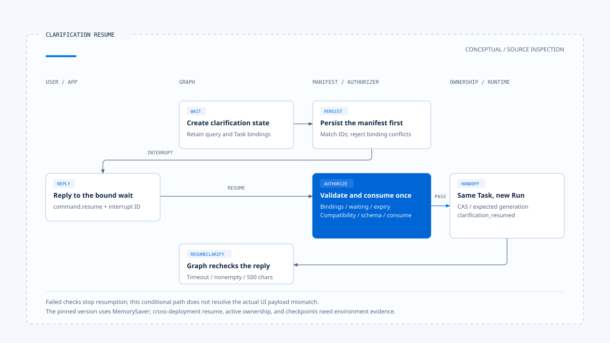
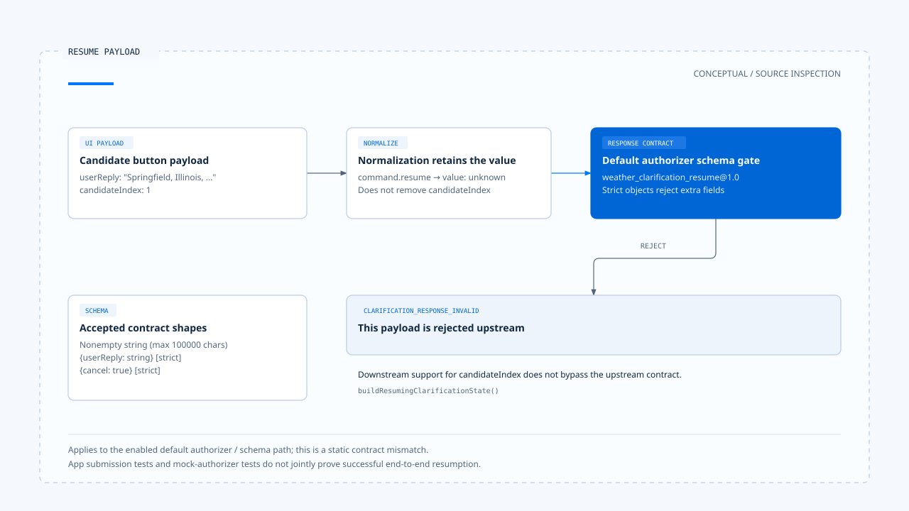

# Clarification and task resumption

[English](./03-clarification-and-resume.md) | [繁體中文](./03-clarification-and-resume-zh-TW.md)

[Back to overview](./README.md) · Previous: [Run ownership and visible state](./02-run-ownership-and-visible-state.md) · Next: [Cancellation, correction, and committed effects](./04-cancellation-and-correction.md)

A weather query containing only "Springfield" may match several places. After the user chooses one, the system needs to return the answer to the original wait while preserving the query's time and capability conditions. Treating the city name as a new ordinary prompt may lead to an answer about different work.

Using the [pinned versions and evidence scope](./README.md#sources-and-verification-status), this article follows Chat Gun's weather clarification through manifests, frontend replies, and resumption checks. Source and tests were inspected; no actual weather service calls or resumption across deployments were verified.

## 1. Distinguish three kinds of wait

| Kind of wait | What the user must supply | Main contract |
|---|---|---|
| Task clarification | A location, conditions, or missing task data. | A specific interrupt, response Schema, and Task correlation. |
| Input classification confirmation | Whether new input revises intent or starts an independent task. | Tentative classification and its confirmation result. |
| Tool approval | Consent to a proposed operation. | Action Governance approval and decision bindings. |

All three may ask the user to respond, but the same "agree" cannot be reused across these entry points. The [previous section](../action-governance/03-human-confirmation.md) covers tool approval; this article handles clarification of task information.

## 2. How Deep Researcher creates a clarification wait

### Form state from candidate locations

[Deep Researcher][g-deep] creates `WeatherClarificationState` when weather execution reports that clarification is needed and there are at least two candidates. The state preserves the original location query, weather capability, time range, candidates, round, and timing conditions.

It also carries Thread, Run, Task, and, when available, Scope / Step. `createClarificationInterruptId()` derives the identity from the specified correlations and round, avoiding lookup based solely on the displayed question text.

### Persist the manifest before interrupting

`clarifyInterrupt()` creates the display payload and durable manifest, checks that their interrupt IDs match, persists the manifest, then calls `interrupt()`. Missing required Scope correlation causes failure; the missing binding is not treated as optional data.

[`persistClarificationInterruptManifest()`][g-manifest] permits reentry with the same identity and bindings, but throws a conflict if an existing record has different bindings. This handles persistence on node reentry without reauthorizing a reply.

## 3. How the frontend replies to a specific wait

[App][g-app] reads the interrupt ID and displays candidates. While the clarification UI is present, it blocks ordinary submission; the dedicated entry point submits the answer through `command.resume` with `inputKind: clarification_resume`.

[`readNormalizedAgentInput()`][g-reader] extracts the resume value from the request or command and forms normalized input with the interrupt ID. Here, [`value` is unknown][g-normalized]; the wait's response Schema must still determine whether it is valid.

For the default authorizer, an answer object can be:

```json
{
  "userReply": "Springfield, Illinois, United States"
}
```

This is only a shape accepted by the response Schema. It does not authorize the entire resume; manifest, identity correlation, expiry, and execution compatibility checks still follow.

## 4. Checks before an answer can resume execution

[`createClarificationResumeAuthorizer()`][g-resume] checks these conditions in order:

1. The interrupt manifest exists and has kind clarification.
2. Thread, Scope, Run, and Task match active ownership.
3. The manifest is still waiting and has not expired.
4. A current execution manifest exists and is compatible with the manifest at the time of the wait.
5. The answer conforms to the registered response Schema.
6. The repository's single consume operation succeeds.

Each layer has its own rejection reason. For example, expiry changes the manifest state before returning; failed consumption retains `CLARIFICATION_RESUME_CONSUME_REJECTED` rather than passing the reply directly back to the Graph.

### The same Task need not use the same Run

When policy selects `resume_same_task` and the authorizer passes, the [orchestrator][g-runtime] conditionally supersedes ownership using the waiting Task ID and the current request's Run ID. The new generation reaches downstream consumers with the `clarification_resumed` event.

The same work can therefore continue under a new Run. "Resume the same task" does not mean that every execution identity remains unchanged.

In the inspected assembly, the production resolver supplies a current execution manifest only for Deep Researcher. Other Graphs need their own manifests and compatibility wiring.



[Open the HTML diagram](../../assets/agent-harness/interaction-and-feedback/03-clarification-and-resume/03-clarification-resume-swimlane-en.html)

## 5. An answer contract mismatch in the pinned version

### Fields sent by candidate buttons

[App tests][g-app-test] check that choosing a candidate submits this shape:

```json
{
  "userReply": "Springfield, Illinois, United States",
  "candidateIndex": 1
}
```

Deep Researcher's `buildResumingClarificationState()` also recognizes candidateIndex and checks the corresponding candidate's display name before creating a direct-selection resolution.

### The default response Schema rejects the extra field

However, `weather_clarification_resume@1.0` in the default [Schema Registry][g-schema] accepts only:

- A nonempty string.
- A strict `{ userReply: string }` object.
- A strict `{ cancel: true }` object.

Because these objects are strict, a payload containing `candidateIndex` does not conform to the default Schema; the normalized reader does not remove that field first. With the authorizer enabled in this configuration, this is a static contract gap resulting in `CLARIFICATION_RESPONSE_INVALID`.

This conclusion applies to the inspected interface combination, rather than an error reproduced during this work. App tests verify submitted data, while wrapper tests use a mock authorizer that returns success. Neither establishes that the candidate button passes the real Schema and completes resumption.

Fixing this requires a shared contract across the UI payload, Schema, and Graph consumer, followed by integration tests. This article does not modify the source repositories.



[Open the HTML diagram](../../assets/agent-harness/interaction-and-feedback/03-clarification-and-resume/03-resume-payload-contract-en.html)

## 6. Returning to the Graph has additional conditions

After `interrupt()` returns, Deep Researcher builds the resuming clarification state and transitions to `resumeClarify()`. That node also checks timeout, a nonempty reply, and a 500-character limit before parsing candidate selection, filters, a different location, or cancellation.

The Schema and node also impose different text length limits. Passing the outer Schema does not guarantee successful semantic parsing or tool execution.

If selection succeeds, the Graph updates the weather plan and reenters the relevant tool flow. If ambiguity remains, it asks again or returns an error according to round conditions. This fills in information without granting new resource permissions.

## 7. Which resumption guarantees still need environment evidence?

The pinned Deep Researcher explicitly compiles with `MemorySaver`, then wraps execution Context and interaction governance around the Graph. This source assembly fact does not establish that production server checkpoints are stored in PostgreSQL.

The [boundary document][g-boundary] records development observations of normal shutdown, restart, and resume. It retains unverified scope for the production Server, forced kill, and joint persistence of manifests and checkpoints. These procedures were not rerun during this work.

Whether a clarification wait still has active ownership, and how the wrapper marks terminal state during stream / invoke cleanup, also require checking the actual native invocation path. Mocking one active ownership record cannot replace evidence that the wait remains discoverable across requests.

The next article examines another user request: stopping a task, and the distinctions between cancelling a wait, replacing a Run, and handling effects that have already taken place.

[g-deep]: https://github.com/HsienW/chat-gun/blob/92a5673003e4ac4ec09be8b1b350f42dbf4a5e69/backend/src/agents/deep-researcher.ts
[g-manifest]: https://github.com/HsienW/chat-gun/blob/92a5673003e4ac4ec09be8b1b350f42dbf4a5e69/backend/src/runtime/recovery/clarification-manifest.ts
[g-app]: https://github.com/HsienW/chat-gun/blob/92a5673003e4ac4ec09be8b1b350f42dbf4a5e69/frontend/src/App.tsx
[g-reader]: https://github.com/HsienW/chat-gun/blob/92a5673003e4ac4ec09be8b1b350f42dbf4a5e69/backend/src/runtime/input/read-normalized-agent-input.ts
[g-normalized]: https://github.com/HsienW/chat-gun/blob/92a5673003e4ac4ec09be8b1b350f42dbf4a5e69/backend/src/runtime/input/normalized-agent-input.ts
[g-resume]: https://github.com/HsienW/chat-gun/blob/92a5673003e4ac4ec09be8b1b350f42dbf4a5e69/backend/src/runtime/recovery/clarification-resume-authorization.ts
[g-runtime]: https://github.com/HsienW/chat-gun/blob/92a5673003e4ac4ec09be8b1b350f42dbf4a5e69/backend/src/platform/interaction-runtime.ts
[g-app-test]: https://github.com/HsienW/chat-gun/blob/92a5673003e4ac4ec09be8b1b350f42dbf4a5e69/frontend/src/App.stream-activity.test.tsx
[g-schema]: https://github.com/HsienW/chat-gun/blob/92a5673003e4ac4ec09be8b1b350f42dbf4a5e69/backend/src/runtime/recovery/resume-response-schema-registry.ts
[g-boundary]: https://github.com/HsienW/chat-gun/blob/92a5673003e4ac4ec09be8b1b350f42dbf4a5e69/docs/decisions/current-langgraph-runtime-boundary.md
