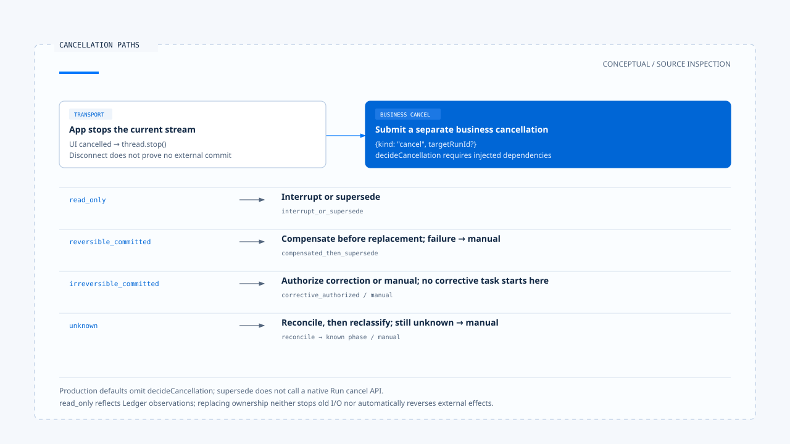

# 取消、修正与已生效操作

[English](./04-cancellation-and-correction.md) | [繁體中文](./04-cancellation-and-correction-zh-TW.md) | [简体中文](./04-cancellation-and-correction-zh-CN.md)

[回到导览](./README-zh-CN.md) · 上一篇：[厘清提问与任务恢复](./03-clarification-and-resume-zh-CN.md) · 下一篇：[反馈、评估与回归案例](./05-feedback-and-evaluation-zh-CN.md)

用户按下停止时，画面可以立即停止更新，远端服务却可能已接受操作。产品需要说明究竟停止了哪一层：不再等待回应、要求原 Run 结束，还是已确认没有外部提交。若原本的效果已存在，后续修正也需要自己的权限与结果。

本篇依[固定版本与证据范围](./README-zh-CN.md#来源与查证状态)，追踪 Chat Gun 的取消入口与决策 helper，并对照第三方 CCB 的 query abort。未执行真实外部提交、取消竞态或补偿演练。

## 1. 停止按钮其实发出哪些动作

[App 的 `handleCancel()`][g-app] 先清除厘清显示与等待参照，将活动设为 cancelled，再调用 `thread.stop()`。它也另外送出 `kind: cancel`，可附上目前 active-run hint 的 target Run，并带取消 input metadata。

因此，此固定版本已不只做 transport abort；它也尝试交付业务取消要求。但前端送出要求不等于后端已完成取消，更不代表外部效果已还原。

[BFF][g-bff] 将 client disconnect、upstream timeout 与 stream proxy 失败分成不同原因。连接中断是传输事实，不能单凭它宣称下游工作尚未提交。

## 2. 取消决策先看 Ledger 中的效果

[`deriveCancellationPhase()`][g-cancel] 依 Run 的执行纪录推导四类 phase：

| Phase | 此 helper 的依据 | 后续问题 |
|---|---|---|
| `read_only` | 没有 entries，或没有符合已提交条件的纪录，且没有 unknown 状态。 | 是否可以中断或替换？Ledger 覆盖是否完整？ |
| `reversible_committed` | 已提交效果皆被判定可逆。 | 是否有可用补偿动作，且补偿成功？ |
| `irreversible_committed` | 至少一项已提交效果不可逆。 | 能否获准做修正，或需人工处理？ |
| `unknown` | 仍 executing、未知效果，或执行与 effect 状态不一致。 | 先回查，再决定可以做什么。 |

Phase 描述已读纪录的判断，不是直接查遍外部世界。尤其空集合在这里会得到 read_only，若某个工具没有被 Ledger 覆盖，就不能用空集合证明它没有发生效果。

## 3. 决策 helper 如何选路径

### 已知状态

`decideCancellation()` 对 read_only 选择 `interrupt_or_supersede`。可逆已提交则调用注入的 compensate，成功才返回 `compensated_then_supersede`，失败转人工处理。

不可逆已提交时，helper 要求 `interaction.corrective` 授权。Allow 形成 `corrective_authorized`，其余结果保留决策 ID 并转 manual handling。它没有因用户按下停止，就跳过修正操作的授权。

### 未知状态

Unknown 先调用注入的 reconcile。若回查仍 unknown，返回人工处理；若得到已知 phase，再依该 phase 判断。这与[前区的重试条件](../action-governance/05-retry-and-side-effects-zh-CN.md)相接：未知提交不能直接当成未提交。

取消的不同路径需要 Ledger reader、可逆判断、补偿、回查与 corrective authorizer。只有函数类型存在，还没有完成这些部署依赖。

## 4. Policy 字段与 production 接线的差距

[InteractionPolicy][g-policy] 宣告 cancellation mode，但 [`createProductionInteractionOrchestrator()`][g-runtime] 在所读固定版本的默认组装没有提供 `decideCancellation`。它保留 override 注入位置，模块导出的 production orchestrator 则使用默认建构。

当流程真的走到 interrupt／supersede／rollback 等替换策略，缺少这个 callback 会抛出配置错误。这表示不能只设置策略名称，就宣称补偿、原 Run 停止与替换已自动串好。

同样地，policy 中的取消模式如何影响实际 dependency，需要沿 callback 的实现核对；不能将 enum 的每个值直接画成 production 已具备的分支。

## 5. Ownership 替换也不是外部效果恢复

Orchestrator 只让以下路径继续 supersede：

- `interrupt_or_supersede`。
- `compensated_then_supersede`。

其他 cancellation path 会记录 cancelled-after-commit 或 manual event，并以 `ACTIVE_RUN_REQUIRES_CORRECTIVE_OR_MANUAL_HANDLING` 停止替换。即使返回 `corrective_authorized`，这个函数也没有因此直接启动另一项修正任务。

Supersede 成功更新的是权威 ownership 与 generation。本段流程没有调用 native Run cancel API，也没有因为更新数据列就使所有旧 I/O 停止。要宣称原执行已停止，必须追到 AbortSignal 或 native cancellation 的实际 consumer。

[Wrapper 测试][g-runtime-test] 注入假的 cancellation decision，能验证特定决策下是否调用 supersede。这不等同真实工具已成功补偿或原 Run 已退出。

[开启 HTML 图解](../../assets/agent-harness/interaction-and-feedback/04-cancellation-and-correction/04-cancellation-paths-en.html)

## 6. 厘清取消与整项任务取消分开

[前篇](./03-clarification-and-resume-zh-CN.md)的 `command.resume: { cancel: true }` 回到天气厘清等待，让 Graph 形成 clarification cancelled 的结果。一般 `kind: cancel` 则交给互动政策与 cancellation decision。

这两份数据会走不同入口。产品若要提供「取消这次地点选择」与「停止整项工作」，应让显示文字与实际作用范围一致。

## 7. CCB 在 abort 后保留对话结构

CCB 的 [`query.ts`][c-query] 在流式传输 abort 时，会从 StreamingToolExecutor 取得剩余结果，或补上缺失的 tool result blocks，避免 assistant 的 tool use 没有对应结果。

Submit-interrupt 还会依 signal reason 决定是否省略额外的中断消息，由后续排队的用户输入提供上下文。这些都是 query／对话结构处理，不是外部提交的事实证明。

因此，synthetic tool result 应被理解为中断状态的呈现。它不能证明寄信已撤回、文件已复原，或远端程序已终止。

## 8. 用户回复应保留哪种事实

| 已取得的证据 | 可以回报 | 仍不能宣称 |
|---|---|---|
| UI 已停止流式传输等待 | 已停止目前显示或等待。 | 远端操作没有发生。 |
| 取消要求已送出 | 已提出停止指定工作的要求。 | Backend 已完成停止。 |
| 确认未派送或未提交 | 对应操作没有提交，附上适用范围。 | 其他未追踪操作也没有影响。 |
| 已提交且补偿成功 | 原效果及已完成的补偿结果。 | 所有历史影响完全消失。 |
| 已提交待修正或状态未知 | 已知效果、未知处及下一步处理。 | 任务干净回到原状。 |

这份表格是回复设计建议。若要实际验收，还需同时取得取消要求、Run 状态、Ledger 与外部资源证据，不能只检查画面出现「已取消」。

下一篇会把这类失败与误报整理成评估材料，区分一次互动中的修正与日后版本的回归验证。

[g-app]: https://github.com/HsienW/chat-gun/blob/92a5673003e4ac4ec09be8b1b350f42dbf4a5e69/frontend/src/App.tsx
[g-bff]: https://github.com/HsienW/chat-gun/blob/92a5673003e4ac4ec09be8b1b350f42dbf4a5e69/bff/src/server.ts
[g-cancel]: https://github.com/HsienW/chat-gun/blob/92a5673003e4ac4ec09be8b1b350f42dbf4a5e69/backend/src/runtime/interaction/cancel-decision.ts
[g-policy]: https://github.com/HsienW/chat-gun/blob/92a5673003e4ac4ec09be8b1b350f42dbf4a5e69/backend/src/runtime/interaction/policy.ts
[g-runtime]: https://github.com/HsienW/chat-gun/blob/92a5673003e4ac4ec09be8b1b350f42dbf4a5e69/backend/src/platform/interaction-runtime.ts
[g-runtime-test]: https://github.com/HsienW/chat-gun/blob/92a5673003e4ac4ec09be8b1b350f42dbf4a5e69/backend/src/platform/interaction-runtime.test.ts
[c-query]: https://github.com/claude-code-best/claude-code/blob/77a7934e15d69da13879112ed7db695c9ee7a52a/src/query.ts
