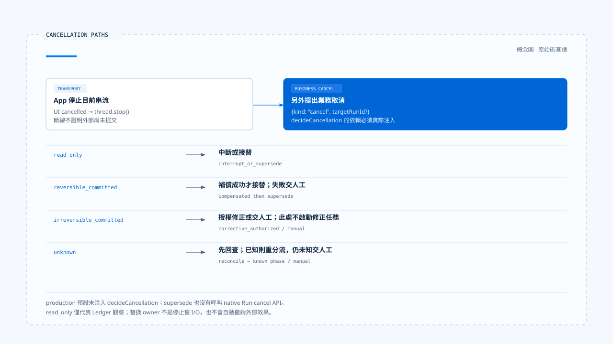

# 取消、修正與已生效操作

[English](./04-cancellation-and-correction.md) | [繁體中文](./04-cancellation-and-correction-zh-TW.md)

[回到導覽](./README-zh-TW.md) · 上一篇：[釐清提問與任務恢復](./03-clarification-and-resume-zh-TW.md) · 下一篇：[回饋、評估與回歸案例](./05-feedback-and-evaluation-zh-TW.md)

使用者按下停止時，畫面可以立即停止更新，遠端服務卻可能已接受操作。產品需要說明究竟停止了哪一層：不再等待回應、要求原 Run 結束，還是已確認沒有外部提交。若原本的效果已存在，後續修正也需要自己的權限與結果。

本篇依[固定版本與證據範圍](./README-zh-TW.md#來源與查證狀態)，追蹤 Chat Gun 的取消入口與決策 helper，並對照第三方 CCB 的 query abort。未執行真實外部提交、取消競態或補償演練。

## 1. 停止按鈕其實發出哪些動作

[App 的 `handleCancel()`][g-app] 先清除釐清顯示與等待參照，將活動設為 cancelled，再呼叫 `thread.stop()`。它也另外送出 `kind: cancel`，可附上目前 active-run hint 的 target Run，並帶取消 input metadata。

因此，此固定版本已不只做 transport abort；它也嘗試交付業務取消要求。但前端送出要求不等於後端已完成取消，更不代表外部效果已還原。

[BFF][g-bff] 將 client disconnect、upstream timeout 與 stream proxy 失敗分成不同原因。連線中斷是傳輸事實，不能單憑它宣稱下游工作尚未提交。

## 2. 取消決策先看 Ledger 中的效果

[`deriveCancellationPhase()`][g-cancel] 依 Run 的執行紀錄推導四類 phase：

| Phase | 此 helper 的依據 | 後續問題 |
|---|---|---|
| `read_only` | 沒有 entries，或沒有符合已提交條件的紀錄，且沒有 unknown 狀態。 | 是否可以中斷或替換？Ledger 覆蓋是否完整？ |
| `reversible_committed` | 已提交效果皆被判定可逆。 | 是否有可用補償動作，且補償成功？ |
| `irreversible_committed` | 至少一項已提交效果不可逆。 | 能否獲准做修正，或需人工處理？ |
| `unknown` | 仍 executing、未知效果，或執行與 effect 狀態不一致。 | 先回查，再決定可以做什麼。 |

Phase 描述已讀紀錄的判斷，不是直接查遍外部世界。尤其空集合在這裡會得到 read_only，若某個工具沒有被 Ledger 覆蓋，就不能用空集合證明它沒有發生效果。

## 3. 決策 helper 如何選路徑

### 已知狀態

`decideCancellation()` 對 read_only 選擇 `interrupt_or_supersede`。可逆已提交則呼叫注入的 compensate，成功才回傳 `compensated_then_supersede`，失敗轉人工處理。

不可逆已提交時，helper 要求 `interaction.corrective` 授權。Allow 形成 `corrective_authorized`，其餘結果保留決策 ID 並轉 manual handling。它沒有因使用者按下停止，就跳過修正操作的授權。

### 未知狀態

Unknown 先呼叫注入的 reconcile。若回查仍 unknown，回傳人工處理；若得到已知 phase，再依該 phase 判斷。這與[前區的重試條件](../action-governance/05-retry-and-side-effects-zh-TW.md)相接：未知提交不能直接當成未提交。

取消的不同路徑需要 Ledger reader、可逆判斷、補償、回查與 corrective authorizer。只有函式型別存在，還沒有完成這些部署依賴。

## 4. Policy 欄位與 production 接線的差距

[InteractionPolicy][g-policy] 宣告 cancellation mode，但 [`createProductionInteractionOrchestrator()`][g-runtime] 在所讀固定版本的預設組裝沒有提供 `decideCancellation`。它保留 override 注入位置，模組匯出的 production orchestrator 則使用預設建構。

當流程真的走到 interrupt／supersede／rollback 等替換策略，缺少這個 callback 會拋出配置錯誤。這表示不能只設定策略名稱，就宣稱補償、原 Run 停止與替換已自動串好。

同樣地，policy 中的取消模式如何影響實際 dependency，需要沿 callback 的實作核對；不能將 enum 的每個值直接畫成 production 已具備的分支。

## 5. Ownership 替換也不是外部效果回復

Orchestrator 只讓以下路徑繼續 supersede：

- `interrupt_or_supersede`。
- `compensated_then_supersede`。

其他 cancellation path 會記錄 cancelled-after-commit 或 manual event，並以 `ACTIVE_RUN_REQUIRES_CORRECTIVE_OR_MANUAL_HANDLING` 停止替換。即使回傳 `corrective_authorized`，這個函式也沒有因此直接啟動另一項修正任務。

Supersede 成功更新的是權威 ownership 與 generation。本段流程沒有呼叫 native Run cancel API，也沒有因為更新資料列就使所有舊 I/O 停止。要宣稱原執行已停止，必須追到 AbortSignal 或 native cancellation 的實際 consumer。

[Wrapper 測試][g-runtime-test] 注入假的 cancellation decision，能驗證特定決策下是否呼叫 supersede。這不等同真實工具已成功補償或原 Run 已退出。

[開啟 HTML 圖解](../../assets/agent-harness/interaction-and-feedback/04-cancellation-and-correction/04-cancellation-paths.html)

## 6. 釐清取消與整項任務取消分開

[前篇](./03-clarification-and-resume-zh-TW.md)的 `command.resume: { cancel: true }` 回到天氣釐清等待，讓 Graph 形成 clarification cancelled 的結果。一般 `kind: cancel` 則交給互動政策與 cancellation decision。

這兩份資料會走不同入口。產品若要提供「取消這次地點選擇」與「停止整項工作」，應讓顯示文字與實際作用範圍一致。

## 7. CCB 在 abort 後保留對話結構

CCB 的 [`query.ts`][c-query] 在串流 abort 時，會從 StreamingToolExecutor 取得剩餘結果，或補上缺失的 tool result blocks，避免 assistant 的 tool use 沒有對應結果。

Submit-interrupt 還會依 signal reason 決定是否省略額外的中斷訊息，由後續排隊的使用者輸入提供脈絡。這些都是 query／對話結構處理，不是外部提交的事實證明。

因此，synthetic tool result 應被理解為中斷狀態的呈現。它不能證明寄信已撤回、檔案已復原，或遠端程序已終止。

## 8. 使用者回覆應保留哪種事實

| 已取得的證據 | 可以回報 | 仍不能宣稱 |
|---|---|---|
| UI 已停止串流等待 | 已停止目前顯示或等待。 | 遠端操作沒有發生。 |
| 取消要求已送出 | 已提出停止指定工作的要求。 | Backend 已完成停止。 |
| 確認未派送或未提交 | 對應操作沒有提交，附上適用範圍。 | 其他未追蹤操作也沒有影響。 |
| 已提交且補償成功 | 原效果及已完成的補償結果。 | 所有歷史影響完全消失。 |
| 已提交待修正或狀態未知 | 已知效果、未知處及下一步處理。 | 任務乾淨回到原狀。 |

這份表格是回覆設計建議。若要實際驗收，還需同時取得取消要求、Run 狀態、Ledger 與外部資源證據，不能只檢查畫面出現「已取消」。

下一篇會把這類失敗與誤報整理成評估材料，區分一次互動中的修正與日後版本的回歸驗證。

[g-app]: https://github.com/HsienW/chat-gun/blob/92a5673003e4ac4ec09be8b1b350f42dbf4a5e69/frontend/src/App.tsx
[g-bff]: https://github.com/HsienW/chat-gun/blob/92a5673003e4ac4ec09be8b1b350f42dbf4a5e69/bff/src/server.ts
[g-cancel]: https://github.com/HsienW/chat-gun/blob/92a5673003e4ac4ec09be8b1b350f42dbf4a5e69/backend/src/runtime/interaction/cancel-decision.ts
[g-policy]: https://github.com/HsienW/chat-gun/blob/92a5673003e4ac4ec09be8b1b350f42dbf4a5e69/backend/src/runtime/interaction/policy.ts
[g-runtime]: https://github.com/HsienW/chat-gun/blob/92a5673003e4ac4ec09be8b1b350f42dbf4a5e69/backend/src/platform/interaction-runtime.ts
[g-runtime-test]: https://github.com/HsienW/chat-gun/blob/92a5673003e4ac4ec09be8b1b350f42dbf4a5e69/backend/src/platform/interaction-runtime.test.ts
[c-query]: https://github.com/claude-code-best/claude-code/blob/77a7934e15d69da13879112ed7db695c9ee7a52a/src/query.ts
