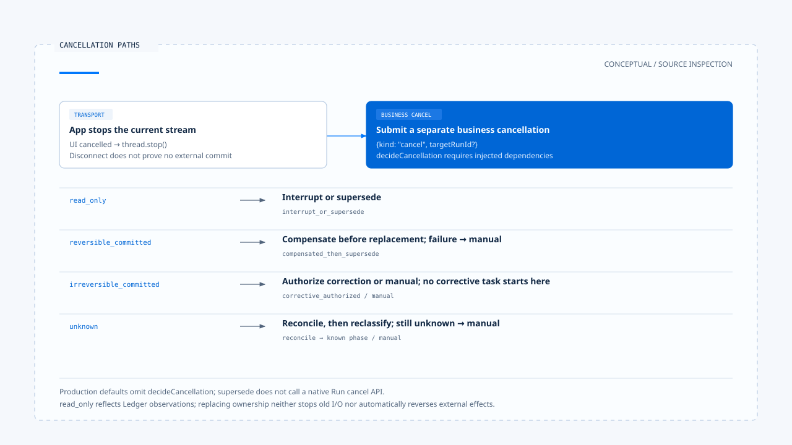

# Cancellation, correction, and committed effects

[English](./04-cancellation-and-correction.md) | [繁體中文](./04-cancellation-and-correction-zh-TW.md)

[Back to overview](./README.md) · Previous: [Clarification and task resumption](./03-clarification-and-resume.md) · Next: [Feedback, evaluation, and regression cases](./05-feedback-and-evaluation.md)

When a user presses Stop, the view can stop updating immediately even though a remote service may already have accepted an operation. The product needs to explain which layer stopped: waiting for a response, requesting termination of the original Run, or confirming that no external commit occurred. If the original effect already exists, correction requires its own authorization and result.

Using the [pinned versions and evidence scope](./README.md#sources-and-verification-status), this article traces Chat Gun's cancellation entry point and decision helpers, then compares query abort in the third-party CCB. No real external commits, cancellation races, or compensation drills were performed.

## 1. What does the Stop button actually do?

[App's `handleCancel()`][g-app] first clears the clarification display and wait reference, marks activity as cancelled, then calls `thread.stop()`. It also separately submits `kind: cancel`, optionally targeting the Run in the current active-run hint, with cancellation input metadata.

This pinned version therefore attempts to deliver a business cancellation request as well as aborting transport. A frontend request does not establish that the backend completed cancellation or that external effects were reversed.

The [BFF][g-bff] distinguishes client disconnect, upstream timeout, and stream proxy failure. A dropped connection is a transport fact; it cannot alone establish that downstream work has not committed.

## 2. Cancellation decisions first inspect effects in the Ledger

[`deriveCancellationPhase()`][g-cancel] derives four phases from a Run's execution records:

| Phase | Evidence used by this helper | Follow-up question |
|---|---|---|
| `read_only` | No entries, or no records meeting committed conditions, with no unknown state. | Can execution be interrupted or replaced? Is Ledger coverage complete? |
| `reversible_committed` | All committed effects are considered reversible. | Is compensation available, and did it succeed? |
| `irreversible_committed` | At least one committed effect is irreversible. | Can correction be authorized, or is manual handling required? |
| `unknown` | Still executing, an unknown effect, or inconsistent execution and effect states. | Reconcile first, then decide what is possible. |

A phase describes an interpretation of inspected records, rather than a direct inspection of the entire external world. An empty set yields read_only here. If the Ledger does not cover a tool, that empty set cannot prove the tool produced no effect.

## 3. How the decision helper selects a path

### Known states

`decideCancellation()` selects `interrupt_or_supersede` for read_only. For reversible committed effects, it calls the injected compensate dependency and returns `compensated_then_supersede` only on success; failure requires manual handling.

For irreversible committed effects, the helper requires `interaction.corrective` authorization. Allow produces `corrective_authorized`; other outcomes retain the decision ID and require manual handling. Pressing Stop does not bypass authorization for a corrective operation.

### Unknown states

Unknown first calls the injected reconcile dependency. If reconciliation still returns unknown, the helper returns manual handling; if it yields a known phase, the helper decides based on that phase. This connects to the [previous section's retry conditions](../action-governance/05-retry-and-side-effects.md): an unknown commit cannot be treated as no commit.

These cancellation paths need a Ledger reader, reversibility checks, compensation, reconciliation, and a corrective authorizer. A function type alone does not supply those deployment dependencies.

## 4. The gap between policy fields and production wiring

[InteractionPolicy][g-policy] declares a cancellation mode, but the default assembly of [`createProductionInteractionOrchestrator()`][g-runtime] in the pinned version supplies no `decideCancellation`. It exposes an override injection point, while the module's exported production orchestrator uses default construction.

When execution reaches replacement strategies such as interrupt / supersede / rollback, the missing callback causes a configuration error. Setting a strategy name does not establish automatic wiring for compensation, termination of the original Run, and replacement.

Likewise, determining how a policy cancellation mode affects actual dependencies requires tracing the callback implementation. Each enum value does not establish an available production branch.

## 5. Ownership replacement does not reverse external effects

The orchestrator lets only these paths proceed to supersede:

- `interrupt_or_supersede`.
- `compensated_then_supersede`.

Other cancellation paths record a cancelled-after-commit or manual event, then stop replacement with `ACTIVE_RUN_REQUIRES_CORRECTIVE_OR_MANUAL_HANDLING`. Even when the result is `corrective_authorized`, this function does not directly start another corrective task.

Successful supersede updates authoritative ownership and generation. This part of the flow calls no native Run cancel API, and updating a database row does not stop all old I/O. Claiming that the original execution stopped requires tracing the actual AbortSignal or native cancellation consumer.

[Wrapper tests][g-runtime-test] inject fake cancellation decisions to verify whether supersede is called under specific decisions. This does not establish successful compensation by real tools or termination of the original Run.

[Open the HTML diagram](../../assets/agent-harness/interaction-and-feedback/04-cancellation-and-correction/04-cancellation-paths-en.html)

## 6. Cancelling clarification differs from cancelling the entire task

The [previous article's](./03-clarification-and-resume.md) `command.resume: { cancel: true }` returns to the weather clarification wait so the Graph can produce a clarification cancelled result. An ordinary `kind: cancel` goes through interaction policy and cancellation decisions instead.

These inputs use different entry points. A product offering "cancel this location selection" and "stop the entire task" should make its labels match their actual scopes.

## 7. CCB preserves conversation structure after abort

When a stream aborts, CCB's [`query.ts`][c-query] obtains remaining results from StreamingToolExecutor or fills in missing tool result blocks, so assistant tool use does not lack corresponding results.

Submit-interrupt also uses the signal reason to decide whether to omit an additional interruption message, leaving the next queued user input to supply context. These operations handle query and conversation structure; they do not establish external commit facts.

A synthetic tool result therefore represents interruption state. It cannot prove that an email was recalled, a file restored, or a remote process terminated.

## 8. Which facts should a user-facing reply preserve?

| Evidence obtained | What can be reported | What remains unproven |
|---|---|---|
| The UI stopped waiting for the stream | The current display or wait has stopped. | No remote operation occurred. |
| A cancellation request was sent | A request to stop the specified work was submitted. | The backend finished stopping it. |
| Confirmed absence of dispatch or commit | The corresponding operation did not commit, within the stated scope. | Other untracked operations had no effects. |
| An effect committed and compensation succeeded | The original effect and completed compensation result. | All historical consequences disappeared. |
| A committed effect needs correction, or state is unknown | Known effects, unknowns, and next handling steps. | The task returned completely to its original state. |

This table is guidance for reply design. Actual acceptance requires cancellation requests, Run state, Ledger records, and external resource evidence together; seeing "cancelled" in the UI alone is insufficient.

The next article organizes failures and inaccurate reports into evaluation material, distinguishing correction within one interaction from regression validation of later versions.

[g-app]: https://github.com/HsienW/chat-gun/blob/92a5673003e4ac4ec09be8b1b350f42dbf4a5e69/frontend/src/App.tsx
[g-bff]: https://github.com/HsienW/chat-gun/blob/92a5673003e4ac4ec09be8b1b350f42dbf4a5e69/bff/src/server.ts
[g-cancel]: https://github.com/HsienW/chat-gun/blob/92a5673003e4ac4ec09be8b1b350f42dbf4a5e69/backend/src/runtime/interaction/cancel-decision.ts
[g-policy]: https://github.com/HsienW/chat-gun/blob/92a5673003e4ac4ec09be8b1b350f42dbf4a5e69/backend/src/runtime/interaction/policy.ts
[g-runtime]: https://github.com/HsienW/chat-gun/blob/92a5673003e4ac4ec09be8b1b350f42dbf4a5e69/backend/src/platform/interaction-runtime.ts
[g-runtime-test]: https://github.com/HsienW/chat-gun/blob/92a5673003e4ac4ec09be8b1b350f42dbf4a5e69/backend/src/platform/interaction-runtime.test.ts
[c-query]: https://github.com/claude-code-best/claude-code/blob/77a7934e15d69da13879112ed7db695c9ee7a52a/src/query.ts
