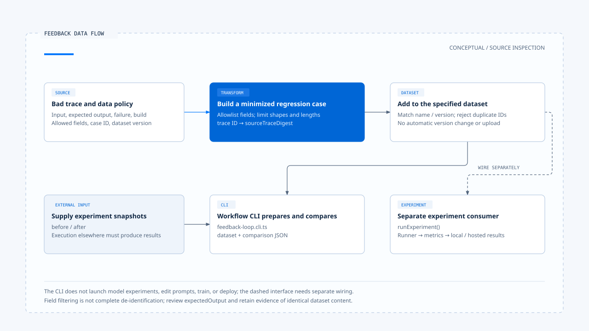
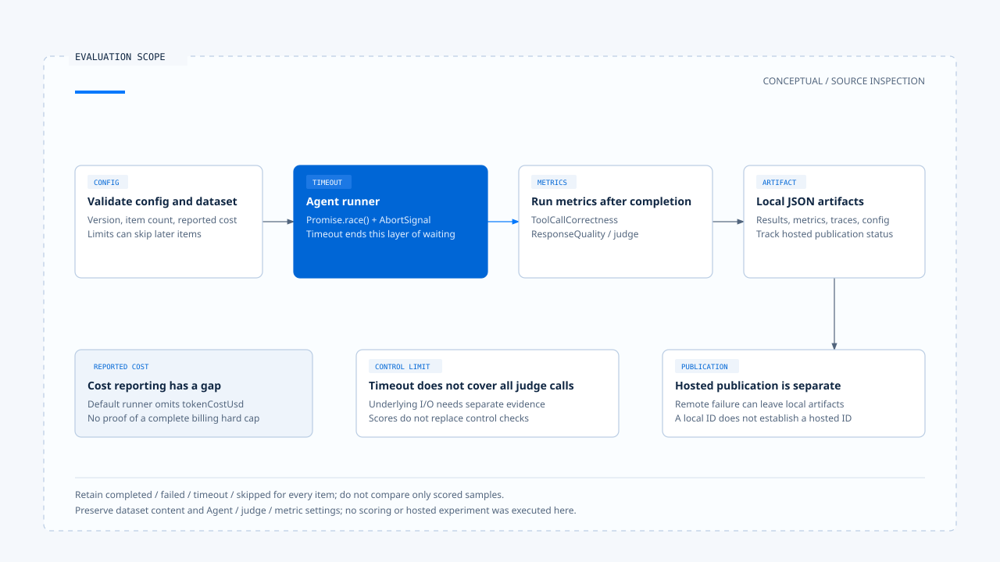

# 反馈、评估与回归案例

[English](./05-feedback-and-evaluation.md) | [繁體中文](./05-feedback-and-evaluation-zh-TW.md) | [简体中文](./05-feedback-and-evaluation-zh-CN.md)

[回到导览](./README-zh-CN.md) · 上一篇：[取消、修正与已生效操作](./04-cancellation-and-correction-zh-CN.md) · 下一篇：[一次追问到反馈的控制流程](./06-case-interaction-to-feedback-zh-CN.md)

用户说「不是这个城市」，能让目前任务修正方向；要判断下个版本是否减少同类错误，还需要重现条件、预期结果与固定的比较材料。一段不满意的评语，不会自行变成可验证的回归案例。

本篇依[固定版本与证据范围](./README-zh-CN.md#来源与查证状态)，追踪 Chat Gun 的 feedback helper、workflow CLI 与 Opik experiment 接点。未执行模型、评分、数据集上传或正式实验。

## 1. 四种材料各有用途

| 材料 | 用途 | 需要补上的条件 |
|---|---|---|
| 对话内补充 | 改变目前任务的信息或要求。 | 输入归属与互动政策。 |
| 用户反馈 | 表达错误、偏好或未满足之处。 | 可对回的请求与具体失败类型。 |
| 执行证据 | 说明实际发生的决策、调用与效果。 | 关联识别、版本与数据保留政策。 |
| 评估案例 | 让不同版本在相同条件下比较。 | 最小化输入、预期结果、dataset 与 metric 设置。 |

把这些材料分开，才能知道某次修改究竟改善了任务控制、工具选择，还是回答品质。Trace 本身也可能含有不适合进入 dataset 的内容。

## 2. 从 bad trace 建立最小化案例

[`createRedactedRegressionCase()`][g-feedback] 接受带版本的 bad trace 与数据处理 policy。输入要有 trace ID、failure type、结构化 input、expected output 与 runtime build ID。

Policy 另外指定 dataset name／version、case ID、policy version 与允许的 input 字段。函数只选入列出的字段，限制可保存值的形状及长度，并将原 trace ID 杂凑为 `sourceTraceDigest`。

产出的案例保留：

- 用来重现的 input 与 expected output。
- Failure type 与 runtime build ID。
- Dataset 与 redaction policy 版本。
- 来源 trace 的 digest，而非原 trace ID。

### 字段筛选不等于完整去识别

Policy 禁止 token、secret、credential、password、authorization、cookie、prompt、tool output 等敏感名称。这是字段名称与值形状的检查，不会自动判断所有允许字符串是否含个资。

`expectedOutput` 也不是由同一个 input allowlist 逐字段清除。把真实对话或外部数据转成案例时，仍需审阅允许字段的内容与预期输出，不能因 helper 名称含 redacted 就宣称已完成全面去识别。

## 3. 案例加入哪个版本

`addBadTraceRegressionCase()` 核对 policy 与 dataset 的名称、版本一致，并拒绝重复 case ID。它返回带新增案例的数据集，没有在这个函数中自动改版或发布远端 dataset。

同一版本名称下新增内容，仍需要产品自己的版本治理。若要保证跨实验材料完全相同，应保存内容摘要或不可变快照；不能只依赖版本字符串一致。

[Feedback 测试][g-feedback-test] 使用固定 bad trace，核对 input 只保留指定栏位、原敏感文字未出现在案例中，以及版本不符时拒绝。这些断言有明确测试数据范围，未执行，也不能泛化成任意真实数据皆安全。

## 4. Workflow CLI 做到哪里

[`feedback-loop.cli.ts`][g-feedback-cli] 从工作区范围内读取一份 workflow JSON，限制文件大小，接着：

1. 将 bad trace 与 policy 加入 base dataset。
2. 比较 workflow 已提供的 before／after experiment snapshots。
3. 将 dataset 与 comparison 输出成 JSON。

错误时输出 `FEEDBACK_WORKFLOW_INVALID` 并以非零状态结束。这个 CLI 不在此启动两次模型实验，也没有自动修改 Prompt、训练模型或部署新版本。

这条路径适合追踪数据准备与比较接点。它与后面的 `runExperiment()` 是不同 consumer，不能在图解中把尚未确认的自动接线画成实线。

[开启 HTML 图解](../../assets/agent-harness/interaction-and-feedback/05-feedback-and-evaluation/05-feedback-data-flow-en.html)

## 5. 实验如何取得执行结果

### Dataset、runner 与逐项状态

[`runExperiment()`][g-experiment] 先验证设置与要求的 dataset version。未注入其他 runner 时，默认透过 Deep Researcher 执行结构化 evaluation input，并传入 Thread、Run、Task 与 AbortSignal。

每个 item 会保留 completed、failed、timeout 或 skipped 等状态。数量限制与已累积成本达到上限时，后续 item 可被略过，不能只看有分数的样本而忽略 skipped。

Timeout 使用 `Promise.race()`，并向 runner 传递 abort。这会停止本层等待，底层能否真正停止仍取决于 Graph、工具与外部 consumer；评估框架也不能以 timeout 推论没有外部效果。

### 成本与评分的边界

累积成本依成功结果返回的 `tokenCostUsd` 更新。默认 runner 在此返回 response 与 tool calls，没有自行提供这个成本字段；所以 `maxTotalCostUsd` 不能单凭设置就被解读为完整账单硬上限。

此外，逐项 timeout 在所读流程中包住 Agent runner，metrics 在其完成后另外执行。不能因此宣称 judge 的所有调用都受同一个逐项 timeout 限制。

### 本地产物与 hosted 发布分开

Runner 将 item 结果、metric、trace ID 与设置写入本地 JSON，并记录 hosted publication 状态。远端发布失败时可以保留本地产物，不能把 local experiment ID 当成已存在的 hosted experiment ID。

[Experiment 测试][g-experiment-test] 有版本不符、timeout、failed、skipped、judge 配置不符与 hosted 失败的案例。它们使用可注入依赖，不能拿测试存在代替所列版本真的完成一次远端实验。

[开启 HTML 图解](../../assets/agent-harness/interaction-and-feedback/05-feedback-and-evaluation/05-evaluation-control-scope-en.html)

## 6. 工具比对与回答评分看不同证据

### ToolCallCorrectness

[`ToolCallCorrectnessMetric`][g-toolmetric] 比对预期工具名称、参数与待比对 calls 数量。名称或参数部分符合可产生部分分数，额外调用也会影响分母。

`runDefaultAgent()` 取得 calls 时，同时读取消息的 `tool_calls` 与执行 artifact。这两条来源不必然有相同证据强度；名称叫 actual calls，也不能直接证明每个外部效果已完成。

因此，metric 适合判断所观察的调用是否接近预期。授权、提交与资源状态仍需另外核对。

### ResponseQuality

[`ResponseQualityMetric`][g-qualitymetric] 固定 temperature 为 0，保留 model、provider、prompt version 与 template hash，要求 judge 返回 0～1 分数及 reasoning。解析或调用失败时，结果是 failed score，而非可信的低品质判定。

Temperature 0 也不使模型评分变成 deterministic。Judge 分数不能替代「未批准不派送」「旧 generation 不覆盖新活动」这类控制条件的程序检查。

## 7. Before／after 比较仍需要共同条件

`compareVersionPinnedExperiments()` 要求 dataset name 与 version 相同，再计算各 metric 的差值；某一侧缺少的 metric 在此以 0 处理。

这个函数没有替调用者核对完整 Agent／judge／metric 设置，也没有自动辨认分数方向。正值是否代表改善，取决于指标，例如通过率与重复效果率的方向就不同。

一份可供判读的比较应另列：

- Dataset 内容、版本与样本覆盖。
- Agent build、Prompt、Provider 与实际模型设置。
- Metric 定义、judge 设置及 failed／skipped 数量。
- 目标改善与其他行为是否退步。

这是评估报告的设计要求，不是 helper 已自动建立的全部保证。

## 8. 修改如何回到验证

对话反馈可以促成修改，但修改后要重新取得相同情境的控制与结果证据。若问题是旧事件覆盖新状态，应检查 reducer、消息关联与终止回调；增加一段更强的 Prompt，未必会改变这些程序路径。

下一篇用一个厘清与晚到输出的情境，将前文的条件放回同一条阅读路径，再分清源代码、测试安排与真正尚待执行的部分。

[g-feedback]: https://github.com/HsienW/chat-gun/blob/92a5673003e4ac4ec09be8b1b350f42dbf4a5e69/backend/src/operations/feedback-loop.ts
[g-feedback-test]: https://github.com/HsienW/chat-gun/blob/92a5673003e4ac4ec09be8b1b350f42dbf4a5e69/backend/src/operations/feedback-loop.test.ts
[g-feedback-cli]: https://github.com/HsienW/chat-gun/blob/92a5673003e4ac4ec09be8b1b350f42dbf4a5e69/backend/src/operations/feedback-loop.cli.ts
[g-experiment]: https://github.com/HsienW/chat-gun/blob/92a5673003e4ac4ec09be8b1b350f42dbf4a5e69/backend/src/evaluation/opik/experiment.ts
[g-experiment-test]: https://github.com/HsienW/chat-gun/blob/92a5673003e4ac4ec09be8b1b350f42dbf4a5e69/backend/src/evaluation/opik/experiment.test.ts
[g-toolmetric]: https://github.com/HsienW/chat-gun/blob/92a5673003e4ac4ec09be8b1b350f42dbf4a5e69/backend/src/evaluation/opik/metrics/tool-call-correctness.ts
[g-qualitymetric]: https://github.com/HsienW/chat-gun/blob/92a5673003e4ac4ec09be8b1b350f42dbf4a5e69/backend/src/evaluation/opik/metrics/response-quality.ts
