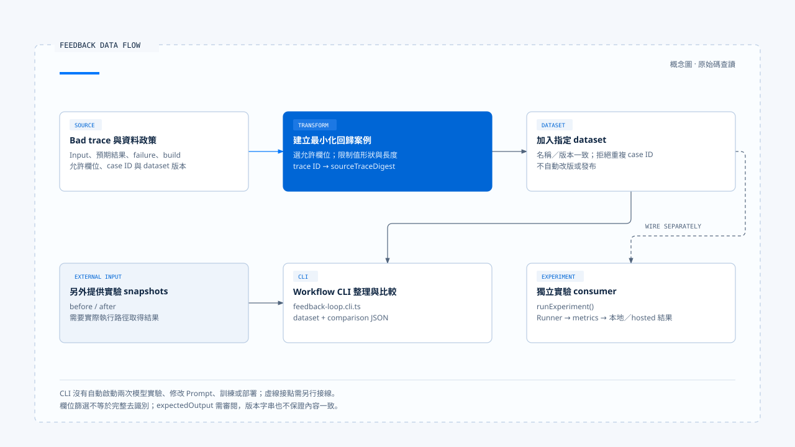
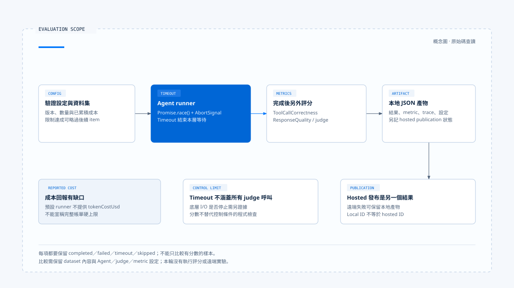

# 回饋、評估與回歸案例

[English](./05-feedback-and-evaluation.md) | [繁體中文](./05-feedback-and-evaluation-zh-TW.md)

[回到導覽](./README-zh-TW.md) · 上一篇：[取消、修正與已生效操作](./04-cancellation-and-correction-zh-TW.md) · 下一篇：[一次追問到回饋的控制流程](./06-case-interaction-to-feedback-zh-TW.md)

使用者說「不是這個城市」，能讓目前任務修正方向；要判斷下個版本是否減少同類錯誤，還需要重現條件、預期結果與固定的比較材料。一段不滿意的評語，不會自行變成可驗證的回歸案例。

本篇依[固定版本與證據範圍](./README-zh-TW.md#來源與查證狀態)，追蹤 Chat Gun 的 feedback helper、workflow CLI 與 Opik experiment 接點。本輪沒有執行模型、評分、資料集上傳或正式實驗。

## 1. 四種材料各有用途

| 材料 | 用途 | 需要補上的條件 |
|---|---|---|
| 對話內補充 | 改變目前任務的資訊或要求。 | 輸入歸屬與互動政策。 |
| 使用者回饋 | 表達錯誤、偏好或未滿足之處。 | 可對回的請求與具體失敗類型。 |
| 執行證據 | 說明實際發生的決策、呼叫與效果。 | 關聯識別、版本與資料保留政策。 |
| 評估案例 | 讓不同版本在相同條件下比較。 | 最小化輸入、預期結果、dataset 與 metric 設定。 |

把這些材料分開，才能知道某次修改究竟改善了任務控制、工具選擇，還是回答品質。Trace 本身也可能含有不適合進入 dataset 的內容。

## 2. 從 bad trace 建立最小化案例

[`createRedactedRegressionCase()`][g-feedback] 接受帶版本的 bad trace 與資料處理 policy。輸入要有 trace ID、failure type、結構化 input、expected output 與 runtime build ID。

Policy 另外指定 dataset name／version、case ID、policy version 與允許的 input 欄位。函式只選入列出的欄位，限制可保存值的形狀及長度，並將原 trace ID 雜湊為 `sourceTraceDigest`。

產出的案例保留：

- 用來重現的 input 與 expected output。
- Failure type 與 runtime build ID。
- Dataset 與 redaction policy 版本。
- 來源 trace 的 digest，而非原 trace ID。

### 欄位篩選不等於完整去識別

Policy 禁止 token、secret、credential、password、authorization、cookie、prompt、tool output 等敏感名稱。這是欄位名稱與值形狀的檢查，不會自動判斷所有允許字串是否含個資。

`expectedOutput` 也不是由同一個 input allowlist 逐欄位清除。把真實對話或外部資料轉成案例時，仍需審閱允許欄位的內容與預期輸出，不能因 helper 名稱含 redacted 就宣稱已完成全面去識別。

## 3. 案例加入哪個版本

`addBadTraceRegressionCase()` 核對 policy 與 dataset 的名稱、版本一致，並拒絕重複 case ID。它回傳帶新增案例的資料集，沒有在這個函式中自動改版或發布遠端 dataset。

同一版本名稱下新增內容，仍需要產品自己的版本治理。若要保證跨實驗材料完全相同，應保存內容摘要或不可變快照；不能只依賴版本字串一致。

[Feedback 測試][g-feedback-test] 使用固定 bad trace，核對 input 只保留指定欄位、原敏感文字未出現在案例中，以及版本不符時拒絕。這些斷言有明確測試資料範圍，本輪沒有執行，也不能泛化成任意真實資料皆安全。

## 4. Workflow CLI 做到哪裡

[`feedback-loop.cli.ts`][g-feedback-cli] 從工作區範圍內讀取一份 workflow JSON，限制檔案大小，接著：

1. 將 bad trace 與 policy 加入 base dataset。
2. 比較 workflow 已提供的 before／after experiment snapshots。
3. 將 dataset 與 comparison 輸出成 JSON。

錯誤時輸出 `FEEDBACK_WORKFLOW_INVALID` 並以非零狀態結束。這個 CLI 不在此啟動兩次模型實驗，也沒有自動修改 Prompt、訓練模型或部署新版本。

這條路徑適合追蹤資料準備與比較接點。它與後面的 `runExperiment()` 是不同 consumer，不能在圖解中把尚未確認的自動接線畫成實線。

[開啟 HTML 圖解](../../assets/agent-harness/interaction-and-feedback/05-feedback-and-evaluation/05-feedback-data-flow.html)

## 5. 實驗如何取得執行結果

### Dataset、runner 與逐項狀態

[`runExperiment()`][g-experiment] 先驗證設定與要求的 dataset version。未注入其他 runner 時，預設透過 Deep Researcher 執行結構化 evaluation input，並傳入 Thread、Run、Task 與 AbortSignal。

每個 item 會保留 completed、failed、timeout 或 skipped 等狀態。數量限制與已累積成本達到上限時，後續 item 可被略過，不能只看有分數的樣本而忽略 skipped。

Timeout 使用 `Promise.race()`，並向 runner 傳遞 abort。這會停止本層等待，底層能否真正停止仍取決於 Graph、工具與外部 consumer；評估框架也不能以 timeout 推論沒有外部效果。

### 成本與評分的邊界

累積成本依成功結果回傳的 `tokenCostUsd` 更新。預設 runner 在此回傳 response 與 tool calls，沒有自行提供這個成本欄位；所以 `maxTotalCostUsd` 不能單憑設定就被解讀為完整帳單硬上限。

此外，逐項 timeout 在所讀流程中包住 Agent runner，metrics 在其完成後另外執行。不能因此宣稱 judge 的所有呼叫都受同一個逐項 timeout 限制。

### 本地產物與 hosted 發布分開

Runner 將 item 結果、metric、trace ID 與設定寫入本地 JSON，並記錄 hosted publication 狀態。遠端發布失敗時可以保留本地產物，不能把 local experiment ID 當成已存在的 hosted experiment ID。

[Experiment 測試][g-experiment-test] 有版本不符、timeout、failed、skipped、judge 設定不符與 hosted 失敗的案例。它們使用可注入依賴，不能拿測試存在代替本輪真的完成一次遠端實驗。

[開啟 HTML 圖解](../../assets/agent-harness/interaction-and-feedback/05-feedback-and-evaluation/05-evaluation-control-scope.html)

## 6. 工具比對與回答評分看不同證據

### ToolCallCorrectness

[`ToolCallCorrectnessMetric`][g-toolmetric] 比對預期工具名稱、參數與待比對 calls 數量。名稱或參數部分符合可產生部分分數，額外呼叫也會影響分母。

`runDefaultAgent()` 取得 calls 時，同時讀取訊息的 `tool_calls` 與執行 artifact。這兩條來源不必然有相同證據強度；名稱叫 actual calls，也不能直接證明每個外部效果已完成。

因此，metric 適合判斷所觀察的呼叫是否接近預期。授權、提交與資源狀態仍需另外核對。

### ResponseQuality

[`ResponseQualityMetric`][g-qualitymetric] 固定 temperature 為 0，保留 model、provider、prompt version 與 template hash，要求 judge 回傳 0～1 分數及 reasoning。解析或呼叫失敗時，結果是 failed score，而非可信的低品質判定。

Temperature 0 也不使模型評分變成 deterministic。Judge 分數不能替代「未批准不派送」「舊 generation 不覆蓋新活動」這類控制條件的程式檢查。

## 7. Before／after 比較仍需要共同條件

`compareVersionPinnedExperiments()` 要求 dataset name 與 version 相同，再計算各 metric 的差值；某一側缺少的 metric 在此以 0 處理。

這個函式沒有替呼叫者核對完整 Agent／judge／metric 設定，也沒有自動辨認分數方向。正值是否代表改善，取決於指標，例如通過率與重複效果率的方向就不同。

一份可供判讀的比較應另列：

- Dataset 內容、版本與樣本覆蓋。
- Agent build、Prompt、Provider 與實際模型設定。
- Metric 定義、judge 設定及 failed／skipped 數量。
- 目標改善與其他行為是否退步。

這是評估報告的設計要求，不是 helper 已自動建立的全部保證。

## 8. 修改如何回到驗證

對話回饋可以促成修改，但修改後要重新取得相同情境的控制與結果證據。若問題是舊事件覆蓋新狀態，應檢查 reducer、訊息關聯與終止回呼；增加一段更強的 Prompt，未必會改變這些程式路徑。

下一篇用一個釐清與晚到輸出的情境，將前五篇的條件放回同一條閱讀路徑，再分清原始碼、測試安排與真正尚待執行的部分。

[g-feedback]: https://github.com/HsienW/chat-gun/blob/92a5673003e4ac4ec09be8b1b350f42dbf4a5e69/backend/src/operations/feedback-loop.ts
[g-feedback-test]: https://github.com/HsienW/chat-gun/blob/92a5673003e4ac4ec09be8b1b350f42dbf4a5e69/backend/src/operations/feedback-loop.test.ts
[g-feedback-cli]: https://github.com/HsienW/chat-gun/blob/92a5673003e4ac4ec09be8b1b350f42dbf4a5e69/backend/src/operations/feedback-loop.cli.ts
[g-experiment]: https://github.com/HsienW/chat-gun/blob/92a5673003e4ac4ec09be8b1b350f42dbf4a5e69/backend/src/evaluation/opik/experiment.ts
[g-experiment-test]: https://github.com/HsienW/chat-gun/blob/92a5673003e4ac4ec09be8b1b350f42dbf4a5e69/backend/src/evaluation/opik/experiment.test.ts
[g-toolmetric]: https://github.com/HsienW/chat-gun/blob/92a5673003e4ac4ec09be8b1b350f42dbf4a5e69/backend/src/evaluation/opik/metrics/tool-call-correctness.ts
[g-qualitymetric]: https://github.com/HsienW/chat-gun/blob/92a5673003e4ac4ec09be8b1b350f42dbf4a5e69/backend/src/evaluation/opik/metrics/response-quality.ts
