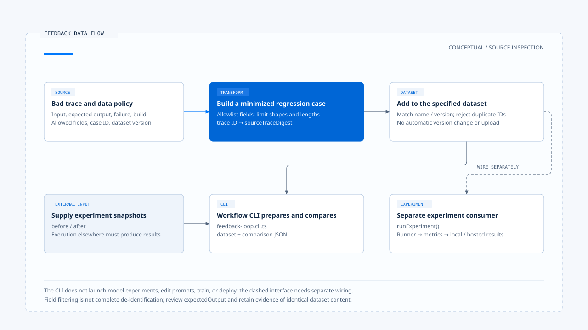
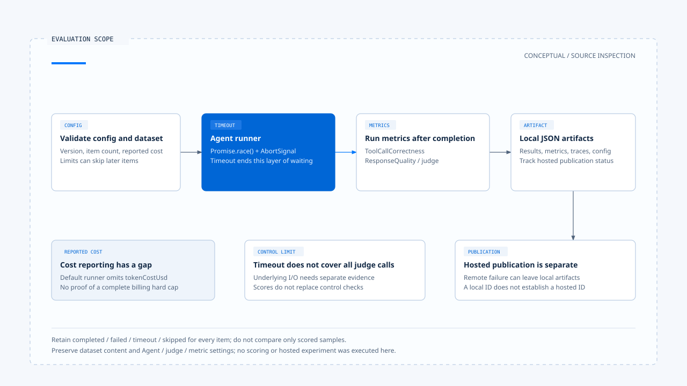

# Feedback, evaluation, and regression cases

[English](./05-feedback-and-evaluation.md) | [繁體中文](./05-feedback-and-evaluation-zh-TW.md)

[Back to overview](./README.md) · Previous: [Cancellation, correction, and committed effects](./04-cancellation-and-correction.md) · Next: [Control flow from a follow-up to feedback](./06-case-interaction-to-feedback.md)

A user saying "not this city" can redirect the current task. Determining whether the next version reduces similar errors also requires reproduction conditions, expected results, and fixed comparison material. A dissatisfied comment does not turn itself into a verifiable regression case.

Using the [pinned versions and evidence scope](./README.md#sources-and-verification-status), this article traces Chat Gun's feedback helper, workflow CLI, and Opik experiment interfaces. No model runs, scoring, dataset uploads, or formal experiments were performed during this work.

## 1. Four kinds of material serve different purposes

| Material | Purpose | Additional conditions needed |
|---|---|---|
| In-conversation supplement | Change information or requirements for the current task. | Input ownership and interaction policy. |
| User feedback | Express an error, preference, or unmet requirement. | A correlated request and a specific failure type. |
| Execution evidence | Explain actual decisions, calls, and effects. | Correlation identities, versions, and data retention policy. |
| Evaluation case | Compare different versions under the same conditions. | Minimized input, expected output, dataset, and metric settings. |

Separating these materials helps identify whether a change improved task control, tool selection, or response quality. A trace may itself contain content unsuitable for a dataset.

## 2. Build a minimized case from a bad trace

[`createRedactedRegressionCase()`][g-feedback] accepts a versioned bad trace and a data handling policy. Input requires a trace ID, failure type, structured input, expected output, and runtime build ID.

The policy separately specifies dataset name / version, case ID, policy version, and allowed input fields. The function selects only listed fields, restricts the shapes and lengths of retained values, and hashes the original trace ID into `sourceTraceDigest`.

The resulting case retains:

- Input and expected output for reproduction.
- Failure type and runtime build ID.
- Dataset and redaction policy versions.
- A digest of the source trace, rather than its original trace ID.

### Field filtering does not establish complete de-identification

The policy prohibits sensitive names such as token, secret, credential, password, authorization, cookie, prompt, and tool output. These checks inspect field names and value shapes; they do not automatically determine whether every allowed string contains personal information.

The same input allowlist does not clear `expectedOutput` field by field either. Converting real conversations or external data into cases still requires reviewing allowed field contents and expected outputs. The word redacted in a helper name does not establish complete de-identification.

## 3. Which version receives the case?

`addBadTraceRegressionCase()` checks that policy and dataset names and versions match, and rejects duplicate case IDs. It returns a dataset containing the new case without automatically changing its version or publishing a remote dataset.

Adding content under the same version name still requires the product's own version governance. Identical material across experiments requires a content digest or immutable snapshot; matching version strings alone are insufficient.

[Feedback tests][g-feedback-test] use a fixed bad trace to check that input retains only specified fields, original sensitive text does not appear in the case, and version mismatches cause rejection. These assertions apply to specific test data. They were not executed during this work and do not establish safety for arbitrary real data.

## 4. What the workflow CLI does

[`feedback-loop.cli.ts`][g-feedback-cli] reads a workflow JSON file within the workspace, limits file size, then:

1. Adds the bad trace with its policy to the base dataset.
2. Compares the before / after experiment snapshots already supplied in the workflow.
3. Outputs the dataset and comparison as JSON.

On error, it outputs `FEEDBACK_WORKFLOW_INVALID` and exits with a nonzero status. This CLI does not launch two model experiments here, automatically modify Prompts, train models, or deploy a new version.

This path exposes data preparation and comparison interfaces. It is a different consumer from `runExperiment()` below; unverified automatic wiring must not appear as a solid connection in a diagram.

[Open the HTML diagram](../../assets/agent-harness/interaction-and-feedback/05-feedback-and-evaluation/05-feedback-data-flow-en.html)

## 5. How experiments obtain execution results

### Dataset, runner, and item states

[`runExperiment()`][g-experiment] first validates configuration and the requested dataset version. Unless another runner is injected, it executes structured evaluation input through Deep Researcher by default, passing Thread, Run, Task, and AbortSignal.

Each item retains a status such as completed, failed, timeout, or skipped. Item count limits and accumulated cost reaching its cap can skip later items. Looking only at scored samples would omit skipped work.

Timeout uses `Promise.race()` and signals abort to the runner. This ends the wait at this layer; actual termination below it still depends on the Graph, tools, and external consumers. The evaluation framework cannot infer the absence of external effects from timeout.

### Cost and scoring boundaries

Accumulated cost updates from `tokenCostUsd` returned by successful results. The default runner here returns the response and tool calls without supplying this cost field. Configuring `maxTotalCostUsd` alone therefore does not establish a hard cap on the entire bill.

In the inspected flow, the per-item timeout wraps the Agent runner, while metrics execute separately after it completes. This does not establish that every judge call falls within the same per-item timeout.

### Separate local artifacts from hosted publication

The runner writes item results, metrics, trace IDs, and configuration to local JSON, and records hosted publication status. Local artifacts can remain after remote publication fails. A local experiment ID does not establish an existing hosted experiment ID.

[Experiment tests][g-experiment-test] include version mismatch, timeout, failed, skipped, judge configuration mismatch, and hosted failure cases. They use injectable dependencies; their existence does not mean a remote experiment was completed during this work.

[Open the HTML diagram](../../assets/agent-harness/interaction-and-feedback/05-feedback-and-evaluation/05-evaluation-control-scope-en.html)

## 6. Tool comparison and response scoring use different evidence

### ToolCallCorrectness

[`ToolCallCorrectnessMetric`][g-toolmetric] compares expected tool names, arguments, and the number of calls under comparison. Partial name or argument matches can yield partial scores, while extra calls also affect the denominator.

When obtaining calls, `runDefaultAgent()` reads both message `tool_calls` and execution artifacts. These sources do not necessarily carry equal evidence strength. Calling them actual calls does not directly prove that each external effect completed.

The metric therefore helps assess how closely observed calls match expectations. Authorization, commit, and resource state still require separate checks.

### ResponseQuality

[`ResponseQualityMetric`][g-qualitymetric] fixes temperature at 0, retains the model, provider, prompt version, and template hash, and asks the judge to return a score from 0 to 1 with reasoning. Parsing or call failure yields a failed score, rather than a reliable judgment of low quality.

Temperature 0 does not make model scoring deterministic. Judge scores cannot replace programmatic checks for control conditions such as "no dispatch without approval" or "old generations do not overwrite new activity."

## 7. Before / after comparisons still need shared conditions

`compareVersionPinnedExperiments()` requires matching dataset name and version, then computes each metric's delta. A metric missing on either side is treated as 0 here.

The function does not verify the caller's complete Agent / judge / metric configuration or automatically determine score direction. Whether a positive value means improvement depends on the metric: pass rate and duplicate effect rate, for example, have different directions.

An interpretable comparison should also list:

- Dataset content, version, and sample coverage.
- Agent build, Prompt, Provider, and actual model settings.
- Metric definitions, judge settings, and failed / skipped counts.
- Improvement in the target behavior and any regressions elsewhere.

These are evaluation report design requirements, rather than guarantees the helper already establishes automatically.

## 8. Returning changes to validation

Conversation feedback can prompt changes, but those changes require fresh control and outcome evidence for the same scenario. If old events overwrite new state, inspect the reducer, message correlation, and terminal callbacks. A stronger Prompt may leave those code paths unchanged.

The next article uses clarification and late output to bring the first five articles' conditions into one reading path, while distinguishing source, test arrangements, and work that still needs execution.

[g-feedback]: https://github.com/HsienW/chat-gun/blob/92a5673003e4ac4ec09be8b1b350f42dbf4a5e69/backend/src/operations/feedback-loop.ts
[g-feedback-test]: https://github.com/HsienW/chat-gun/blob/92a5673003e4ac4ec09be8b1b350f42dbf4a5e69/backend/src/operations/feedback-loop.test.ts
[g-feedback-cli]: https://github.com/HsienW/chat-gun/blob/92a5673003e4ac4ec09be8b1b350f42dbf4a5e69/backend/src/operations/feedback-loop.cli.ts
[g-experiment]: https://github.com/HsienW/chat-gun/blob/92a5673003e4ac4ec09be8b1b350f42dbf4a5e69/backend/src/evaluation/opik/experiment.ts
[g-experiment-test]: https://github.com/HsienW/chat-gun/blob/92a5673003e4ac4ec09be8b1b350f42dbf4a5e69/backend/src/evaluation/opik/experiment.test.ts
[g-toolmetric]: https://github.com/HsienW/chat-gun/blob/92a5673003e4ac4ec09be8b1b350f42dbf4a5e69/backend/src/evaluation/opik/metrics/tool-call-correctness.ts
[g-qualitymetric]: https://github.com/HsienW/chat-gun/blob/92a5673003e4ac4ec09be8b1b350f42dbf4a5e69/backend/src/evaluation/opik/metrics/response-quality.ts
