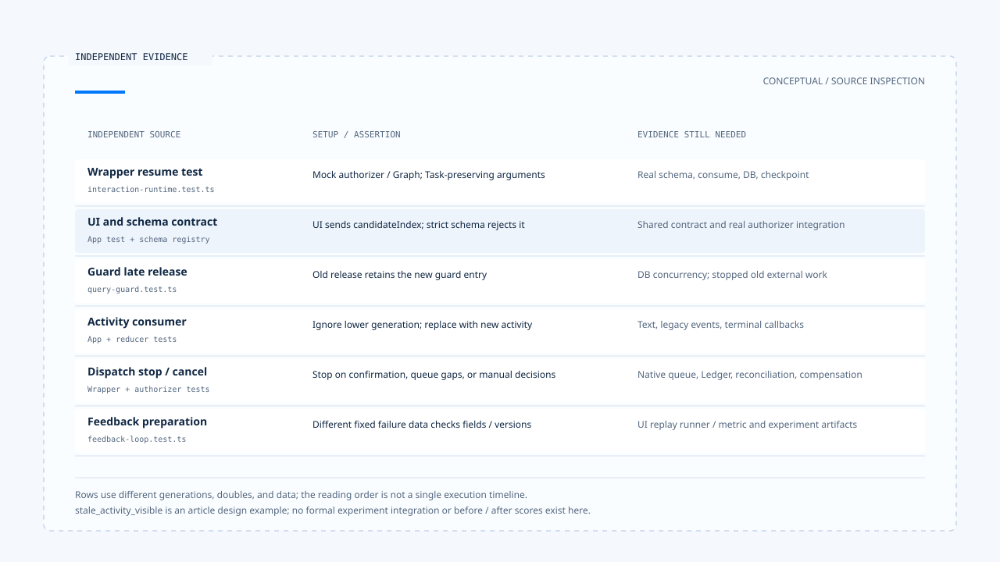

# 一次追问到反馈的控制流程

[English](./06-case-interaction-to-feedback.md) | [繁體中文](./06-case-interaction-to-feedback-zh-TW.md) | [简体中文](./06-case-interaction-to-feedback-zh-CN.md)

[回到导览](./README-zh-CN.md) · 上一篇：[反馈、评估与回归案例](./05-feedback-and-evaluation-zh-CN.md)

假设用户正在选择天气查询的地点，回复后原任务继续执行，先前 Run 的活动却晚到。要说明「答案回到正确任务，旧活动没有盖掉新结果」，至少需要等待关联、ownership、generation 与各消费端的状态证据。

本篇将固定版本的 wrapper、厘清 authorizer、Query Guard、App 与 feedback 测试分段对照。这是教学情境与源代码查读，并非本轮执行的一笔完整 E2E；没有送出模型请求、执行测试或取得正式部署结果。版本与来源范围见[本区导览](./README-zh-CN.md#来源与查证状态)。

## 1. 先列出环境与替身

主控制案例来自 [`interaction-runtime.test.ts`][g-runtime-test] 的 clarification resume 测试。它准备一笔 active ownership，并将 policy 设为 `resume_same_task`。

| 数据或依赖 | 该测试的安排 | 证据界线 |
|---|---|---|
| Thread／Scope | `thread-1`／`scope-1`。 | 测试指定的关联，不是登入验证结果。 |
| 等待中的 Task／Run | `task-1`／`run-1`，generation 3。 | Fake repository 返回的活动状态。 |
| 新请求 Run | `run-2`。 | 新 Run identity，不表示原 Task 必须改名。 |
| Clarification authorizer | `vi.fn()` 返回 `{ ok: true }`。 | 不会实际查 manifest 或执行 response Schema。 |
| Graph invoke | 返回 `{ resumed: true }` 的 mock。 | 没有真的恢复 Deep Researcher 或执行天气工具。 |

另外几份测试分别覆盖 guard、UI 与数据整理。它们使用的 generation 数值及替身不同，不能拼接成同一次执行的完整 trace。

## 2. 回答如何走到指定等待

该 wrapper 测试以 clarification metadata 和 interrupt ID 送入：

```json
{
  "command": {
    "resume": {
      "answer": "Taipei"
    }
  },
  "interruptId": "clarification:<64 hex characters>"
}
```

Interrupt ID 在此是示意占位符；原测试使用符合格式的固定值。测试接着核对 authorizer 收到该 interrupt、response、Thread、Scope 与原 ownership。

但 `{ answer: "Taipei" }` 并不是默认 weather response Schema 接受的对象。之所以能在此案例继续，是因为 authorizer 是固定返回成功的替身。

真实 [`createClarificationResumeAuthorizer()`][g-resume] 还要检查 manifest、关联、期限、兼容性、Schema 与 consume。不能以这个 wrapper 测试宣称任意回答 payload 都会通过。

## 3. 同 Task 的要求如何交给 ownership

测试核对 `supersede()` 收到：

```json
{
  "threadId": "thread-1",
  "scopeId": "scope-1",
  "expectedGeneration": 3,
  "replacementTaskId": "task-1",
  "replacementRunId": "run-2"
}
```

这份参数保留等待中的 Task，将 Run 换成本次请求。真实 [ownership repository][g-ownership] 以 transaction 和 expected generation 更新旧列，再建立新 generation 的 active ownership。

此测试的通用 mock repository 则返回预先准备的 replacement 对象，没有实际执行数据库更新。因此，测试对调用参数的断言与正式数据列确实保留 Task 的证据，仍是不同层次。

[Orchestrator][g-runtime] 在此交接后记录 `clarification_resumed`，并要求 guard 进入 dispatch。真正 Graph 从哪个 checkpoint 继续，需要另有 runtime／checkpointer 证据。

## 4. UI 到真实 Schema 有自己的缺口

[App 测试][g-app-test] 检查用户选候选后送出 `userReply` 加 `candidateIndex`。前篇已指出，[默认 Schema][g-schema] 的严格对象分支不接受 candidateIndex。

同一份固定版本里，可以同时存在：

- Frontend 测试证明 UI 送出某份数据。
- Wrapper 测试证明 mock authorizer 成功后如何交接。
- 真实 Schema 拒绝该数据形状的静态差异。

因此，补足整合前应先对齐 payload 契约，而不是把两份成功路径测试合称一次已通过的恢复。至于 [Deep Researcher][g-deep] 的 interrupt 保存与 `resumeClarify()`，也需要在相同设置下接续验证。

## 5. 旧 finalizer 与旧活动各在哪里停止

### Guard 的晚到清理

[`query-guard.test.ts`][g-guard-test] 先保留旧 Run，再 adopt 新 Run／generation，接着以旧 Run 的 generation 调用 release。断言新 guard entry 仍存在，只有正确的新 Run 清理才会移除。

这是进程内 guard 的保护。没有因此证明旧 Run 的外部工作已停止，也没有实际跑 PostgreSQL 多进程竞态。

### UI 的晚到活动

[`stream-activity-state.test.ts`][g-ui-test] 分别检查较低 generation 不更新、较高 generation 替换，以及终止后忽略进度。

[App 测试][g-app-test] 另先送入 superseded 事件，带 replacement Run 与 generation 2，再送入旧 Run 的 versioned event，核对 live activity 没有旧内容。

这些断言针对活动消费端。若要宣称整个画面都没有旧内容，还要检查一般文字消息、legacy 事件与旧 finish／error 回调，不能由 live activity 的结果直接推出。

## 6. 停止分支需要各自的证据

| 分支 | 已读 consumer 或测试 | 仍需补上的证据 |
|---|---|---|
| 回复错绑、过期或 Schema 不合法 | Clarification authorizer 与其测试。 | 与实际 UI payload、Graph checkpoint 的整合。 |
| 缺少分类确认流程 | Wrapper 对 tentative 结果停止派送。 | 确认保存、UI 与回复入口。 |
| Enqueue 缺 native ownership | Wrapper 测试要求 `NATIVE_QUEUE_OWNERSHIP_REQUIRED`。 | 真正 queue 建立与取出路径。 |
| 取消需要人工处理 | Mock cancellation decision 下，不调用 supersede。 | Ledger、回查、补偿或 corrective consumer。 |
| 旧 Run 已停止 | Ownership 替换本身不能证明。 | Native cancellation／AbortSignal 与外部操作结果。 |

这些分支能帮助定位「没有继续派送」的位置。若没有对应的资源效果证据，就保留未知，不将取消或中断文案当成外部真相。



[开启 HTML 图解](../../assets/agent-harness/interaction-and-feedback/06-case-interaction-to-feedback/06-interaction-evidence-swimlanes-en.html)

## 7. 把误显示问题整理成回归材料

假设后续实际重现「旧 generation 活动覆盖新活动」，可以先由人员整理以下案例描述。它是本文新增的设计例子，不是此版本已收集的 production trace：

```json
{
  "failureType": "stale_activity_visible",
  "input": {
    "scenario": "late activity from a superseded run",
    "locale": "zh-TW"
  },
  "expectedOutput": {
    "status": "stale_event_ignored",
    "code": "STALE_GENERATION"
  }
}
```

完整 bad trace 契约还要来源识别、schema version 与 runtime build；policy 另提供允许字段、case ID 与 dataset version。[Feedback helper][g-feedback] 可以把这些数据整理成 evaluation item，但不会自行判断这个 expectedOutput 是否正确。

这类 UI 状态回归还需要专用 runner／metric 去重播事件与观察 reducer。默认 weather experiment runner 只执行 Agent 并取得回答与 calls，不能因为数据存进 dataset 就宣称已能评估 UI stale-output 问题。

[`feedback-loop.test.ts`][g-feedback-test] 使用另一组固定失败数据验证字段处理与版本比较，没有把本篇新设计的案例接进正式实验。本轮也没有产生 before／after 分数。

## 8. 完成陈述需要把证据接起来

若要把这篇教学情境改写成一次实际验收，应保存：

1. 指定版本与 policy，原 Task、Run、generation、Scope 与等待数据。
2. UI 实际送出的 payload，以及真实 Schema 与 manifest consume 结果。
3. Ownership 变更、checkpoint 与 Graph 恢复结果。
4. 新旧事件、guard 清理与画面各 consumer 的前后状态。
5. 涉及工具时的提交证据、取消或修正结果。
6. 经数据处理的回归案例、适用 runner／metric 及真正执行出的比较产物。

本区完成的是这些责任与源代码路径的初稿。它把互动政策、执行归属、恢复契约与反馈材料连成可查对的阅读顺序；正式环境的执行、资源效果与改善幅度，仍由相应验收证据支持。

[g-runtime-test]: https://github.com/HsienW/chat-gun/blob/92a5673003e4ac4ec09be8b1b350f42dbf4a5e69/backend/src/platform/interaction-runtime.test.ts
[g-resume]: https://github.com/HsienW/chat-gun/blob/92a5673003e4ac4ec09be8b1b350f42dbf4a5e69/backend/src/runtime/recovery/clarification-resume-authorization.ts
[g-ownership]: https://github.com/HsienW/chat-gun/blob/92a5673003e4ac4ec09be8b1b350f42dbf4a5e69/backend/src/runtime/interaction/ownership.ts
[g-runtime]: https://github.com/HsienW/chat-gun/blob/92a5673003e4ac4ec09be8b1b350f42dbf4a5e69/backend/src/platform/interaction-runtime.ts
[g-app-test]: https://github.com/HsienW/chat-gun/blob/92a5673003e4ac4ec09be8b1b350f42dbf4a5e69/frontend/src/App.stream-activity.test.tsx
[g-schema]: https://github.com/HsienW/chat-gun/blob/92a5673003e4ac4ec09be8b1b350f42dbf4a5e69/backend/src/runtime/recovery/resume-response-schema-registry.ts
[g-deep]: https://github.com/HsienW/chat-gun/blob/92a5673003e4ac4ec09be8b1b350f42dbf4a5e69/backend/src/agents/deep-researcher.ts
[g-guard-test]: https://github.com/HsienW/chat-gun/blob/92a5673003e4ac4ec09be8b1b350f42dbf4a5e69/backend/src/runtime/input/query-guard.test.ts
[g-ui-test]: https://github.com/HsienW/chat-gun/blob/92a5673003e4ac4ec09be8b1b350f42dbf4a5e69/frontend/src/lib/stream-activity-state.test.ts
[g-feedback]: https://github.com/HsienW/chat-gun/blob/92a5673003e4ac4ec09be8b1b350f42dbf4a5e69/backend/src/operations/feedback-loop.ts
[g-feedback-test]: https://github.com/HsienW/chat-gun/blob/92a5673003e4ac4ec09be8b1b350f42dbf4a5e69/backend/src/operations/feedback-loop.test.ts
