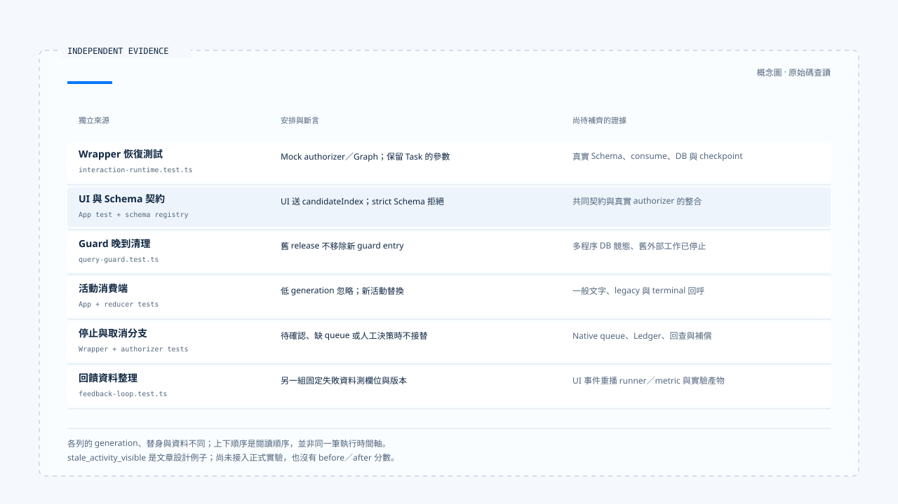

# 一次追問到回饋的控制流程

[English](./06-case-interaction-to-feedback.md) | [繁體中文](./06-case-interaction-to-feedback-zh-TW.md)

[回到導覽](./README-zh-TW.md) · 上一篇：[回饋、評估與回歸案例](./05-feedback-and-evaluation-zh-TW.md)

假設使用者正在選擇天氣查詢的地點，回覆後原任務繼續執行，先前 Run 的活動卻晚到。要說明「答案回到正確任務，舊活動沒有蓋掉新結果」，至少需要等待關聯、ownership、generation 與各消費端的狀態證據。

本篇將固定版本的 wrapper、釐清 authorizer、Query Guard、App 與 feedback 測試分段對照。這是教學情境與原始碼查讀，並非本輪執行的一筆完整 E2E；沒有送出模型請求、執行測試或取得正式部署結果。版本與來源範圍見[本區導覽](./README-zh-TW.md#來源與查證狀態)。

## 1. 先列出環境與替身

主控制案例來自 [`interaction-runtime.test.ts`][g-runtime-test] 的 clarification resume 測試。它準備一筆 active ownership，並將 policy 設為 `resume_same_task`。

| 資料或依賴 | 該測試的安排 | 證據界線 |
|---|---|---|
| Thread／Scope | `thread-1`／`scope-1`。 | 測試指定的關聯，不是登入驗證結果。 |
| 等待中的 Task／Run | `task-1`／`run-1`，generation 3。 | Fake repository 回傳的活動狀態。 |
| 新請求 Run | `run-2`。 | 新 Run identity，不表示原 Task 必須改名。 |
| Clarification authorizer | `vi.fn()` 回傳 `{ ok: true }`。 | 不會實際查 manifest 或執行 response Schema。 |
| Graph invoke | 回傳 `{ resumed: true }` 的 mock。 | 沒有真的恢復 Deep Researcher 或執行天氣工具。 |

另外幾份測試分別覆蓋 guard、UI 與資料整理。它們使用的 generation 數值及替身不同，不能拼接成同一次執行的完整 trace。

## 2. 回答如何走到指定等待

該 wrapper 測試以 clarification metadata 和 interrupt ID 送入：

```json
{
  "command": {
    "resume": {
      "answer": "Taipei"
    }
  },
  "interruptId": "clarification:<64 hex characters>"
}
```

Interrupt ID 在此是示意佔位符；原測試使用符合格式的固定值。測試接著核對 authorizer 收到該 interrupt、response、Thread、Scope 與原 ownership。

但 `{ answer: "Taipei" }` 並不是預設 weather response Schema 接受的物件。之所以能在此案例繼續，是因為 authorizer 是固定回傳成功的替身。

真實 [`createClarificationResumeAuthorizer()`][g-resume] 還要檢查 manifest、關聯、期限、相容性、Schema 與 consume。不能以這個 wrapper 測試宣稱任意回答 payload 都會通過。

## 3. 同 Task 的要求如何交給 ownership

測試核對 `supersede()` 收到：

```json
{
  "threadId": "thread-1",
  "scopeId": "scope-1",
  "expectedGeneration": 3,
  "replacementTaskId": "task-1",
  "replacementRunId": "run-2"
}
```

這份參數保留等待中的 Task，將 Run 換成本次請求。真實 [ownership repository][g-ownership] 以 transaction 和 expected generation 更新舊列，再建立新 generation 的 active ownership。

此測試的通用 mock repository 則回傳預先準備的 replacement 物件，沒有實際執行資料庫更新。因此，測試對呼叫參數的斷言與正式資料列確實保留 Task 的證據，仍是不同層次。

[Orchestrator][g-runtime] 在此交接後記錄 `clarification_resumed`，並要求 guard 進入 dispatch。真正 Graph 從哪個 checkpoint 繼續，需要另有 runtime／checkpointer 證據。

## 4. UI 到真實 Schema 有自己的缺口

[App 測試][g-app-test] 檢查使用者選候選後送出 `userReply` 加 `candidateIndex`。前篇已指出，[預設 Schema][g-schema] 的嚴格物件分支不接受 candidateIndex。

同一份固定版本裡，可以同時存在：

- Frontend 測試證明 UI 送出某份資料。
- Wrapper 測試證明 mock authorizer 成功後如何交接。
- 真實 Schema 拒絕該資料形狀的靜態差異。

因此，補足整合前應先對齊 payload 契約，而不是把兩份成功路徑測試合稱一次已通過的恢復。至於 [Deep Researcher][g-deep] 的 interrupt 保存與 `resumeClarify()`，也需要在相同設定下接續驗證。

## 5. 舊 finalizer 與舊活動各在哪裡停止

### Guard 的晚到清理

[`query-guard.test.ts`][g-guard-test] 先保留舊 Run，再 adopt 新 Run／generation，接著以舊 Run 的 generation 呼叫 release。斷言新 guard entry 仍存在，只有正確的新 Run 清理才會移除。

這是程序內 guard 的保護。沒有因此證明舊 Run 的外部工作已停止，也沒有實際跑 PostgreSQL 多程序競態。

### UI 的晚到活動

[`stream-activity-state.test.ts`][g-ui-test] 分別檢查較低 generation 不更新、較高 generation 替換，以及終止後忽略進度。

[App 測試][g-app-test] 另先送入 superseded 事件，帶 replacement Run 與 generation 2，再送入舊 Run 的 versioned event，核對 live activity 沒有舊內容。

這些斷言針對活動消費端。若要宣稱整個畫面都沒有舊內容，還要檢查一般文字訊息、legacy 事件與舊 finish／error 回呼，不能由 live activity 的結果直接推出。

## 6. 停止分支需要各自的證據

| 分支 | 已讀 consumer 或測試 | 仍需補上的證據 |
|---|---|---|
| 回覆錯綁、過期或 Schema 不合法 | Clarification authorizer 與其測試。 | 與實際 UI payload、Graph checkpoint 的整合。 |
| 缺少分類確認流程 | Wrapper 對 tentative 結果停止派送。 | 確認保存、UI 與回覆入口。 |
| Enqueue 缺 native ownership | Wrapper 測試要求 `NATIVE_QUEUE_OWNERSHIP_REQUIRED`。 | 真正 queue 建立與取出路徑。 |
| 取消需要人工處理 | Mock cancellation decision 下，不呼叫 supersede。 | Ledger、回查、補償或 corrective consumer。 |
| 舊 Run 已停止 | Ownership 替換本身不能證明。 | Native cancellation／AbortSignal 與外部操作結果。 |

這些分支能幫助定位「沒有繼續派送」的位置。若沒有對應的資源效果證據，就保留未知，不將取消或中斷文案當成外部真相。



[開啟 HTML 圖解](../../assets/agent-harness/interaction-and-feedback/06-case-interaction-to-feedback/06-interaction-evidence-swimlanes.html)

## 7. 把誤顯示問題整理成回歸材料

假設後續實際重現「舊 generation 活動覆蓋新活動」，可以先由人員整理以下案例描述。它是本文新增的設計例子，不是此版本已收集的 production trace：

```json
{
  "failureType": "stale_activity_visible",
  "input": {
    "scenario": "late activity from a superseded run",
    "locale": "zh-TW"
  },
  "expectedOutput": {
    "status": "stale_event_ignored",
    "code": "STALE_GENERATION"
  }
}
```

完整 bad trace 契約還要來源識別、schema version 與 runtime build；policy 另提供允許欄位、case ID 與 dataset version。[Feedback helper][g-feedback] 可以把這些資料整理成 evaluation item，但不會自行判斷這個 expectedOutput 是否正確。

這類 UI 狀態回歸還需要專用 runner／metric 去重播事件與觀察 reducer。預設 weather experiment runner 只執行 Agent 並取得回答與 calls，不能因為資料存進 dataset 就宣稱已能評估 UI stale-output 問題。

[`feedback-loop.test.ts`][g-feedback-test] 使用另一組固定失敗資料驗證欄位處理與版本比較，沒有把本篇新設計的案例接進正式實驗。本輪也沒有產生 before／after 分數。

## 8. 完成陳述需要把證據接起來

若要把這篇教學情境改寫成一次實際驗收，應保存：

1. 指定版本與 policy，原 Task、Run、generation、Scope 與等待資料。
2. UI 實際送出的 payload，以及真實 Schema 與 manifest consume 結果。
3. Ownership 變更、checkpoint 與 Graph 恢復結果。
4. 新舊事件、guard 清理與畫面各 consumer 的前後狀態。
5. 涉及工具時的提交證據、取消或修正結果。
6. 經資料處理的回歸案例、適用 runner／metric 及真正執行出的比較產物。

本區完成的是這些責任與原始碼路徑的初稿。它把互動政策、執行歸屬、恢復契約與回饋材料連成可查對的閱讀順序；正式環境的執行、資源效果與改善幅度，仍由相應驗收證據支持。

[g-runtime-test]: https://github.com/HsienW/chat-gun/blob/92a5673003e4ac4ec09be8b1b350f42dbf4a5e69/backend/src/platform/interaction-runtime.test.ts
[g-resume]: https://github.com/HsienW/chat-gun/blob/92a5673003e4ac4ec09be8b1b350f42dbf4a5e69/backend/src/runtime/recovery/clarification-resume-authorization.ts
[g-ownership]: https://github.com/HsienW/chat-gun/blob/92a5673003e4ac4ec09be8b1b350f42dbf4a5e69/backend/src/runtime/interaction/ownership.ts
[g-runtime]: https://github.com/HsienW/chat-gun/blob/92a5673003e4ac4ec09be8b1b350f42dbf4a5e69/backend/src/platform/interaction-runtime.ts
[g-app-test]: https://github.com/HsienW/chat-gun/blob/92a5673003e4ac4ec09be8b1b350f42dbf4a5e69/frontend/src/App.stream-activity.test.tsx
[g-schema]: https://github.com/HsienW/chat-gun/blob/92a5673003e4ac4ec09be8b1b350f42dbf4a5e69/backend/src/runtime/recovery/resume-response-schema-registry.ts
[g-deep]: https://github.com/HsienW/chat-gun/blob/92a5673003e4ac4ec09be8b1b350f42dbf4a5e69/backend/src/agents/deep-researcher.ts
[g-guard-test]: https://github.com/HsienW/chat-gun/blob/92a5673003e4ac4ec09be8b1b350f42dbf4a5e69/backend/src/runtime/input/query-guard.test.ts
[g-ui-test]: https://github.com/HsienW/chat-gun/blob/92a5673003e4ac4ec09be8b1b350f42dbf4a5e69/frontend/src/lib/stream-activity-state.test.ts
[g-feedback]: https://github.com/HsienW/chat-gun/blob/92a5673003e4ac4ec09be8b1b350f42dbf4a5e69/backend/src/operations/feedback-loop.ts
[g-feedback-test]: https://github.com/HsienW/chat-gun/blob/92a5673003e4ac4ec09be8b1b350f42dbf4a5e69/backend/src/operations/feedback-loop.test.ts
