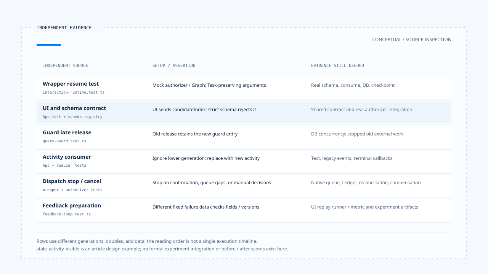

# Control flow from a follow-up to feedback

[English](./06-case-interaction-to-feedback.md) | [繁體中文](./06-case-interaction-to-feedback-zh-TW.md)

[Back to overview](./README.md) · Previous: [Feedback, evaluation, and regression cases](./05-feedback-and-evaluation.md)

Suppose a user chooses a location for a weather query, the original task continues after the reply, and activity from the earlier Run arrives late. Establishing that "the answer returned to the correct task and old activity did not overwrite the new result" requires at least wait correlation, ownership, generation, and state evidence from each consumer.

This article compares the pinned version's wrapper, clarification authorizer, Query Guard, App, and feedback tests in separate stages. It is a teaching scenario and source inspection, not a complete E2E execution performed during this work. No model requests, tests, or production deployment results were obtained. See the [section overview](./README.md#sources-and-verification-status) for versions and source scope.

## 1. List the environment and test doubles

The main control case comes from the clarification resume test in [`interaction-runtime.test.ts`][g-runtime-test]. It prepares active ownership and sets policy to `resume_same_task`.

| Data or dependency | Test arrangement | Evidence boundary |
|---|---|---|
| Thread / Scope | `thread-1` / `scope-1`. | Correlations specified by the test, not authentication results. |
| Waiting Task / Run | `task-1` / `run-1`, generation 3. | Active state returned by a fake repository. |
| New request Run | `run-2`. | A new Run identity does not require renaming the original Task. |
| Clarification authorizer | `vi.fn()` returns `{ ok: true }`. | No actual manifest lookup or response Schema validation. |
| Graph invoke | A mock returning `{ resumed: true }`. | No actual Deep Researcher resumption or weather tool execution. |

Other tests separately cover the guard, UI, and data preparation. They use different generation values and test doubles, so they cannot be stitched into a complete trace of one execution.

## 2. How an answer reaches a specific wait

The wrapper test submits this with clarification metadata and an interrupt ID:

```json
{
  "command": {
    "resume": {
      "answer": "Taipei"
    }
  },
  "interruptId": "clarification:<64 hex characters>"
}
```

The interrupt ID here is an illustrative placeholder; the original test uses a fixed value matching the format. The test then checks that the authorizer receives that interrupt, response, Thread, Scope, and original ownership.

However, `{ answer: "Taipei" }` is not an object accepted by the default weather response Schema. This case continues because the authorizer is a test double that always returns success.

The real [`createClarificationResumeAuthorizer()`][g-resume] must still check the manifest, correlations, expiry, compatibility, Schema, and consume. This wrapper test does not establish that arbitrary answer payloads pass.

## 3. How the same-Task requirement reaches ownership

The test checks that `supersede()` receives:

```json
{
  "threadId": "thread-1",
  "scopeId": "scope-1",
  "expectedGeneration": 3,
  "replacementTaskId": "task-1",
  "replacementRunId": "run-2"
}
```

These arguments retain the waiting Task and replace the Run with the current request's Run. The real [ownership repository][g-ownership] updates the old row using a transaction and expected generation, then creates active ownership with a new generation.

The test's general mock repository instead returns a prepared replacement object without updating a database. Assertions about call arguments therefore remain a different evidence level from proof that a production row actually retained the Task.

After this handoff, the [orchestrator][g-runtime] records `clarification_resumed` and asks the guard to enter dispatch. The actual checkpoint from which the Graph continues requires separate runtime / checkpointer evidence.

## 4. The UI-to-Schema path has its own gap

[App tests][g-app-test] check that selecting a candidate submits `userReply` plus `candidateIndex`. As discussed earlier, the strict object branches of the [default Schema][g-schema] do not accept candidateIndex.

The same pinned version can contain all of these:

- Frontend tests proving the UI submits a particular payload.
- Wrapper tests proving the handoff after a mock authorizer succeeds.
- A static mismatch in which the real Schema rejects that payload shape.

Aligning the payload contract must therefore precede completing integration. Two tests of successful paths do not together establish a successful resume. [Deep Researcher's][g-deep] interrupt persistence and `resumeClarify()` also need follow-through validation under the same settings.

## 5. Where old finalizers and old activity stop

### Late cleanup in the guard

[`query-guard.test.ts`][g-guard-test] first reserves an old Run, adopts a new Run / generation, then calls release with the old Run's generation. It asserts that the new guard entry remains and that only cleanup for the correct new Run removes it.

This protects the in-process guard. It does not establish that the old Run's external work stopped, nor does it exercise PostgreSQL concurrency across processes.

### Late activity in the UI

[`stream-activity-state.test.ts`][g-ui-test] separately checks that a lower generation does not update state, a higher generation replaces it, and progress after termination is ignored.

An [App test][g-app-test] also sends a superseded event with a replacement Run and generation 2, then sends a versioned event from the old Run and checks that live activity has no old content.

These assertions target activity consumers. Claiming that the entire view contains no old content also requires checking ordinary text messages, legacy events, and old finish / error callbacks. Live activity results alone do not establish that.

## 6. Each stop branch needs its own evidence

| Branch | Inspected consumer or test | Evidence still needed |
|---|---|---|
| Reply binding mismatch, expiry, or invalid Schema | Clarification authorizer and its tests. | Integration with actual UI payloads and Graph checkpoints. |
| Missing classification confirmation flow | The wrapper stops dispatch for tentative results. | Confirmation persistence, UI, and reply entry point. |
| Enqueue lacks native ownership | Wrapper tests require `NATIVE_QUEUE_OWNERSHIP_REQUIRED`. | Actual queue creation and retrieval paths. |
| Cancellation requires manual handling | No supersede call under a mock cancellation decision. | Ledger, reconciliation, compensation, or a corrective consumer. |
| The old Run stopped | Ownership replacement alone cannot establish this. | Native cancellation / AbortSignal and external operation results. |

These branches help locate where dispatch does not continue. Without corresponding resource-effect evidence, retain the unknown state rather than treating cancellation or interruption text as external truth.



[Open the HTML diagram](../../assets/agent-harness/interaction-and-feedback/06-case-interaction-to-feedback/06-interaction-evidence-swimlanes-en.html)

## 7. Turn an incorrect display into regression material

Suppose a later reproduction confirms that "old-generation activity overwrites new activity." A reviewer could first prepare the following case description. This is a design example introduced by the article, not a production trace collected in this version:

```json
{
  "failureType": "stale_activity_visible",
  "input": {
    "scenario": "late activity from a superseded run",
    "locale": "zh-TW"
  },
  "expectedOutput": {
    "status": "stale_event_ignored",
    "code": "STALE_GENERATION"
  }
}
```

The complete bad trace contract also needs source identity, schema version, and runtime build. Policy separately supplies allowed fields, case ID, and dataset version. The [feedback helper][g-feedback] can organize this data into an evaluation item, but does not determine whether the expectedOutput is correct.

This kind of UI state regression also needs a dedicated runner / metric to replay events and observe the reducer. The default weather experiment runner executes the Agent and obtains responses and calls. Storing data in a dataset does not establish that it can evaluate UI stale-output problems.

[`feedback-loop.test.ts`][g-feedback-test] uses a different set of fixed failure data to verify field handling and version comparison. It does not connect this article's new design example to a formal experiment. No before / after scores were produced during this work either.

## 8. Completion claims require linked evidence

Turning this teaching scenario into actual acceptance requires retaining:

1. The specified version and policy, original Task, Run, generation, Scope, and wait data.
2. The actual UI payload, real Schema results, and manifest consume results.
3. Ownership changes, checkpoints, and Graph resumption results.
4. Old and new events, guard cleanup, and before / after state for each UI consumer.
5. Commit evidence and cancellation or correction results when tools are involved.
6. Regression cases after data handling, applicable runners / metrics, and comparison artifacts from actual execution.

This section provides drafts of those responsibilities and source paths. It connects interaction policy, execution ownership, resumption contracts, and feedback material in a reading order that can be checked against evidence. Production execution, resource effects, and the extent of improvement still require the corresponding acceptance evidence.

[g-runtime-test]: https://github.com/HsienW/chat-gun/blob/92a5673003e4ac4ec09be8b1b350f42dbf4a5e69/backend/src/platform/interaction-runtime.test.ts
[g-resume]: https://github.com/HsienW/chat-gun/blob/92a5673003e4ac4ec09be8b1b350f42dbf4a5e69/backend/src/runtime/recovery/clarification-resume-authorization.ts
[g-ownership]: https://github.com/HsienW/chat-gun/blob/92a5673003e4ac4ec09be8b1b350f42dbf4a5e69/backend/src/runtime/interaction/ownership.ts
[g-runtime]: https://github.com/HsienW/chat-gun/blob/92a5673003e4ac4ec09be8b1b350f42dbf4a5e69/backend/src/platform/interaction-runtime.ts
[g-app-test]: https://github.com/HsienW/chat-gun/blob/92a5673003e4ac4ec09be8b1b350f42dbf4a5e69/frontend/src/App.stream-activity.test.tsx
[g-schema]: https://github.com/HsienW/chat-gun/blob/92a5673003e4ac4ec09be8b1b350f42dbf4a5e69/backend/src/runtime/recovery/resume-response-schema-registry.ts
[g-deep]: https://github.com/HsienW/chat-gun/blob/92a5673003e4ac4ec09be8b1b350f42dbf4a5e69/backend/src/agents/deep-researcher.ts
[g-guard-test]: https://github.com/HsienW/chat-gun/blob/92a5673003e4ac4ec09be8b1b350f42dbf4a5e69/backend/src/runtime/input/query-guard.test.ts
[g-ui-test]: https://github.com/HsienW/chat-gun/blob/92a5673003e4ac4ec09be8b1b350f42dbf4a5e69/frontend/src/lib/stream-activity-state.test.ts
[g-feedback]: https://github.com/HsienW/chat-gun/blob/92a5673003e4ac4ec09be8b1b350f42dbf4a5e69/backend/src/operations/feedback-loop.ts
[g-feedback-test]: https://github.com/HsienW/chat-gun/blob/92a5673003e4ac4ec09be8b1b350f42dbf4a5e69/backend/src/operations/feedback-loop.test.ts
