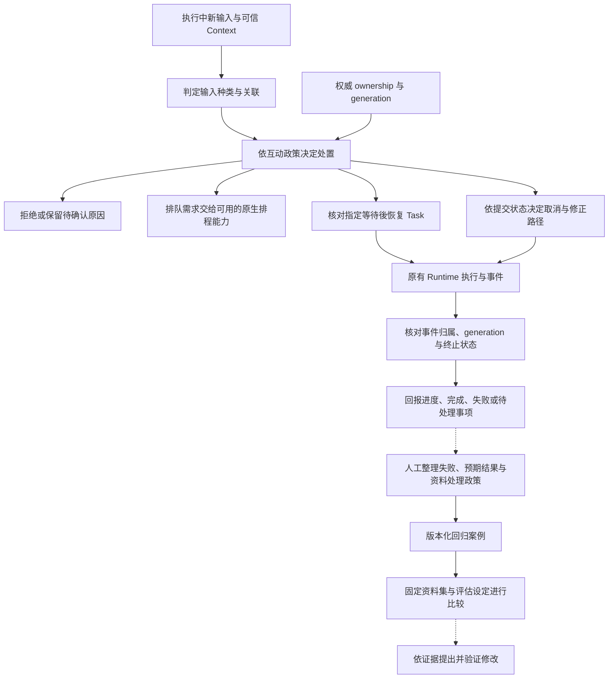

# Interaction and Feedback

[English](./README.md) | [繁體中文](./README-zh-TW.md) | [简体中文](./README-zh-CN.md)

本篇章接在 [Action Governance](../action-governance/README-zh-CN.md) 之后。前区追踪单次工具调用的授权、批准、派送与效果；本篇章处理任务尚未结束时的新输入、等待与恢复、取消及可见状态，再把可查证的失败整理成后续评估材料。

## 阅读顺序

| 篇次 | 文章 | 要回答的问题 | 文件名 |
|---|---|---|---|
| 01 | [执行中新输入与互动策略](./01-in-flight-input-policy-zh-CN.md) | 新消息是补充、改意、取消、重复输入，还是另一项任务？ | `01-in-flight-input-policy-zh-CN.md` |
| 02 | [Run 归属与可见状态](./02-run-ownership-and-visible-state-zh-CN.md) | 哪一次执行有权更新目前画面，旧回调何时必须停止清理？ | `02-run-ownership-and-visible-state-zh-CN.md` |
| 03 | [厘清提问与任务恢复](./03-clarification-and-resume-zh-CN.md) | 用户的回答应交给哪一次等待，恢复前要核对哪些条件？ | `03-clarification-and-resume-zh-CN.md` |
| 04 | [取消、修正与已生效操作](./04-cancellation-and-correction-zh-CN.md) | 停止要求到达时，哪些工作还能阻止，哪些效果必须另行处理？ | `04-cancellation-and-correction-zh-CN.md` |
| 05 | [反馈、评估与回归案例](./05-feedback-and-evaluation-zh-CN.md) | 如何把一次失败变成可重现、可比较且经过数据处理的测试材料？ | `05-feedback-and-evaluation-zh-CN.md` |
| 06 | [一次追问到反馈的控制流程](./06-case-interaction-to-feedback-zh-CN.md) | 能否把输入归属、恢复、旧输出与回归证据连回同一项情境？ | `06-case-interaction-to-feedback-zh-CN.md` |

## 架构与责任范围

下图是文章的阅读模型，方块不表示程序中存在同名类型，也不表示整条链已完成端到端整合。下半部的回归案例是后续整理与评估流程，不能据此宣称产品会自动修改 Prompt、政策或模型。

- **Foundations** 已说明用户介入、晚到输出与完成证据；本篇章追到实际 consumer、设置与失败分支。
- **Input and Context** 负责输入形状、来源、指令权威与容量；本篇章从已规范化输入开始，追踪它在活动任务中的归属与处置。
- **Behavior and Capabilities** 负责有效指令、工具组装与候选范围；这里只说明新输入何时影响既有任务，不重讲 loader 与工具选择。
- **Action Governance** 负责工具批准与副作用契约；本篇章引用其提交状态与补偿条件，聚焦整项互动的取消及修正决策。厘清回答与工具批准必须分开。
- **Agent Runtime** 后续处理执行核心、checkpoint、恢复及事件传递细节；本篇章保留政策与可见状态责任，不另建一套通用 Run queue 或 worker runtime。

## 01. 执行中新输入与互动策略

### 文章范围

从已有活动 Run 时收到另一份输入开始，说明 deterministic 信号、语义分类建议与互动政策如何组合。先辨认输入，再追踪目前入口能采用哪些处置，避免把同一个送出按钮理解成永远建立新任务。

正文主题：

1. `prompt`、`clarification_resume`、`cancel` 与可信 Context 如何进入互动入口；输入规范化细节连回前区。
2. `classifyInteractionInput()` 的五类结果：厘清回答、意图修订、取消、新任务与重复输入。
3. 明确取消、相同 idempotency key 加相同 bytes、指定等待回复的 deterministic 分支。
4. 语义建议的 `awaiting_confirmation`，以及分类器不可用时的保守结果。
5. `InteractionPolicy` 的策略、厘清回复模式、取消模式与意图修订设置。
6. disposition 如何交给 orchestrator；拒绝、重用、恢复、要求原生 queue 与替换的差异。
7. CCB 忙碌时的 prompt／bash enqueue、可中断工具条件与立即命令分支。

### 查证与失败分支

- `DEFAULT_INTERACTION_POLICY` 有 `enqueue`，但未配置政策时 orchestrator 是 no-op。类型默认值不能当成所有正式入口已启用的行为。
- `enqueue` 的现有 consumer 返回 `NATIVE_QUEUE_OWNERSHIP_REQUIRED` 并拒绝本地派送；正文不得画出未确认的本地持久排队与自动取出流程。
- 分类 helper 有 pending／confirm／timeout 函数，但目前 orchestrator 对 tentative 结果以 `INPUT_CLASSIFICATION_CONFIRMATION_REQUIRED` 停止；完整分类确认界面及返回入口须另外查证。
- 重复输入的分类与已完成结果重用是不同接点。须区分 `duplicate_input` 标记、可信 idempotency storage 与实际 cached result。
- CCB 有自己的命令队列与同步 QueryGuard，不套用 Chat Gun 的原生 queue 边界或 PostgreSQL ownership 类型。

主要来源：[G1][g-runtime]、[G2][g-policy]、[G3][g-classify]、[G4][g-guard]、[C1][c-submit]、[C2][c-guard]。

图解候选：输入种类 → classification／disposition → 实际 consumer 的处置对照，将「需要确认但尚未完整接线」与「原生 queue 前置条件」标成停止出口。

## 02. Run 归属与可见状态

### 文章范围

以相同 Thread／Scope 中的新旧 Run 为主线，分开说明权威 ownership、进程内 query guard、事件 generation 与前端显示状态。读者要能指出谁可以更新画面，也能辨认「已终止」与「业务成功」的不同来源。

正文主题：

1. Request、Thread、Task、Run、generation 与 native Run status 各自的用途。
2. `PgActiveRunOwnershipRepository` 的 claim、条件式 supersede 与 terminal 更新。
3. Query Guard 在 `dispatching` 与 `running` 之间的保留，以及旧 finalizer 不清除新 generation 的条件。
4. Client active-run hint 与数据库 ownership 的权威差异。
5. Backend 先交付互动事件，前端 reducer 再依提供的 generation 过滤旧活动。
6. Task reducer 的终止状态保护、活动封存与重新送出的区别。
7. CCB `reserve()`、`tryStart()`、`end(generation)` 与 `forceEnd()` 的进程内对照。

### 查证与失败分支

- Ownership repository 的 CAS 与 QueryGuard 的 Map 各有责任。Mock 竞态测试不是正式 PostgreSQL 多连接压测。
- `createGovernedStream()` 先发送互动事件再转送 chunks，本身未逐个 chunk 重查 ownership；不可写成 backend 已自动丢弃每个旧输出。
- `streamActivityReducer` 的 generation 过滤取决于 action 有提供 generation；terminal action 与没有 generation 的事件须另追调用端。正式写作前补查 App、事件 parser 与 BFF 透传，才可主张整段显示路径覆盖。
- Task reducer 的终止后忽略与流式传输活动 reducer 的终止保护分开说明，不将其中一者套到全部消息显示。
- Wrapper 对非取消错误也可能以 ownership `completed` 做收尾，再记录 failed idempotency。这个字段不能等同工具成功、Task 成功或 native Run success。

主要来源：[G1][g-runtime]、[G4][g-guard]、[G5][g-ownership]、[G6][g-events]、[G7][g-ui]、[G8][g-reducer]、[C2][c-guard]、[G18][g-boundary]。

图解候选：Run A／generation N 与 Run B／generation N+1 的泳道，分开画 ownership 替换、旧 finalizer、晚到活动与 UI 可见状态。

## 03. 厘清提问与任务恢复

### 文章范围

从一个指定的厘清等待开始，追踪回答如何对回 interrupt、Task、Run 与 Scope。工具授权批准连回 Action Governance，这篇只处理「还缺什么任务信息」及其恢复契约。

正文主题：

1. 厘清回答、意图分类确认与工具批准的差异。
2. `clarificationReplyMode` 的 `resume_same_task` 与 `new_task`。
3. `createClarificationResumeAuthorizer()` 读取 manifest、核对种类与关联。
4. Waiting 状态、期限、response Schema 与 execution manifest compatibility。
5. 单次 consume 成功后，orchestrator 如何保留 Task 并替换 ownership。
6. `clarification_resumed` 事件、interrupt ID 与后续 Graph 执行交接。
7. Checkpoint 与服务器恢复能力的证据范围。

### 查证与失败分支

- 「恢复同一 Task」不表示沿用同一 Run／generation；所读分支使用新 Run ID 与递增 generation，Task ID 对回等待中的任务。
- Manifest 缺少、类型不符、关联不符、非 waiting、过期、回应不合法、版本不兼容与 consume 被拒绝要分别保留原因。
- Production resolver 在所读组装中只解析 Deep Researcher 的 current execution manifest，不能将此厘清 authorizer 宣称成所有 Graph 的通用恢复能力。
- 本轮已读 authorizer 与测试；正式正文仍须续查 Deep Researcher 的 interrupt 产生、manifest 保存与实际 resume payload 消费，才可将完整往返描述为已接线。
- 已有 boundary 文件记录 dev 环境的历史观察，但不是本轮新跑的证据，也不升格为正式部署 PostgreSQL／Redis、强制 kill 或跨部署恢复保证。

主要来源：[G1][g-runtime]、[G3][g-classify]、[G9][g-resume]、[G14][g-resume-test]、[G18][g-boundary]。

图解候选：等待数据 → 回答与 interrupt ID → 关联／Schema／版本检查 → consume → 同 Task、新 Run 的交接；拒绝出口标出对应原因。

## 04. 取消、修正与已生效操作

### 文章范围

从用户要求停止或修改既有任务开始，对照已知提交状态与互动决策。前区已展开工具重试、Ledger 与补偿，这篇聚焦是否替换活动 Run，以及用户应收到什么取消结果。

正文主题：

1. 「停止显示」「取消等待」「停止工具」与「外部效果还原」各自需要的条件。
2. `deriveCancellationPhase()` 的 read-only、可逆已提交、不可逆已提交与 unknown。
3. `decideCancellation()` 对补偿、回查与 `interaction.corrective` 授权的依赖。
4. Orchestrator 接受哪些 cancellation path 才进入 supersede，哪些保留 corrective／manual handling。
5. 替换 ownership 与真正停止底层执行之间的差距；AbortSignal 要追到实际 consumer。
6. CCB query abort 后补齐 tool result blocks、保留消息结构的做法。
7. 对用户区分「已收到取消」「已停止等待」「已确认无提交」「已提交待修正」。

### 查证与失败分支

- `decideCancellation()` 需要 Ledger、compensate、reconcile 与 corrective authorizer。Policy 的 `cancellationMode` 字段存在，不表示这些依赖已在每个 production 入口完成注入。
- 所读 production orchestrator 建构没有提供默认 `decideCancellation`，替换策略需要的 callback 由设置提供；未找到实际 consumer 前，不能宣称设置 supersede 就会自动停止原 Run。
- Orchestrator 只让 `interrupt_or_supersede`、`compensated_then_supersede` 进入 ownership 替换。`corrective_authorized` 也不代表本函数已启动修正任务；须另查后续 consumer。
- Cancellation phase 依 Ledger entries 推导，空集合在此 helper 回 `read_only`；Ledger 覆盖不足不能据此推论外部世界一定没有提交。
- CCB 的 synthetic tool results 是对话结构修复，不能拿来证明外部操作已被中止或复原。

主要来源：[G10][g-cancel]、[G1][g-runtime]、[G12][g-runtime-test]、[C3][c-query]，并连回[重试与副作用处理](../action-governance/05-retry-and-side-effects-zh-CN.md)。

图解候选：取消请求与四种 effect phase 对照，再分成可替换、补偿后替换、修正授权与人工处理；将「决策」与「实际执行取消／修正」分两层。

## 05. 反馈、评估与回归案例

### 文章范围

从一笔具失败类型与预期行为的 trace 材料开始，追踪数据最小化、版本化 dataset、实验执行及结果比较。用户修正回答、对话内补充与离线回归数据，各有不同目的与保留条件。

正文主题：

1. 区分用户即时修订、产品反馈、执行证据与评估样本。
2. `createRedactedRegressionCase()` 如何选取 input 字段、杂凑 trace ID，保留 failure type、build 与数据政策版本。
3. `addBadTraceRegressionCase()` 的 dataset name／version 与 case ID 检查。
4. `feedback-loop.cli.ts` 接受 workflow 文件，输出新增案例与 before／after 比较结果。
5. `runExperiment()` 的数据集、Agent 设置、judge 设置、逐项失败与实验产物。
6. ToolCallCorrectness 与 ResponseQuality 的不同判断依据。
7. 由 bad case 提出修改，再以相同数据与设置核对改善、退步与成本。

### 查证与失败分支

- CLI 读取已准备好的 workflow 并输出 JSON，不会在这段程序里自动启动两次实验、部署修改或更新 Prompt。图解须分开人工准备、模块转换与实验 consumer。
- Input allowlist、敏感字段名称规则与 trace ID digest 不等于完整 PII 去识别。允许字段的值及 `expectedOutput` 仍需数据审阅；不得宣称所有敏感信息自动清干净。
- `compareVersionPinnedExperiments()` 检查 dataset name／version，不能代替 Agent／judge／metric 设置一致性检查；缺少的 metric 在此函数以 0 计算，也需要显示与判读规则。
- Tool-call metric 依观察到的 calls 比对预期名称与参数，并不是资源效果验证；judge 分数也不能取代授权、重复效果或恢复控制的 deterministic 检查。
- Trace 到案例、案例到评估、评估到修改是不同 consumer。本文不宣称用户按下反馈后产品会自动训练或改善。

主要来源：[G11][g-feedback]、[G15][g-feedback-test]、[G16][g-feedback-cli]、[G17][g-experiment]、[G19][g-toolmetric]、[G20][g-qualitymetric]。

图解候选：失败证据 → 人工审阅／字段处理 → 固定 dataset → 实验与 deterministic／judge 指标 → 比较与修改决策，标出每阶段的版本与缺口。

## 06. 一次追问到反馈的控制流程

### 主案例与对照

采用「等待用户补充条件后继续同一 Task，并处理旧 Run 的晚到输出」作为教学情境。主控制路径对照 `interaction-runtime.test.ts` 的 scoped clarification resume；ownership、stale cleanup 与 UI 行为再分别引用各自测试。最后以人工整理的 bad case 接回第五篇。

正文主题：

1. 列出原 Task、旧 Run／generation、interrupt、Scope 与新请求的身份；标明测试数据及尚待整合的部分。
2. 将回答对回指定等待，核对 authorizer consumer 与 manifest。
3. 保留 Task，建立新 Run／generation，核对 ownership、query guard 与事件。
4. 对照旧 finalizer、低 generation 活动与终止后事件，逐一说明是哪个 consumer 忽略。
5. 分支：过期或错绑回复、需要人工处理的取消、要求 enqueue 却缺少 native queue ownership。
6. 由可重现的错误现象整理 expected behavior，再建立最小化回归案例。
7. 列出能支持完成陈述的控制、资源与评估证据，以及实际部署尚缺的数据。

### 所需证据

| 主张 | 需要核对的数据 | 本轮已读范围 |
|---|---|---|
| 回复只恢复指定等待 | Interrupt ID、manifest、可信关联、Schema、consume 结果。 | Authorizer 与 mock 测试；Graph 产生到消费的完整往返待续查。 |
| 同 Task 可以有新 Run | Orchestrator supersede 参数与 ownership 结果。 | Wrapper 测试对回原 Task、新 Run 及预期 generation。 |
| 旧 finalizer 不清除新保留 | 新旧 runId／generation 与 guard state。 | QueryGuard 源代码与测试案例。 |
| 旧活动不覆盖新活动 | 事件 metadata、action generation、reducer 前后状态。 | UI reducer 与测试；完整消息显示与 BFF 路径待补。 |
| 取消后外部效果可交代 | Ledger、下游状态、补偿／回查结果。 | 决策 helper；未执行真实外部操作。 |
| 反馈可形成回归材料 | 处理政策、dataset／build／metric 版本、expected behavior。 | Feedback helper、CLI 与 mock／固定数据测试。 |

多份测试可以支持分段说明，不能合称已执行的一次完整 E2E。案例中的恢复、晚到输出与数据集整理尚未在本轮串成可重现的正式请求，正文须保留教学情境的标示。

主要来源：[G12][g-runtime-test]、[G13][g-guard-test]、[G14][g-resume-test]、[G21][g-ui-test]、[G15][g-feedback-test]，并对照[基础篇的一次任务](../foundations/05-one-turn-walkthrough-zh-CN.md)。

图解候选：用户、互动入口、ownership／manifest、Graph、UI、回归数据整理的泳道。恢复与数据集整理之间使用虚线，避免暗示已存在自动接线。

## 来源与查证状态

GUN-ATLAS v1.0 提供代码库定位与起始索引。指定 session 文件在原路径及修正为用户目录下 `.codex` 的路径均未找到，不列为已读证据；附件中的面试回答规则不作为本篇章写作格式。用户提及的 claude-code-base，依附件所指的 Claude Code Best 代码库处理。

| 来源 | 固定 commit | 用途 |
|---|---|---|
| [Chat Gun](https://github.com/HsienW/chat-gun) | `92a5673003e4ac4ec09be8b1b350f42dbf4a5e69` | 互动入口、ownership、分类、厘清恢复、取消与反馈评估。 |
| [Claude Code Best](https://github.com/claude-code-best/claude-code) | `77a7934e15d69da13879112ed7db695c9ee7a52a` | 第三方 Coding Agent 的 QueryGuard、提交／排队与 query abort 对照。 |

CCB 为第三方项目，不当作 Anthropic 官方现行产品的必然行为。已读源代码、测试及 boundary 文件，只代表本轮知道其内容；没有执行 unit、integration、E2E、真实 Provider、外部 MCP、数据库竞态或部署故障演练。来源文件中的历史验收结果也不当成本轮新产生的结果。

### 已查读来源索引

| 索引 | 路径 | 用途 |
|---|---|---|
| [G1][g-runtime] | `backend/src/platform/interaction-runtime.ts` | Policy 启用、before／afterRun、厘清恢复、替换与流式传输 wrapper。 |
| [G2][g-policy] | `backend/src/runtime/interaction/policy.ts` | 策略、模式、默认值与配置解析。 |
| [G3][g-classify] | `backend/src/runtime/interaction/classify.ts` | Deterministic／tentative 分类与 disposition。 |
| [G4][g-guard] | `backend/src/runtime/input/query-guard.ts` | Reservation、durable owner 查找及 generation-aware release。 |
| [G5][g-ownership] | `backend/src/runtime/interaction/ownership.ts` | Claim、transactional supersede 与 terminal 更新。 |
| [G6][g-events] | `backend/src/runtime/interaction/events.ts` | 互动事件关联、摘要、audit 与 trace metadata。 |
| [G7][g-ui] | `frontend/src/lib/stream-activity-state.ts` | 活动 generation 过滤与流式传输终止状态。 |
| [G8][g-reducer] | `frontend/src/lib/task-event-reducer.ts` | Task 事件合并与 terminal late-event 保护。 |
| [G9][g-resume] | `backend/src/runtime/recovery/clarification-resume-authorization.ts` | 指定厘清等待的关联、期限、Schema、兼容性与 consume。 |
| [G10][g-cancel] | `backend/src/runtime/interaction/cancel-decision.ts` | Ledger phase、补偿、回查与 corrective 决策。 |
| [G11][g-feedback] | `backend/src/operations/feedback-loop.ts` | 最小化案例、dataset 验证与版本化实验比较。 |
| [G12][g-runtime-test] | `backend/src/platform/interaction-runtime.test.ts` | 无配置、enqueue 拒绝、idempotency、取消与厘清恢复案例。 |
| [G13][g-guard-test] | `backend/src/runtime/input/query-guard.test.ts` | Dispatch gap、ownership 冲突与 stale finalizer 案例。 |
| [G14][g-resume-test] | `backend/src/runtime/recovery/clarification-resume-authorization.test.ts` | 回复一次消费、重播与错误绑定案例。 |
| [G15][g-feedback-test] | `backend/src/operations/feedback-loop.test.ts` | 固定失败数据的字段处理、dataset 与比较案例。 |
| [G16][g-feedback-cli] | `backend/src/operations/feedback-loop.cli.ts` | Workflow 文件入口及 JSON 输出。 |
| [G17][g-experiment] | `backend/src/evaluation/opik/experiment.ts` | Dataset、Agent／judge 设置与实验执行接点。 |
| [G18][g-boundary] | `docs/decisions/current-langgraph-runtime-boundary.md` | Native Run／Thread、dev 观察与正式部署未验证范围。 |
| [G19][g-toolmetric] | `backend/src/evaluation/opik/metrics/tool-call-correctness.ts` | 预期与观察到的 tool calls 比对。 |
| [G20][g-qualitymetric] | `backend/src/evaluation/opik/metrics/response-quality.ts` | Judge 设置、输出解析与分数边界。 |
| [G21][g-ui-test] | `frontend/src/lib/stream-activity-state.test.ts` | Generation、终止、取消与活动封存案例。 |
| [G22][g-chat] | `backend/src/agents/chatbot.ts` | 已确认 chatbot 导出经过互动 wrapper；启用仍取决于政策。 |
| [G23][g-ownership-test] | `backend/src/runtime/interaction/ownership.test.ts` | Repository mock 的 generation／CAS 竞态案例。 |
| [C1][c-submit] | `src/utils/handlePromptSubmit.ts` | 忙碌输入、enqueue、条件式 abort 与 query reservation。 |
| [C2][c-guard] | `src/utils/QueryGuard.ts` | 同步状态与 generation-aware cleanup。 |
| [C3][c-query] | `src/query.ts` | Query abort 与 tool result 消息结构修复。 |

## 正文补查结果与后续验证

1. 已查 Deep Researcher 的 manifest 保存、`interrupt()`、`resumeClarify()` 与 MemorySaver 组装；正式部署中等待 ownership、checkpoint 与数据库的联合生命周期仍需实际验证。
2. 已查 App、事件 parser 与 BFF。正文分开说明 versioned envelope 的 Run 检查、活动 generation 过滤及 terminal 保护，未将它扩大成全部文字与回调皆受保护。
3. 已确认 App 同时调用 `thread.stop()` 与送出 business cancel；默认 production orchestrator 仍没有注入 `decideCancellation`，也未在 ownership 替换段调用 native Run cancel API。
4. 已对照 UI 的 candidateIndex payload、normalized reader 与默认 strict response Schema。第三、六篇明列字段不兼容，没有用分开的 mock 测试宣称完整恢复已通过。
5. 已追 experiment 的默认 Deep Researcher runner、Agent timeout、metrics、本地 JSON 与 hosted 状态。成本来源、judge timeout、工具证据与 UI regression runner 的限制列在第五、六篇。
6. Native queue 仍保留为未接通的前置条件；所读 enqueue consumer 在本地派送前拒绝。若要宣称排队可用，需另查实际所有权与派送入口。
7. 每篇均保留停止或拒绝分支，区分源代码、测试定义与执行证据。六篇初稿及导览只做文件结构、来源与本地连结检查，未执行来源库的测试。
8. 八张图解已提供中英文 SVG／HTML 分档，资产放在 `assets/agent-harness/interaction-and-feedback/`，并由各语言文章引用对应版本。

### 正文新增来源

| 接点 | 补查用途 |
|---|---|
| [App][g-app]、[App 测试][g-app-test] | Hint 更新、活动 Run 检查、厘清送出、transport stop 与 business cancel。 |
| [事件 parser][g-parser]、[BFF][g-bff] | Generation／Run hint 提取、metadata 转送与 response body pipe。 |
| [Deep Researcher][g-deep]、[厘清 manifest][g-manifest] | 候选地点、等待保存、interrupt、节点恢复与 checkpoint 组装。 |
| [Response Schema][g-schema] | 默认回复形状及 candidateIndex 的 strict 接口差异。 |
| [Normalized reader][g-reader]、[输入类型][g-normalized] | Resume 值的取出与后续 Schema 检查界线。 |
| [Experiment 测试][g-experiment-test] | 版本、Provider／judge 设置、失败、timeout、skipped 与 hosted 结果的测试安排。 |

[g-runtime]: https://github.com/HsienW/chat-gun/blob/92a5673003e4ac4ec09be8b1b350f42dbf4a5e69/backend/src/platform/interaction-runtime.ts
[g-policy]: https://github.com/HsienW/chat-gun/blob/92a5673003e4ac4ec09be8b1b350f42dbf4a5e69/backend/src/runtime/interaction/policy.ts
[g-classify]: https://github.com/HsienW/chat-gun/blob/92a5673003e4ac4ec09be8b1b350f42dbf4a5e69/backend/src/runtime/interaction/classify.ts
[g-guard]: https://github.com/HsienW/chat-gun/blob/92a5673003e4ac4ec09be8b1b350f42dbf4a5e69/backend/src/runtime/input/query-guard.ts
[g-ownership]: https://github.com/HsienW/chat-gun/blob/92a5673003e4ac4ec09be8b1b350f42dbf4a5e69/backend/src/runtime/interaction/ownership.ts
[g-events]: https://github.com/HsienW/chat-gun/blob/92a5673003e4ac4ec09be8b1b350f42dbf4a5e69/backend/src/runtime/interaction/events.ts
[g-ui]: https://github.com/HsienW/chat-gun/blob/92a5673003e4ac4ec09be8b1b350f42dbf4a5e69/frontend/src/lib/stream-activity-state.ts
[g-reducer]: https://github.com/HsienW/chat-gun/blob/92a5673003e4ac4ec09be8b1b350f42dbf4a5e69/frontend/src/lib/task-event-reducer.ts
[g-resume]: https://github.com/HsienW/chat-gun/blob/92a5673003e4ac4ec09be8b1b350f42dbf4a5e69/backend/src/runtime/recovery/clarification-resume-authorization.ts
[g-cancel]: https://github.com/HsienW/chat-gun/blob/92a5673003e4ac4ec09be8b1b350f42dbf4a5e69/backend/src/runtime/interaction/cancel-decision.ts
[g-feedback]: https://github.com/HsienW/chat-gun/blob/92a5673003e4ac4ec09be8b1b350f42dbf4a5e69/backend/src/operations/feedback-loop.ts
[g-runtime-test]: https://github.com/HsienW/chat-gun/blob/92a5673003e4ac4ec09be8b1b350f42dbf4a5e69/backend/src/platform/interaction-runtime.test.ts
[g-guard-test]: https://github.com/HsienW/chat-gun/blob/92a5673003e4ac4ec09be8b1b350f42dbf4a5e69/backend/src/runtime/input/query-guard.test.ts
[g-resume-test]: https://github.com/HsienW/chat-gun/blob/92a5673003e4ac4ec09be8b1b350f42dbf4a5e69/backend/src/runtime/recovery/clarification-resume-authorization.test.ts
[g-feedback-test]: https://github.com/HsienW/chat-gun/blob/92a5673003e4ac4ec09be8b1b350f42dbf4a5e69/backend/src/operations/feedback-loop.test.ts
[g-feedback-cli]: https://github.com/HsienW/chat-gun/blob/92a5673003e4ac4ec09be8b1b350f42dbf4a5e69/backend/src/operations/feedback-loop.cli.ts
[g-experiment]: https://github.com/HsienW/chat-gun/blob/92a5673003e4ac4ec09be8b1b350f42dbf4a5e69/backend/src/evaluation/opik/experiment.ts
[g-boundary]: https://github.com/HsienW/chat-gun/blob/92a5673003e4ac4ec09be8b1b350f42dbf4a5e69/docs/decisions/current-langgraph-runtime-boundary.md
[g-toolmetric]: https://github.com/HsienW/chat-gun/blob/92a5673003e4ac4ec09be8b1b350f42dbf4a5e69/backend/src/evaluation/opik/metrics/tool-call-correctness.ts
[g-qualitymetric]: https://github.com/HsienW/chat-gun/blob/92a5673003e4ac4ec09be8b1b350f42dbf4a5e69/backend/src/evaluation/opik/metrics/response-quality.ts
[g-ui-test]: https://github.com/HsienW/chat-gun/blob/92a5673003e4ac4ec09be8b1b350f42dbf4a5e69/frontend/src/lib/stream-activity-state.test.ts
[g-chat]: https://github.com/HsienW/chat-gun/blob/92a5673003e4ac4ec09be8b1b350f42dbf4a5e69/backend/src/agents/chatbot.ts
[g-ownership-test]: https://github.com/HsienW/chat-gun/blob/92a5673003e4ac4ec09be8b1b350f42dbf4a5e69/backend/src/runtime/interaction/ownership.test.ts
[c-submit]: https://github.com/claude-code-best/claude-code/blob/77a7934e15d69da13879112ed7db695c9ee7a52a/src/utils/handlePromptSubmit.ts
[c-guard]: https://github.com/claude-code-best/claude-code/blob/77a7934e15d69da13879112ed7db695c9ee7a52a/src/utils/QueryGuard.ts
[c-query]: https://github.com/claude-code-best/claude-code/blob/77a7934e15d69da13879112ed7db695c9ee7a52a/src/query.ts
[g-reader]: https://github.com/HsienW/chat-gun/blob/92a5673003e4ac4ec09be8b1b350f42dbf4a5e69/backend/src/runtime/input/read-normalized-agent-input.ts
[g-app]: https://github.com/HsienW/chat-gun/blob/92a5673003e4ac4ec09be8b1b350f42dbf4a5e69/frontend/src/App.tsx
[g-bff]: https://github.com/HsienW/chat-gun/blob/92a5673003e4ac4ec09be8b1b350f42dbf4a5e69/bff/src/server.ts
[g-parser]: https://github.com/HsienW/chat-gun/blob/92a5673003e4ac4ec09be8b1b350f42dbf4a5e69/frontend/src/lib/agent-runtime-events.ts
[g-app-test]: https://github.com/HsienW/chat-gun/blob/92a5673003e4ac4ec09be8b1b350f42dbf4a5e69/frontend/src/App.stream-activity.test.tsx
[g-deep]: https://github.com/HsienW/chat-gun/blob/92a5673003e4ac4ec09be8b1b350f42dbf4a5e69/backend/src/agents/deep-researcher.ts
[g-manifest]: https://github.com/HsienW/chat-gun/blob/92a5673003e4ac4ec09be8b1b350f42dbf4a5e69/backend/src/runtime/recovery/clarification-manifest.ts
[g-normalized]: https://github.com/HsienW/chat-gun/blob/92a5673003e4ac4ec09be8b1b350f42dbf4a5e69/backend/src/runtime/input/normalized-agent-input.ts
[g-schema]: https://github.com/HsienW/chat-gun/blob/92a5673003e4ac4ec09be8b1b350f42dbf4a5e69/backend/src/runtime/recovery/resume-response-schema-registry.ts
[g-experiment-test]: https://github.com/HsienW/chat-gun/blob/92a5673003e4ac4ec09be8b1b350f42dbf4a5e69/backend/src/evaluation/opik/experiment.test.ts
