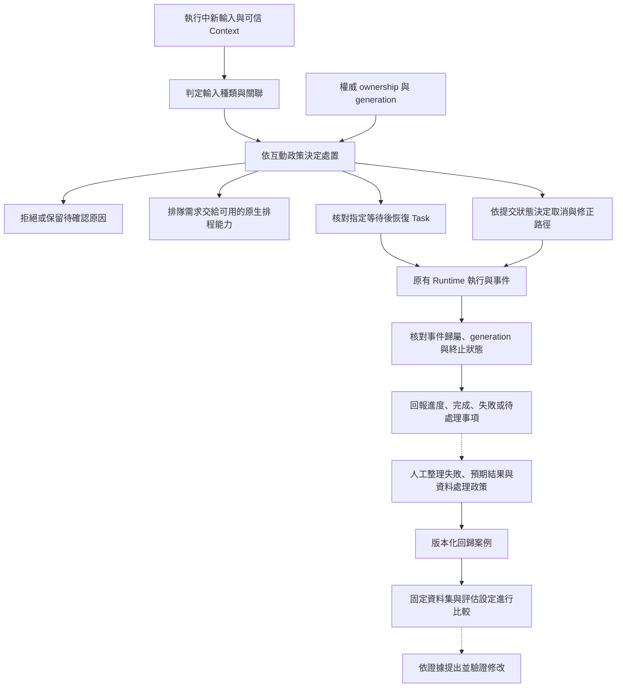

# Interaction and Feedback

[English](./README.md) | [繁體中文](./README-zh-TW.md)

本篇章接在 [Action Governance](../action-governance/README-zh-TW.md) 之後。前區追蹤單次工具呼叫的授權、批准、派送與效果；本篇章處理任務尚未結束時的新輸入、等待與恢復、取消及可見狀態，再把可查證的失敗整理成後續評估材料。

## 閱讀順序

| 篇次 | 文章 | 要回答的問題 | 檔名 |
|---|---|---|---|
| 01 | [執行中新輸入與互動策略](./01-in-flight-input-policy-zh-TW.md) | 新訊息是補充、改意、取消、重複輸入，還是另一項任務？ | `01-in-flight-input-policy-zh-TW.md` |
| 02 | [Run 歸屬與可見狀態](./02-run-ownership-and-visible-state-zh-TW.md) | 哪一次執行有權更新目前畫面，舊回呼何時必須停止清理？ | `02-run-ownership-and-visible-state-zh-TW.md` |
| 03 | [釐清提問與任務恢復](./03-clarification-and-resume-zh-TW.md) | 使用者的回答應交給哪一次等待，恢復前要核對哪些條件？ | `03-clarification-and-resume-zh-TW.md` |
| 04 | [取消、修正與已生效操作](./04-cancellation-and-correction-zh-TW.md) | 停止要求到達時，哪些工作還能阻止，哪些效果必須另行處理？ | `04-cancellation-and-correction-zh-TW.md` |
| 05 | [回饋、評估與回歸案例](./05-feedback-and-evaluation-zh-TW.md) | 如何把一次失敗變成可重現、可比較且經過資料處理的測試材料？ | `05-feedback-and-evaluation-zh-TW.md` |
| 06 | [一次追問到回饋的控制流程](./06-case-interaction-to-feedback-zh-TW.md) | 能否把輸入歸屬、恢復、舊輸出與回歸證據連回同一項情境？ | `06-case-interaction-to-feedback-zh-TW.md` |

## 架構與責任範圍

下圖是文章的閱讀模型，方塊不表示程式中存在同名型別，也不表示整條鏈已完成端到端整合。下半部的回歸案例是後續整理與評估流程，不能據此宣稱產品會自動修改 Prompt、政策或模型。

- **Foundations** 已說明使用者介入、晚到輸出與完成證據；本篇章追到實際 consumer、設定與失敗分支。
- **Input and Context** 負責輸入形狀、來源、指令權威與容量；本篇章從已正規化輸入開始，追蹤它在活動任務中的歸屬與處置。
- **Behavior and Capabilities** 負責有效指令、工具組裝與候選範圍；這裡只說明新輸入何時影響既有任務，不重講 loader 與工具選擇。
- **Action Governance** 負責工具批准與副作用契約；本篇章引用其提交狀態與補償條件，聚焦整項互動的取消及修正決策。釐清回答與工具批准必須分開。
- **Agent Runtime** 後續處理執行核心、checkpoint、恢復及事件傳遞細節；本篇章保留政策與可見狀態責任，不另建一套通用 Run queue 或 worker runtime。

## 01. 執行中新輸入與互動策略

### 文章範圍

從已有活動 Run 時收到另一份輸入開始，說明 deterministic 訊號、語意分類建議與互動政策如何組合。先辨認輸入，再追蹤目前入口能採用哪些處置，避免把同一個送出按鈕理解成永遠建立新任務。

正文主題：

1. `prompt`、`clarification_resume`、`cancel` 與可信 Context 如何進入互動入口；輸入正規化細節連回前區。
2. `classifyInteractionInput()` 的五類結果：釐清回答、意圖修訂、取消、新任務與重複輸入。
3. 明確取消、相同 idempotency key 加相同 bytes、指定等待回覆的 deterministic 分支。
4. 語意建議的 `awaiting_confirmation`，以及分類器不可用時的保守結果。
5. `InteractionPolicy` 的策略、釐清回覆模式、取消模式與意圖修訂設定。
6. disposition 如何交給 orchestrator；拒絕、重用、恢復、要求原生 queue 與替換的差異。
7. CCB 忙碌時的 prompt／bash enqueue、可中斷工具條件與立即命令分支。

### 查證與失敗分支

- `DEFAULT_INTERACTION_POLICY` 有 `enqueue`，但未配置政策時 orchestrator 是 no-op。型別預設值不能當成所有正式入口已啟用的行為。
- `enqueue` 的現有 consumer 回傳 `NATIVE_QUEUE_OWNERSHIP_REQUIRED` 並拒絕本地派送；正文不得畫出未確認的本地持久排隊與自動取出流程。
- 分類 helper 有 pending／confirm／timeout 函式，但目前 orchestrator 對 tentative 結果以 `INPUT_CLASSIFICATION_CONFIRMATION_REQUIRED` 停止；完整分類確認介面及回傳入口須另外查證。
- 重複輸入的分類與已完成結果重用是不同接點。須區分 `duplicate_input` 標記、可信 idempotency storage 與實際 cached result。
- CCB 有自己的命令佇列與同步 QueryGuard，不套用 Chat Gun 的原生 queue 邊界或 PostgreSQL ownership 型別。

主要來源：[G1][g-runtime]、[G2][g-policy]、[G3][g-classify]、[G4][g-guard]、[C1][c-submit]、[C2][c-guard]。

圖解候選：輸入種類 → classification／disposition → 實際 consumer 的處置對照，將「需要確認但尚未完整接線」與「原生 queue 前置條件」標成停止出口。

## 02. Run 歸屬與可見狀態

### 文章範圍

以相同 Thread／Scope 中的新舊 Run 為主線，分開說明權威 ownership、程序內 query guard、事件 generation 與前端顯示狀態。讀者要能指出誰可以更新畫面，也能辨認「已終止」與「業務成功」的不同來源。

正文主題：

1. Request、Thread、Task、Run、generation 與 native Run status 各自的用途。
2. `PgActiveRunOwnershipRepository` 的 claim、條件式 supersede 與 terminal 更新。
3. Query Guard 在 `dispatching` 與 `running` 之間的保留，以及舊 finalizer 不清除新 generation 的條件。
4. Client active-run hint 與資料庫 ownership 的權威差異。
5. Backend 先交付互動事件，前端 reducer 再依提供的 generation 過濾舊活動。
6. Task reducer 的終止狀態保護、活動封存與重新送出的區別。
7. CCB `reserve()`、`tryStart()`、`end(generation)` 與 `forceEnd()` 的程序內對照。

### 查證與失敗分支

- Ownership repository 的 CAS 與 QueryGuard 的 Map 各有責任。Mock 競態測試不是正式 PostgreSQL 多連線壓測。
- `createGovernedStream()` 先發送互動事件再轉送 chunks，本身未逐個 chunk 重查 ownership；不可寫成 backend 已自動丟棄每個舊輸出。
- `streamActivityReducer` 的 generation 過濾取決於 action 有提供 generation；terminal action 與沒有 generation 的事件須另追呼叫端。正式寫作前補查 App、事件 parser 與 BFF 透傳，才可主張整段顯示路徑覆蓋。
- Task reducer 的終止後忽略與串流活動 reducer 的終止保護分開說明，不將其中一者套到全部訊息顯示。
- Wrapper 對非取消錯誤也可能以 ownership `completed` 做收尾，再記錄 failed idempotency。這個欄位不能等同工具成功、Task 成功或 native Run success。

主要來源：[G1][g-runtime]、[G4][g-guard]、[G5][g-ownership]、[G6][g-events]、[G7][g-ui]、[G8][g-reducer]、[C2][c-guard]、[G18][g-boundary]。

圖解候選：Run A／generation N 與 Run B／generation N+1 的泳道，分開畫 ownership 替換、舊 finalizer、晚到活動與 UI 可見狀態。

## 03. 釐清提問與任務恢復

### 文章範圍

從一個指定的釐清等待開始，追蹤回答如何對回 interrupt、Task、Run 與 Scope。工具授權批准連回 Action Governance，這篇只處理「還缺什麼任務資訊」及其恢復契約。

正文主題：

1. 釐清回答、意圖分類確認與工具批准的差異。
2. `clarificationReplyMode` 的 `resume_same_task` 與 `new_task`。
3. `createClarificationResumeAuthorizer()` 讀取 manifest、核對種類與關聯。
4. Waiting 狀態、期限、response Schema 與 execution manifest compatibility。
5. 單次 consume 成功後，orchestrator 如何保留 Task 並替換 ownership。
6. `clarification_resumed` 事件、interrupt ID 與後續 Graph 執行交接。
7. Checkpoint 與伺服器恢復能力的證據範圍。

### 查證與失敗分支

- 「恢復同一 Task」不表示沿用同一 Run／generation；所讀分支使用新 Run ID 與遞增 generation，Task ID 對回等待中的任務。
- Manifest 缺少、類型不符、關聯不符、非 waiting、過期、回應不合法、版本不相容與 consume 被拒絕要分別保留原因。
- Production resolver 在所讀組裝中只解析 Deep Researcher 的 current execution manifest，不能將此釐清 authorizer 宣稱成所有 Graph 的通用恢復能力。
- 本輪已讀 authorizer 與測試；正式正文仍須續查 Deep Researcher 的 interrupt 產生、manifest 保存與實際 resume payload 消費，才可將完整往返描述為已接線。
- 已有 boundary 文件記錄 dev 環境的歷史觀察，但不是本輪新跑的證據，也不升格為正式部署 PostgreSQL／Redis、強制 kill 或跨部署恢復保證。

主要來源：[G1][g-runtime]、[G3][g-classify]、[G9][g-resume]、[G14][g-resume-test]、[G18][g-boundary]。

圖解候選：等待資料 → 回答與 interrupt ID → 關聯／Schema／版本檢查 → consume → 同 Task、新 Run 的交接；拒絕出口標出對應原因。

## 04. 取消、修正與已生效操作

### 文章範圍

從使用者要求停止或修改既有任務開始，對照已知提交狀態與互動決策。前區已展開工具重試、Ledger 與補償，這篇聚焦是否替換活動 Run，以及使用者應收到什麼取消結果。

正文主題：

1. 「停止顯示」「取消等待」「停止工具」與「外部效果還原」各自需要的條件。
2. `deriveCancellationPhase()` 的 read-only、可逆已提交、不可逆已提交與 unknown。
3. `decideCancellation()` 對補償、回查與 `interaction.corrective` 授權的依賴。
4. Orchestrator 接受哪些 cancellation path 才進入 supersede，哪些保留 corrective／manual handling。
5. 替換 ownership 與真正停止底層執行之間的差距；AbortSignal 要追到實際 consumer。
6. CCB query abort 後補齊 tool result blocks、保留訊息結構的做法。
7. 對使用者區分「已收到取消」「已停止等待」「已確認無提交」「已提交待修正」。

### 查證與失敗分支

- `decideCancellation()` 需要 Ledger、compensate、reconcile 與 corrective authorizer。Policy 的 `cancellationMode` 欄位存在，不表示這些依賴已在每個 production 入口完成注入。
- 所讀 production orchestrator 建構沒有提供預設 `decideCancellation`，替換策略需要的 callback 由設定提供；未找到實際 consumer 前，不能宣稱設定 supersede 就會自動停止原 Run。
- Orchestrator 只讓 `interrupt_or_supersede`、`compensated_then_supersede` 進入 ownership 替換。`corrective_authorized` 也不代表本函式已啟動修正任務；須另查後續 consumer。
- Cancellation phase 依 Ledger entries 推導，空集合在此 helper 回 `read_only`；Ledger 覆蓋不足不能據此推論外部世界一定沒有提交。
- CCB 的 synthetic tool results 是對話結構修復，不能拿來證明外部操作已被中止或復原。

主要來源：[G10][g-cancel]、[G1][g-runtime]、[G12][g-runtime-test]、[C3][c-query]，並連回[重試與副作用處理](../action-governance/05-retry-and-side-effects-zh-TW.md)。

圖解候選：取消請求與四種 effect phase 對照，再分成可替換、補償後替換、修正授權與人工處理；將「決策」與「實際執行取消／修正」分兩層。

## 05. 回饋、評估與回歸案例

### 文章範圍

從一筆具失敗類型與預期行為的 trace 材料開始，追蹤資料最小化、版本化 dataset、實驗執行及結果比較。使用者修正回答、對話內補充與離線回歸資料，各有不同目的與保留條件。

正文主題：

1. 區分使用者即時修訂、產品回饋、執行證據與評估樣本。
2. `createRedactedRegressionCase()` 如何選取 input 欄位、雜湊 trace ID，保留 failure type、build 與資料政策版本。
3. `addBadTraceRegressionCase()` 的 dataset name／version 與 case ID 檢查。
4. `feedback-loop.cli.ts` 接受 workflow 檔案，輸出新增案例與 before／after 比較結果。
5. `runExperiment()` 的資料集、Agent 設定、judge 設定、逐項失敗與實驗產物。
6. ToolCallCorrectness 與 ResponseQuality 的不同判斷依據。
7. 由 bad case 提出修改，再以相同資料與設定核對改善、退步與成本。

### 查證與失敗分支

- CLI 讀取已準備好的 workflow 並輸出 JSON，不會在這段程式裡自動啟動兩次實驗、部署修改或更新 Prompt。圖解須分開人工準備、模組轉換與實驗 consumer。
- Input allowlist、敏感欄位名稱規則與 trace ID digest 不等於完整 PII 去識別。允許欄位的值及 `expectedOutput` 仍需資料審閱；不得宣稱所有敏感資訊自動清乾淨。
- `compareVersionPinnedExperiments()` 檢查 dataset name／version，不能代替 Agent／judge／metric 設定一致性檢查；缺少的 metric 在此函式以 0 計算，也需要顯示與判讀規則。
- Tool-call metric 依觀察到的 calls 比對預期名稱與參數，並不是資源效果驗證；judge 分數也不能取代授權、重複效果或恢復控制的 deterministic 檢查。
- Trace 到案例、案例到評估、評估到修改是不同 consumer。本文不宣稱使用者按下回饋後產品會自動訓練或改善。

主要來源：[G11][g-feedback]、[G15][g-feedback-test]、[G16][g-feedback-cli]、[G17][g-experiment]、[G19][g-toolmetric]、[G20][g-qualitymetric]。

圖解候選：失敗證據 → 人工審閱／欄位處理 → 固定 dataset → 實驗與 deterministic／judge 指標 → 比較與修改決策，標出每階段的版本與缺口。

## 06. 一次追問到回饋的控制流程

### 主案例與對照

採用「等待使用者補充條件後繼續同一 Task，並處理舊 Run 的晚到輸出」作為教學情境。主控制路徑對照 `interaction-runtime.test.ts` 的 scoped clarification resume；ownership、stale cleanup 與 UI 行為再分別引用各自測試。最後以人工整理的 bad case 接回第五篇。

正文主題：

1. 列出原 Task、舊 Run／generation、interrupt、Scope 與新請求的身分；標明測試資料及尚待整合的部分。
2. 將回答對回指定等待，核對 authorizer consumer 與 manifest。
3. 保留 Task，建立新 Run／generation，核對 ownership、query guard 與事件。
4. 對照舊 finalizer、低 generation 活動與終止後事件，逐一說明是哪個 consumer 忽略。
5. 分支：過期或錯綁回覆、需要人工處理的取消、要求 enqueue 卻缺少 native queue ownership。
6. 由可重現的錯誤現象整理 expected behavior，再建立最小化回歸案例。
7. 列出能支持完成陳述的控制、資源與評估證據，以及實際部署尚缺的資料。

### 所需證據

| 主張 | 需要核對的資料 | 本輪已讀範圍 |
|---|---|---|
| 回覆只恢復指定等待 | Interrupt ID、manifest、可信關聯、Schema、consume 結果。 | Authorizer 與 mock 測試；Graph 產生到消費的完整往返待續查。 |
| 同 Task 可以有新 Run | Orchestrator supersede 參數與 ownership 結果。 | Wrapper 測試對回原 Task、新 Run 及預期 generation。 |
| 舊 finalizer 不清除新保留 | 新舊 runId／generation 與 guard state。 | QueryGuard 原始碼與測試案例。 |
| 舊活動不覆蓋新活動 | 事件 metadata、action generation、reducer 前後狀態。 | UI reducer 與測試；完整訊息顯示與 BFF 路徑待補。 |
| 取消後外部效果可交代 | Ledger、下游狀態、補償／回查結果。 | 決策 helper；未執行真實外部操作。 |
| 回饋可形成回歸材料 | 處理政策、dataset／build／metric 版本、expected behavior。 | Feedback helper、CLI 與 mock／固定資料測試。 |

多份測試可以支持分段說明，不能合稱已執行的一次完整 E2E。案例中的恢復、晚到輸出與資料集整理尚未在本輪串成可重現的正式請求，正文須保留教學情境的標示。

主要來源：[G12][g-runtime-test]、[G13][g-guard-test]、[G14][g-resume-test]、[G21][g-ui-test]、[G15][g-feedback-test]，並對照[基礎篇的一次任務](../foundations/05-one-turn-walkthrough-zh-TW.md)。

圖解候選：使用者、互動入口、ownership／manifest、Graph、UI、回歸資料整理的泳道。恢復與資料集整理之間使用虛線，避免暗示已存在自動接線。

## 來源與查證狀態

GUN-ATLAS v1.0 提供程式庫定位與起始索引。指定 session 檔案在原路徑及修正為使用者目錄下 `.codex` 的路徑均未找到，不列為已讀證據；附件中的面試回答規則不作為本篇章寫作格式。使用者提及的 claude-code-base，依附件所指的 Claude Code Best 程式庫處理。

| 來源 | 固定 commit | 用途 |
|---|---|---|
| [Chat Gun](https://github.com/HsienW/chat-gun) | `92a5673003e4ac4ec09be8b1b350f42dbf4a5e69` | 互動入口、ownership、分類、釐清恢復、取消與回饋評估。 |
| [Claude Code Best](https://github.com/claude-code-best/claude-code) | `77a7934e15d69da13879112ed7db695c9ee7a52a` | 第三方 Coding Agent 的 QueryGuard、提交／排隊與 query abort 對照。 |

CCB 為第三方專案，不當作 Anthropic 官方現行產品的必然行為。已讀原始碼、測試及 boundary 文件，只代表本輪知道其內容；沒有執行 unit、integration、E2E、真實 Provider、外部 MCP、資料庫競態或部署故障演練。來源文件中的歷史驗收結果也不當成本輪新產生的結果。

### 已查讀來源索引

| 索引 | 路徑 | 用途 |
|---|---|---|
| [G1][g-runtime] | `backend/src/platform/interaction-runtime.ts` | Policy 啟用、before／afterRun、釐清恢復、替換與串流 wrapper。 |
| [G2][g-policy] | `backend/src/runtime/interaction/policy.ts` | 策略、模式、預設值與配置解析。 |
| [G3][g-classify] | `backend/src/runtime/interaction/classify.ts` | Deterministic／tentative 分類與 disposition。 |
| [G4][g-guard] | `backend/src/runtime/input/query-guard.ts` | Reservation、durable owner 查找及 generation-aware release。 |
| [G5][g-ownership] | `backend/src/runtime/interaction/ownership.ts` | Claim、transactional supersede 與 terminal 更新。 |
| [G6][g-events] | `backend/src/runtime/interaction/events.ts` | 互動事件關聯、摘要、audit 與 trace metadata。 |
| [G7][g-ui] | `frontend/src/lib/stream-activity-state.ts` | 活動 generation 過濾與串流終止狀態。 |
| [G8][g-reducer] | `frontend/src/lib/task-event-reducer.ts` | Task 事件合併與 terminal late-event 保護。 |
| [G9][g-resume] | `backend/src/runtime/recovery/clarification-resume-authorization.ts` | 指定釐清等待的關聯、期限、Schema、相容性與 consume。 |
| [G10][g-cancel] | `backend/src/runtime/interaction/cancel-decision.ts` | Ledger phase、補償、回查與 corrective 決策。 |
| [G11][g-feedback] | `backend/src/operations/feedback-loop.ts` | 最小化案例、dataset 驗證與版本化實驗比較。 |
| [G12][g-runtime-test] | `backend/src/platform/interaction-runtime.test.ts` | 無配置、enqueue 拒絕、idempotency、取消與釐清恢復案例。 |
| [G13][g-guard-test] | `backend/src/runtime/input/query-guard.test.ts` | Dispatch gap、ownership 衝突與 stale finalizer 案例。 |
| [G14][g-resume-test] | `backend/src/runtime/recovery/clarification-resume-authorization.test.ts` | 回覆一次消費、重播與錯誤綁定案例。 |
| [G15][g-feedback-test] | `backend/src/operations/feedback-loop.test.ts` | 固定失敗資料的欄位處理、dataset 與比較案例。 |
| [G16][g-feedback-cli] | `backend/src/operations/feedback-loop.cli.ts` | Workflow 檔案入口及 JSON 輸出。 |
| [G17][g-experiment] | `backend/src/evaluation/opik/experiment.ts` | Dataset、Agent／judge 設定與實驗執行接點。 |
| [G18][g-boundary] | `docs/decisions/current-langgraph-runtime-boundary.md` | Native Run／Thread、dev 觀察與正式部署未驗證範圍。 |
| [G19][g-toolmetric] | `backend/src/evaluation/opik/metrics/tool-call-correctness.ts` | 預期與觀察到的 tool calls 比對。 |
| [G20][g-qualitymetric] | `backend/src/evaluation/opik/metrics/response-quality.ts` | Judge 設定、輸出解析與分數邊界。 |
| [G21][g-ui-test] | `frontend/src/lib/stream-activity-state.test.ts` | Generation、終止、取消與活動封存案例。 |
| [G22][g-chat] | `backend/src/agents/chatbot.ts` | 已確認 chatbot 匯出經過互動 wrapper；啟用仍取決於政策。 |
| [G23][g-ownership-test] | `backend/src/runtime/interaction/ownership.test.ts` | Repository mock 的 generation／CAS 競態案例。 |
| [C1][c-submit] | `src/utils/handlePromptSubmit.ts` | 忙碌輸入、enqueue、條件式 abort 與 query reservation。 |
| [C2][c-guard] | `src/utils/QueryGuard.ts` | 同步狀態與 generation-aware cleanup。 |
| [C3][c-query] | `src/query.ts` | Query abort 與 tool result 訊息結構修復。 |

## 正文補查結果與後續驗證

1. 已查 Deep Researcher 的 manifest 保存、`interrupt()`、`resumeClarify()` 與 MemorySaver 組裝；正式部署中等待 ownership、checkpoint 與資料庫的聯合生命週期仍需實際驗證。
2. 已查 App、事件 parser 與 BFF。正文分開說明 versioned envelope 的 Run 檢查、活動 generation 過濾及 terminal 保護，未將它擴大成全部文字與回呼皆受保護。
3. 已確認 App 同時呼叫 `thread.stop()` 與送出 business cancel；預設 production orchestrator 仍沒有注入 `decideCancellation`，也未在 ownership 替換段呼叫 native Run cancel API。
4. 已對照 UI 的 candidateIndex payload、normalized reader 與預設 strict response Schema。第三、六篇明列欄位不相容，沒有用分開的 mock 測試宣稱完整恢復已通過。
5. 已追 experiment 的預設 Deep Researcher runner、Agent timeout、metrics、本地 JSON 與 hosted 狀態。成本來源、judge timeout、工具證據與 UI regression runner 的限制列在第五、六篇。
6. Native queue 仍保留為未接通的前置條件；所讀 enqueue consumer 在本地派送前拒絕。若要宣稱排隊可用，需另查實際所有權與派送入口。
7. 每篇均保留停止或拒絕分支，區分原始碼、測試定義與執行證據。六篇初稿及導覽只做文件結構、來源與本地連結檢查，未執行來源庫的測試。
8. 八張圖解已提供中英文 SVG／HTML 分檔，資產放在 `assets/agent-harness/interaction-and-feedback/`，並由各語言文章引用對應版本。

### 正文新增來源

| 接點 | 補查用途 |
|---|---|
| [App][g-app]、[App 測試][g-app-test] | Hint 更新、活動 Run 檢查、釐清送出、transport stop 與 business cancel。 |
| [事件 parser][g-parser]、[BFF][g-bff] | Generation／Run hint 提取、metadata 轉送與 response body pipe。 |
| [Deep Researcher][g-deep]、[釐清 manifest][g-manifest] | 候選地點、等待保存、interrupt、節點恢復與 checkpoint 組裝。 |
| [Response Schema][g-schema] | 預設回覆形狀及 candidateIndex 的 strict 介面差異。 |
| [Normalized reader][g-reader]、[輸入型別][g-normalized] | Resume 值的取出與後續 Schema 檢查界線。 |
| [Experiment 測試][g-experiment-test] | 版本、Provider／judge 設定、失敗、timeout、skipped 與 hosted 結果的測試安排。 |

[g-runtime]: https://github.com/HsienW/chat-gun/blob/92a5673003e4ac4ec09be8b1b350f42dbf4a5e69/backend/src/platform/interaction-runtime.ts
[g-policy]: https://github.com/HsienW/chat-gun/blob/92a5673003e4ac4ec09be8b1b350f42dbf4a5e69/backend/src/runtime/interaction/policy.ts
[g-classify]: https://github.com/HsienW/chat-gun/blob/92a5673003e4ac4ec09be8b1b350f42dbf4a5e69/backend/src/runtime/interaction/classify.ts
[g-guard]: https://github.com/HsienW/chat-gun/blob/92a5673003e4ac4ec09be8b1b350f42dbf4a5e69/backend/src/runtime/input/query-guard.ts
[g-ownership]: https://github.com/HsienW/chat-gun/blob/92a5673003e4ac4ec09be8b1b350f42dbf4a5e69/backend/src/runtime/interaction/ownership.ts
[g-events]: https://github.com/HsienW/chat-gun/blob/92a5673003e4ac4ec09be8b1b350f42dbf4a5e69/backend/src/runtime/interaction/events.ts
[g-ui]: https://github.com/HsienW/chat-gun/blob/92a5673003e4ac4ec09be8b1b350f42dbf4a5e69/frontend/src/lib/stream-activity-state.ts
[g-reducer]: https://github.com/HsienW/chat-gun/blob/92a5673003e4ac4ec09be8b1b350f42dbf4a5e69/frontend/src/lib/task-event-reducer.ts
[g-resume]: https://github.com/HsienW/chat-gun/blob/92a5673003e4ac4ec09be8b1b350f42dbf4a5e69/backend/src/runtime/recovery/clarification-resume-authorization.ts
[g-cancel]: https://github.com/HsienW/chat-gun/blob/92a5673003e4ac4ec09be8b1b350f42dbf4a5e69/backend/src/runtime/interaction/cancel-decision.ts
[g-feedback]: https://github.com/HsienW/chat-gun/blob/92a5673003e4ac4ec09be8b1b350f42dbf4a5e69/backend/src/operations/feedback-loop.ts
[g-runtime-test]: https://github.com/HsienW/chat-gun/blob/92a5673003e4ac4ec09be8b1b350f42dbf4a5e69/backend/src/platform/interaction-runtime.test.ts
[g-guard-test]: https://github.com/HsienW/chat-gun/blob/92a5673003e4ac4ec09be8b1b350f42dbf4a5e69/backend/src/runtime/input/query-guard.test.ts
[g-resume-test]: https://github.com/HsienW/chat-gun/blob/92a5673003e4ac4ec09be8b1b350f42dbf4a5e69/backend/src/runtime/recovery/clarification-resume-authorization.test.ts
[g-feedback-test]: https://github.com/HsienW/chat-gun/blob/92a5673003e4ac4ec09be8b1b350f42dbf4a5e69/backend/src/operations/feedback-loop.test.ts
[g-feedback-cli]: https://github.com/HsienW/chat-gun/blob/92a5673003e4ac4ec09be8b1b350f42dbf4a5e69/backend/src/operations/feedback-loop.cli.ts
[g-experiment]: https://github.com/HsienW/chat-gun/blob/92a5673003e4ac4ec09be8b1b350f42dbf4a5e69/backend/src/evaluation/opik/experiment.ts
[g-boundary]: https://github.com/HsienW/chat-gun/blob/92a5673003e4ac4ec09be8b1b350f42dbf4a5e69/docs/decisions/current-langgraph-runtime-boundary.md
[g-toolmetric]: https://github.com/HsienW/chat-gun/blob/92a5673003e4ac4ec09be8b1b350f42dbf4a5e69/backend/src/evaluation/opik/metrics/tool-call-correctness.ts
[g-qualitymetric]: https://github.com/HsienW/chat-gun/blob/92a5673003e4ac4ec09be8b1b350f42dbf4a5e69/backend/src/evaluation/opik/metrics/response-quality.ts
[g-ui-test]: https://github.com/HsienW/chat-gun/blob/92a5673003e4ac4ec09be8b1b350f42dbf4a5e69/frontend/src/lib/stream-activity-state.test.ts
[g-chat]: https://github.com/HsienW/chat-gun/blob/92a5673003e4ac4ec09be8b1b350f42dbf4a5e69/backend/src/agents/chatbot.ts
[g-ownership-test]: https://github.com/HsienW/chat-gun/blob/92a5673003e4ac4ec09be8b1b350f42dbf4a5e69/backend/src/runtime/interaction/ownership.test.ts
[c-submit]: https://github.com/claude-code-best/claude-code/blob/77a7934e15d69da13879112ed7db695c9ee7a52a/src/utils/handlePromptSubmit.ts
[c-guard]: https://github.com/claude-code-best/claude-code/blob/77a7934e15d69da13879112ed7db695c9ee7a52a/src/utils/QueryGuard.ts
[c-query]: https://github.com/claude-code-best/claude-code/blob/77a7934e15d69da13879112ed7db695c9ee7a52a/src/query.ts
[g-reader]: https://github.com/HsienW/chat-gun/blob/92a5673003e4ac4ec09be8b1b350f42dbf4a5e69/backend/src/runtime/input/read-normalized-agent-input.ts
[g-app]: https://github.com/HsienW/chat-gun/blob/92a5673003e4ac4ec09be8b1b350f42dbf4a5e69/frontend/src/App.tsx
[g-bff]: https://github.com/HsienW/chat-gun/blob/92a5673003e4ac4ec09be8b1b350f42dbf4a5e69/bff/src/server.ts
[g-parser]: https://github.com/HsienW/chat-gun/blob/92a5673003e4ac4ec09be8b1b350f42dbf4a5e69/frontend/src/lib/agent-runtime-events.ts
[g-app-test]: https://github.com/HsienW/chat-gun/blob/92a5673003e4ac4ec09be8b1b350f42dbf4a5e69/frontend/src/App.stream-activity.test.tsx
[g-deep]: https://github.com/HsienW/chat-gun/blob/92a5673003e4ac4ec09be8b1b350f42dbf4a5e69/backend/src/agents/deep-researcher.ts
[g-manifest]: https://github.com/HsienW/chat-gun/blob/92a5673003e4ac4ec09be8b1b350f42dbf4a5e69/backend/src/runtime/recovery/clarification-manifest.ts
[g-normalized]: https://github.com/HsienW/chat-gun/blob/92a5673003e4ac4ec09be8b1b350f42dbf4a5e69/backend/src/runtime/input/normalized-agent-input.ts
[g-schema]: https://github.com/HsienW/chat-gun/blob/92a5673003e4ac4ec09be8b1b350f42dbf4a5e69/backend/src/runtime/recovery/resume-response-schema-registry.ts
[g-experiment-test]: https://github.com/HsienW/chat-gun/blob/92a5673003e4ac4ec09be8b1b350f42dbf4a5e69/backend/src/evaluation/opik/experiment.test.ts
