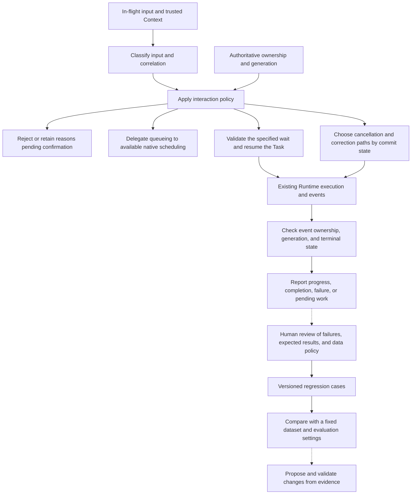

# Interaction and Feedback

[English](./README.md) | [繁體中文](./README-zh-TW.md) | [简体中文](./README-zh-CN.md)

This section follows [Action Governance](../action-governance/README.md). That section traces authorization, approval, dispatch, and effects for a single tool call. This section handles new input, waiting and resumption, cancellation, and visible state while a task is still active, then turns verifiable failures into material for subsequent evaluation.

## Reading order

| Number | Article | Question | Filename |
|---|---|---|---|
| 01 | [In-flight input and interaction policy](./01-in-flight-input-policy.md) | Is a new message additional information, an intent revision, cancellation, duplicate input, or another task? | `01-in-flight-input-policy.md` |
| 02 | [Run ownership and visible state](./02-run-ownership-and-visible-state.md) | Which execution may update the current view, and when must an old callback stop cleanup? | `02-run-ownership-and-visible-state.md` |
| 03 | [Clarification and task resumption](./03-clarification-and-resume.md) | Which wait receives the user's answer, and what must be checked before resuming? | `03-clarification-and-resume.md` |
| 04 | [Cancellation, correction, and committed effects](./04-cancellation-and-correction.md) | When a stop request arrives, which work can still be prevented and which effects require separate handling? | `04-cancellation-and-correction.md` |
| 05 | [Feedback, evaluation, and regression cases](./05-feedback-and-evaluation.md) | How does a failure become reproducible, comparable test material with appropriate data handling? | `05-feedback-and-evaluation.md` |
| 06 | [Control flow from a follow-up to feedback](./06-case-interaction-to-feedback.md) | Can input ownership, resumption, stale output, and regression evidence be traced to the same scenario? | `06-case-interaction-to-feedback.md` |

## Architecture and responsibilities

The diagram is a reading model. Its blocks do not establish that identically named types exist in the code or that the entire chain has been integrated end to end. The regression cases in the lower half belong to subsequent preparation and evaluation. They do not establish that the product automatically changes Prompts, policies, or models.

- **Foundations** covers user intervention, late output, and completion evidence. This section traces actual consumers, configuration, and failure branches.
- **Input and Context** owns input shape, sources, instruction authority, and capacity. This section starts with normalized input and traces its ownership and disposition during an active task.
- **Behavior and Capabilities** owns effective instructions, tool composition, and candidate scope. This section explains when new input affects an existing task, without repeating loaders and tool selection.
- **Action Governance** owns tool approval and side-effect contracts. This section uses its commit states and compensation conditions to examine cancellation and correction of the overall interaction. Clarification answers and tool approvals have separate contracts.
- **Agent Runtime** subsequently covers execution internals, checkpoints, recovery, and event delivery. This section retains responsibility for policy and visible state without introducing another general Run queue or worker runtime.

## 01. In-flight input and interaction policy

### Article scope

Start when another input arrives during an active Run, and explain how deterministic signals, semantic classification suggestions, and interaction policy combine. Identify the input first, then trace which dispositions the current entry point supports. The same submit button need not always create a new task.

Key topics:

1. How `prompt`, `clarification_resume`, `cancel`, and trusted Context enter the interaction entry point. Input normalization details refer back to the preceding section.
2. The five results of `classifyInteractionInput()`: clarification answer, intent revision, cancellation, new task, and duplicate input.
3. Deterministic branches for explicit cancellation, the same idempotency key with identical bytes, and replies to a specified wait.
4. Semantic suggestions in `awaiting_confirmation` and conservative results when the classifier is unavailable.
5. Strategies, clarification reply modes, cancellation modes, and intent revision settings in `InteractionPolicy`.
6. How disposition reaches the orchestrator, including rejection, reuse, resumption, native queue requirements, and replacement.
7. CCB's busy-time prompt/bash enqueue behavior, interruptible-tool conditions, and immediate-command branches.

### Verification and failure branches

- `DEFAULT_INTERACTION_POLICY` contains `enqueue`, but the orchestrator is a no-op when no policy is configured. Type defaults do not establish enabled behavior at every production entry point.
- The current `enqueue` consumer returns `NATIVE_QUEUE_OWNERSHIP_REQUIRED` and rejects local dispatch. That return value does not establish a local persistent queue or automatic dequeue flow.
- Classification helpers provide pending/confirm/timeout functions, but the current orchestrator stops tentative results with `INPUT_CLASSIFICATION_CONFIRMATION_REQUIRED`. The full confirmation UI and return entry point require separate verification.
- Duplicate classification and reuse of completed results occur at separate integration points. Distinguish the `duplicate_input` label, trusted idempotency storage, and the actual cached result.
- CCB has its own command queue and synchronous QueryGuard. Chat Gun's native queue boundary and PostgreSQL ownership types do not apply to it.

Main sources: [G1][g-runtime], [G2][g-policy], [G3][g-classify], [G4][g-guard], [C1][c-submit], [C2][c-guard].

## 02. Run ownership and visible state

### Article scope

Follow old and new Runs in the same Thread/Scope, separating authoritative ownership, the in-process query guard, event generation, and frontend display state. Readers should identify who may update the view and distinguish termination from business success by their respective evidence sources.

Key topics:

1. The roles of Request, Thread, Task, Run, generation, and native Run status.
2. Claims, conditional supersede, and terminal updates in `PgActiveRunOwnershipRepository`.
3. Query Guard reservations between `dispatching` and `running`, and the conditions preventing an old finalizer from clearing a new generation.
4. The authority difference between a client active-run hint and database ownership.
5. Backend delivery of interaction events before the frontend reducer filters stale activity using supplied generation metadata.
6. Terminal-state protection in the Task reducer, activity archival, and resubmission.
7. In-process comparisons with CCB `reserve()`, `tryStart()`, `end(generation)`, and `forceEnd()`.

### Verification and failure branches

- The ownership repository's CAS and QueryGuard's Map have separate responsibilities. Mock race tests do not establish production PostgreSQL behavior under concurrent connections.
- `createGovernedStream()` emits interaction events before forwarding chunks. It does not itself recheck ownership for each chunk, so the article cannot claim the backend automatically discards every stale output.
- Generation filtering in `streamActivityReducer` depends on the action supplying generation. Trace terminal actions and events without generation to their callers. Inspect App, the event parser, and BFF forwarding before claiming coverage of the full display path.
- Explain the Task reducer's handling of events after termination separately from terminal protection in the stream activity reducer. Neither behavior applies automatically to all message displays.
- The wrapper may finalize ownership as `completed` even for non-cancellation errors, then record failed idempotency. That field cannot be equated with tool success, Task success, or native Run success.

Main sources: [G1][g-runtime], [G4][g-guard], [G5][g-ownership], [G6][g-events], [G7][g-ui], [G8][g-reducer], [C2][c-guard], [G18][g-boundary].

## 03. Clarification and task resumption

### Article scope

Start with a specific clarification wait and trace how an answer correlates with its interrupt, Task, Run, and Scope. Tool authorization approval refers back to Action Governance. This article handles missing task information and the contract for resuming with it.

Key topics:

1. Differences among clarification answers, intent-classification confirmation, and tool approval.
2. `resume_same_task` and `new_task` in `clarificationReplyMode`.
3. Manifest loading, kind checks, and correlation checks in `createClarificationResumeAuthorizer()`.
4. Waiting state, expiry, response Schema, and execution manifest compatibility.
5. How the orchestrator preserves the Task and replaces ownership after successful single consumption.
6. The `clarification_resumed` event, interrupt ID, and handoff to subsequent Graph execution.
7. The evidence scope for checkpoints and server recovery.

### Verification and failure branches

- Resuming the same Task does not imply retaining the same Run/generation. The inspected branch uses a new Run ID and increments generation, while the Task ID identifies the waiting task.
- Preserve distinct reasons for a missing manifest, wrong kind, correlation mismatch, non-waiting state, expiry, invalid response, incompatible version, and rejected consumption.
- In the inspected assembly, the production resolver resolves only Deep Researcher's current execution manifest. This clarification authorizer cannot be described as general recovery support for every Graph.
- The authorizer and tests were read during this work. Trace Deep Researcher's interrupt creation, manifest persistence, and actual resume payload consumption before describing the complete round trip as integrated.
- The boundary document contains historical development-environment observations. They are not newly executed evidence from this work or guarantees for production PostgreSQL/Redis, forced termination, or recovery across deployments.

Main sources: [G1][g-runtime], [G3][g-classify], [G9][g-resume], [G14][g-resume-test], [G18][g-boundary].

## 04. Cancellation, correction, and committed effects

### Article scope

Start with a user asking to stop or revise an existing task, and compare known commit state with interaction decisions. The preceding section covers tool retries, Ledgers, and compensation. This article focuses on whether to replace the active Run and which cancellation result the user should receive.

Key topics:

1. Conditions required to stop display, cancel a wait, stop a tool, and reverse external effects.
2. Read-only, reversibly committed, irreversibly committed, and unknown phases in `deriveCancellationPhase()`.
3. Dependencies of `decideCancellation()` on compensation, reconciliation, and `interaction.corrective` authorization.
4. Which cancellation paths the orchestrator accepts for supersede and which retain corrective/manual handling.
5. The gap between replacing ownership and stopping underlying execution. Trace AbortSignal to its actual consumer.
6. How CCB fills tool result blocks after query abort to preserve message structure.
7. Distinguishing cancellation received, waiting stopped, no commit confirmed, and committed effects awaiting correction in user-facing results.

### Verification and failure branches

- `decideCancellation()` needs the Ledger, compensate, reconcile, and corrective authorizer. The existence of the policy's `cancellationMode` field does not establish dependency injection at every production entry point.
- The inspected production orchestrator constructor supplies no default `decideCancellation`. The callback required by replacement policy comes from configuration. Confirm an actual consumer before claiming that supersede configuration automatically stops the original Run.
- The orchestrator allows only `interrupt_or_supersede` and `compensated_then_supersede` to replace ownership. `corrective_authorized` also does not establish that this function started a corrective task. Trace the subsequent consumer separately.
- Cancellation phase is derived from Ledger entries. This helper returns `read_only` for an empty set, but incomplete Ledger coverage cannot establish that nothing committed externally.
- CCB's synthetic tool results repair conversation structure. They do not prove that an external operation was stopped or reversed.

Main sources: [G10][g-cancel], [G1][g-runtime], [G12][g-runtime-test], [C3][c-query], together with [Retries and side effects](../action-governance/05-retry-and-side-effects.md).

## 05. Feedback, evaluation, and regression cases

### Article scope

Start with trace material carrying a failure type and expected behavior, then trace data minimization, versioned datasets, experiment execution, and result comparison. Immediate user corrections, conversational additions, and offline regression data have different purposes and retention conditions.

Key topics:

1. Distinguish immediate user revisions, product feedback, execution evidence, and evaluation samples.
2. How `createRedactedRegressionCase()` selects input fields, hashes trace IDs, and retains failure type, build, and data policy version.
3. Dataset name/version and case ID checks in `addBadTraceRegressionCase()`.
4. How `feedback-loop.cli.ts` accepts a workflow file and outputs added cases and before/after comparisons.
5. Datasets, Agent configuration, judge configuration, per-item failures, and experiment artifacts in `runExperiment()`.
6. The different criteria used by ToolCallCorrectness and ResponseQuality.
7. Propose a change from a bad case, then use the same data and settings to check improvements, regressions, and cost.

### Verification and failure branches

- The CLI reads a prepared workflow and outputs JSON. This code does not automatically start two experiments, deploy changes, or update Prompts. Diagrams must separate manual preparation, module transformations, and experiment consumers.
- Input allowlists, sensitive-field naming rules, and trace ID digests do not establish complete PII de-identification. Allowed field values and `expectedOutput` still need data review. Do not claim automatic removal of all sensitive information.
- `compareVersionPinnedExperiments()` checks dataset name/version. Agent/judge/metric configuration consistency requires additional checks. The function treats missing metrics as 0, which also needs explicit display and interpretation rules.
- The tool-call metric compares observed calls with expected names and parameters. It does not verify resource effects. Judge scores also cannot replace deterministic checks for authorization, duplicate effects, or recovery control.
- Trace-to-case, case-to-evaluation, and evaluation-to-change are different consumers. This article does not claim that pressing a feedback button automatically trains or improves the product.

Main sources: [G11][g-feedback], [G15][g-feedback-test], [G16][g-feedback-cli], [G17][g-experiment], [G19][g-toolmetric], [G20][g-qualitymetric].

## 06. Control flow from a follow-up to feedback

### Main case and comparisons

Use a teaching scenario that resumes the same Task after the user supplies missing conditions while handling late output from the old Run. Compare the main control path with scoped clarification resume in `interaction-runtime.test.ts`. Cite the separate ownership, stale cleanup, and UI tests for their respective behavior. Finally connect a manually prepared bad case to article five.

Key topics:

1. List identities for the original Task, old Run/generation, interrupt, Scope, and new request. Mark test data and portions awaiting integration.
2. Correlate the answer with its specified wait and check the authorizer consumer and manifest.
3. Preserve the Task, create a new Run/generation, and check ownership, query guard, and events.
4. Compare the old finalizer, lower-generation activity, and post-terminal events, identifying which consumer ignores each.
5. Branches for expired or incorrectly bound replies, cancellation requiring human handling, and enqueue requested without native queue ownership.
6. Derive expected behavior from a reproducible error, then create a minimal regression case.
7. List control, resource, and evaluation evidence supporting completion statements, and the data still needed from actual deployment.

### Required evidence

| Claim | Data to check | Inspected scope |
|---|---|---|
| A reply resumes only the specified wait | Interrupt ID, manifest, trusted correlation, Schema, and consumption result. | Authorizer and mock tests. The full Graph creation-to-consumption round trip needs further inspection. |
| The same Task can have a new Run | Orchestrator supersede parameters and ownership results. | Wrapper tests correlate the original Task, new Run, and expected generation. |
| An old finalizer cannot clear a new reservation | Old/new runId and generation, and guard state. | QueryGuard source and test cases. |
| Old activity does not overwrite new activity | Event metadata, action generation, and reducer state before/after. | UI reducer and tests. Full message display and BFF paths need further inspection. |
| External effects can be explained after cancellation | Ledger, downstream state, and compensation/reconciliation results. | Decision helpers. No real external operations were executed. |
| Feedback can form regression material | Processing policy, dataset/build/metric versions, and expected behavior. | Feedback helpers, CLI, and mock/fixed-data tests. |

Multiple tests can support separate explanations. They cannot collectively be described as one executed E2E flow. Resumption, late output, and dataset preparation in this case were not connected into a reproducible production request during this work. The implementations must retain the teaching-scenario label.

Main sources: [G12][g-runtime-test], [G13][g-guard-test], [G14][g-resume-test], [G21][g-ui-test], [G15][g-feedback-test], compared with [the Foundations task walkthrough](../foundations/05-one-turn-walkthrough.md).

## Sources and verification status

| Source | Pinned commit | Use |
|---|---|---|
| [Chat Gun](https://github.com/HsienW/chat-gun) | `92a5673003e4ac4ec09be8b1b350f42dbf4a5e69` | Interaction entry points, ownership, classification, clarification resumption, cancellation, and feedback evaluation. |
| [Claude Code Best](https://github.com/claude-code-best/claude-code) | `77a7934e15d69da13879112ed7db695c9ee7a52a` | Comparisons with a third-party Coding Agent's QueryGuard, submission/queuing, and query abort. |

CCB is a third-party project and is not treated as mandatory behavior of the current official Anthropic product. Reading source, tests, and the boundary document establishes familiarity with their contents. No unit, integration, E2E, live Provider, external MCP, database race, or deployment failure tests were executed during this work. Historical acceptance results in source documents are not newly produced results from this work.

### Inspected source index

| Index | Path | Use |
|---|---|---|
| [G1][g-runtime] | `backend/src/platform/interaction-runtime.ts` | Policy enablement, before/afterRun, clarification resumption, replacement, and stream wrapping. |
| [G2][g-policy] | `backend/src/runtime/interaction/policy.ts` | Strategies, modes, defaults, and configuration parsing. |
| [G3][g-classify] | `backend/src/runtime/interaction/classify.ts` | Deterministic/tentative classification and disposition. |
| [G4][g-guard] | `backend/src/runtime/input/query-guard.ts` | Reservations, durable owner lookup, and generation-aware release. |
| [G5][g-ownership] | `backend/src/runtime/interaction/ownership.ts` | Claims, transactional supersede, and terminal updates. |
| [G6][g-events] | `backend/src/runtime/interaction/events.ts` | Interaction event correlation, summaries, audit, and trace metadata. |
| [G7][g-ui] | `frontend/src/lib/stream-activity-state.ts` | Activity generation filtering and stream termination state. |
| [G8][g-reducer] | `frontend/src/lib/task-event-reducer.ts` | Task event merging and terminal late-event protection. |
| [G9][g-resume] | `backend/src/runtime/recovery/clarification-resume-authorization.ts` | Correlation, expiry, Schema, compatibility, and consumption for a specific clarification wait. |
| [G10][g-cancel] | `backend/src/runtime/interaction/cancel-decision.ts` | Ledger phases, compensation, reconciliation, and corrective decisions. |
| [G11][g-feedback] | `backend/src/operations/feedback-loop.ts` | Minimal cases, dataset validation, and versioned experiment comparisons. |
| [G12][g-runtime-test] | `backend/src/platform/interaction-runtime.test.ts` | Cases for absent configuration, enqueue rejection, idempotency, cancellation, and clarification resumption. |
| [G13][g-guard-test] | `backend/src/runtime/input/query-guard.test.ts` | Dispatch gap, ownership conflicts, and stale finalizer cases. |
| [G14][g-resume-test] | `backend/src/runtime/recovery/clarification-resume-authorization.test.ts` | Single-consumption replies, replay, and incorrect binding cases. |
| [G15][g-feedback-test] | `backend/src/operations/feedback-loop.test.ts` | Field handling, datasets, and comparisons with fixed failure data. |
| [G16][g-feedback-cli] | `backend/src/operations/feedback-loop.cli.ts` | Workflow file entry point and JSON output. |
| [G17][g-experiment] | `backend/src/evaluation/opik/experiment.ts` | Dataset, Agent/judge settings, and experiment execution integration points. |
| [G18][g-boundary] | `docs/decisions/current-langgraph-runtime-boundary.md` | Native Run/Thread, development observations, and unverified production scope. |
| [G19][g-toolmetric] | `backend/src/evaluation/opik/metrics/tool-call-correctness.ts` | Comparison of expected and observed tool calls. |
| [G20][g-qualitymetric] | `backend/src/evaluation/opik/metrics/response-quality.ts` | Judge settings, output parsing, and score bounds. |
| [G21][g-ui-test] | `frontend/src/lib/stream-activity-state.test.ts` | Generation, termination, cancellation, and activity archival cases. |
| [G22][g-chat] | `backend/src/agents/chatbot.ts` | Confirmed chatbot export through the interaction wrapper. Enablement still depends on policy. |
| [G23][g-ownership-test] | `backend/src/runtime/interaction/ownership.test.ts` | Generation/CAS race cases using repository mocks. |
| [C1][c-submit] | `src/utils/handlePromptSubmit.ts` | Busy-time input, enqueue, conditional abort, and query reservations. |
| [C2][c-guard] | `src/utils/QueryGuard.ts` | Synchronous state and generation-aware cleanup. |
| [C3][c-query] | `src/query.ts` | Query abort and repair of tool result message structure. |

## Implementation conditions and validation scope

1. Deep Researcher's manifest persistence, `interrupt()`, `resumeClarify()`, and MemorySaver assembly were inspected. The combined lifecycle of waiting ownership, checkpoints, and the database in production still requires actual verification.
2. App, the event parser, and BFF were inspected. The articles separately describe Run checks in versioned envelopes, activity generation filtering, and terminal protection, without extending coverage to every text message and callback.
3. App was confirmed to call both `thread.stop()` and business cancel. The default production orchestrator still does not inject `decideCancellation` or call the native Run cancel API in the ownership replacement section.
4. The UI candidateIndex payload, normalized reader, and default strict response Schema were compared. Articles three and six explicitly document the incompatible field. Separate mock tests are not presented as a successful complete resume.
5. The experiment's default Deep Researcher runner, Agent timeout, metrics, local JSON, and hosted state were traced. Articles five and six list limits on cost sources, judge timeout, tool evidence, and the UI regression runner.
6. Native queue support remains an unwired prerequisite. The inspected enqueue consumer rejects before local dispatch. Claims of usable queuing need separate inspection of actual ownership and dispatch entry points.
7. Each article retains stopping or rejection branches and separates source code, test definitions, and execution evidence. Source-repository tests were not executed.
8. Eight diagrams have separate Traditional Chinese and English SVG/HTML files under `assets/agent-harness/interaction-and-feedback/`. Each language article references its corresponding version.

### Related sources

| Integration point | Additional inspection purpose |
|---|---|
| [App][g-app], [App tests][g-app-test] | Hint updates, active Run checks, clarification submission, transport stop, and business cancel. |
| [Event parser][g-parser], [BFF][g-bff] | Generation/Run hint extraction, metadata forwarding, and response body piping. |
| [Deep Researcher][g-deep], [Clarification manifest][g-manifest] | Candidate locations, wait persistence, interrupts, node resumption, and checkpoint assembly. |
| [Response Schema][g-schema] | Default reply shape and the strict-interface difference for candidateIndex. |
| [Normalized reader][g-reader], [Input types][g-normalized] | Extraction of resume values and the boundary for subsequent Schema checks. |
| [Experiment tests][g-experiment-test] | Test arrangements for versions, Provider/judge settings, failures, timeout, skipped items, and hosted results. |

[g-runtime]: https://github.com/HsienW/chat-gun/blob/92a5673003e4ac4ec09be8b1b350f42dbf4a5e69/backend/src/platform/interaction-runtime.ts
[g-policy]: https://github.com/HsienW/chat-gun/blob/92a5673003e4ac4ec09be8b1b350f42dbf4a5e69/backend/src/runtime/interaction/policy.ts
[g-classify]: https://github.com/HsienW/chat-gun/blob/92a5673003e4ac4ec09be8b1b350f42dbf4a5e69/backend/src/runtime/interaction/classify.ts
[g-guard]: https://github.com/HsienW/chat-gun/blob/92a5673003e4ac4ec09be8b1b350f42dbf4a5e69/backend/src/runtime/input/query-guard.ts
[g-ownership]: https://github.com/HsienW/chat-gun/blob/92a5673003e4ac4ec09be8b1b350f42dbf4a5e69/backend/src/runtime/interaction/ownership.ts
[g-events]: https://github.com/HsienW/chat-gun/blob/92a5673003e4ac4ec09be8b1b350f42dbf4a5e69/backend/src/runtime/interaction/events.ts
[g-ui]: https://github.com/HsienW/chat-gun/blob/92a5673003e4ac4ec09be8b1b350f42dbf4a5e69/frontend/src/lib/stream-activity-state.ts
[g-reducer]: https://github.com/HsienW/chat-gun/blob/92a5673003e4ac4ec09be8b1b350f42dbf4a5e69/frontend/src/lib/task-event-reducer.ts
[g-resume]: https://github.com/HsienW/chat-gun/blob/92a5673003e4ac4ec09be8b1b350f42dbf4a5e69/backend/src/runtime/recovery/clarification-resume-authorization.ts
[g-cancel]: https://github.com/HsienW/chat-gun/blob/92a5673003e4ac4ec09be8b1b350f42dbf4a5e69/backend/src/runtime/interaction/cancel-decision.ts
[g-feedback]: https://github.com/HsienW/chat-gun/blob/92a5673003e4ac4ec09be8b1b350f42dbf4a5e69/backend/src/operations/feedback-loop.ts
[g-runtime-test]: https://github.com/HsienW/chat-gun/blob/92a5673003e4ac4ec09be8b1b350f42dbf4a5e69/backend/src/platform/interaction-runtime.test.ts
[g-guard-test]: https://github.com/HsienW/chat-gun/blob/92a5673003e4ac4ec09be8b1b350f42dbf4a5e69/backend/src/runtime/input/query-guard.test.ts
[g-resume-test]: https://github.com/HsienW/chat-gun/blob/92a5673003e4ac4ec09be8b1b350f42dbf4a5e69/backend/src/runtime/recovery/clarification-resume-authorization.test.ts
[g-feedback-test]: https://github.com/HsienW/chat-gun/blob/92a5673003e4ac4ec09be8b1b350f42dbf4a5e69/backend/src/operations/feedback-loop.test.ts
[g-feedback-cli]: https://github.com/HsienW/chat-gun/blob/92a5673003e4ac4ec09be8b1b350f42dbf4a5e69/backend/src/operations/feedback-loop.cli.ts
[g-experiment]: https://github.com/HsienW/chat-gun/blob/92a5673003e4ac4ec09be8b1b350f42dbf4a5e69/backend/src/evaluation/opik/experiment.ts
[g-boundary]: https://github.com/HsienW/chat-gun/blob/92a5673003e4ac4ec09be8b1b350f42dbf4a5e69/docs/decisions/current-langgraph-runtime-boundary.md
[g-toolmetric]: https://github.com/HsienW/chat-gun/blob/92a5673003e4ac4ec09be8b1b350f42dbf4a5e69/backend/src/evaluation/opik/metrics/tool-call-correctness.ts
[g-qualitymetric]: https://github.com/HsienW/chat-gun/blob/92a5673003e4ac4ec09be8b1b350f42dbf4a5e69/backend/src/evaluation/opik/metrics/response-quality.ts
[g-ui-test]: https://github.com/HsienW/chat-gun/blob/92a5673003e4ac4ec09be8b1b350f42dbf4a5e69/frontend/src/lib/stream-activity-state.test.ts
[g-chat]: https://github.com/HsienW/chat-gun/blob/92a5673003e4ac4ec09be8b1b350f42dbf4a5e69/backend/src/agents/chatbot.ts
[g-ownership-test]: https://github.com/HsienW/chat-gun/blob/92a5673003e4ac4ec09be8b1b350f42dbf4a5e69/backend/src/runtime/interaction/ownership.test.ts
[c-submit]: https://github.com/claude-code-best/claude-code/blob/77a7934e15d69da13879112ed7db695c9ee7a52a/src/utils/handlePromptSubmit.ts
[c-guard]: https://github.com/claude-code-best/claude-code/blob/77a7934e15d69da13879112ed7db695c9ee7a52a/src/utils/QueryGuard.ts
[c-query]: https://github.com/claude-code-best/claude-code/blob/77a7934e15d69da13879112ed7db695c9ee7a52a/src/query.ts
[g-reader]: https://github.com/HsienW/chat-gun/blob/92a5673003e4ac4ec09be8b1b350f42dbf4a5e69/backend/src/runtime/input/read-normalized-agent-input.ts
[g-app]: https://github.com/HsienW/chat-gun/blob/92a5673003e4ac4ec09be8b1b350f42dbf4a5e69/frontend/src/App.tsx
[g-bff]: https://github.com/HsienW/chat-gun/blob/92a5673003e4ac4ec09be8b1b350f42dbf4a5e69/bff/src/server.ts
[g-parser]: https://github.com/HsienW/chat-gun/blob/92a5673003e4ac4ec09be8b1b350f42dbf4a5e69/frontend/src/lib/agent-runtime-events.ts
[g-app-test]: https://github.com/HsienW/chat-gun/blob/92a5673003e4ac4ec09be8b1b350f42dbf4a5e69/frontend/src/App.stream-activity.test.tsx
[g-deep]: https://github.com/HsienW/chat-gun/blob/92a5673003e4ac4ec09be8b1b350f42dbf4a5e69/backend/src/agents/deep-researcher.ts
[g-manifest]: https://github.com/HsienW/chat-gun/blob/92a5673003e4ac4ec09be8b1b350f42dbf4a5e69/backend/src/runtime/recovery/clarification-manifest.ts
[g-normalized]: https://github.com/HsienW/chat-gun/blob/92a5673003e4ac4ec09be8b1b350f42dbf4a5e69/backend/src/runtime/input/normalized-agent-input.ts
[g-schema]: https://github.com/HsienW/chat-gun/blob/92a5673003e4ac4ec09be8b1b350f42dbf4a5e69/backend/src/runtime/recovery/resume-response-schema-registry.ts
[g-experiment-test]: https://github.com/HsienW/chat-gun/blob/92a5673003e4ac4ec09be8b1b350f42dbf4a5e69/backend/src/evaluation/opik/experiment.test.ts
