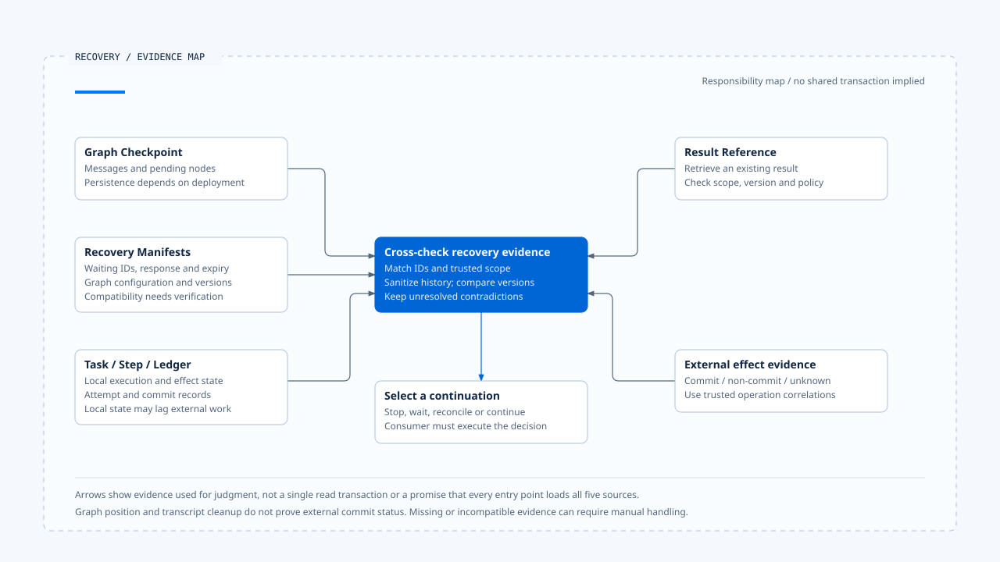
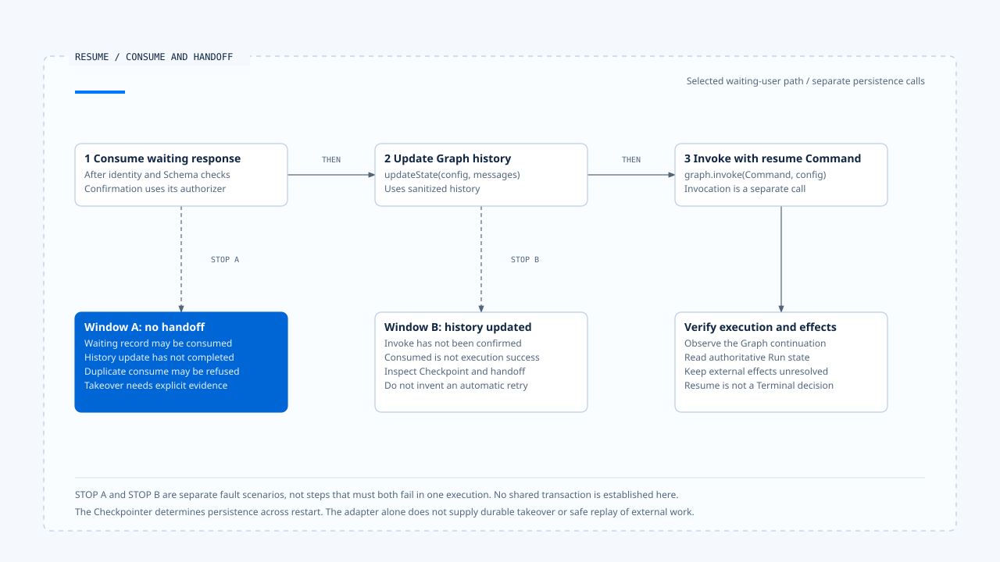

# Checkpoints and recovery state

[English](./01-checkpoints-and-recovery-state.md) | [繁體中文](./01-checkpoints-and-recovery-state-zh-TW.md) | [简体中文](./01-checkpoints-and-recovery-state-zh-CN.md)

> In the following content:
> CCB is short for [claude-code-best](https://github.com/claude-code-best/claude-code).
> Chat Gun refers to [chat-gun](https://github.com/HsienW/chat-gun).

[Back to the guide](./README-zh-TW.md) · Next: [Idempotency and replay identity](./02-idempotency-and-replay-identity.md)

> A tool sent a write before the process stopped, but the Checkpoint loaded after restart still shows its node as pending. Rerunning from that position may send a second operation to the external system. Restoring only the visible conversation can instead lose pending operations and version conditions.

**Recovery must cross-check execution position, waiting contracts, and external-effect evidence.** The Checkpoint supplies one part of that state. Whether execution can continue also depends on the Manifest, Task / Step, and Ledger.

## What needs to be loaded

The Graph may remember its next node, the Task repository may record work as running, and the external system may already have committed. These sources record different facts; a process stop can leave them temporarily inconsistent.

| Data | Main purpose | What it cannot answer alone |
|---|---|---|
| Checkpoint | Preserve Graph values, messages, and pending nodes. | Has the external write completed? |
| Interrupt Manifest | Specify the wait, response Schema, expiry, and execution correlations. | Did control reach the Graph after response consumption? |
| Execution Manifest | Preserve Graph configuration and relevant Schema versions. | Does the new deployment have a data migrator? |
| Task / Step | Record durable task and step state. | What happened externally if local recording failed after success? |
| Ledger / Result Reference | Locate execution attempts, effect state, and existing results. | Can another source recover the missing external response? |

This table assigns responsibilities without requiring every Runtime to use the same storage structure. Recovery should establish which source is authoritative for each fact before resolving contradictions. The latest write timestamp cannot replace that semantic judgment.

- Evidence sources support different judgments. The diagram establishes no common read transaction or external-commit guarantee.
- [Open the editable HTML diagram](../../assets/agent-runtime/effects-and-recovery/01-checkpoints-and-recovery-state/01-recovery-evidence-map-en.html).

## Chat Gun's recovery entry point

`createConversationRecovery().recover()` locates a Manifest by `interruptId`, then checks thread, Run, Task, and scope. When a response is supplied, it also checks that the Manifest is waiting and has not expired.

It then reads the Checkpoint. A missing Checkpoint produces a manual-intervention result with `CHECKPOINT_NOT_FOUND`; history sanitization, durable-evidence loading, and execution-position classification follow only after data is found. This entry requires a locatable Interrupt Manifest. Its name does not establish takeover support for every process failure without a waiting record.

The conceptual order below omits individual rejection exits:

~~~text
尋找 Manifest 並核對關聯
  → 讀取 Checkpoint
  → 核對版本並整理歷史
  → 載入 Task／Step／Ledger 證據
  → 分類最後執行位置
  → 回傳續行、等待、回查或人工處理結果
~~~

The source establishes this call order. Dependencies supply `loadDurableEvidence` and the actual Reconciler wiring, which require separate verification.

## Version compatibility precedes history reuse

Execution Manifest preserves the Graph ID, Graph configuration hash, and Schema versions. `classifyExecutionManifestCompatibility()` compares the Manifest major version, Graph ID, configuration hash, and individual Schema versions.

| Classification | Direction of the inspected checks | Follow-up responsibility |
|---|---|---|
| compatible | Relevant configuration and Schema comparisons pass. | Still inspect history and execution evidence. |
| migratable | Schema versions differ without the checked major-version differences. | Supply and validate an actual migration. |
| incompatible | Graph, configuration, or a checked major version differs. | Stop direct reuse. |

This classifier does not run a migration. The Sanitizer can park data requiring migration; `migratable` must not be displayed as a completed automatic upgrade. Deployment versions must also be interpreted through the fields actually compared. Not every Manifest field necessarily acts as a rejection condition.

## What history sanitization preserves

Recovered messages may contain a partial Assistant Message, a Tool Call without a matching result, or duplicate results left by an old executor. Before supplying these fragments to the next model turn, check whether they can still be paired.

Chat Gun's `sanitizeRecoveryHistory()` returns valid, sanitized, or parked. It also preserves reason codes for unmatched calls, unmatched results, duplicate results, incomplete arguments, incompatible versions, and unprovable history.

Those codes describe different branches. They do not mean that every anomaly is deleted before continuing. A sanitized result preserves the cleaned history and reasons; a parked result requires manual handling, and `recover()` does not proceed to consume the response.

History sanitization produces usable conversation data and pairings. Removing an old tool result does not reverse the external write it triggered or turn a Ledger unknown into proof of no commit.

## Execution-position classification order

`classifyLastExecutionPoint()` uses Task, optional Step, Ledger, Checkpoint, and Manifest evidence. Its checks have an order:

1. A terminal Checkpoint or specified Task / Step state takes precedence and produces terminal.
2. A committed or unknown Ledger produces the corresponding classification.
3. A waiting Manifest produces waiting_user.
4. A qualifying not-started combination produces not_started; other in-flight evidence can produce executing.
5. Evidence that still cannot be classified remains unknown.

Terminal priority stops ordinary continuation; effect verification can remain a separate follow-up task. The classifier accepts combinations without a Checkpoint, but `recover()` currently rejects a missing Checkpoint before calling it. Read the reachable paths at these two levels separately.

`executing` means that in-flight evidence was found. The takeover consumer must still check ownership, whether the old Worker is alive, and the tool's replay path before deciding how to continue.

## The window after Resume consumption

In the waiting_user branch, Recovery validates the response Schema, seeds the allocator with the maximum persisted event sequence, then attempts to consume the specified wait. Confirmation uses a supplied authorizer; without it, the path does not grant approval directly.

After consumption succeeds, the Checkpoint Adapter executes these calls in order:

~~~ts
await graph.updateState(config, { messages: sanitizedHistory });
return graph.invoke(new Command({ resume: response }), config);
~~~

This is the inspected Adapter's core order. Manifest consumption, history update, and Graph invocation are separate calls, and the process can stop between any two. A response may be consumable only once while still leaving a consumed-but-not-handed-off window. Recovery needs a takeover record or another provable handoff repair mechanism.

The Adapter does not determine the underlying Checkpointer's durability. The inspected Deep Researcher location uses `MemorySaver`, which alone does not guarantee that state survives a process restart. Confirm the deployed Checkpointer through the actual Graph and environment configuration.

- Response consumption, history update, and invocation are separate calls. The two stop windows are independent fault scenarios.
- [Open the editable HTML diagram](../../assets/agent-runtime/effects-and-recovery/01-checkpoints-and-recovery-state/01-resume-consume-and-handoff-windows-en.html).

## Comparing CCB Session recovery

CCB's `QueryEngine.ts` uses `isSessionPersistenceDisabled()` to decide whether to persist transcripts. Inspected sections include paths that await `recordTranscript()` and asynchronous writes through `void recordTranscript()`. Whether the consumer waits for persistence affects what can be recovered after failure.

`sessionStorage.ts` provides transcript recording and loading helpers. `sessionRestore.ts` assembles recovered messages, file history, agent settings, and other session state. These are concrete Session recovery points, but they do not alone establish a durable Ledger or recovery transaction for every tool's external effects.

Compare how the sources restore history usable for reasoning, then trace tool effects separately. Session messages, Graph Checkpoints, and external business records each have their own persistence contract.

### How a transcript recovers a conversation

On its JSONL path, CCB's `loadTranscriptFromFile()` first calls `loadTranscriptFile()`, finds a leaf message, and builds a conversation chain from leaf to root. It throws when messages or a valid chain are missing, rather than loading every row and immediately continuing.

Recovery therefore has structural conditions: message existence, traceable parent-child links, and branch selection are separate concerns. `recordTranscript()` also identifies recorded messages, preserves prefix chain participants, and then inserts the new message chain. Data remaining in the file does not necessarily belong to the reachable branch being recovered.

Session recovery validation should check the leaf, parent-child chain, tool pairing, and valid post-compaction history as well as message count. Restoring those structures still does not prove that an external operation did not commit.

## How to validate recovery state

- Remove the Manifest, Checkpoint, and Ledger separately, checking each combination's exit and reason.
- Inject partial messages, duplicate results, and incompatible versions; confirm parked paths do not consume a response.
- Stop the process after Resume consumption, after history update, and before Graph invocation; check the takeover mechanism.
- Restart a deployment and confirm that its Checkpointer can actually reload state; then check whether different Workers read the same state.

These are validation designs. Recovery implementations and existing test arrangements were inspected; no process-restart, database, or cross-Worker exercises were run.

## Engineering judgment

I would list the facts recovery needs and their authoritative sources before choosing a read order. Preserving reasons and unresolved effects when data conflicts tells reconciliation what is missing. Rerunning a node directly can turn those contradictions into a second operation.

## Implementation references and scope

- Chat Gun: `runtime/recovery/conversation-recovery.ts`, `langgraph-checkpoint-adapter.ts`, `last-execution-point.ts`, `execution-manifest.ts`, and `recovery-sanitizer.ts`, relative to `backend/src/`.
- CCB: `src/QueryEngine.ts`, `src/utils/sessionStorage.ts`, and `src/utils/sessionRestore.ts`.
- [Sources and file fingerprints](./README-zh-TW.md#來源與查證狀態) record the local inspection scope. This article does not claim that a general Recovery entry is enabled in every production Graph.

## Further reading

Next, [Idempotency and replay identity](./02-idempotency-and-replay-identity.md) examines how recovery distinguishes the same call, another Attempt, and the same business effect.
