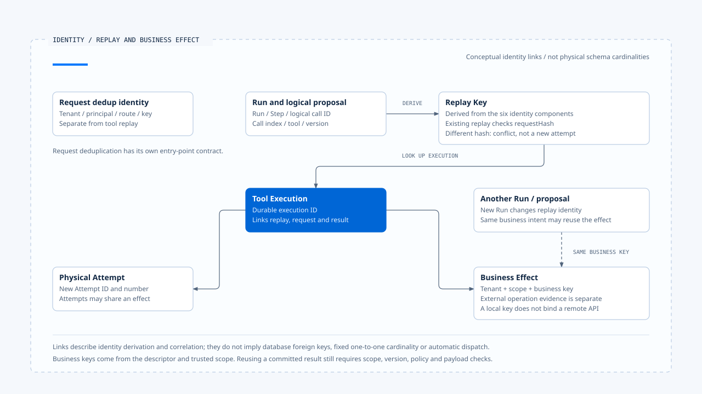

# Idempotency and replay identity

[English](./02-idempotency-and-replay-identity.md) | [繁體中文](./02-idempotency-and-replay-identity-zh-TW.md) | [简体中文](./02-idempotency-and-replay-identity-zh-CN.md)

> In the following content:
> CCB is short for [claude-code-best](https://github.com/claude-code-best/claude-code).
> Chat Gun refers to [chat-gun](https://github.com/HsienW/chat-gun).

[Back to the guide](./README.md) · Previous: [Checkpoints and recovery state](./01-checkpoints-and-recovery-state.md) · Next: [Effect Ledger and commit boundaries](./03-effect-ledger-and-commit-boundaries.md)

> A user submits an operation, loses the connection, and resubmits. Runtime creates a new Run and the model generates a new Tool Call ID, while the external system sees the same business request. Comparing only Run IDs can repeat the operation; comparing only tool names can merge two legitimate, different operations.

**Deduplication must define the scope of sameness first.** Requests, logical calls, physical Attempts, and business effects have different identities, with different reuse conditions.

## What the five identities answer

| Identity | Question it answers | Judgment it cannot replace |
|---|---|---|
| Request Dedup Key | Did the same principal resubmit a request to the same route? | Does the tool produce the same business effect? |
| Replay Key | Is this a replay of the specified logical call in one Run? | Does a new Run repeat the same business operation? |
| Tool Execution ID | Which durable tool execution record is this? | How many physical dispatches occurred? |
| Attempt ID | Which physical attempt is this? | Should multiple attempts represent one effect? |
| Business Effect Key | Which business effect within a trusted scope is this? | Has the external service accepted the same idempotency key? |

These identifiers need traceable correlations. Giving every field the same random value loses the distinction between a logical call and physical retries. Adding more IDs does not automatically establish a deduplication contract either.

## How Chat Gun builds its keys

The installed `@gun-ai/harness-kernel`, version `0.1.0-alpha.1`, was inspected further. `identity.ts` supplies hash and UUID dependencies, while the kernel defines composition rules. Reading `src/side-effect.ts` and the exported `dist/side-effect.js` establishes the following fields.

Replay Key inputs are ordered as follows:

~~~text
runId
stepId
logicalToolCallId (falls back to toolCallId when absent)
callIndex
toolName
toolVersion
~~~

The kernel validates required strings and a non-negative safe-integer `callIndex`, then passes the values to the wrapper's hash. Chat Gun's wrapper computes SHA256 over the array's JSON representation.

Request Dedup Key uses tenant, principal, route namespace, and client key. Attempt identity retains Tool Execution ID and a positive-integer `executionAttempt`, while generating another UUID. These helpers define identity rules; adoption and client-key validation remain the entry-point consumer's responsibility.

## The same replay key with different arguments

After finding an existing Replay Key, the Chat Gun runner compares `requestHash`. The same key with a different hash returns `SIDE_EFFECT_REPLAY_CONFLICT`; an existing record that is not committed returns a reconciliation requirement instead of calling the tool again.

This branch protects the recorded logical call. How `requestHash` covers canonical input and which fields need stabilization still depend on the Pipeline and tool contract that produce it. If upstream hashes semantically different requests identically, the runner cannot reconstruct the lost distinction from the hash.

A new model-generated ID likewise denotes another proposal. The system must still check whether it refers to the same business effect. Restating a request cannot erase an earlier unknown effect record.

## Business-effect deduplication scope

The descriptor defines `deriveBusinessEffectKey(input, scope)`, which the wrapper then hashes. The database uniqueness constraint uses:

~~~text
tenant_id + scope_id + business_effect_key
~~~

A new Run therefore changes Replay Key but can still correlate to an existing effect through the same business key. Design business keys around operation semantics, such as a trusted order and a specified refund intent. This is a teaching example, not a claim that the source repository provides a refund tool.

Amount, resource version, target, and whether repetition is allowed all affect key design. A coarse key can block legitimate new operations; an overly fine key can turn resubmission into a new effect. Scope must also come from trusted Context rather than a model-supplied tenant name.

The database separately constrains the pairing and uniqueness of external system namespace and operation ID. This maintains external correlations already obtained locally. Whether the external API accepts and durably deduplicates the same operation still requires a server-side contract.

### A production MCP business-key example

For the inspected non-read-only MCP tools, `production-runtime-tool-descriptors.ts` builds canonical JSON from server name, tool name, tool version, tenant, scope, and input as the raw business key. Its canonicalizer recursively sorts object keys while preserving array element order.

This stabilizes identical inputs whose object fields appear in different orders, with clear limits: a tool-version or input-value change may change the key. Semantically identical business requests using different defaults, time strings, or representations still need tool-defined semantic normalization. Conversely, if the business permits repeating exactly the same arguments, identical parameters alone cannot prove resubmission.

The inspected Pipeline section builds runner identity from the canonical Tool Call ID and sets `callIndex` to `0`. Kernel support for call index does not mean this consumer assigns increasing indices to same-name calls. This entry also relies on correct Tool Call ID creation and pairing.

- The links show identity derivation and correlation. A new Run can still refer to the same scoped business effect.
- [Open the editable HTML diagram](../../assets/agent-runtime/effects-and-recovery/02-idempotency-and-replay-identity/02-replay-attempt-and-effect-identity-en.html).

## After TTL expiry

`PgIdempotencyGuard` preserves namespace, resource key, version, and locked / completed / failed state. The kernel serializes the key as `namespace:resourceKey:vversion`. These records are separate from the runner's Replay Key and effect Ledger.

The Guard can delete a failed record before reacquiring it, or attempt reclamation when expiry conditions hold. TTL limits the local record's validity; the remote operation may still be running or may have committed without a local update.

In the inspected methods, completion and failure updates locate records by serialized key without checking an owner token in that update condition. If the application allows another executor to take over after TTL reclamation, inspect how late updates from the old holder are controlled. This window needs consumer and concurrency validation; the Guard's existence alone does not establish cross-Worker fencing.

## When a committed result can be reused

A committed Ledger tells Runtime that a commit record exists, while content needed by the model may reside in Result Reference. `PgResultReferenceStore.resolve()` checks scope compatibility, tool version, cache state, and `policy.isReusable()` before calling `resolveResultRef()` for the payload.

| Situation | Direction of the inspected path | Fact to preserve |
|---|---|---|
| Same replay key, different request hash | Report conflict. | New arguments conflict with the original operation. |
| Existing execution not yet committed | Require reconciliation. | No committed result is directly reusable yet. |
| Scope / version mismatch or non-reusable result | Refuse result reuse. | The existing effect may still have committed. |
| Missing payload | Cannot deliver the existing result. | Missing content does not mean no effect occurred. |
| Result meets reuse conditions | Return the existing result. | Its source is cache or reconciled data. |

Result reuse is a data-access and compatibility judgment that remains subject to product authorization requirements. Readable cache content must not be expanded into authorization to execute a new operation.

## Comparing CCB IDs

CCB tool-use / tool-result IDs support message pairing, and StreamingToolExecutor collects results through tool correlations. They identify which proposal receives a result. This inspection did not establish the same cross-Run business-effect uniqueness constraint as Chat Gun from those IDs.

External idempotency for a particular CCB tool still requires inspecting its adapter, external API, and durable records. A successful message appearing once in a transcript is only part of the available evidence.

## How to validate replay identity

- Change the argument hash for the same Replay Key; confirm conflict without dispatch.
- Use the same business key in a new Run; inspect the committed effect and result-reuse conditions.
- Make the payload unavailable, change scope, or introduce a version mismatch; confirm missing content does not trigger repetition.
- Interleave old and new holders' completion updates after TTL reclamation; check owner and external-effect records.
- Test external-key retention and server behavior for the same key with different arguments.

Identity, Guard, Ledger, and Result Reference implementations were inspected. No external API or multi-Worker resubmission tests were run.

## Engineering judgment

I would define which operations the business permits repeating before designing keys. Retries should add Attempt evidence, replay should locate the original logical call, and a new business operation needs its own semantic identity. Those correlations keep failure handling grounded in evidence.

## Implementation references and scope

- Chat Gun: `runtime/side-effect/identity.ts`, `tool-execution-runner.ts`, `business-effect-ledger.ts`, `result-reference-store.ts`, and `runtime/idempotency/idempotency-guard.ts`, relative to `backend/src/`.
- Chat Gun production MCP: canonical input and business keys in `backend/src/tools/production-runtime-tool-descriptors.ts`; identity construction in `backend/src/runtime/tool-dispatch/pipeline.ts`.
- Kernel: `src/side-effect.ts`, `dist/side-effect.js`, and `src/idempotency.ts` in `@gun-ai/harness-kernel`.
- [Sources and file fingerprints](./README.md#sources-and-verification-status) record the package and local files. This article establishes no universal exactly-once guarantee for external services.

## Further reading

Next, [Effect Ledger and commit boundaries](./03-effect-ledger-and-commit-boundaries.md) follows physical dispatch to examine the failure windows between external effects and local commits.
