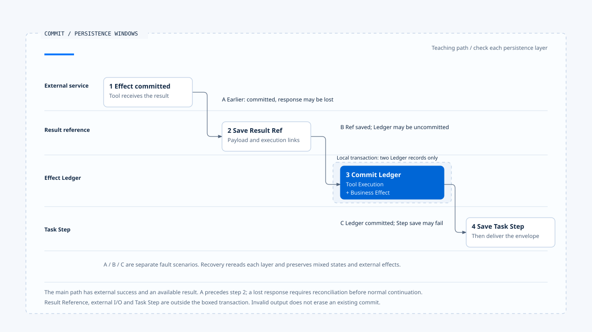

# 效果账本与提交边界

[English](./03-effect-ledger-and-commit-boundaries.md) | [繁體中文](./03-effect-ledger-and-commit-boundaries-zh-TW.md) | [简体中文](./03-effect-ledger-and-commit-boundaries-zh-CN.md)

> 以下内容所提到的
> CCB 为 [claude-code-best](https://github.com/claude-code-best/claude-code) 的简称。
> Chat Gun 为 [chat-gun](https://github.com/HsienW/chat-gun)。

[回到导览](./README-zh-CN.md) · 前一篇：[幂等与重放识别](./02-idempotency-and-replay-identity-zh-CN.md) · 下一篇：[效果回查与重试判断](./04-reconciliation-and-safe-retry-zh-CN.md)

> 工具返回成功，Runtime 保存结果参照后，Ledger 的 transaction 却失败。另一次执行则相反：Ledger 已 committed，Task Step 的结果更新才出错。两次画面都可能显示失败，但外部操作与本地记录停在不同位置。

**效果账本需要保留派送、提交与保存各自的证据。** 失败后先指出哪个边界尚未确认，后续才有办法决定补记、回查或重新派送。

## 账本记录的三个对象

Chat Gun 将工具执行、业务效果与补偿执行分开记录。一次业务效果可能关联到重放与多个 Attempt，补偿也会形成新的执行记录。

| 记录 | 主要关联 | 查读的状态范围 |
|---|---|---|
| Tool Execution | Replay Key、request hash、Step、工具版本与结果参照。 | prepared、executing、committed、failed、unknown，另有补偿及人工处理状态。 |
| Business Effect | tenant、scope、业务键与外部 Operation 关联。 | prepared、committed、compensated、unknown。 |
| Tool Execution Attempt | Tool Execution 与实体尝试编号。 | 保存个别尝试及其完成数据。 |
| Compensation Execution | 原效果、原工具执行与补偿动作。 | prepared、executing、compensated、failed、manual_intervention_required。 |

这些是各自的状态集合，不能因为名称相似就同步改写。Task 被取消后，Business Effect 仍可能 committed；补偿成功之后，原操作也仍应保留曾经发生的证据。

## 派送前先取得 claim

具 Side-effect Descriptor 的路径会先查 Replay Key。若没有既有执行，再由 `PgBusinessEffectLedger.prepare()` 在本地 transaction 中准备业务效果与工具执行记录，利用唯一约束处理重复要求。

| prepare 结果 | Runner 的后续方向 |
|---|---|
| claimed | 取得本次执行资格，再尝试进入 executing。 |
| existing_committed | 依结果参照与重用条件取得既有内容。 |
| not_claimed | 回报未取得 claim，不开始另一份实体操作。 |
| conflict | 回报重放冲突。 |
| unavailable | 回报 Ledger 不可用，不继续这条派送主线。 |

Runner 将 claimed 的执行由 prepared 转成 executing，成功后才进入 Attempt 循环。若这一步保存失败，会返回 deferred，避免缺少执行记录时仍送出外部工作。

Claim 是本地的执行控制。远端服务收到请求后如何处理重复操作，仍依外部契约，不能由本地唯一约束推论它也共用相同 transaction。

## 每次 Attempt 的先后

在提供 `authorizeTyped` 的 executor 路径，runner 会先取得授权结果、保存 decision 关联，确认允许后才建立实体 Attempt。拒绝、等待确认或缺少必要 decision ID，都有提前返回分支。

之后增加尝试编号、记录 budget attempt、建立 Attempt identity，并先调用 `recordAttempt()`。这些步骤成功后才进入实体执行。重试时再次进入循环，不能直接沿用前一个 Attempt ID。

这份顺序限查读的 runner 契约。没有 Side-effect Descriptor 的工具可走其他路径；executor 若没有拆分授权方法，也不能直接套用同一组 decision 接线描述。

## 外部与本地提交分开发生

假设一次工具外部操作成功，runner 的后续包含以下保存工作：

~~~text
外部工具执行并返回结果
  → Result Reference Store 保存结果参照
  → Ledger 同一 transaction 提交 Tool Execution 与 Business Effect
  → Pipeline 依 outcome 保存 Task Step
  → 将结果封套交给 consumer
~~~

`commitExecutionAndBusinessEffect()` 可将两份 Ledger 记录放进本地 transaction。外部 API、Result Reference 保存、Task Step 更新及结果交付没有因此全部加入同一交易。

| 故障窗口 | 可能留下的事实 | 恢复时要查明 |
|---|---|---|
| Claim 后、实体派送前 | prepared／executing 记录，外部尚未确认开始。 | 是否已有 Attempt、是否真的派送。 |
| 外部提交后、回应抵达前 | 本地仍缺少成功结果。 | 外部 Operation 与提交证据。 |
| 参照保存后、Ledger commit 前 | 可能存在结果参照，但效果状态未完整提交。 | 参照归属及 Ledger／外部的一致性。 |
| Ledger commit 后、Task Step 保存前 | 效果已有 committed 记录，Step 仍旧。 | 补记 Step 及结果交付的方式。 |
| 结果封套交付失败 | 持久结果可能完整，consumer 未收到。 | 能否安全重用并重新交付。 |

表格描述需要演练的窗口，不代表单一方法已包含每个窗口的自动修复器。

- 框内 transaction 只包含 Tool Execution 与 Business Effect；A、B、C 是分别演练的故障窗口。
- [开启可编辑 HTML 图解](../../assets/agent-runtime/effects-and-recovery/03-effect-ledger-and-commit-boundaries/03-external-commit-and-local-persistence-en.html)。

## 输出验证失败时保留提交事实

`persistCommittedResult()` 先计算输出验证结果，再尝试保存 Result Reference 与提交 Ledger。如果保存完成但输出验证不通过，会返回 `SIDE_EFFECT_OUTPUT_VALIDATION_FAILED`。

这个结果要求处理格式或交付问题，Ledger 却可能已 committed。若 consumer 将它显示成「工具失败，请再试一次」，就会把格式问题转成重复业务操作。

保存区段抛错时，runner 返回 `SIDE_EFFECT_PERSISTENCE_UNCERTAIN`。该错误不能单独指出失败发生在参照保存之前，还是 Ledger 提交期间；恢复需要重新读取并比对，而不是从错误码倒推出外部未执行。

## Task Step 保存失败的另一层

Pipeline 在 runner 返回后仍要更新 Task Step。相应保存失败时，会建立内层 `ambiguous_after_dispatch` 的 structured envelope，错误码为 `TASK_STEP_PERSISTENCE_FAILED_AFTER_DISPATCH`。

外层可以成功交付这份封套，但其内层要求进一步判读。若 runner 的 Ledger 已 committed，这份 ambiguity 可能来自后续保存；若外部回应本来就遗失，则还需要外部回查。相同 UI 显示无法取代两条来源的证据。

这一层与前分类的[工具结果与错误回灌](../model-and-tool-execution/05-tool-results-and-error-feedback-zh-CN.md)衔接：封套保留需要分流的信息，本区再查明如何补齐提交事实。

## 从正式入口确认这条路径存在

`tools/registry.ts` 依 source 对应的环境标志判断是否建立 Tool Dispatch Pipeline，只有相应标志值为字符串 `"true"` 时才启用。建立后，才透过 governance options 的 executor factory 将工具接到 Pipeline；模块可建立与部署已使用，需要分别提出证据。

进入 Pipeline 之后，调度 callback 才调用 runner。只读 descriptor 传入的 side-effect descriptor 是 `undefined`，非只读则取 `descriptor.sideEffect`。因此同一个 Pipeline 内也有不同 runner 路径，不能只凭工具进过调度，就认定它已建立业务效果 Ledger。

### Outcome 如何经过下一层映射

Pipeline 的 `mapRunnerResult()` 对成功结果再验 output Schema。若验证失败，只读工具映射为 failed_not_committed；非只读工具则映射为 ambiguous_after_dispatch，使用 `TOOL_OUTPUT_VALIDATION_FAILED_AFTER_COMMIT`。Deferred 结果也会依错误码集合分成 ambiguity 或派送前拒绝。

这些映射保留了 consumer 的处理方向，仍需查回原 runner 结果与 Ledger。错误码包含 AFTER_COMMIT，不能取代实际提交记录；同样地，单一 envelope 的分类也无法完整呈现所有存储层的状态。

## 消息清理的作用范围

CCB 的 query fallback 可清理旧消息及工具收集，StreamingToolExecutor 的 `discard()` 设置 discarded flag，由其他执行与结果方法判读。这些位置支持旧结果不再混入新回应。

已开始的外部 I/O 则要另查。Tombstone 没有证明外部操作已撤回，discard 也不等于一个远端补偿交易。把这类清理与 Ledger 并列，是为了核对各自维护哪种状态，没有将两个来源合并成同一套效果模型。

## 如何验证提交边界

- Ledger prepare 失败时，确认底层工具没有被调用。
- 实体执行前注入 Attempt 保存失败，核对派送是否停止。
- 外部提交后切断回应，确认保留 unknown 与原身份。
- 分别让参照保存、Ledger commit 与 Task Step 更新失败，核对后续读取能辨认差异。
- 让外部成功结果不符输出 Schema，确认 committed 证据仍在，且没有自动重做。

所列版本读取 runner、Ledger、Pipeline 与相关测试安排，未执行真实数据库 transaction 故障或外部提交测试。

## 本篇的工程判断

我会沿每一个 `await` 问程序若在此停止，下一个接手者能从哪里知道先前发生什么。本地 transaction 能缩小部分窗口，剩下的跨服务窗口则需要稳定身份、效果证据与明确的回查责任。

## 实现参照与适用范围

- Chat Gun：`runtime/side-effect/business-effect-ledger.ts`、`tool-execution-runner.ts`、`result-reference-store.ts`、`runtime/tool-dispatch/pipeline.ts` 与 `runtime/persistence/migrations/006_create_business_effects.sql`，路径相对 `backend/src/`。
- Chat Gun 正式组装入口：`backend/src/tools/registry.ts`，保留 source 对应标志与 executor factory 的条件。
- CCB：`src/query.ts` 与 `src/services/tools/StreamingToolExecutor.ts` 的 fallback／discard 接点。
- Pool、descriptor、Pipeline flag 与外部 adapter 的实际部署仍需逐入口确认。

## 接续阅读

下一篇[效果回查与重试判断](./04-reconciliation-and-safe-retry-zh-CN.md)从不确定的提交状态出发，整理重新派送需要的证据。
