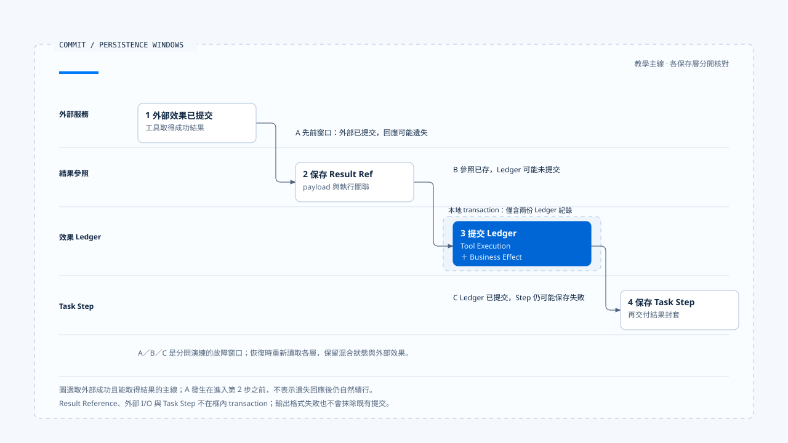

# 效果帳本與提交邊界

[English](./03-effect-ledger-and-commit-boundaries.md) | [繁體中文](./03-effect-ledger-and-commit-boundaries-zh-TW.md) | [简体中文](./03-effect-ledger-and-commit-boundaries-zh-CN.md)

> 以下內容所提到的
> CCB 為 [claude-code-best](https://github.com/claude-code-best/claude-code) 的簡稱。
> Chat Gun 為 [chat-gun](https://github.com/HsienW/chat-gun)。

[回到導覽](./README-zh-TW.md) · 前一篇：[冪等與重放識別](./02-idempotency-and-replay-identity-zh-TW.md) · 下一篇：[效果回查與重試判斷](./04-reconciliation-and-safe-retry-zh-TW.md)

> 工具返回成功，Runtime 保存結果參照後，Ledger 的 transaction 卻失敗。另一次執行則相反：Ledger 已 committed，Task Step 的結果更新才出錯。兩次畫面都可能顯示失敗，但外部操作與本地紀錄停在不同位置。

**效果帳本需要保留派送、提交與保存各自的證據。** 失敗後先指出哪個邊界尚未確認，後續才有辦法決定補記、回查或重新派送。

## 帳本記錄的三個對象

Chat Gun 將工具執行、業務效果與補償執行分開記錄。一次業務效果可能關聯到重放與多個 Attempt，補償也會形成新的執行紀錄。

| 紀錄 | 主要關聯 | 查讀的狀態範圍 |
|---|---|---|
| Tool Execution | Replay Key、request hash、Step、工具版本與結果參照。 | prepared、executing、committed、failed、unknown，另有補償及人工處理狀態。 |
| Business Effect | tenant、scope、業務鍵與外部 Operation 關聯。 | prepared、committed、compensated、unknown。 |
| Tool Execution Attempt | Tool Execution 與實體嘗試編號。 | 保存個別嘗試及其完成資料。 |
| Compensation Execution | 原效果、原工具執行與補償動作。 | prepared、executing、compensated、failed、manual_intervention_required。 |

這些是各自的狀態集合，不能因為名稱相似就同步改寫。Task 被取消後，Business Effect 仍可能 committed；補償成功之後，原操作也仍應保留曾經發生的證據。

## 派送前先取得 claim

具 Side-effect Descriptor 的路徑會先查 Replay Key。若沒有既有執行，再由 `PgBusinessEffectLedger.prepare()` 在本地 transaction 中準備業務效果與工具執行紀錄，利用唯一約束處理重複要求。

| prepare 結果 | Runner 的後續方向 |
|---|---|
| claimed | 取得本次執行資格，再嘗試進入 executing。 |
| existing_committed | 依結果參照與重用條件取得既有內容。 |
| not_claimed | 回報未取得 claim，不開始另一份實體操作。 |
| conflict | 回報重放衝突。 |
| unavailable | 回報 Ledger 不可用，不繼續這條派送主線。 |

Runner 將 claimed 的執行由 prepared 轉成 executing，成功後才進入 Attempt 迴圈。若這一步保存失敗，會回傳 deferred，避免缺少執行紀錄時仍送出外部工作。

Claim 是本地的執行控制。遠端服務收到請求後如何處理重複操作，仍依外部契約，不能由本地唯一約束推論它也共用相同 transaction。

## 每次 Attempt 的先後

在提供 `authorizeTyped` 的 executor 路徑，runner 會先取得授權結果、保存 decision 關聯，確認允許後才建立實體 Attempt。拒絕、等待確認或缺少必要 decision ID，都有提前返回分支。

之後增加嘗試編號、記錄 budget attempt、建立 Attempt identity，並先呼叫 `recordAttempt()`。這些步驟成功後才進入實體執行。重試時再次進入迴圈，不能直接沿用前一個 Attempt ID。

這份順序限查讀的 runner 契約。沒有 Side-effect Descriptor 的工具可走其他路徑；executor 若沒有拆分授權方法，也不能直接套用同一組 decision 接線描述。

## 外部與本地提交分開發生

假設一次工具外部操作成功，runner 的後續包含以下保存工作：

~~~text
外部工具執行並返回結果
  → Result Reference Store 保存結果參照
  → Ledger 同一 transaction 提交 Tool Execution 與 Business Effect
  → Pipeline 依 outcome 保存 Task Step
  → 將結果封套交給 consumer
~~~

`commitExecutionAndBusinessEffect()` 可將兩份 Ledger 紀錄放進本地 transaction。外部 API、Result Reference 保存、Task Step 更新及結果交付沒有因此全部加入同一交易。

| 故障窗口 | 可能留下的事實 | 恢復時要查明 |
|---|---|---|
| Claim 後、實體派送前 | prepared／executing 紀錄，外部尚未確認開始。 | 是否已有 Attempt、是否真的派送。 |
| 外部提交後、回應抵達前 | 本地仍缺少成功結果。 | 外部 Operation 與提交證據。 |
| 參照保存後、Ledger commit 前 | 可能存在結果參照，但效果狀態未完整提交。 | 參照歸屬及 Ledger／外部的一致性。 |
| Ledger commit 後、Task Step 保存前 | 效果已有 committed 紀錄，Step 仍舊。 | 補記 Step 及結果交付的方式。 |
| 結果封套交付失敗 | 持久結果可能完整，consumer 未收到。 | 能否安全重用並重新交付。 |

表格描述需要演練的窗口，不代表單一方法已包含每個窗口的自動修復器。

- 框內 transaction 只包含 Tool Execution 與 Business Effect；A、B、C 是分別演練的故障窗口。
- [開啟可編輯 HTML 圖解](../../assets/agent-runtime/effects-and-recovery/03-effect-ledger-and-commit-boundaries/03-external-commit-and-local-persistence.html)。

## 輸出驗證失敗時保留提交事實

`persistCommittedResult()` 先計算輸出驗證結果，再嘗試保存 Result Reference 與提交 Ledger。如果保存完成但輸出驗證不通過，會回傳 `SIDE_EFFECT_OUTPUT_VALIDATION_FAILED`。

這個結果要求處理格式或交付問題，Ledger 卻可能已 committed。若 consumer 將它顯示成「工具失敗，請再試一次」，就會把格式問題轉成重複業務操作。

保存區段拋錯時，runner 回傳 `SIDE_EFFECT_PERSISTENCE_UNCERTAIN`。該錯誤不能單獨指出失敗發生在參照保存之前，還是 Ledger 提交期間；恢復需要重新讀取並比對，而不是從錯誤碼倒推出外部未執行。

## Task Step 保存失敗的另一層

Pipeline 在 runner 返回後仍要更新 Task Step。相應保存失敗時，會建立內層 `ambiguous_after_dispatch` 的 structured envelope，錯誤碼為 `TASK_STEP_PERSISTENCE_FAILED_AFTER_DISPATCH`。

外層可以成功交付這份封套，但其內層要求進一步判讀。若 runner 的 Ledger 已 committed，這份 ambiguity 可能來自後續保存；若外部回應本來就遺失，則還需要外部回查。相同 UI 顯示無法取代兩條來源的證據。

這一層與前分類的[工具結果與錯誤回灌](../model-and-tool-execution/05-tool-results-and-error-feedback-zh-TW.md)銜接：封套保留需要分流的資訊，本區再查明如何補齊提交事實。

## 從正式入口確認這條路徑存在

`tools/registry.ts` 依 source 對應的環境旗標判斷是否建立 Tool Dispatch Pipeline，只有相應旗標值為字串 `"true"` 時才啟用。建立後，才透過 governance options 的 executor factory 將工具接到 Pipeline；模組可建立與部署已使用，需要分別提出證據。

進入 Pipeline 之後，排程 callback 才呼叫 runner。唯讀 descriptor 傳入的 side-effect descriptor 是 `undefined`，非唯讀則取 `descriptor.sideEffect`。因此同一個 Pipeline 內也有不同 runner 路徑，不能只憑工具進過排程，就認定它已建立業務效果 Ledger。

### Outcome 如何經過下一層映射

Pipeline 的 `mapRunnerResult()` 對成功結果再驗 output Schema。若驗證失敗，唯讀工具映射為 failed_not_committed；非唯讀工具則映射為 ambiguous_after_dispatch，使用 `TOOL_OUTPUT_VALIDATION_FAILED_AFTER_COMMIT`。Deferred 結果也會依錯誤碼集合分成 ambiguity 或派送前拒絕。

這些映射保留了 consumer 的處理方向，仍需查回原 runner 結果與 Ledger。錯誤碼包含 AFTER_COMMIT，不能取代實際提交紀錄；同樣地，單一 envelope 的分類也無法完整呈現所有儲存層的狀態。

## 訊息清理的作用範圍

CCB 的 query fallback 可清理舊訊息及工具收集，StreamingToolExecutor 的 `discard()` 設定 discarded flag，由其他執行與結果方法判讀。這些位置支援舊結果不再混入新回應。

已開始的外部 I/O 則要另查。Tombstone 沒有證明外部操作已撤回，discard 也不等於一個遠端補償交易。把這類清理與 Ledger 並列，是為了核對各自維護哪種狀態，沒有將兩個來源合併成同一套效果模型。

## 如何驗證提交邊界

- Ledger prepare 失敗時，確認底層工具沒有被呼叫。
- 實體執行前注入 Attempt 保存失敗，核對派送是否停止。
- 外部提交後切斷回應，確認保留 unknown 與原身分。
- 分別讓參照保存、Ledger commit 與 Task Step 更新失敗，核對後續讀取能辨認差異。
- 讓外部成功結果不符輸出 Schema，確認 committed 證據仍在，且沒有自動重做。

本輪讀取 runner、Ledger、Pipeline 與相關測試安排，未執行真實資料庫 transaction 故障或外部提交測試。

## 本篇的工程判斷

我會沿每一個 `await` 問程序若在此停止，下一個接手者能從哪裡知道先前發生什麼。本地 transaction 能縮小部分窗口，剩下的跨服務窗口則需要穩定身分、效果證據與明確的回查責任。

## 實作參照與適用範圍

- Chat Gun：`runtime/side-effect/business-effect-ledger.ts`、`tool-execution-runner.ts`、`result-reference-store.ts`、`runtime/tool-dispatch/pipeline.ts` 與 `runtime/persistence/migrations/006_create_business_effects.sql`，路徑相對 `backend/src/`。
- Chat Gun 正式組裝入口：`backend/src/tools/registry.ts`，保留 source 對應旗標與 executor factory 的條件。
- CCB：`src/query.ts` 與 `src/services/tools/StreamingToolExecutor.ts` 的 fallback／discard 接點。
- [來源與檔案指紋](./README-zh-TW.md#來源與查證狀態)保留查讀範圍。Pool、descriptor、Pipeline flag 與外部 adapter 的實際部署仍需逐入口確認。

## 接續閱讀

下一篇[效果回查與重試判斷](./04-reconciliation-and-safe-retry-zh-TW.md)從不確定的提交狀態出發，整理重新派送需要的證據。
