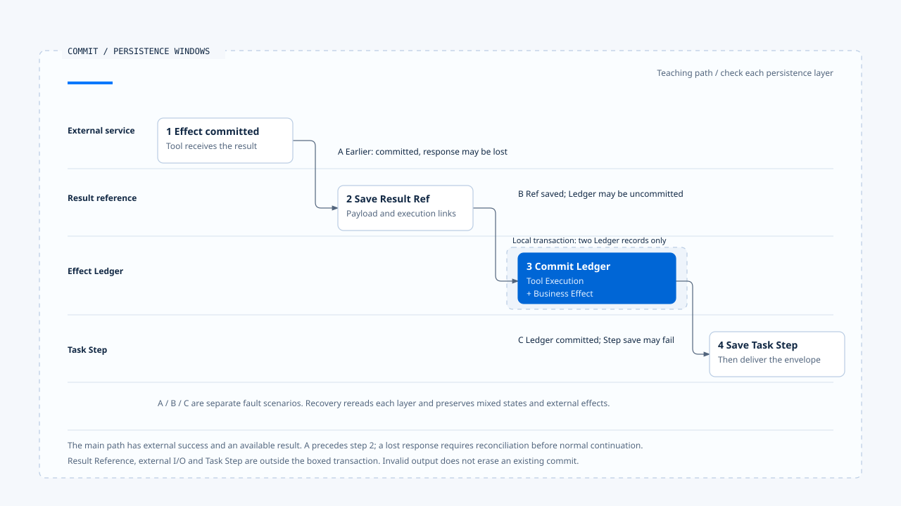

# Effect Ledger and commit boundaries

[English](./03-effect-ledger-and-commit-boundaries.md) | [繁體中文](./03-effect-ledger-and-commit-boundaries-zh-TW.md)

> In the following content:
> CCB is short for [claude-code-best](https://github.com/claude-code-best/claude-code).
> Chat Gun refers to [chat-gun](https://github.com/HsienW/chat-gun).

[Back to the guide](./README-zh-TW.md) · Previous: [Idempotency and replay identity](./02-idempotency-and-replay-identity.md) · Next: [Effect reconciliation and retry decisions](./04-reconciliation-and-safe-retry.md)

> A tool returns success. Runtime saves its result reference, but the Ledger transaction fails. Another execution encounters the reverse: the Ledger is committed before the Task Step update fails. Both screens may show failure while external operations and local records stand at different points.

**The effect Ledger must preserve separate evidence of dispatch, commit, and persistence.** First identify the unconfirmed boundary after a failure, then decide whether to complete local records, reconcile, or redispatch.

## The three objects recorded in the Ledger

Chat Gun records tool executions, business effects, and compensation executions separately. A business effect may correlate to replay and multiple Attempts, while compensation creates new execution records of its own.

| Record | Main correlations | Inspected state range |
|---|---|---|
| Tool Execution | Replay Key, request hash, Step, tool version, and result reference. | prepared, executing, committed, failed, unknown, plus compensation and manual-handling states. |
| Business Effect | tenant, scope, business key, and external Operation correlations. | prepared, committed, compensated, unknown. |
| Tool Execution Attempt | Tool Execution and physical attempt number. | Preserves individual attempts and their completion data. |
| Compensation Execution | Original effect, original tool execution, and compensation action. | prepared, executing, compensated, failed, manual_intervention_required. |

These are separate state sets. Similar names do not justify updating them together. A Business Effect may remain committed after Task cancellation; successful compensation must also preserve evidence that the original operation occurred.

## Acquire a claim before dispatch

The Side-effect Descriptor path first checks Replay Key. If no execution exists, `PgBusinessEffectLedger.prepare()` prepares business-effect and tool-execution records in a local transaction, using uniqueness constraints to handle duplicate requests.

| prepare result | Runner's next direction |
|---|---|
| claimed | Acquire execution eligibility, then attempt to enter executing. |
| existing_committed | Retrieve existing content under result-reference and reuse conditions. |
| not_claimed | Report that the claim was not acquired; do not start another physical operation. |
| conflict | Report a replay conflict. |
| unavailable | Report Ledger unavailability; do not continue this dispatch path. |

The runner transitions a claimed execution from prepared to executing before entering the Attempt loop. A persistence failure at that step returns deferred, preventing external dispatch along this path without the execution record.

A claim is local execution control. A remote service handles duplicate operations under its own contract; local uniqueness constraints do not establish a shared transaction with that service.

## Ordering within each Attempt

On executor paths providing `authorizeTyped`, the runner obtains authorization, persists its decision correlation, and creates a physical Attempt only after an allow result. Denial, pending confirmation, and missing required decision IDs have early exits.

It then increments the attempt number, records the budget attempt, creates Attempt identity, and calls `recordAttempt()` first. Physical execution follows only after those steps succeed. A retry reenters the loop and cannot reuse the previous Attempt ID directly.

This order applies to the inspected runner contract. Tools without a Side-effect Descriptor may take other paths. Executors without split authorization methods do not automatically share the same decision wiring either.

## External and local commits occur separately

Assuming a tool's external operation succeeds, the runner's follow-up includes these persistence steps:

~~~text
外部工具執行並返回結果
  → Result Reference Store 保存結果參照
  → Ledger 同一 transaction 提交 Tool Execution 與 Business Effect
  → Pipeline 依 outcome 保存 Task Step
  → 將結果封套交給 consumer
~~~

`commitExecutionAndBusinessEffect()` can place two Ledger records in one local transaction. This does not also place the external API, Result Reference persistence, Task Step update, and result delivery in that transaction.

| Failure window | Facts that may remain | What recovery must establish |
|---|---|---|
| After claim, before physical dispatch | prepared / executing records without confirmed external execution. | Whether an Attempt exists and dispatch occurred. |
| After external commit, before response arrival | Local success result is still missing. | External Operation and commit evidence. |
| After reference persistence, before Ledger commit | A result reference may exist without complete effect-state persistence. | Reference ownership and Ledger / external consistency. |
| After Ledger commit, before Task Step persistence | Effect is recorded as committed while the Step remains stale. | How to complete the Step record and deliver the result. |
| Result-envelope delivery failure | Durable results may be complete while the consumer received nothing. | Whether safe reuse and redelivery are possible. |

The table describes windows to exercise. It does not imply that one method already provides automatic repair for every window.

- The boxed transaction contains only Tool Execution and Business Effect. A, B, and C are separate fault scenarios.
- [Open the editable HTML diagram](../../assets/agent-runtime/effects-and-recovery/03-effect-ledger-and-commit-boundaries/03-external-commit-and-local-persistence-en.html).

## Preserve commit facts when output validation fails

`persistCommittedResult()` first determines output validity, then attempts to save Result Reference and commit the Ledger. If persistence completes but output validation fails, it returns `SIDE_EFFECT_OUTPUT_VALIDATION_FAILED`.

That result requires format or delivery handling even though the Ledger may already be committed. A consumer displaying "tool failed, try again" can turn a formatting problem into a duplicate business operation.

An exception in the persistence section makes the runner return `SIDE_EFFECT_PERSISTENCE_UNCERTAIN`. That code alone cannot establish whether failure preceded reference persistence or occurred during Ledger commit. Recovery must reread and compare records instead of inferring no external execution from the error code.

## Another layer of Task Step persistence failure

The Pipeline still updates Task Step after the runner returns. If that persistence fails, it constructs a structured envelope with inner `ambiguous_after_dispatch` and error code `TASK_STEP_PERSISTENCE_FAILED_AFTER_DISPATCH`.

The outer call may successfully deliver that envelope while its inner result requires further interpretation. If the runner's Ledger is committed, ambiguity may come from later persistence. If the external response was already lost, external reconciliation remains necessary. The same UI display cannot replace evidence from those two sources.

This connects to [Tool results and error feedback](../model-and-tool-execution/05-tool-results-and-error-feedback.md) in the previous section: the envelope preserves branching information, and this section examines how to complete the commit evidence.

## Confirm the path through a production entry point

`tools/registry.ts` uses a source-specific environment flag to decide whether to construct Tool Dispatch Pipeline. It enables the path only when that flag equals the string `"true"`. The governance options' executor factory then connects tools to the Pipeline. Module construction and actual deployment use need separate evidence.

Inside the Pipeline, a scheduling callback calls the runner. Read-only descriptors pass `undefined` as the side-effect descriptor; non-read-only descriptors pass `descriptor.sideEffect`. Even one Pipeline therefore contains different runner paths. A tool having passed through scheduling does not prove it has a business-effect Ledger.

### How Outcome maps to the next layer

The Pipeline's `mapRunnerResult()` validates successful results against the output Schema again. Validation failure maps a read-only tool to failed_not_committed, while a non-read-only tool maps to ambiguous_after_dispatch with `TOOL_OUTPUT_VALIDATION_FAILED_AFTER_COMMIT`. Deferred results also map to ambiguity or pre-dispatch rejection according to an error-code set.

Those mappings preserve directions for consumer handling, but the original runner result and Ledger still need inspection. AFTER_COMMIT in a code cannot replace actual commit records, and one envelope classification cannot fully represent every persistence layer's state.

## The scope of message cleanup

CCB query fallback can clear old messages and tool collections. StreamingToolExecutor's `discard()` sets a discarded flag that other execution and result methods inspect. These locations keep stale results out of a new response.

External I/O already started needs separate investigation. A tombstone does not prove reversal, and discard is not a remote compensation transaction. Comparing cleanup with the Ledger identifies which state each maintains; it does not combine the two sources into one effect model.

## How to validate commit boundaries

- Fail Ledger prepare and confirm that the underlying tool is not called.
- Inject Attempt persistence failure before physical execution and check whether dispatch stops.
- Cut the response after external commit; confirm unknown and original identity remain.
- Fail reference persistence, Ledger commit, and Task Step update separately; check that subsequent reads distinguish them.
- Return an externally successful result that violates the output Schema; confirm committed evidence remains without automatic repetition.

The runner, Ledger, Pipeline, and related test arrangements were inspected. No real database transaction fault or external-commit tests were run.

## Engineering judgment

At each `await`, I would ask where the next consumer could learn what happened if the process stopped there. A local transaction narrows some windows. The remaining cross-service windows need stable identity, effect evidence, and explicit reconciliation responsibility.

## Implementation references and scope

- Chat Gun: `runtime/side-effect/business-effect-ledger.ts`, `tool-execution-runner.ts`, `result-reference-store.ts`, `runtime/tool-dispatch/pipeline.ts`, and `runtime/persistence/migrations/006_create_business_effects.sql`, relative to `backend/src/`.
- Chat Gun production composition: `backend/src/tools/registry.ts`, including source-specific flags and executor-factory conditions.
- CCB: fallback / discard points in `src/query.ts` and `src/services/tools/StreamingToolExecutor.ts`.
- [Sources and file fingerprints](./README-zh-TW.md#來源與查證狀態) preserve the inspection scope. Pool, descriptor, Pipeline flag, and external-adapter deployment must still be verified per entry point.

## Further reading

Next, [Effect reconciliation and retry decisions](./04-reconciliation-and-safe-retry.md) starts from uncertain commit state and examines evidence needed for redispatch.
