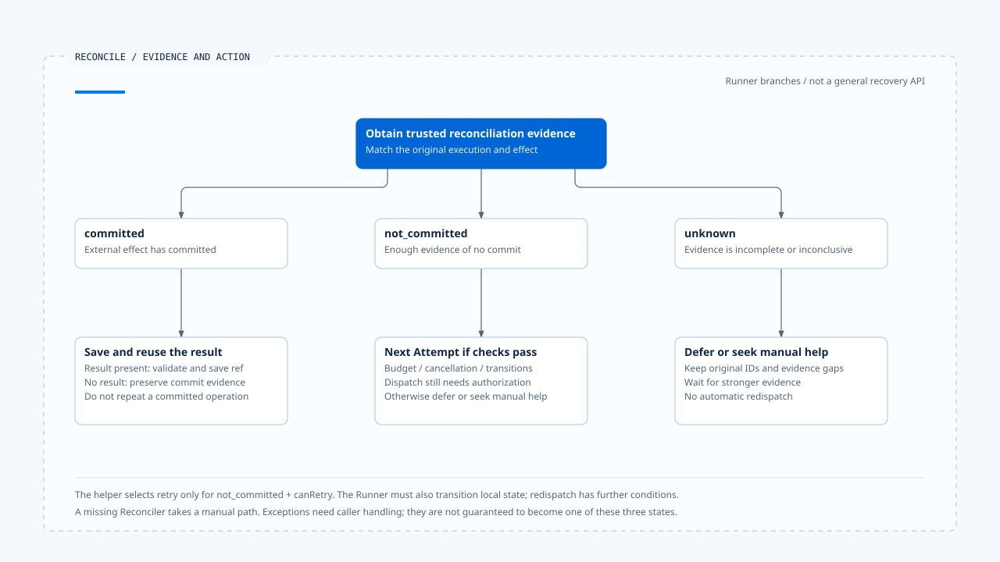

# 效果回查与重试判断

[English](./04-reconciliation-and-safe-retry.md) | [繁體中文](./04-reconciliation-and-safe-retry-zh-TW.md) | [简体中文](./04-reconciliation-and-safe-retry-zh-CN.md)

> 以下内容所提到的
> CCB 为 [claude-code-best](https://github.com/claude-code-best/claude-code) 的简称。
> Chat Gun 为 [chat-gun](https://github.com/HsienW/chat-gun)。

[回到导览](./README-zh-CN.md) · 前一篇：[效果账本与提交边界](./03-effect-ledger-and-commit-boundaries-zh-CN.md) · 下一篇：[补偿与人工介入](./05-compensation-and-manual-recovery-zh-CN.md)

> 写入要求超时后，状态查询返回「找不到记录」。查询端却使用延迟同步的索引，原服务其实已经提交。如果 Runtime 将这个空结果当成未提交证据，第二次派送仍可能造成重复效果。

**回查需要可证明提交状态的外部契约，重试还需要目前仍有效的执行条件。** 连接错误、剩余额度与查询空值各自只回答其中一部分。

## 回查的三种结果

Chat Gun `SideEffectReconciler` 接受 Tool Execution ID、Business Effect Key 与可选的外部 Operation ID，返回 committed、not_committed 或 unknown。

| 结果 | 可以采取的方向 | 仍要确认 |
|---|---|---|
| committed | 补齐本地记录并重用结果。 | 结果是否存在、可读、兼容且允许交付。 |
| not_committed | 在允许重试时考虑新 Attempt。 | 证据是否涵盖原操作、目前限制是否成立。 |
| unknown | 延后、继续回查或人工处理。 | 缺少哪份证据，以及谁负责接手。 |

接口允许提供外部 Operation ID，不代表每个调用点都传入它。查读 runner 的回查调用使用工具执行与业务键；如何对应到外部操作，需要 descriptor 的 Reconciler 实现与可信 Context 补足。

## 从结果到决策

`decideReconciliationAction()` 的规则很短：

~~~ts
if (result.state === "committed") return "commit";
if (result.state === "not_committed" && canRetry) return "retry";
return "defer";
~~~

这段是决策 helper。它接收已算好的 `canRetry`，没有查询 ownership、授权或外部服务，也没有自行送出新操作。安全性取决于调用者提供的证据与后续执行路径。

尤其 committed 的回查结果可以缺少 result。Runner 在这种情况返回 `SIDE_EFFECT_COMMITTED_RESULT_UNAVAILABLE`，没有因为内容不足就重新执行已提交操作。

## 未提交证据需要多强

外部查询需要对应原来的 tenant、资源与操作身份。只查工具名称或最新一笔状态，可能把别次操作的结果误认成这次证据。

设计 Reconciler 时，应说明查询是否具备足够的一致性，以及原操作还能否在查询之后完成。若原请求仍可能执行，某一瞬间的「尚未出现」不足以证明重新派送安全。

- 外部有持久 idempotency key 时，确认查询与重送使用同一语义身份，并核对键的保存期限。
- 查询来自延迟索引时，保留 unknown 或等待条件，避免直接转成 not_committed。
- 查不到 Operation ID 时，确认是否仍有其他可信业务关联；没有就保留证据缺口。

这些是外部 adapter 的契约要求，未验证任何真实服务已满足它们。

## Runner 内部的回查路径

对已执行而效果不明的操作，runner 会尝试使用 descriptor 的 Reconciler。缺少 Reconciler 时，会尝试将执行转成人工介入并返回 `SIDE_EFFECT_RECONCILIATION_REQUIRED`。

如果回查证明 not_committed，helper 也选择 retry，runner 还要成功将 Tool Execution 从 unknown 转回 executing，并将 Business Effect 从 unknown 转回 prepared。两个状态转移未全部成立时，返回保存不确定，不继续这条重试主线。

这两个调用仍有各自的保存边界。若第一份成功、第二份失败，接手者需要重新读取混合状态，不能假设一个布尔失败值表示所有写入均撤回。

已 committed 且附带结果时，runner 走 `persistCommittedResult()` 补记与交付，沿用结果保存及验证条件。回查本身也可能抛错；查读区段没有把每个抛错都转成一份三态结果，调用边界须保留处理责任。

- 图将回查结果与后续条件分层呈现；Recovery 返回决策与真正重新派送仍有接手责任。
- [开启可编辑 HTML 图解](../../assets/agent-runtime/effects-and-recovery/04-reconciliation-and-safe-retry/04-reconciliation-outcomes-and-retry-en.html)。

## 重试额度与再次授权

Runner 对只读错误及可证明未提交的失败有各自判断。Error classification、Retry Policy 的类别与 Retry Budget 共同限制重试；在 unknown 回查分支，helper 使用回查结果与 budget 判断，不能把其他分支的条件全部画成同一个共同函数。

Kernel `checkBudget()` 检查取消、attempt 上限与 elapsed 限制。Backoff 会影响下一次尝试的时间，runner 的等待也支持 Abort；它们限制执行量与等待，没有建立未提交证据。

在 executor 提供拆分授权方法的路径，每次循环会先走授权及 decision 关联，再建立新的实体 Attempt。政策改变、确认仍在等待或 decision 缺失，都可能阻止第二次派送。这也是为何重试不能直接调用原工具函数来绕过 Pipeline。

原 Run 的 ownership、期限与取消是否在每个正式入口持续生效，仍要沿接线核对。本文没有从 Retry Budget 推论全部生命周期限制已自动传递。

## 恢复决策与实际重做的距离

`ConversationRecovery` 可以返回 status 为 reconciled，并带有 commit 或 retry action。查读的该分支直接返回决策，没有在里面调用工具 runner，也没有替 caller 补完 Ledger 或 Task Step。

另一方面，runner 对既有未 committed Replay Key 会先返回回查需求。将 Recovery 的 retry 结果原封不动送回同一 replay 入口，未必能进入新的 Attempt；接手 consumer 需要明确的状态转移、claim 与执行契约。

| 层次 | 查读可确认的责任 | 不能直接推论 |
|---|---|---|
| Reconciler | 提供外部效果三态。 | 已修改全部本地状态。 |
| Decision helper | 依三态与 canRetry 选方向。 | 已通过正式授权并重新派送。 |
| Runner 的回查分支 | 进行指定转移、等待与后续 Attempt。 | 任意重启都可接回此区域。 |
| Conversation Recovery | 分类恢复位置并返回决策或执行指定 Resume。 | 每种 action 都已完成副作用。 |

这些区别有助于找出产品真正需要补接的 consumer，而非把几个模块存在当成完整恢复能力。

## Production descriptor 的实际限制

所列版本续读 `production-runtime-tool-descriptors.ts`。其中提供 Side-effect Descriptor 的查读分支，Reconciler 直接回传 unknown，没有实现查询外部 Operation 后确认提交状态的流程。

这个保守出口能保留不确定性；它也表示通用 runner 的「回查已提交后重用」及「证明未提交后重试」能力，仍需由具体工具提供足够证据。接口、默认对象与测试用 Reconciler，各自具有不同适用范围。

CCB 的 Provider fallback、工具错误消息与 discard 处理，可以对照本地失败回应。外部效果是否允许重做，仍要查具体工具，不能套用模型请求可重试的判断。

## Worker 恢复分类与实际接手

Chat Gun `operations/recovery/worker-recovery.ts` 另外提供 Worker 恢复分类。它先判断 Task 是否完成，再判断效果 unknown；unknown 优先进入 reconciliation_required，即使传入的 Worker 健康标志为 true，也不直接忽略效果问题。其后才看健康、额度耗尽、不安全 ambiguity 与 `isReplaySafe`。

这些输入由 caller 提供，分类器没有自己向外部服务取得提交证据。`isReplaySafe: true` 是需要建立依据的判断，不能由 caller 为了重新排队而直接设置。

Reaper 对 heartbeat 过期、没有进度、ownership 不符与等待过久等信号产生 finding，再将可恢复分类映射成 requeued 或 resumed 等 decision。查读 `PgRecoveryOwnershipPort.takeover()` 的 SQL 以 Run、预期 generation、active 状态及未被替换作条件，更新 generation 与时间；它没有在这段 SQL 中把工具送进 queue。

`runReaperCycle()` 还会取得 singleton lease、逐笔 renew 并 assert current。这些步骤约束本地接手者；实际重新排队、恢复 Graph、传递新 generation 到下游与拒绝旧 Worker，仍须追 consumer。Decision 名称为 requeued 或 resumed，不代表这个函数已执行同名动作。

### 测试中的两条可核对路径

Runner 测试用替身份别返回 not_committed 与 committed。前者检查 Attempt 编号为 `1`、`2`，后者检查实体 executor 只被调用一次，并返回 source 为 reconciled 的结果。这些 assertion 有助于定位预期控制流，但不提供真实外部服务的一致性、重启接手或跨 Worker 验证。

## 如何验证回查与重试

- 对 committed 分别提供可用结果、缺少结果与保存失败，确认不重新派送原效果。
- 对 not_committed 交错 budget 耗尽、取消、再次授权拒绝及状态转移失败。
- 模拟外部查询延迟、查不到记录但原操作晚到提交，确认 Reconciler 不误报未提交。
- 让 Reconciler 缺失、抛错或一直 unknown，核对接手责任与人工处理原因。
- 从实际恢复入口追到下一次物理 Attempt，确认中间没有绕过 claim 或治理条件。

仅查读来源及测试安排，未执行外部一致性测试、取消注入或跨程序重试。

## 本篇的工程判断

我会将 unknown 视为需要保留的结果，让处理者知道哪些操作暂时不能重做。回查提供外部事实，consumer 负责本地转移与执行资格，两者接起来才形成可检验的恢复流程。

## 实现参照与适用范围

- Chat Gun：`runtime/side-effect/reconciler.ts`、`side-effect-descriptor.ts`、`tool-execution-runner.ts`、`runtime/recovery/conversation-recovery.ts`、`last-execution-point.ts` 与 `tools/production-runtime-tool-descriptors.ts`，路径相对 `backend/src/`。
- Chat Gun Worker 接手：`backend/src/operations/recovery/worker-recovery.ts`、`reaper.ts`；预期重试行为另对照 `backend/src/runtime/side-effect/tool-execution-runner.test.ts` 的 assertion。
- Kernel：`@gun-ai/harness-kernel/src/retry.ts` 的分类、budget 与 backoff。

## 接续阅读

下一篇[补偿与人工介入](./05-compensation-and-manual-recovery-zh-CN.md)处理效果已成立、业务流程却只完成一部分的情况。
