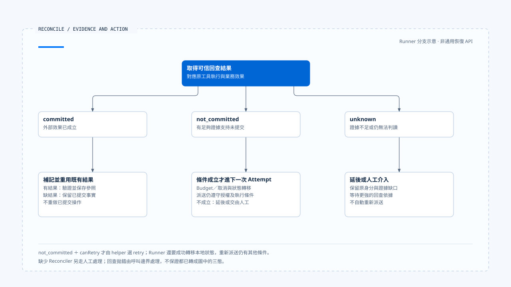

# 效果回查與重試判斷

[English](./04-reconciliation-and-safe-retry.md) | [繁體中文](./04-reconciliation-and-safe-retry-zh-TW.md) | [简体中文](./04-reconciliation-and-safe-retry-zh-CN.md)

> 以下內容所提到的
> CCB 為 [claude-code-best](https://github.com/claude-code-best/claude-code) 的簡稱。
> Chat Gun 為 [chat-gun](https://github.com/HsienW/chat-gun)。

[回到導覽](./README-zh-TW.md) · 前一篇：[效果帳本與提交邊界](./03-effect-ledger-and-commit-boundaries-zh-TW.md) · 下一篇：[補償與人工介入](./05-compensation-and-manual-recovery-zh-TW.md)

> 寫入要求逾時後，狀態查詢回傳「找不到紀錄」。查詢端卻使用延遲同步的索引，原服務其實已經提交。如果 Runtime 將這個空結果當成未提交證據，第二次派送仍可能造成重複效果。

**回查需要可證明提交狀態的外部契約，重試還需要目前仍有效的執行條件。** 連線錯誤、剩餘額度與查詢空值各自只回答其中一部分。

## 回查的三種結果

Chat Gun `SideEffectReconciler` 接受 Tool Execution ID、Business Effect Key 與可選的外部 Operation ID，回傳 committed、not_committed 或 unknown。

| 結果 | 可以採取的方向 | 仍要確認 |
|---|---|---|
| committed | 補齊本地紀錄並重用結果。 | 結果是否存在、可讀、相容且允許交付。 |
| not_committed | 在允許重試時考慮新 Attempt。 | 證據是否涵蓋原操作、目前限制是否成立。 |
| unknown | 延後、繼續回查或人工處理。 | 缺少哪份證據，以及誰負責接手。 |

介面允許提供外部 Operation ID，不代表每個呼叫點都傳入它。查讀 runner 的回查呼叫使用工具執行與業務鍵；如何對應到外部操作，需要 descriptor 的 Reconciler 實作與可信 Context 補足。

## 從結果到決策

`decideReconciliationAction()` 的規則很短：

~~~ts
if (result.state === "committed") return "commit";
if (result.state === "not_committed" && canRetry) return "retry";
return "defer";
~~~

這段是決策 helper。它接收已算好的 `canRetry`，沒有查詢 ownership、授權或外部服務，也沒有自行送出新操作。安全性取決於呼叫者提供的證據與後續執行路徑。

尤其 committed 的回查結果可以缺少 result。Runner 在這種情況回傳 `SIDE_EFFECT_COMMITTED_RESULT_UNAVAILABLE`，沒有因為內容不足就重新執行已提交操作。

## 未提交證據需要多強

外部查詢需要對應原來的 tenant、資源與操作身分。只查工具名稱或最新一筆狀態，可能把別次操作的結果誤認成這次證據。

設計 Reconciler 時，應說明查詢是否具備足夠的一致性，以及原操作還能否在查詢之後完成。若原請求仍可能執行，某一瞬間的「尚未出現」不足以證明重新派送安全。

- 外部有持久 idempotency key 時，確認查詢與重送使用同一語意身分，並核對鍵的保存期限。
- 查詢來自延遲索引時，保留 unknown 或等待條件，避免直接轉成 not_committed。
- 查不到 Operation ID 時，確認是否仍有其他可信業務關聯；沒有就保留證據缺口。

這些是外部 adapter 的契約要求，未驗證任何真實服務已滿足它們。

## Runner 內部的回查路徑

對已執行而效果不明的操作，runner 會嘗試使用 descriptor 的 Reconciler。缺少 Reconciler 時，會嘗試將執行轉成人工介入並回傳 `SIDE_EFFECT_RECONCILIATION_REQUIRED`。

如果回查證明 not_committed，helper 也選擇 retry，runner 還要成功將 Tool Execution 從 unknown 轉回 executing，並將 Business Effect 從 unknown 轉回 prepared。兩個狀態轉移未全部成立時，回傳保存不確定，不繼續這條重試主線。

這兩個呼叫仍有各自的保存邊界。若第一份成功、第二份失敗，接手者需要重新讀取混合狀態，不能假設一個布林失敗值表示所有寫入均撤回。

已 committed 且附帶結果時，runner 走 `persistCommittedResult()` 補記與交付，沿用結果保存及驗證條件。回查本身也可能拋錯；查讀區段沒有把每個拋錯都轉成一份三態結果，呼叫邊界須保留處理責任。

- 圖將回查結果與後續條件分層呈現；Recovery 回傳決策與真正重新派送仍有接手責任。
- [開啟可編輯 HTML 圖解](../../assets/agent-runtime/effects-and-recovery/04-reconciliation-and-safe-retry/04-reconciliation-outcomes-and-retry.html)。

## 重試額度與再次授權

Runner 對唯讀錯誤及可證明未提交的失敗有各自判斷。Error classification、Retry Policy 的類別與 Retry Budget 共同限制重試；在 unknown 回查分支，helper 使用回查結果與 budget 判斷，不能把其他分支的條件全部畫成同一個共同函式。

Kernel `checkBudget()` 檢查取消、attempt 上限與 elapsed 限制。Backoff 會影響下一次嘗試的時間，runner 的等待也支援 Abort；它們限制執行量與等待，沒有建立未提交證據。

在 executor 提供拆分授權方法的路徑，每次迴圈會先走授權及 decision 關聯，再建立新的實體 Attempt。政策改變、確認仍在等待或 decision 缺失，都可能阻止第二次派送。這也是為何重試不能直接呼叫原工具函式來繞過 Pipeline。

原 Run 的 ownership、期限與取消是否在每個正式入口持續生效，仍要沿接線核對。本文沒有從 Retry Budget 推論全部生命週期限制已自動傳遞。

## 恢復決策與實際重做的距離

`ConversationRecovery` 可以回傳 status 為 reconciled，並帶有 commit 或 retry action。查讀的該分支直接回傳決策，沒有在裡面呼叫工具 runner，也沒有替 caller 補完 Ledger 或 Task Step。

另一方面，runner 對既有未 committed Replay Key 會先回傳回查需求。將 Recovery 的 retry 結果原封不動送回同一 replay 入口，未必能進入新的 Attempt；接手 consumer 需要明確的狀態轉移、claim 與執行契約。

| 層次 | 查讀可確認的責任 | 不能直接推論 |
|---|---|---|
| Reconciler | 提供外部效果三態。 | 已修改全部本地狀態。 |
| Decision helper | 依三態與 canRetry 選方向。 | 已通過正式授權並重新派送。 |
| Runner 的回查分支 | 進行指定轉移、等待與後續 Attempt。 | 任意重啟都可接回此區域。 |
| Conversation Recovery | 分類恢復位置並回傳決策或執行指定 Resume。 | 每種 action 都已完成副作用。 |

這些區別有助於找出產品真正需要補接的 consumer，而非把幾個模組存在當成完整恢復能力。

## Production descriptor 的實際限制

所列版本續讀 `production-runtime-tool-descriptors.ts`。其中提供 Side-effect Descriptor 的查讀分支，Reconciler 直接回傳 unknown，沒有實作查詢外部 Operation 後確認提交狀態的流程。

這個保守出口能保留不確定性；它也表示通用 runner 的「回查已提交後重用」及「證明未提交後重試」能力，仍需由具體工具提供足夠證據。介面、預設物件與測試用 Reconciler，各自具有不同適用範圍。

CCB 的 Provider fallback、工具錯誤訊息與 discard 處理，可以對照本地失敗回應。外部效果是否允許重做，仍要查具體工具，不能套用模型請求可重試的判斷。

## Worker 恢復分類與實際接手

Chat Gun `operations/recovery/worker-recovery.ts` 另外提供 Worker 恢復分類。它先判斷 Task 是否完成，再判斷效果 unknown；unknown 優先進入 reconciliation_required，即使傳入的 Worker 健康旗標為 true，也不直接忽略效果問題。其後才看健康、額度耗盡、不安全 ambiguity 與 `isReplaySafe`。

這些輸入由 caller 提供，分類器沒有自己向外部服務取得提交證據。`isReplaySafe: true` 是需要建立依據的判斷，不能由 caller 為了重新排隊而直接設定。

Reaper 對 heartbeat 過期、沒有進度、ownership 不符與等待過久等訊號產生 finding，再將可恢復分類映射成 requeued 或 resumed 等 decision。查讀 `PgRecoveryOwnershipPort.takeover()` 的 SQL 以 Run、預期 generation、active 狀態及未被替換作條件，更新 generation 與時間；它沒有在這段 SQL 中把工具送進 queue。

`runReaperCycle()` 還會取得 singleton lease、逐筆 renew 並 assert current。這些步驟約束本地接手者；實際重新排隊、恢復 Graph、傳遞新 generation 到下游與拒絕舊 Worker，仍須追 consumer。Decision 名稱為 requeued 或 resumed，不代表這個函式已執行同名動作。

### 測試中的兩條可核對路徑

Runner 測試用替身分別回傳 not_committed 與 committed。前者檢查 Attempt 編號為 `1`、`2`，後者檢查實體 executor 只被呼叫一次，並返回 source 為 reconciled 的結果。這些 assertion 有助於定位預期控制流，但不提供真實外部服務的一致性、重啟接手或跨 Worker 驗證。

## 如何驗證回查與重試

- 對 committed 分別提供可用結果、缺少結果與保存失敗，確認不重新派送原效果。
- 對 not_committed 交錯 budget 耗盡、取消、再次授權拒絕及狀態轉移失敗。
- 模擬外部查詢延遲、查不到紀錄但原操作晚到提交，確認 Reconciler 不誤報未提交。
- 讓 Reconciler 缺失、拋錯或一直 unknown，核對接手責任與人工處理原因。
- 從實際恢復入口追到下一次物理 Attempt，確認中間沒有繞過 claim 或治理條件。

僅查讀來源及測試安排，未執行外部一致性測試、取消注入或跨程序重試。

## 本篇的工程判斷

我會將 unknown 視為需要保留的結果，讓處理者知道哪些操作暫時不能重做。回查提供外部事實，consumer 負責本地轉移與執行資格，兩者接起來才形成可檢驗的恢復流程。

## 實作參照與適用範圍

- Chat Gun：`runtime/side-effect/reconciler.ts`、`side-effect-descriptor.ts`、`tool-execution-runner.ts`、`runtime/recovery/conversation-recovery.ts`、`last-execution-point.ts` 與 `tools/production-runtime-tool-descriptors.ts`，路徑相對 `backend/src/`。
- Chat Gun Worker 接手：`backend/src/operations/recovery/worker-recovery.ts`、`reaper.ts`；預期重試行為另對照 `backend/src/runtime/side-effect/tool-execution-runner.test.ts` 的 assertion。
- Kernel：`@gun-ai/harness-kernel/src/retry.ts` 的分類、budget 與 backoff。

## 接續閱讀

下一篇[補償與人工介入](./05-compensation-and-manual-recovery-zh-TW.md)處理效果已成立、業務流程卻只完成一部分的情況。
