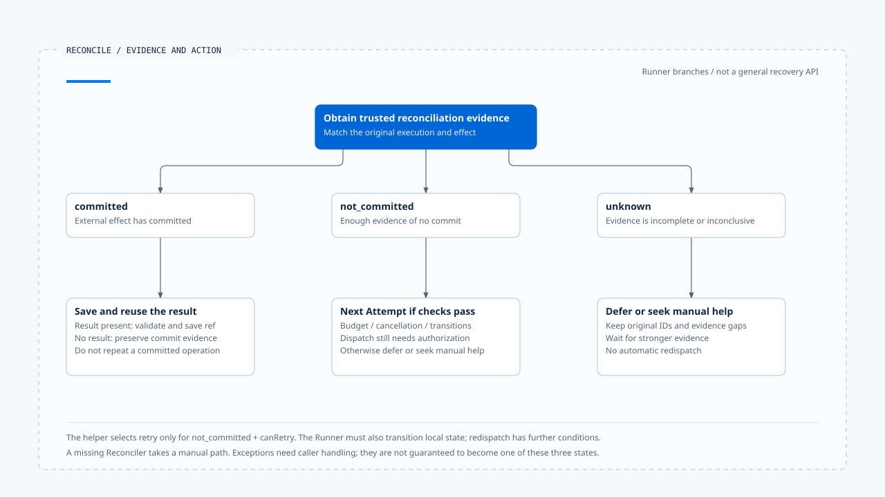
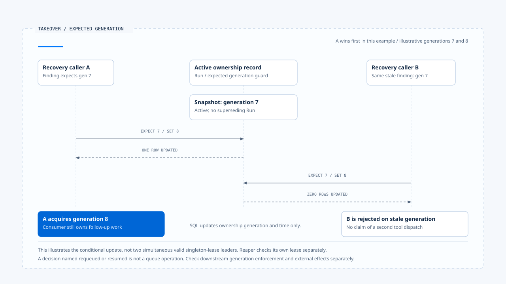

# Effect reconciliation and retry decisions

[English](./04-reconciliation-and-safe-retry.md) | [繁體中文](./04-reconciliation-and-safe-retry-zh-TW.md) | [简体中文](./04-reconciliation-and-safe-retry-zh-CN.md)

> In the following content:
> CCB is short for [claude-code-best](https://github.com/claude-code-best/claude-code).
> Chat Gun refers to [chat-gun](https://github.com/HsienW/chat-gun).

[Back to the guide](./README-zh-TW.md) · Previous: [Effect Ledger and commit boundaries](./03-effect-ledger-and-commit-boundaries.md) · Next: [Compensation and manual intervention](./05-compensation-and-manual-recovery.md)

> After a write times out, a status query reports "record not found." Its query endpoint uses a delayed index, while the original service has already committed. If Runtime treats that empty result as proof of no commit, redispatch can still duplicate the effect.

**Reconciliation needs an external contract that can establish commit state, and retry needs currently valid execution conditions.** A connection error, remaining budget, and an empty query each answer only part of the problem.

## Three reconciliation results

Chat Gun's `SideEffectReconciler` accepts Tool Execution ID, Business Effect Key, and an optional external Operation ID, returning committed, not_committed, or unknown.

| Result | Possible direction | Still to confirm |
|---|---|---|
| committed | Complete local records and reuse the result. | Whether the result exists, is readable and compatible, and may be delivered. |
| not_committed | Consider a new Attempt when retry is permitted. | Whether evidence covers the original operation and current limits permit it. |
| unknown | Defer, reconcile further, or seek manual handling. | Which evidence is missing and who takes over. |

An interface accepting an external Operation ID does not mean every caller supplies it. The inspected runner reconciliation call uses execution identity and business key. Mapping those to the external operation needs the descriptor's Reconciler implementation and trusted Context.

## From result to decision

`decideReconciliationAction()` has a short rule:

~~~ts
if (result.state === "committed") return "commit";
if (result.state === "not_committed" && canRetry) return "retry";
return "defer";
~~~

This is a decision helper. It accepts an already computed `canRetry`, without querying ownership, authorization, or an external service, and without sending a new operation. Safety depends on caller-provided evidence and the subsequent execution path.

A committed reconciliation result can notably lack result content. The runner then returns `SIDE_EFFECT_COMMITTED_RESULT_UNAVAILABLE` rather than repeating the committed operation because content is missing.

## How strong non-commit evidence must be

An external query must correlate to the original tenant, resource, and operation identity. Querying only the tool name or latest status can mistake another operation's result for evidence of this one.

A Reconciler contract should state whether its query is sufficiently consistent and whether the original operation can still complete afterward. If the original request may still execute, absence at one instant cannot prove redispatch safe.

- With a durable external idempotency key, confirm queries and resubmissions use the same semantic identity and check key retention.
- With a delayed index, preserve unknown or waiting conditions instead of converting directly to not_committed.
- When Operation ID is unavailable, look for another trusted business correlation; otherwise preserve the evidence gap.

These are external-adapter contract requirements. No real service was validated as meeting them in this inspection.

## Reconciliation inside the Runner

For an executed operation with uncertain effects, the runner attempts to use the descriptor's Reconciler. If none exists, it attempts a transition to manual intervention and returns `SIDE_EFFECT_RECONCILIATION_REQUIRED`.

If reconciliation establishes not_committed and the helper selects retry, the runner must also transition Tool Execution from unknown to executing and Business Effect from unknown to prepared. Unless both succeed, it returns persistence uncertainty without continuing this retry path.

The two calls retain separate persistence boundaries. If the first succeeds and the second fails, the consumer must reread the mixed state. A false result does not establish that every write was reversed.

For committed with an available result, the runner uses `persistCommittedResult()` to record and deliver it under the existing persistence and validation conditions. Reconciliation itself may throw; the inspected section does not convert every exception to a three-state result, so the call boundary must retain handling responsibility.

- The diagram separates reconciliation results from subsequent conditions. Returning a Recovery decision still leaves takeover responsibility before actual redispatch.
- [Open the editable HTML diagram](../../assets/agent-runtime/effects-and-recovery/04-reconciliation-and-safe-retry/04-reconciliation-outcomes-and-retry-en.html).

## Retry budget and renewed authorization

The runner has separate judgments for read-only errors and failures proven not committed. Error classification, Retry Policy categories, and Retry Budget jointly limit retries. In the unknown reconciliation branch, the helper uses reconciliation state and budget; conditions from other branches must not be depicted as one shared function.

The kernel's `checkBudget()` checks cancellation, attempt limits, and elapsed limits. Backoff affects the next attempt's timing, and runner waiting supports Abort. These constrain work and waiting, without establishing non-commit evidence.

On executor paths with split authorization methods, each loop first handles authorization and decision correlation, then creates a new physical Attempt. Policy changes, pending confirmation, or a missing decision may block a second dispatch. Retry therefore cannot call the original tool function directly to bypass the Pipeline.

Whether ownership, expiry, and cancellation of the original Run remain enforced at every production entry still requires tracing the wiring. Retry Budget alone does not establish automatic propagation of all lifecycle constraints.

## The distance between recovery decisions and repetition

`ConversationRecovery` can return status reconciled with a commit or retry action. That inspected branch returns the decision directly; it neither calls the tool runner nor completes Ledger or Task Step records for the caller.

The runner, meanwhile, first requires reconciliation for an existing uncommitted Replay Key. Passing a Recovery retry result unchanged back into the same replay entry may not reach a new Attempt. The takeover consumer needs explicit state-transition, claim, and execution contracts.

| Layer | Responsibility established by inspection | What cannot be inferred directly |
|---|---|---|
| Reconciler | Supply three-state external-effect evidence. | Every local state has been updated. |
| Decision helper | Select a direction from the three states and canRetry. | Production authorization passed and redispatch occurred. |
| Runner reconciliation branch | Perform specified transitions, waiting, and subsequent Attempts. | Any restart can reconnect to this branch. |
| Conversation Recovery | Classify recovery position and return decisions or execute a specified Resume. | Every action has completed its side effects. |

These distinctions locate the consumer a product actually needs to connect, rather than treating several existing modules as complete recovery capability.

## Actual production-descriptor limits

Further inspection covered `production-runtime-tool-descriptors.ts`. In the inspected Side-effect Descriptor branch, its Reconciler returns unknown directly, without querying an external Operation to establish commit state.

This conservative exit preserves uncertainty. It also means generic runner support for reuse after a reconciled commit or retry after a proven non-commit still needs evidence from a concrete tool. Interfaces, default objects, and test Reconcilers each have different scopes.

CCB Provider fallback, tool-error messages, and discard handling offer local-failure comparisons. Whether an external effect may be repeated still depends on the concrete tool; model-request retry eligibility cannot be applied to it wholesale.

## Worker recovery classification and takeover

Chat Gun's `operations/recovery/worker-recovery.ts` provides separate Worker recovery classification. It checks Task completion first, then unknown effects. Unknown takes priority through reconciliation_required even when the supplied Worker health flag is true. Only afterward does it consider health, budget exhaustion, unsafe ambiguity, and `isReplaySafe`.

The caller provides these inputs; the classifier does not obtain commit evidence from an external service itself. `isReplaySafe: true` needs a basis and must not be set merely to enable requeueing.

Reaper generates findings from heartbeat expiry, lack of progress, ownership mismatch, and excessive waiting, then maps recoverable classifications to decisions such as requeued or resumed. The inspected SQL in `PgRecoveryOwnershipPort.takeover()` conditions generation and timestamp updates on Run, expected generation, active status, and absence of supersession. That SQL does not put a tool into a queue.

`runReaperCycle()` also acquires a singleton lease, renews it per finding, and asserts currency. These constrain the local takeover caller. Actual requeueing, Graph resumption, downstream generation propagation, and rejection of the old Worker still require tracing consumers. A decision named requeued or resumed does not mean this function executed that action.

- The example selects A advancing generation first and B later presenting a stale value. Ownership updates do not dispatch tools or provide remote fencing.
- [Open the editable HTML diagram](../../assets/agent-runtime/effects-and-recovery/04-reconciliation-and-safe-retry/04-generation-conditional-takeover-en.html).

### Two inspectable test paths

Runner tests use doubles returning not_committed and committed. The first checks Attempt numbers `1` and `2`; the second checks one physical executor call and a result with source reconciled. These assertions locate expected control flow without validating real external-service consistency, restart takeover, or cross-Worker behavior.

## How to validate reconciliation and retry

- For committed, test available results, missing results, and persistence failures; confirm no redispatch of the original effect.
- For not_committed, interleave budget exhaustion, cancellation, renewed authorization denial, and state-transition failure.
- Simulate delayed queries that find no record before a late original commit; confirm the Reconciler does not falsely report non-commit.
- Remove the Reconciler, make it throw, or keep returning unknown; check takeover responsibility and manual-handling reasons.
- Trace from the real recovery entry to the next physical Attempt, confirming that claim and governance checks are not bypassed.

Only source and test arrangements were inspected. No external-consistency tests, cancellation injection, or cross-process retries were run.

## Engineering judgment

I would preserve unknown as a result so handlers know which operations cannot yet be repeated. Reconciliation supplies external facts, while the consumer owns local transitions and execution eligibility. Connecting them produces a recovery process that can be examined and tested.

## Implementation references and scope

- Chat Gun: `runtime/side-effect/reconciler.ts`, `side-effect-descriptor.ts`, `tool-execution-runner.ts`, `runtime/recovery/conversation-recovery.ts`, `last-execution-point.ts`, and `tools/production-runtime-tool-descriptors.ts`, relative to `backend/src/`.
- Chat Gun Worker takeover: `backend/src/operations/recovery/worker-recovery.ts` and `reaper.ts`; expected retry behavior also follows assertions in `backend/src/runtime/side-effect/tool-execution-runner.test.ts`.
- Kernel: classification, budget, and backoff in `@gun-ai/harness-kernel/src/retry.ts`.
- [Sources and file fingerprints](./README-zh-TW.md#來源與查證狀態) preserve implementation versions and unverified scope.

## Further reading

Next, [Compensation and manual intervention](./05-compensation-and-manual-recovery.md) handles established effects when a business workflow completed only partially.
