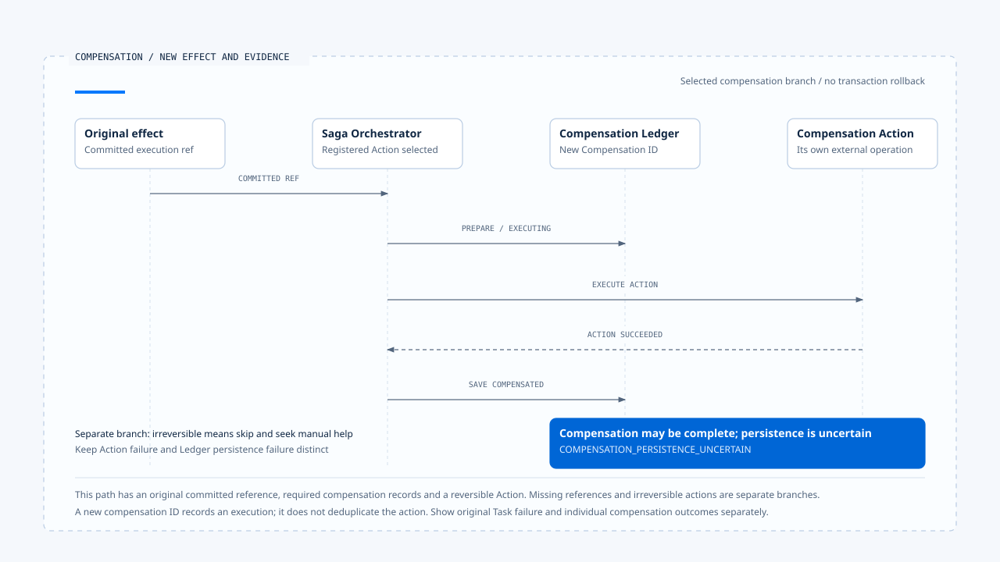

# 补偿与人工介入

[English](./05-compensation-and-manual-recovery.md) | [繁體中文](./05-compensation-and-manual-recovery-zh-TW.md) | [简体中文](./05-compensation-and-manual-recovery-zh-CN.md)

> 以下内容所提到的
> CCB 为 [claude-code-best](https://github.com/claude-code-best/claude-code) 的简称。
> Chat Gun 为 [chat-gun](https://github.com/HsienW/chat-gun)。

[回到导览](./README-zh-CN.md) · 前一篇：[效果回查与重试判断](./04-reconciliation-and-safe-retry-zh-CN.md) · 下一篇：[一次提交不明的恢复](./06-case-ambiguous-commit-recovery-zh-CN.md)

> 工作流程已完成资源预留，下一步通知却失败。取消整个 Task 只能停止后续工作，先前的预留仍存在；即使再送出释放要求，也可能遇到释放已完成、回应却遗失的情况。

**补偿是一份需要独立执行与查证的业务操作。** 它处理已成立的效果，自己也会产生失败、未知与重复执行风险。

## 决定补偿之前

部分流程失败后，应先查明哪些效果确实存在，再依业务规则决定保留、补偿或人工处理。取消 Run 没有回答已提交操作该怎么处置；查不到外部结果，也没有提供足够依据去执行相反操作。

例如释放预留需要知道指定预留是否存在、是否已被使用，以及目前是否允许释放。这是教学场景，没有宣称两个来源库实现相同资源服务。

| 问题 | 所需证据 | 缺少时的处置方向 |
|---|---|---|
| 原效果是否成立？ | Ledger 与外部 Operation 的可信关联。 | 先回查或交由人工确认。 |
| 是否仍可逆？ | 业务规则、资源状态及时间条件。 | 保留不可逆原因。 |
| 本次谁能执行补偿？ | 可信 scope、授权及具体动作范围。 | 不从原工具成功推论新授权。 |
| 补偿是否已执行？ | Compensation Execution 与外部效果证据。 | 避免盲目重做。 |

## Chat Gun 选取哪些 Step

`SagaOrchestratorImpl.compensate()` 先加载 Task，只接受 partially_failed 或 cancelled。接着读取 Steps，找出第一个 terminal_failed 的位置，选取其前面的 succeeded Steps；没有该失败位置时，依程序条件选取 succeeded Steps。

这些是本地状态所决定的候选集合。Step status 尚未补齐或外部效果仍 unknown 时，不能假设这个集合已完整代表所有实际效果。

选取后，程序将 Task 更新为 compensating，再反向处理成功 Step；每个 Step 的 Action 也反向执行。这份反向顺序沿用 repository 返回的 Steps 与 Registry 的 Action 次序，实际顺序契约仍需确认，不能只靠方法名称推论跨服务依赖已正确排序。

## Registry 决定动作是否存在

`CompensationRegistryImpl` 依 step name 登记动作，Action 提供 ID、description、`execute(context)` 与 `isReversible`。这份接口没有直接接收与工具 runner 相同的 Retry Budget、AbortSignal 或授权 port。

应用可以在 Action 内部或外层提供这些限制，但本文没有把它们写成 Orchestrator 已内建的保证。调用补偿会产生新的外部操作，仍需要具体工具与治理接线。

Pipeline 的 production defaults 可以建立空 Registry。没有登记动作时，循环可能没有实际补偿工作；在查读分支中，没有失败或不可逆标志的 Step 仍可能被更新为 compensated。因此看到 Step 名称或结果 `no_actions_needed`，还得核对是否真的需要补偿，以及动作是否有登记。

## 原效果与补偿记录的关联

有提供 Ledger 时，Orchestrator 会依 Step 查找 committed Tool Execution。取得参照后，Action context 可带原 Tool Execution ID 与 Business Effect ID，并建立新的 Compensation Execution ID。

主要顺序为：

~~~text
找到原 committed execution
  → prepare Compensation Execution
  → 转成 executing
  → 执行 Action
  → 保存 compensated 或人工处理状态
  → 保存 Step、Task 与结果事件
~~~

准备或转移补偿记录失败时，查读路径记录失败并略过这次 Action。这可避免在必要记录建立失败后仍沿同一主线执行动作。

但 Ledger 是可选 dependency，找不到 committed reference 时也有不建立上述补偿记录而调用 Action 的路径。应用若要求每个外部补偿都能持久追查，就需要更强的接纳条件；不能只由 Orchestrator 类别存在推论已达成。

## 不可逆与补偿失败

`isReversible` 为 false 时，Action 被略过并保存 `irreversible_requires_manual_intervention`。这份标志来自已登记动作的契约，并非执行器自动验证外部操作是否可逆。

Action 返回 failed 或直接抛错时，Orchestrator 保存 failure entry，并在可行时将补偿记录标成人工处理。它会继续处理后续候选，汇整成功、失败与略过项目。

### 动作成功，补记却失败

如果 Action 已返回成功，Compensation Execution 的 compensated 保存却失败，程序建立 `COMPENSATION_PERSISTENCE_UNCERTAIN`。此时补偿可能已发生，不能把本地失败再翻成「需要重新补偿」。

另一个窗口是更新人工处理状态本身失败。程序会尝试 Audit 记录，Audit 再失败时有后续诊断；这些努力仍没有提供外部补偿是否提交的答案。

补偿需要保留自己的 Operation 身份、可重用结果及回查方式，尤其当 Action 已开始后遇到 timeout。这些是具体 Action 的设计与验证要求，未查得一套涵盖所有 Action 的外部幂等实现。

- 图选可逆 Action 与原 committed reference 都已具备的分支，补偿保存失败不能直接触发同一动作重做。
- [开启可编辑 HTML 图解](../../assets/agent-runtime/effects-and-recovery/05-compensation-and-manual-recovery/05-compensation-and-persistence-uncertainty-en.html)。

## 结果分类与原 Task 状态

`CompensationResult` 汇整 totalActions、succeeded、failed、skippedIrreversible、failures 与 overallStatus。查读实现会依是否有动作及失败／不可逆项目，选取 no_actions_needed、all_compensated 或 manual_intervention_required。

类型另外允许 `partial_failure`，不代表目前这个结果判断函数会产生它。应沿 consumer 实际返回值描述，避免把所有 enum 值都写成已观察分支。

| 返回信息 | 描述的事实 | 解读限制 |
|---|---|---|
| all_compensated | 查读流程中已执行的候选没有记录失败或不可逆略过。 | 仍需核对候选完整性及外部 Action 契约。 |
| manual_intervention_required | 有失败或不可逆项目需要接手。 | 不代表所有补偿都没有执行。 |
| no_actions_needed | 这次选取／登记范围没有动作。 | 不能单独证明外部没有残留效果。 |
| Task failed | 正常走完补偿汇整后，原 Task 的最终更新。 | 不抹除个别补偿可能已成功的结果。 |

没有 completed Steps 的提前返回另有空结果路径，不会走完同一组 Task／事件更新。前端与运维端应各自显示原工作结果及补偿状态，避免统称「恢复成功」。

## 再次进入补偿时

状态筛选可降低部分重做机会，仍不能替代跨 Worker 的单次执行保证。两个接手者可能在状态更新前都读到同一份候选，或第一次补偿已在外部完成、却没有留下成功状态。

查读流程会为补偿建立新的 UUID；新的识别码可记录一次尝试，却不会自行去重相同业务补偿。若产品允许人工重试，需要以原效果与 Action 语义建立可查证关联，并确定外部重送契约。

CCB 的文件历史与 Session 恢复可提供另一种数据复原视角，但不能推广成任意 HTTP、付款或通知操作的补偿。不同工具要依资源与副作用分别设计。

## CCB 的文件回复具体做了什么

`fileHistoryRewind()` 先检查功能是否启用，再找出指定 message ID 对应的 snapshot。找到后调用 `applySnapshot()`，依追踪文件逐一处理：目标备份为 null 表示当时文件不存在，必要时删除；目标有备份且内容不同时，从备份还原。

`applySnapshot()` 对单一文件的例外记录错误后继续，最后返回已变更路径。这让部分文件仍有机会恢复，也表示外层 rewind 正常返回或记录完成事件，无法单独证明所有追踪文件都已还原。`fileHistoryCanRestore()` 检查功能与 snapshot 是否存在，也没有逐档预先证明备份可读或写入一定成功。

这个实现适合与 Saga 的部分补偿结果对照：两者都需要核对实际完成的项目及剩余失败。差异在于 CCB 此处操作追踪文件与备份，没有恢复任意外部 API 的交易；文件回复本身也是写入或删除，需要自己的验证范围。

## 如何验证补偿

- 对部分成功的 Task 核对 Step 与 Action 次序，并测试空 Registry 及缺少原效果参照。
- 略过不可逆 Action，确认结果留下原因及已成功的其他动作。
- 在 Action 成功后让补偿记录保存失败，确认不自动重做同一外部效果。
- 交错两个 Worker 的补偿请求，检查 Action 是否重复执行及如何接手。
- 让 Step、Task、Audit 或事件保存分别失败，核对未完成项目仍有可查证依据。

源代码查读 Orchestrator、Action、Registry 及测试安排，未执行真实补偿、跨 Worker 竞态或储存故障注入。

## 本篇的工程判断

我会让人工接手者能看见原效果、已完成的补偿与仍未知的动作，而非只提供重新执行按钮。人工处理也需要明确范围及证据；否则只是把相同的重复风险移到另一个入口。

## 实现参照与适用范围

- Chat Gun：`runtime/compensation/saga-orchestrator.ts`、`compensation-action.ts`、`compensation-registry.ts`、`runtime/side-effect/business-effect-ledger.ts` 与 `runtime/tool-dispatch/pipeline.ts`，路径相对 `backend/src/`。
- CCB：`src/utils/fileHistory.ts` 的 rewind、逐档套用及错误处理。
- 补偿登记、授权及外部重送契约需由具体 Action 提供。

## 接续阅读

下一篇[一次提交不明的恢复](./06-case-ambiguous-commit-recovery-zh-CN.md)将恢复数据、效果回查与独立补偿分支串成一个可逐段核对的案例。
