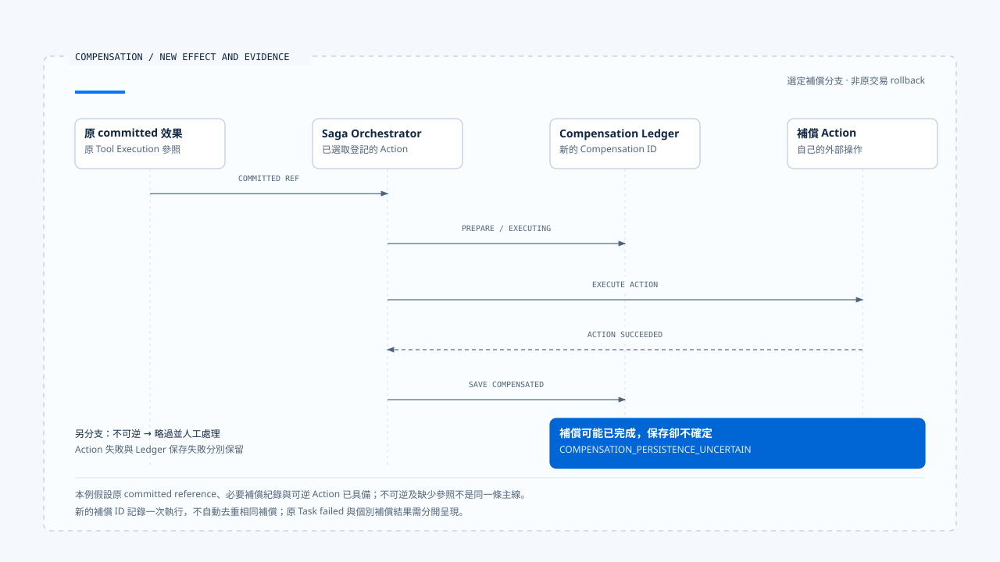

# 補償與人工介入

[English](./05-compensation-and-manual-recovery.md) | [繁體中文](./05-compensation-and-manual-recovery-zh-TW.md) | [简体中文](./05-compensation-and-manual-recovery-zh-CN.md)

> 以下內容所提到的
> CCB 為 [claude-code-best](https://github.com/claude-code-best/claude-code) 的簡稱。
> Chat Gun 為 [chat-gun](https://github.com/HsienW/chat-gun)。

[回到導覽](./README-zh-TW.md) · 前一篇：[效果回查與重試判斷](./04-reconciliation-and-safe-retry-zh-TW.md) · 下一篇：[一次提交不明的恢復](./06-case-ambiguous-commit-recovery-zh-TW.md)

> 工作流程已完成資源預留，下一步通知卻失敗。取消整個 Task 只能停止後續工作，先前的預留仍存在；即使再送出釋放要求，也可能遇到釋放已完成、回應卻遺失的情況。

**補償是一份需要獨立執行與查證的業務操作。** 它處理已成立的效果，自己也會產生失敗、未知與重複執行風險。

## 決定補償之前

部分流程失敗後，應先查明哪些效果確實存在，再依業務規則決定保留、補償或人工處理。取消 Run 沒有回答已提交操作該怎麼處置；查不到外部結果，也沒有提供足夠依據去執行相反操作。

例如釋放預留需要知道指定預留是否存在、是否已被使用，以及目前是否允許釋放。這是教學場景，沒有宣稱兩個來源庫實作相同資源服務。

| 問題 | 所需證據 | 缺少時的處置方向 |
|---|---|---|
| 原效果是否成立？ | Ledger 與外部 Operation 的可信關聯。 | 先回查或交由人工確認。 |
| 是否仍可逆？ | 業務規則、資源狀態及時間條件。 | 保留不可逆原因。 |
| 本次誰能執行補償？ | 可信 scope、授權及具體動作範圍。 | 不從原工具成功推論新授權。 |
| 補償是否已執行？ | Compensation Execution 與外部效果證據。 | 避免盲目重做。 |

## Chat Gun 選取哪些 Step

`SagaOrchestratorImpl.compensate()` 先載入 Task，只接受 partially_failed 或 cancelled。接著讀取 Steps，找出第一個 terminal_failed 的位置，選取其前面的 succeeded Steps；沒有該失敗位置時，依程式條件選取 succeeded Steps。

這些是本地狀態所決定的候選集合。Step status 尚未補齊或外部效果仍 unknown 時，不能假設這個集合已完整代表所有實際效果。

選取後，程式將 Task 更新為 compensating，再反向處理成功 Step；每個 Step 的 Action 也反向執行。這份反向順序沿用 repository 回傳的 Steps 與 Registry 的 Action 次序，實際順序契約仍需確認，不能只靠方法名稱推論跨服務依賴已正確排序。

## Registry 決定動作是否存在

`CompensationRegistryImpl` 依 step name 登記動作，Action 提供 ID、description、`execute(context)` 與 `isReversible`。這份介面沒有直接接收與工具 runner 相同的 Retry Budget、AbortSignal 或授權 port。

應用可以在 Action 內部或外層提供這些限制，但本文沒有把它們寫成 Orchestrator 已內建的保證。呼叫補償會產生新的外部操作，仍需要具體工具與治理接線。

Pipeline 的 production defaults 可以建立空 Registry。沒有登記動作時，迴圈可能沒有實際補償工作；在查讀分支中，沒有失敗或不可逆旗標的 Step 仍可能被更新為 compensated。因此看到 Step 名稱或結果 `no_actions_needed`，還得核對是否真的需要補償，以及動作是否有登記。

## 原效果與補償紀錄的關聯

有提供 Ledger 時，Orchestrator 會依 Step 查找 committed Tool Execution。取得參照後，Action context 可帶原 Tool Execution ID 與 Business Effect ID，並建立新的 Compensation Execution ID。

主要順序為：

~~~text
找到原 committed execution
  → prepare Compensation Execution
  → 轉成 executing
  → 執行 Action
  → 保存 compensated 或人工處理狀態
  → 保存 Step、Task 與結果事件
~~~

準備或轉移補償紀錄失敗時，查讀路徑記錄失敗並略過這次 Action。這可避免在必要紀錄建立失敗後仍沿同一主線執行動作。

但 Ledger 是可選 dependency，找不到 committed reference 時也有不建立上述補償紀錄而呼叫 Action 的路徑。應用若要求每個外部補償都能持久追查，就需要更強的接納條件；不能只由 Orchestrator 類別存在推論已達成。

## 不可逆與補償失敗

`isReversible` 為 false 時，Action 被略過並保存 `irreversible_requires_manual_intervention`。這份旗標來自已登記動作的契約，並非執行器自動驗證外部操作是否可逆。

Action 返回 failed 或直接拋錯時，Orchestrator 保存 failure entry，並在可行時將補償紀錄標成人工處理。它會繼續處理後續候選，彙整成功、失敗與略過項目。

### 動作成功，補記卻失敗

如果 Action 已返回成功，Compensation Execution 的 compensated 保存卻失敗，程式建立 `COMPENSATION_PERSISTENCE_UNCERTAIN`。此時補償可能已發生，不能把本地失敗再翻成「需要重新補償」。

另一個窗口是更新人工處理狀態本身失敗。程式會嘗試 Audit 紀錄，Audit 再失敗時有後續診斷；這些努力仍沒有提供外部補償是否提交的答案。

補償需要保留自己的 Operation 身分、可重用結果及回查方式，尤其當 Action 已開始後遇到 timeout。這些是具體 Action 的設計與驗證要求，本輪沒有查得一套涵蓋所有 Action 的外部冪等實作。

- 圖選可逆 Action 與原 committed reference 都已具備的分支，補償保存失敗不能直接觸發同一動作重做。
- [開啟可編輯 HTML 圖解](../../assets/agent-runtime/effects-and-recovery/05-compensation-and-manual-recovery/05-compensation-and-persistence-uncertainty.html)。

## 結果分類與原 Task 狀態

`CompensationResult` 彙整 totalActions、succeeded、failed、skippedIrreversible、failures 與 overallStatus。查讀實作會依是否有動作及失敗／不可逆項目，選取 no_actions_needed、all_compensated 或 manual_intervention_required。

型別另外允許 `partial_failure`，不代表目前這個結果判斷函式會產生它。應沿 consumer 實際回傳值描述，避免把所有 enum 值都寫成已觀察分支。

| 回傳資訊 | 描述的事實 | 解讀限制 |
|---|---|---|
| all_compensated | 查讀流程中已執行的候選沒有記錄失敗或不可逆略過。 | 仍需核對候選完整性及外部 Action 契約。 |
| manual_intervention_required | 有失敗或不可逆項目需要接手。 | 不代表所有補償都沒有執行。 |
| no_actions_needed | 這次選取／登記範圍沒有動作。 | 不能單獨證明外部沒有殘留效果。 |
| Task failed | 正常走完補償彙整後，原 Task 的最終更新。 | 不抹除個別補償可能已成功的結果。 |

沒有 completed Steps 的提前返回另有空結果路徑，不會走完同一組 Task／事件更新。前端與維運端應各自顯示原工作結果及補償狀態，避免統稱「恢復成功」。

## 再次進入補償時

狀態篩選可降低部分重做機會，仍不能替代跨 Worker 的單次執行保證。兩個接手者可能在狀態更新前都讀到同一份候選，或第一次補償已在外部完成、卻沒有留下成功狀態。

查讀流程會為補償建立新的 UUID；新的識別碼可記錄一次嘗試，卻不會自行去重相同業務補償。若產品允許人工重試，需要以原效果與 Action 語意建立可查證關聯，並確定外部重送契約。

CCB 的檔案歷史與 Session 恢復可提供另一種資料復原視角，但不能推廣成任意 HTTP、付款或通知操作的補償。不同工具要依資源與副作用分別設計。

## CCB 的檔案回復具體做了什麼

`fileHistoryRewind()` 先檢查功能是否啟用，再找出指定 message ID 對應的 snapshot。找到後呼叫 `applySnapshot()`，依追蹤檔案逐一處理：目標備份為 null 表示當時檔案不存在，必要時刪除；目標有備份且內容不同時，從備份還原。

`applySnapshot()` 對單一檔案的例外記錄錯誤後繼續，最後回傳已變更路徑。這讓部分檔案仍有機會恢復，也表示外層 rewind 正常返回或記錄完成事件，無法單獨證明所有追蹤檔案都已還原。`fileHistoryCanRestore()` 檢查功能與 snapshot 是否存在，也沒有逐檔預先證明備份可讀或寫入一定成功。

這個實作適合與 Saga 的部分補償結果對照：兩者都需要核對實際完成的項目及剩餘失敗。差異在於 CCB 此處操作追蹤檔案與備份，沒有恢復任意外部 API 的交易；檔案回復本身也是寫入或刪除，需要自己的驗證範圍。

## 如何驗證補償

- 對部分成功的 Task 核對 Step 與 Action 次序，並測試空 Registry 及缺少原效果參照。
- 略過不可逆 Action，確認結果留下原因及已成功的其他動作。
- 在 Action 成功後讓補償紀錄保存失敗，確認不自動重做同一外部效果。
- 交錯兩個 Worker 的補償請求，檢查 Action 是否重複執行及如何接手。
- 讓 Step、Task、Audit 或事件保存分別失敗，核對未完成項目仍有可查證依據。

本輪查讀 Orchestrator、Action、Registry 及測試安排，未執行真實補償、跨 Worker 競態或儲存故障注入。

## 本篇的工程判斷

我會讓人工接手者能看見原效果、已完成的補償與仍未知的動作，而非只提供重新執行按鈕。人工處理也需要明確範圍及證據；否則只是把相同的重複風險移到另一個入口。

## 實作參照與適用範圍

- Chat Gun：`runtime/compensation/saga-orchestrator.ts`、`compensation-action.ts`、`compensation-registry.ts`、`runtime/side-effect/business-effect-ledger.ts` 與 `runtime/tool-dispatch/pipeline.ts`，路徑相對 `backend/src/`。
- CCB：`src/utils/fileHistory.ts` 的 rewind、逐檔套用及錯誤處理。
- [來源與檔案指紋](./README-zh-TW.md#來源與查證狀態)保留本地實作範圍；補償登記、授權及外部重送契約需由具體 Action 提供。

## 接續閱讀

下一篇[一次提交不明的恢復](./06-case-ambiguous-commit-recovery-zh-TW.md)將恢復資料、效果回查與獨立補償分支串成一個可逐段核對的案例。
