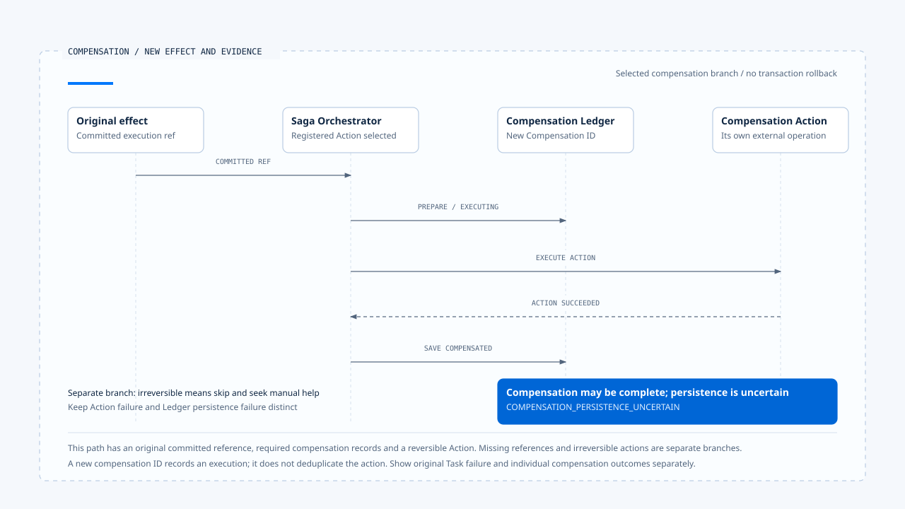

# Compensation and manual intervention

[English](./05-compensation-and-manual-recovery.md) | [繁體中文](./05-compensation-and-manual-recovery-zh-TW.md) | [简体中文](./05-compensation-and-manual-recovery-zh-CN.md)

> In the following content:
> CCB is short for [claude-code-best](https://github.com/claude-code-best/claude-code).
> Chat Gun refers to [chat-gun](https://github.com/HsienW/chat-gun).

[Back to the guide](./README.md) · Previous: [Effect reconciliation and retry decisions](./04-reconciliation-and-safe-retry.md) · Next: [Recovering an ambiguous commit](./06-case-ambiguous-commit-recovery.md)

> A workflow reserves a resource, but its next notification step fails. Cancelling the Task stops later work while the reservation remains. Even sending a release request can encounter another case: release completes, but its response is lost.

**Compensation is a business operation needing its own execution and verification.** It handles established effects while introducing its own failure, uncertainty, and duplicate-execution risks.

## Before deciding to compensate

After partial workflow failure, establish which effects actually exist before applying business rules to retain, compensate, or escalate them. Cancelling a Run does not decide how to handle committed operations; a missing external result is also insufficient grounds to perform the opposite operation.

Releasing a reservation, for example, requires knowing whether it exists, has been used, and may currently be released. This teaching scenario does not claim that both source repositories implement the same resource service.

| Question | Required evidence | Direction when missing |
|---|---|---|
| Did the original effect occur? | Trusted Ledger and external Operation correlations. | Reconcile first or seek manual confirmation. |
| Is it still reversible? | Business rules, resource state, and timing conditions. | Preserve the reason it cannot be reversed. |
| Who may perform this compensation? | Trusted scope, authorization, and concrete action boundaries. | Do not infer new authorization from original tool success. |
| Has compensation already run? | Compensation Execution and external-effect evidence. | Avoid blind repetition. |

## Which Steps Chat Gun selects

`SagaOrchestratorImpl.compensate()` loads a Task and accepts only partially_failed or cancelled. It then reads Steps, finds the first terminal_failed position, and selects preceding succeeded Steps. Without that failure position, it selects succeeded Steps under the code's conditions.

Local state determines this candidate set. If Step status is incomplete or external effects remain unknown, the set cannot be assumed to represent all actual effects.

After selection, the code updates the Task to compensating and processes successful Steps in reverse. Actions within each Step also run in reverse. That order follows repository-returned Steps and Registry Action order. Verify the actual ordering contract rather than inferring correctly sorted cross-service dependencies from method names.

## The Registry determines whether actions exist

`CompensationRegistryImpl` registers actions by step name. An Action provides ID, description, `execute(context)`, and `isReversible`. This interface does not directly accept the same Retry Budget, AbortSignal, or authorization port as the tool runner.

An application may supply those constraints inside an Action or around it; this article does not present them as built-in Orchestrator guarantees. Compensation creates a new external operation and still needs concrete tool and governance wiring.

Pipeline production defaults can create an empty Registry. With no registered actions, the loop may perform no actual compensation. In the inspected branch, a Step without failure or irreversible flags may still become compensated. A Step name or `no_actions_needed` therefore still requires checking whether compensation was needed and whether an action was registered.

## Correlating original effects and compensation records

When a Ledger is supplied, the Orchestrator locates a committed Tool Execution by Step. After obtaining a reference, Action context can include the original Tool Execution ID and Business Effect ID, and a new Compensation Execution ID is created.

The main order is:

~~~text
Find the original committed execution
  → prepare Compensation Execution
  → Transition to executing
  → Execute the Action
  → Save compensated or manual-handling state
  → Save Step, Task, and result events
~~~

When preparing or transitioning a compensation record fails, the inspected path records failure and skips that Action. This prevents action execution along the same path after required record creation fails.

However, Ledger is an optional dependency. There is also a path that calls the Action without those compensation records when no committed reference is found. An application requiring durable traceability for every external compensation needs stronger admission conditions; the Orchestrator class alone does not establish them.

## Irreversibility and compensation failure

When `isReversible` is false, the Action is skipped with `irreversible_requires_manual_intervention`. This flag comes from the registered action's contract; the executor does not automatically prove the external operation reversible.

When an Action returns failed or throws, the Orchestrator saves a failure entry and marks the compensation record for manual handling where possible. It continues through later candidates and aggregates successes, failures, and skipped actions.

### The action succeeds but recording fails

If an Action returns success but saving compensated on Compensation Execution fails, the code creates `COMPENSATION_PERSISTENCE_UNCERTAIN`. Compensation may already have occurred. Local failure cannot be translated into a requirement to compensate again.

Another window occurs when saving the manual-handling state itself fails. The code attempts Audit recording and has further diagnostics if Audit also fails. Those efforts still do not establish whether the external compensation committed.

Compensation needs its own Operation identity, reusable results, and reconciliation method, especially for timeout after an Action starts. These are concrete Action design and validation requirements. This inspection did not establish one external-idempotency implementation covering every Action.

- The diagram selects a reversible Action with an original committed reference. Compensation persistence failure cannot directly trigger repetition of the same action.
- [Open the editable HTML diagram](../../assets/agent-runtime/effects-and-recovery/05-compensation-and-manual-recovery/05-compensation-and-persistence-uncertainty-en.html).

## Result classification and original Task state

`CompensationResult` aggregates totalActions, succeeded, failed, skippedIrreversible, failures, and overallStatus. The inspected implementation selects no_actions_needed, all_compensated, or manual_intervention_required according to action count and failed / irreversible items.

The type also permits `partial_failure`, which does not mean the current result-classification function produces it. Describe actual consumer returns rather than treating every enum value as an observed branch.

| Returned information | Fact described | Interpretation limit |
|---|---|---|
| all_compensated | Executed candidates in the inspected flow recorded no failure or irreversible skip. | Still check candidate completeness and external Action contracts. |
| manual_intervention_required | Failed or irreversible items need takeover. | Other compensation actions may already have run. |
| no_actions_needed | No actions exist in this selected / registered scope. | This alone cannot prove no external effects remain. |
| Task failed | Final update to the original Task after normal compensation aggregation. | Does not erase successful individual compensation results. |

The early return without completed Steps has a separate empty-result path and does not perform the same Task / event updates. Frontend and operations consumers should display the original task result and compensation status separately rather than calling everything successful recovery.

## Entering compensation again

State filtering reduces some repetition opportunities but cannot replace a cross-Worker single-execution guarantee. Two consumers may read the same candidates before an update, or the first compensation may complete externally without recording success.

The inspected flow creates a new UUID for compensation. That identifier records an attempt without automatically deduplicating the same business compensation. Manual retries need provable correlations based on the original effect and Action semantics, together with a defined external-resubmission contract.

CCB file history and Session recovery offer another data-restoration perspective, but cannot be generalized to compensation for arbitrary HTTP, payment, or notification operations. Each tool needs resource-specific and effect-specific design.

## What CCB file restoration actually does

`fileHistoryRewind()` checks feature enablement, then finds the snapshot for a specified message ID. It calls `applySnapshot()` to handle tracked files individually: a null target backup means the file did not exist then and may need deletion; an existing backup with different content triggers restoration.

`applySnapshot()` records individual-file exceptions and continues, finally returning changed paths. This allows some files to recover, but a normal outer rewind return or completion event cannot alone prove that every tracked file was restored. `fileHistoryCanRestore()` checks feature and snapshot existence without proving that each backup is readable or each write will succeed.

This makes a useful comparison with partial Saga compensation results: both need inspection of completed items and remaining failures. CCB here operates on tracked files and backups rather than restoring arbitrary external API transactions. File restoration itself writes or deletes data and needs its own validation scope.

## How to validate compensation

- Check Step and Action order on a partially successful Task, including empty Registry and missing original-effect references.
- Skip an irreversible Action and confirm reasons and other successful actions remain in the result.
- Fail compensation-record persistence after Action success; confirm the same external effect is not repeated automatically.
- Interleave compensation requests from two Workers; inspect duplicate execution and takeover behavior.
- Fail Step, Task, Audit, and event persistence separately; confirm unfinished items remain traceable.

The Orchestrator, Action, Registry, and test arrangements were inspected. No real compensation, cross-Worker race, or storage fault-injection tests were run.

## Engineering judgment

I would show manual handlers the original effect, completed compensation, and still-unknown actions instead of offering only a rerun button. Manual handling also needs explicit scope and evidence; otherwise the same duplication risk simply moves to another entry point.

## Implementation references and scope

- Chat Gun: `runtime/compensation/saga-orchestrator.ts`, `compensation-action.ts`, `compensation-registry.ts`, `runtime/side-effect/business-effect-ledger.ts`, and `runtime/tool-dispatch/pipeline.ts`, relative to `backend/src/`.
- CCB: rewind, per-file application, and error handling in `src/utils/fileHistory.ts`.
- Concrete Actions must supply compensation registration, authorization, and external-resubmission contracts.

## Further reading

Next, [Recovering an ambiguous commit](./06-case-ambiguous-commit-recovery.md) connects recovery state, effect reconciliation, and separate compensation branches in a case that can be checked handoff by handoff.
