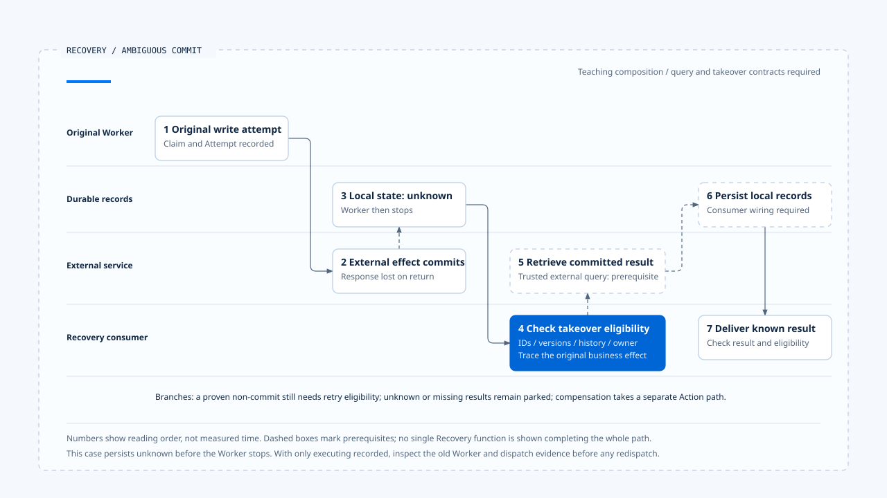

# 一次提交不明的恢复

[English](./06-case-ambiguous-commit-recovery.md) | [繁體中文](./06-case-ambiguous-commit-recovery-zh-TW.md) | [简体中文](./06-case-ambiguous-commit-recovery-zh-CN.md)

> 以下内容所提到的
> CCB 为 [claude-code-best](https://github.com/claude-code-best/claude-code) 的简称。
> Chat Gun 为 [chat-gun](https://github.com/HsienW/chat-gun)。

[回到导览](./README-zh-CN.md) · 前一篇：[补偿与人工介入](./05-compensation-and-manual-recovery-zh-CN.md)

> 外部资源预留已建立，回应在传回 Runtime 时遗失。Worker 随后停止，重启后模型仍能读到「请建立预留」的要求，却没有可信的完成结果。另一个接手者必须先查回原操作，才能决定接下来要做什么。

**这个案例沿着同一业务效果查证，成功续行的前提是提交证据与可用结果都已找回。** 未提交、仍未知、结果缺失及需要补偿的情况，各自保留分支。

## 案例前提与适用范围

以下以资源预留说明责任，名称及识别码都是教学数据。它组合 Chat Gun 已查读的 runner、Ledger 与 Recovery 接点，另列出实际产品仍需提供的部分：

- 工具具备可信 scope、业务键与可执行的 Side-effect Descriptor。
- 外部服务能以稳定关联提供可信提交状态，并在已提交时取得结果。
- Checkpoint 与持久执行数据可在重启后读取。
- 接手 consumer 能核对 ownership、版本与治理条件，再完成回查后的本地补记及续行。

查读的 production MCP Reconciler 目前返回 unknown；本案例的外部查询器是额外前提。Conversation Recovery 返回的决策也不会自行完成所有补记。这些位置在流程中分别标出，没有宣称来源库已跑通这条端到端案例。

## 执行关联

| 身份 | 教学值 | 用途 |
|---|---|---|
| Run | `run-a` | 原本推进工作的执行。 |
| Step／逻辑调用 | `step-reserve`／`call-reserve` | 对应本次工具提案。 |
| Tool Execution | `execution-a` | 查回原持久执行记录。 |
| Attempt | `attempt-1` | 原本送出的实体尝试。 |
| Business Effect | `effect-reserve-a` | 在指定 tenant／scope 中辨认预留意图。 |
| 外部 Operation | `reservation-op-a` | 从外部服务查证提交与结果。 |

Replay Key 由 Run、Step、逻辑调用、call index、工具名称与版本导出。新 Attempt 不能改写旧 Attempt 的记录；新 Run 也不能因为换了 ID 就忽略同一业务效果。

## 1. 原执行取得资格

Pipeline 核对工具与输入、交付授权并建立 canonical Context。具 Side-effect Descriptor 的 runner 查询 Replay Key，没有既有记录时准备 Ledger，取得 claim 后转入 executing。

在有拆分授权方法的 executor 路径，runner 取得并保存 decision，建立 `attempt-1`，成功记录后才开始实体工具。到这里，Ledger 可指出谁有权尝试，但尚未证明外部已完成预留。

## 2. 外部提交，回应遗失

工具送出要求，外部服务建立 `reservation-op-a`，回应却没有抵达 Runtime。原尝试可能仍在等待，也可能先回报效果不明；若 Worker 此时停止，最终本地状态取决于停止发生在哪个 `await` 之间。

本案例选取本地留下 unknown 的情况。若实际只留下 executing，恢复 consumer 需要先判读旧 Worker、派送与外部证据，不能假设程序停止必定已替它保存 unknown。

Checkpoint 可能落后于派送，这是需要演练的窗口。模型历史中没有成功结果，仅代表它缺少结果，不能证明预留尚未建立。

## 3. 重新加载与分类

接手者读取持久状态，核对原 Run、Step、可信 scope 与目前版本，整理可用消息。若其中有未配对 Tool Call 或部分 Assistant Message，需要依 Sanitizer 的 valid／sanitized／parked 结果处理。

Chat Gun `ConversationRecovery` 提供部分读取及分类能力，但它要求存在指定 Interrupt Manifest，并在缺少 Checkpoint 时提前返回人工介入。一般工具崩溃若没有这份等待记录，不能硬接进同一入口；应由其他明确的恢复 consumer 加载证据。

Ledger unknown 让接手者知道应追查原效果。原记录已 committed 时，可以先核对 Result Reference；只有执行位置已恢复，却缺少效果证据时，仍不足以重新派送。

### Reaper 发现卡住的 Run 时

案例可在此加入一个独立的 ownership 接手步骤。Reaper 读取 Run projection，根据 heartbeat、进度及等待信号产生 finding。效果 unknown 时交付 reconciliation_required；不应只因为 Worker 已停止就选择安全重送。

`PgRecoveryOwnershipPort` 可用预期 generation 的条件式更新取得接手资格。若 generation 已改变、Run 已被替换或没有可核对的 generation，该更新会失败或被略过。成功取得资格后，接手 consumer 才负责执行本案例的回查及续行契约；Reaper 的结果本身没有重新送出 `reservation-op-a`。

这也提供一个验证点：两个接手者同时处理相同 finding 时，除了核对只有一方取得 generation，还要确认旧执行者的晚到结果不会直接覆写新状态。单纯更新 ownership 的 SQL 没有替远端服务提供 fencing。

## 4. 查回原业务效果

案例中的外部 Reconciler 以可信业务关联查到 `reservation-op-a` 已提交，并返回预留结果。它必须能说明这份结果确实属于原操作，查询的一致性也足以支持 committed 判断。

这一步不能用「没有错误」或模型文字代替。外部回查超时、关联缺失或查询尚未同步，都应保留 unknown。

### 两条本地接手路径

Runner 尚在同一执行期间的回查分支，可以在取得 committed 结果后走 `persistCommittedResult()`，保存参照与 Ledger，再交付结果。

程序已重启时，Recovery 返回 commit 决策与真正执行补记之间仍有交接。接手 consumer 需要具体的状态检查及补记方式；直接重调用原 replay 入口，对未 committed 的既有记录可能只得到 deferred。

本案例主线假设这份接手契约已提供。它是待整合及验证的工程责任，没有将私有 runner 分支当成任意外部 caller 都可直接使用的 API。

## 5. 补记并交付既有结果

已确认外部提交后，接手者补齐 Result Reference、Ledger 与必要 Task Step。每一层仍有自己的失败出口：结果不可取得、scope 不兼容、工具版本改变或保存不确定，都可能阻止结果交付。

即使外部效果确定，缺少 payload 也需要结果补取或人工处理，不能退回建立另一份预留。若内层 outcome 为 ambiguous 或 deferred，外层成功交付封套也不改变这个分类。

必要记录与结果可用后，再核对目前执行归属及后续治理条件，将结果送回正确的 Tool Call。原 Run 已 terminal 或 superseded 时，晚到结果可以补充证据，不能自行重新取得 owner。

## 6. 依确定结果继续

模型收到已确认的预留结果，可以提出下一个业务步骤。新的工具提案仍需经过验证、授权与派送限制；恢复成功不会给后续工具一份永久批准。

如果原流程含有等待回复，Resume 消费与 Graph 接手也要各自查证。只看到回复已 consumed，不能推论下一个节点已执行。最后是否进入 Run Terminal，由生命周期的权威判断及必要保存决定。

- 虚线框标示案例额外需要的外部查询器与补记接手契约；本图没有宣称来源库已执行完整恢复 E2E。
- [开启可编辑 HTML 图解](../../assets/agent-runtime/effects-and-recovery/06-case-ambiguous-commit-recovery/06-ambiguous-commit-recovery-swimlane-en.html)。

## 其他结果各自分流

| 分支 | 后续处理 | 必须避免的推论 |
|---|---|---|
| 证明未提交 | 核对 budget、取消、ownership、授权及 claim，再建立新 Attempt。 | 查不到一笔数据就等于可安全重做。 |
| 仍 unknown | 停放、等待更强证据或人工处理。 | 重送直到成功便能消除不确定性。 |
| 已提交但没有结果 | 补取结果，保留效果已成立的事实。 | Payload 缺失代表外部未执行。 |
| 本地补记失败 | 重新读取各层记录，处理混合状态。 | 单一 transaction 失败使所有外部效果撤回。 |
| 需要补偿 | 确认原效果与业务条件，走独立 Action 及证据链。 | 补偿直接删除原提交历史。 |

补偿分支可在 Task 部分失败或取消后进入。查读的 Orchestrator 还需要符合条件的 Step 与已登记 Action；原效果仅 unknown 时，不能跳过查证就假设应执行相反动作。

## 故障验证矩阵

下列每列是一个独立情境，应分次安排故障位置与预期结果。

| 注入位置 | 核对的证据 | 预期处理方向 |
|---|---|---|
| Ledger prepare 前失败 | 没有取得 claim，工具调用数为零。 | 不派送。 |
| Claim 后、工具派送前停止 | Attempt 与派送证据。 | 依可信执行位置接手，避免凭状态猜测。 |
| 外部提交后遗失回应 | 原业务键与外部 Operation。 | 回查并重用，或保留 unknown。 |
| Result Reference 保存后停止 | 参照存在，Ledger 可能仍旧。 | 核对归属与效果，再补记。 |
| Ledger 已提交、Task Step 保存失败 | committed 与内层 ambiguous 并存。 | 修复本地记录，不重做原效果。 |
| Resume 消费后 Graph 未接手 | consumed、Checkpoint 与接手记录。 | 依明确恢复契约补接。 |
| 相同重放键改变参数 | request hash 不同。 | 回报 conflict。 |
| 两个接手者使用同一 finding | 预期 generation、实际接手结果与原 Worker 的晚到更新。 | 条件不符者不派送；远端效果仍独立查证。 |
| 补偿成功后保存失败 | Action 效果与补偿记录不一致。 | 保留不确定性，先查证再处置。 |

验收时除了检查返回 code，也要计算物理派送次数、读取每层记录，并确认最终交付给模型及用户的结果没有抹掉未知效果。

## 两个来源各自提供的观察

| 来源 | 可用于本案例的观察 | 本轮没有证明的能力 |
|---|---|---|
| Chat Gun | Claim、Attempt、Ledger、结果参照、回查决策、指定 Resume 与补偿模块。 | 真实外部查询器、通用崩溃接手及全部署自动恢复。 |
| CCB | Session transcript、恢复数据组装、Tool Call 配对及旧 executor 结果清理。 | 对所有工具共用的持久业务效果 Ledger 与补偿交易。 |

本案例是一份教学责任流程，本轮没有执行跨 Provider、Store、外部工具与治理入口的正式 E2E。所需的外部查询器、恢复接手与补偿 Action，都应在实际产品逐项验证。

## 本篇的工程判断

我会用这个案例检查每个接手点是否都能回答：原操作是谁、效果知道多少、下一步由谁执行、失败后数据留在哪里。能保留这些答案，恢复流程才有机会在第二次故障后仍继续查证。

## 实现参照与适用范围

- Chat Gun：前五篇引用的 runner、Ledger、Recovery、Result Reference、production descriptor 与 Saga 模块。
- Chat Gun 接手条件：`backend/src/operations/recovery/reaper.ts` 的 generation 更新；不将 decision 名称视为实际工具重新派送。
- CCB：`src/QueryEngine.ts`、`src/utils/sessionStorage.ts`、`src/utils/sessionRestore.ts` 与 `src/services/tools/StreamingToolExecutor.ts`。
- [来源与文件指纹](./README-zh-CN.md#来源与查证状态)记录本地查读范围及教学前提。

## 接续阅读

回到[Effects and Recovery 导览](./README-zh-CN.md)核对各篇与候选图解，或参照[终止判定与清理](../execution-lifecycle/05-terminal-results-and-finalization-zh-CN.md)，检查效果恢复之后如何交付生命周期结果。
