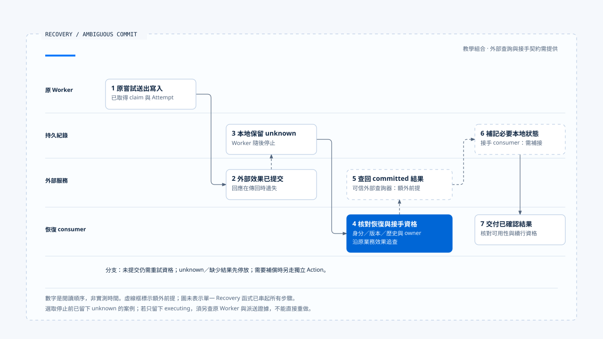

# 一次提交不明的恢復

[English](./06-case-ambiguous-commit-recovery.md) | [繁體中文](./06-case-ambiguous-commit-recovery-zh-TW.md) | [简体中文](./06-case-ambiguous-commit-recovery-zh-CN.md)

> 以下內容所提到的
> CCB 為 [claude-code-best](https://github.com/claude-code-best/claude-code) 的簡稱。
> Chat Gun 為 [chat-gun](https://github.com/HsienW/chat-gun)。

[回到導覽](./README-zh-TW.md) · 前一篇：[補償與人工介入](./05-compensation-and-manual-recovery-zh-TW.md)

> 外部資源預留已建立，回應在傳回 Runtime 時遺失。Worker 隨後停止，重啟後模型仍能讀到「請建立預留」的要求，卻沒有可信的完成結果。另一個接手者必須先查回原操作，才能決定接下來要做什麼。

**這個案例沿著同一業務效果查證，成功續行的前提是提交證據與可用結果都已找回。** 未提交、仍未知、結果缺失及需要補償的情況，各自保留分支。

## 案例前提與適用範圍

以下以資源預留說明責任，名稱及識別碼都是教學資料。它組合 Chat Gun 已查讀的 runner、Ledger 與 Recovery 接點，另列出實際產品仍需提供的部分：

- 工具具備可信 scope、業務鍵與可執行的 Side-effect Descriptor。
- 外部服務能以穩定關聯提供可信提交狀態，並在已提交時取得結果。
- Checkpoint 與持久執行資料可在重啟後讀取。
- 接手 consumer 能核對 ownership、版本與治理條件，再完成回查後的本地補記及續行。

查讀的 production MCP Reconciler 目前回傳 unknown；本案例的外部查詢器是額外前提。Conversation Recovery 回傳的決策也不會自行完成所有補記。這些位置在流程中分別標出，沒有宣稱來源庫已跑通這條端到端案例。

## 執行關聯

| 身分 | 教學值 | 用途 |
|---|---|---|
| Run | `run-a` | 原本推進工作的執行。 |
| Step／邏輯呼叫 | `step-reserve`／`call-reserve` | 對應本次工具提案。 |
| Tool Execution | `execution-a` | 查回原持久執行紀錄。 |
| Attempt | `attempt-1` | 原本送出的實體嘗試。 |
| Business Effect | `effect-reserve-a` | 在指定 tenant／scope 中辨認預留意圖。 |
| 外部 Operation | `reservation-op-a` | 從外部服務查證提交與結果。 |

Replay Key 由 Run、Step、邏輯呼叫、call index、工具名稱與版本導出。新 Attempt 不能改寫舊 Attempt 的紀錄；新 Run 也不能因為換了 ID 就忽略同一業務效果。

## 1. 原執行取得資格

Pipeline 核對工具與輸入、交付授權並建立 canonical Context。具 Side-effect Descriptor 的 runner 查詢 Replay Key，沒有既有紀錄時準備 Ledger，取得 claim 後轉入 executing。

在有拆分授權方法的 executor 路徑，runner 取得並保存 decision，建立 `attempt-1`，成功記錄後才開始實體工具。到這裡，Ledger 可指出誰有權嘗試，但尚未證明外部已完成預留。

## 2. 外部提交，回應遺失

工具送出要求，外部服務建立 `reservation-op-a`，回應卻沒有抵達 Runtime。原嘗試可能仍在等待，也可能先回報效果不明；若 Worker 此時停止，最終本地狀態取決於停止發生在哪個 `await` 之間。

本案例選取本地留下 unknown 的情況。若實際只留下 executing，恢復 consumer 需要先判讀舊 Worker、派送與外部證據，不能假設程序停止必定已替它保存 unknown。

Checkpoint 可能落後於派送，這是需要演練的窗口。模型歷史中沒有成功結果，僅代表它缺少結果，不能證明預留尚未建立。

## 3. 重新載入與分類

接手者讀取持久狀態，核對原 Run、Step、可信 scope 與目前版本，整理可用訊息。若其中有未配對 Tool Call 或部分 Assistant Message，需要依 Sanitizer 的 valid／sanitized／parked 結果處理。

Chat Gun `ConversationRecovery` 提供部分讀取及分類能力，但它要求存在指定 Interrupt Manifest，並在缺少 Checkpoint 時提前返回人工介入。一般工具崩潰若沒有這份等待紀錄，不能硬接進同一入口；應由其他明確的恢復 consumer 載入證據。

Ledger unknown 讓接手者知道應追查原效果。原紀錄已 committed 時，可以先核對 Result Reference；只有執行位置已恢復，卻缺少效果證據時，仍不足以重新派送。

### Reaper 發現卡住的 Run 時

案例可在此加入一個獨立的 ownership 接手步驟。Reaper 讀取 Run projection，根據 heartbeat、進度及等待訊號產生 finding。效果 unknown 時交付 reconciliation_required；不應只因為 Worker 已停止就選擇安全重送。

`PgRecoveryOwnershipPort` 可用預期 generation 的條件式更新取得接手資格。若 generation 已改變、Run 已被替換或沒有可核對的 generation，該更新會失敗或被略過。成功取得資格後，接手 consumer 才負責執行本案例的回查及續行契約；Reaper 的結果本身沒有重新送出 `reservation-op-a`。

這也提供一個驗證點：兩個接手者同時處理相同 finding 時，除了核對只有一方取得 generation，還要確認舊執行者的晚到結果不會直接覆寫新狀態。單純更新 ownership 的 SQL 沒有替遠端服務提供 fencing。

## 4. 查回原業務效果

案例中的外部 Reconciler 以可信業務關聯查到 `reservation-op-a` 已提交，並返回預留結果。它必須能說明這份結果確實屬於原操作，查詢的一致性也足以支援 committed 判斷。

這一步不能用「沒有錯誤」或模型文字代替。外部回查逾時、關聯缺失或查詢尚未同步，都應保留 unknown。

### 兩條本地接手路徑

Runner 尚在同一執行期間的回查分支，可以在取得 committed 結果後走 `persistCommittedResult()`，保存參照與 Ledger，再交付結果。

程序已重啟時，Recovery 回傳 commit 決策與真正執行補記之間仍有交接。接手 consumer 需要具體的狀態檢查及補記方式；直接重呼叫原 replay 入口，對未 committed 的既有紀錄可能只得到 deferred。

本案例主線假設這份接手契約已提供。它是待整合及驗證的工程責任，沒有將私有 runner 分支當成任意外部 caller 都可直接使用的 API。

## 5. 補記並交付既有結果

已確認外部提交後，接手者補齊 Result Reference、Ledger 與必要 Task Step。每一層仍有自己的失敗出口：結果不可取得、scope 不相容、工具版本改變或保存不確定，都可能阻止結果交付。

即使外部效果確定，缺少 payload 也需要結果補取或人工處理，不能退回建立另一份預留。若內層 outcome 為 ambiguous 或 deferred，外層成功交付封套也不改變這個分類。

必要紀錄與結果可用後，再核對目前執行歸屬及後續治理條件，將結果送回正確的 Tool Call。原 Run 已 terminal 或 superseded 時，晚到結果可以補充證據，不能自行重新取得 owner。

## 6. 依確定結果繼續

模型收到已確認的預留結果，可以提出下一個業務步驟。新的工具提案仍需經過驗證、授權與派送限制；恢復成功不會給後續工具一份永久批准。

如果原流程含有等待回覆，Resume 消費與 Graph 接手也要各自查證。只看到回覆已 consumed，不能推論下一個節點已執行。最後是否進入 Run Terminal，由生命週期的權威判斷及必要保存決定。

- 虛線框標示案例額外需要的外部查詢器與補記接手契約；本圖沒有宣稱來源庫已執行完整恢復 E2E。
- [開啟可編輯 HTML 圖解](../../assets/agent-runtime/effects-and-recovery/06-case-ambiguous-commit-recovery/06-ambiguous-commit-recovery-swimlane.html)。

## 其他結果各自分流

| 分支 | 後續處理 | 必須避免的推論 |
|---|---|---|
| 證明未提交 | 核對 budget、取消、ownership、授權及 claim，再建立新 Attempt。 | 查不到一筆資料就等於可安全重做。 |
| 仍 unknown | 停放、等待更強證據或人工處理。 | 重送直到成功便能消除不確定性。 |
| 已提交但沒有結果 | 補取結果，保留效果已成立的事實。 | Payload 缺失代表外部未執行。 |
| 本地補記失敗 | 重新讀取各層紀錄，處理混合狀態。 | 單一 transaction 失敗使所有外部效果撤回。 |
| 需要補償 | 確認原效果與業務條件，走獨立 Action 及證據鏈。 | 補償直接刪除原提交歷史。 |

補償分支可在 Task 部分失敗或取消後進入。查讀的 Orchestrator 還需要符合條件的 Step 與已登記 Action；原效果僅 unknown 時，不能跳過查證就假設應執行相反動作。

## 故障驗證矩陣

下列每列是一個獨立情境，應分次安排故障位置與預期結果。

| 注入位置 | 核對的證據 | 預期處理方向 |
|---|---|---|
| Ledger prepare 前失敗 | 沒有取得 claim，工具呼叫數為零。 | 不派送。 |
| Claim 後、工具派送前停止 | Attempt 與派送證據。 | 依可信執行位置接手，避免憑狀態猜測。 |
| 外部提交後遺失回應 | 原業務鍵與外部 Operation。 | 回查並重用，或保留 unknown。 |
| Result Reference 保存後停止 | 參照存在，Ledger 可能仍舊。 | 核對歸屬與效果，再補記。 |
| Ledger 已提交、Task Step 保存失敗 | committed 與內層 ambiguous 並存。 | 修復本地紀錄，不重做原效果。 |
| Resume 消費後 Graph 未接手 | consumed、Checkpoint 與接手紀錄。 | 依明確恢復契約補接。 |
| 相同重放鍵改變參數 | request hash 不同。 | 回報 conflict。 |
| 兩個接手者使用同一 finding | 預期 generation、實際接手結果與原 Worker 的晚到更新。 | 條件不符者不派送；遠端效果仍獨立查證。 |
| 補償成功後保存失敗 | Action 效果與補償紀錄不一致。 | 保留不確定性，先查證再處置。 |

驗收時除了檢查回傳 code，也要計算物理派送次數、讀取每層紀錄，並確認最終交付給模型及使用者的結果沒有抹掉未知效果。

## 兩個來源各自提供的觀察

| 來源 | 可用於本案例的觀察 | 本輪沒有證明的能力 |
|---|---|---|
| Chat Gun | Claim、Attempt、Ledger、結果參照、回查決策、指定 Resume 與補償模組。 | 真實外部查詢器、通用崩潰接手及全部署自動恢復。 |
| CCB | Session transcript、恢復資料組裝、Tool Call 配對及舊 executor 結果清理。 | 對所有工具共用的持久業務效果 Ledger 與補償交易。 |

本案例是一份教學責任流程，本輪沒有執行跨 Provider、Store、外部工具與治理入口的正式 E2E。所需的外部查詢器、恢復接手與補償 Action，都應在實際產品逐項驗證。

## 本篇的工程判斷

我會用這個案例檢查每個接手點是否都能回答：原操作是誰、效果知道多少、下一步由誰執行、失敗後資料留在哪裡。能保留這些答案，恢復流程才有機會在第二次故障後仍繼續查證。

## 實作參照與適用範圍

- Chat Gun：前五篇引用的 runner、Ledger、Recovery、Result Reference、production descriptor 與 Saga 模組。
- Chat Gun 接手條件：`backend/src/operations/recovery/reaper.ts` 的 generation 更新；不將 decision 名稱視為實際工具重新派送。
- CCB：`src/QueryEngine.ts`、`src/utils/sessionStorage.ts`、`src/utils/sessionRestore.ts` 與 `src/services/tools/StreamingToolExecutor.ts`。
- [來源與檔案指紋](./README-zh-TW.md#來源與查證狀態)記錄本地查讀範圍及教學前提。

## 接續閱讀

回到[Effects and Recovery 導覽](./README-zh-TW.md)核對各篇與候選圖解，或參照[終止判定與清理](../execution-lifecycle/05-terminal-results-and-finalization-zh-TW.md)，檢查效果恢復之後如何交付生命週期結果。
