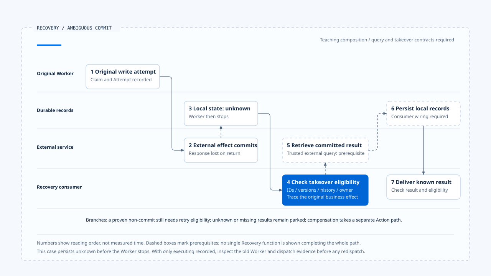

# Recovering an ambiguous commit

[English](./06-case-ambiguous-commit-recovery.md) | [繁體中文](./06-case-ambiguous-commit-recovery-zh-TW.md)

> In the following content:
> CCB is short for [claude-code-best](https://github.com/claude-code-best/claude-code).
> Chat Gun refers to [chat-gun](https://github.com/HsienW/chat-gun).

[Back to the guide](./README-zh-TW.md) · Previous: [Compensation and manual intervention](./05-compensation-and-manual-recovery.md)

> An external resource reservation exists, but its response is lost on the way to Runtime. The Worker stops. After restart, the model can still read the request to create a reservation, without a trusted completion result. Another consumer must locate the original operation before deciding what happens next.

**This case traces one business effect; successful continuation requires recovered commit evidence and a usable result.** Non-commit, uncertainty, missing results, and compensation needs retain separate branches.

## Case premises and scope

The resource reservation illustrates responsibilities; names and identifiers are teaching data. The case combines inspected Chat Gun runner, Ledger, and Recovery points while listing what a real product must still provide:

- A tool with trusted scope, a business key, and an executable Side-effect Descriptor.
- An external service offering trusted commit state through stable correlations and a retrievable committed result.
- Checkpoint and durable execution data readable after restart.
- A takeover consumer that checks ownership, versions, and governance conditions before completing local reconciliation records and continuing.

The inspected production MCP Reconciler currently returns unknown; this case's external query is an additional premise. Conversation Recovery decisions do not complete all records themselves either. Those locations are marked separately, without claiming that the source repository has run this end-to-end case.

## Execution correlations

| Identity | Teaching value | Purpose |
|---|---|---|
| Run | `run-a` | Original execution advancing the task. |
| Step / logical call | `step-reserve` / `call-reserve` | Correlate the tool proposal. |
| Tool Execution | `execution-a` | Locate the original durable execution record. |
| Attempt | `attempt-1` | Original physical attempt sent. |
| Business Effect | `effect-reserve-a` | Identify reservation intent in the specified tenant / scope. |
| External Operation | `reservation-op-a` | Verify commit and result with the external service. |

Replay Key derives from Run, Step, logical call, call index, tool name, and version. A new Attempt must not overwrite the old Attempt record. A new Run also cannot ignore the same business effect merely because its ID changed.

## 1. The original execution acquires eligibility

The Pipeline checks tool and input, handles authorization, and builds canonical Context. A runner with a Side-effect Descriptor checks Replay Key, prepares the Ledger when no record exists, and enters executing after acquiring its claim.

On executor paths with split authorization methods, the runner obtains and records a decision, creates `attempt-1`, and starts the physical tool only after recording succeeds. The Ledger can now identify who may attempt the work, without yet proving that the external reservation completed.

## 2. External commit with a lost response

The tool sends its request, and the external service creates `reservation-op-a`, but no response reaches Runtime. The original attempt may still be waiting or may first report uncertain effects. If the Worker stops then, final local state depends on which `await` boundary it reaches.

This case selects a locally preserved unknown state. If only executing remains, the recovery consumer must first inspect the old Worker, dispatch, and external evidence. A process stop does not necessarily persist unknown on its behalf.

A Checkpoint may lag behind dispatch; that is a window to exercise. Missing success in model history means a result is absent, without proving that no reservation exists.

## 3. Reload and classify

The consumer reads durable state, checks the original Run, Step, trusted scope, and current versions, then sanitizes usable messages. Unmatched Tool Calls or partial Assistant Messages need handling under the Sanitizer's valid / sanitized / parked results.

Chat Gun's `ConversationRecovery` supplies some reading and classification capabilities, but requires a specified Interrupt Manifest and returns manual handling early when a Checkpoint is missing. An ordinary tool crash without that waiting record cannot simply be forced through the same entry. Another explicit recovery consumer must load the evidence.

Ledger unknown tells the consumer to investigate the original effect. A committed original record can first lead to Result Reference checks. Restored execution position without effect evidence is still insufficient for redispatch.

### When Reaper finds a stuck Run

The case can add a separate ownership takeover step here. Reaper reads Run projections and produces findings from heartbeat, progress, and waiting signals. Unknown effects produce reconciliation_required; a stopped Worker alone must not establish safe resubmission.

`PgRecoveryOwnershipPort` can acquire takeover eligibility with an expected-generation conditional update. A changed generation, superseded Run, or missing verifiable generation causes rejection or skipping. After acquisition, the consumer still executes this case's reconciliation and continuation contract. The Reaper result itself has not resent `reservation-op-a`.

This supplies another validation point: when two consumers process the same finding, check not only that one acquires the generation, but also that the old executor's late result cannot overwrite new state directly. An ownership-update SQL statement alone provides no remote-service fencing.

## 4. Reconcile the original business effect

The case's external Reconciler uses trusted business correlations to establish that `reservation-op-a` committed and returns the reservation result. It must demonstrate that the result belongs to the original operation and that query consistency supports the committed judgment.

Neither absence of errors nor model prose can replace this step. External reconciliation timeout, missing correlations, or an unsynchronized query should preserve unknown.

### Two local takeover paths

While still in the same execution, a runner reconciliation branch can use `persistCommittedResult()` after obtaining a committed result, save the reference and Ledger, then deliver the result.

After process restart, a handoff remains between Recovery returning a commit decision and actually completing local records. The consumer needs concrete state checks and recording methods. Recalling the original replay entry directly may only return deferred for an existing uncommitted record.

The main path assumes that takeover contract exists. It is an integration and validation responsibility, without treating a private runner branch as an API available directly to any external caller.

## 5. Complete records and deliver the existing result

After external commit is confirmed, the consumer completes Result Reference, Ledger, and required Task Step records. Each layer retains failure exits: an unavailable result, incompatible scope, changed tool version, or uncertain persistence can block delivery.

Even with a known external effect, missing payload needs result retrieval or manual handling rather than another reservation. If the inner outcome is ambiguous or deferred, successful outer-envelope delivery does not change that classification.

Once required records and results are usable, check current execution ownership and later governance conditions before returning the result to the correct Tool Call. If the original Run is terminal or superseded, late results may add evidence without reclaiming ownership themselves.

## 6. Continue from a known result

After receiving a confirmed reservation result, the model may propose the next business step. New tool proposals still need validation, authorization, and dispatch limits. Successful recovery grants no permanent approval to later tools.

If the original workflow waited for a response, verify Resume consumption and Graph takeover separately. A consumed response alone does not prove that the next node ran. Lifecycle authority and required persistence determine whether the Run ultimately becomes Terminal.

- Dashed boxes mark the case's additional external-query and recording-consumer contracts. This diagram does not claim that the source repository ran a complete recovery E2E.
- [Open the editable HTML diagram](../../assets/agent-runtime/effects-and-recovery/06-case-ambiguous-commit-recovery/06-ambiguous-commit-recovery-swimlane-en.html).

## Route other results separately

| Branch | Follow-up handling | Inference to avoid |
|---|---|---|
| Proven non-commit | Check budget, cancellation, ownership, authorization, and claim before creating a new Attempt. | A missing record proves repetition safe. |
| Still unknown | Park, wait for stronger evidence, or seek manual handling. | Resubmitting until success removes uncertainty. |
| Committed without a result | Retrieve content while preserving the established effect. | Missing payload means no external execution. |
| Local recording failure | Reread each layer and handle mixed state. | One transaction failure reverses every external effect. |
| Compensation required | Verify original effect and business conditions; use a separate Action and evidence chain. | Compensation deletes the original commit history. |

Compensation may follow Task partial failure or cancellation. The inspected Orchestrator still needs qualifying Steps and registered Actions. An unknown original effect cannot justify assuming that an opposite operation should run without verification.

## Fault-validation matrix

Each row is a separate scenario. Arrange fault locations and expected results in separate exercises.

| Injection point | Evidence to inspect | Expected direction |
|---|---|---|
| Failure before Ledger prepare | No acquired claim; zero tool calls. | Do not dispatch. |
| Stop after claim, before tool dispatch | Attempt and dispatch evidence. | Take over from a trusted execution position without guessing from status. |
| Lost response after external commit | Original business key and external Operation. | Reconcile and reuse, or preserve unknown. |
| Stop after Result Reference persistence | Reference exists while Ledger may remain stale. | Verify ownership and effect, then complete records. |
| Ledger committed, Task Step persistence fails | committed coexists with an inner ambiguous result. | Repair local records without repeating the original effect. |
| Resume consumed without Graph takeover | consumed, Checkpoint, and handoff records. | Repair the handoff under an explicit recovery contract. |
| Changed arguments for the same replay key | Different request hash. | Report conflict. |
| Two consumers use the same finding | Expected generation, actual takeover, and old Worker's late updates. | A consumer failing conditions must not dispatch; verify remote effects separately. |
| Persistence failure after compensation success | Action effect and compensation records disagree. | Preserve uncertainty and verify before handling. |

Acceptance should examine physical dispatch counts and every persistence layer as well as returned codes, and confirm that results delivered to the model and user preserve unknown effects.

## What each source contributes

| Source | Observations useful for this case | Capabilities not established here |
|---|---|---|
| Chat Gun | Claim, Attempt, Ledger, result references, reconciliation decisions, specified Resume, and compensation modules. | Real external query, general crash takeover, and deployment-wide automatic recovery. |
| CCB | Session transcripts, recovery-state assembly, Tool Call pairing, and old-executor result cleanup. | A durable business-effect Ledger and compensation transaction shared by all tools. |

This is a teaching responsibility flow. No formal E2E across Provider, Store, external tools, and governance entries was run. Actual products should validate the required external query, recovery takeover, and Compensation Actions individually.

## Engineering judgment

I would use the case to check whether every handoff can identify the original operation, known effect state, next executor, and where data remains after failure. Keeping those answers gives recovery a basis for further verification even after a second failure.

## Implementation references and scope

- Chat Gun: runner, Ledger, Recovery, Result Reference, production descriptor, and Saga modules cited in the preceding five articles.
- Chat Gun takeover conditions: generation updates in `backend/src/operations/recovery/reaper.ts`; decision labels are not actual tool redispatch.
- CCB: `src/QueryEngine.ts`, `src/utils/sessionStorage.ts`, `src/utils/sessionRestore.ts`, and `src/services/tools/StreamingToolExecutor.ts`.
- [Sources and file fingerprints](./README-zh-TW.md#來源與查證狀態) record local inspection scope and teaching premises.

## Further reading

Return to the [Effects and Recovery guide](./README-zh-TW.md) to review the articles and diagram candidates, or see [Terminal results and finalization](../execution-lifecycle/05-terminal-results-and-finalization.md) for lifecycle-result delivery after effect recovery.
