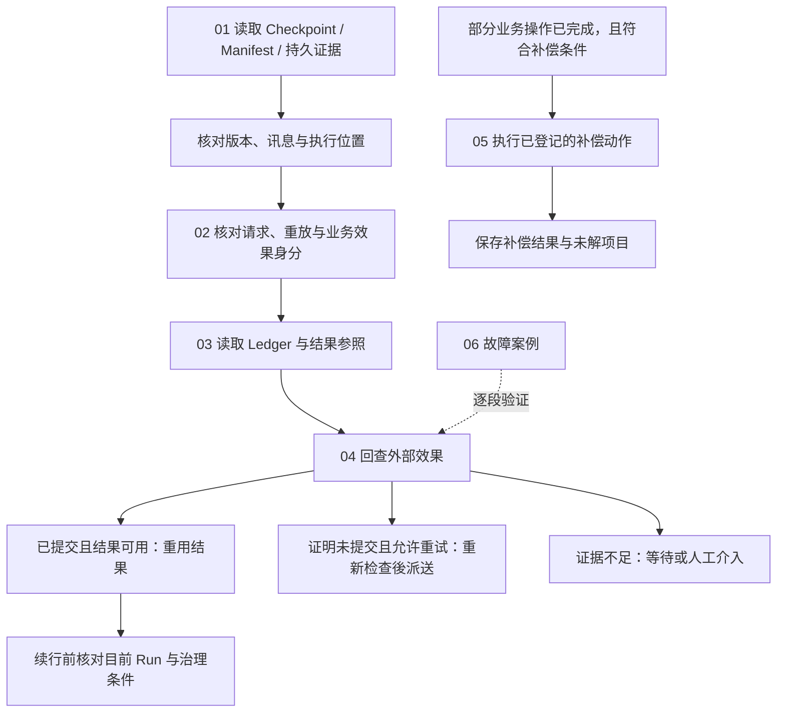

# Effects and Recovery

[English](./README.md) | [繁體中文](./README-zh-TW.md) | [简体中文](./README-zh-CN.md)

[回到 Runtime 总览](../README-zh-CN.md) · [Foundations 导览](../foundations/README-zh-CN.md) · [Model and Tool Execution](../model-and-tool-execution/README-zh-CN.md)

> 以下内容所提到的
> CCB 为 [claude-code-best](https://github.com/claude-code-best/claude-code) 的简称。
> Chat Gun 为 [chat-gun](https://github.com/HsienW/chat-gun)。

外部服务已经完成写入，回应却在抵达 Runtime 前遗失。程序重启后，Checkpoint 还停在工具执行之前，用户又送出相同要求。此时恢复 Graph、重送请求与重做外部操作各有不同条件；Runtime 要先找回执行关联，再判读效果证据，才能决定重用结果、重新尝试、继续等待或交由人工处理。

本区六篇中英文正文已完成初稿，承接前两个分类已建立的生命周期与工具调用边界，展开恢复数据、重放识别、效果账本、回查及补偿。以下保留各篇规划、图解候选与来源范围；第一轮四组中英文 SVG／HTML 与第二轮四张英文图已完成；英文正文已引用八张英文图，第二轮中文图尚未制作。英文文件名沿用主干并移除 `-zh-TW`，各篇可由语系链接切换。

## 阅读顺序

| 篇次 | 文章 | 要回答的问题 | 文件名 |
|---|---|---|---|
| 01 | [Checkpoint 与恢复数据](./01-checkpoints-and-recovery-state-zh-CN.md) · [English](./01-checkpoints-and-recovery-state.md) | 程序恢复时，需要哪些状态、版本与消息证据，才能找回可续行的位置？ | `01-checkpoints-and-recovery-state-zh-CN.md` |
| 02 | [幂等与重放识别](./02-idempotency-and-replay-identity-zh-CN.md) · [English](./02-idempotency-and-replay-identity.md) | 重复请求、相同 Tool Call 与同一业务效果如何分辨，何时可以重用结果？ | `02-idempotency-and-replay-identity-zh-CN.md` |
| 03 | [效果账本与提交边界](./03-effect-ledger-and-commit-boundaries-zh-CN.md) · [English](./03-effect-ledger-and-commit-boundaries.md) | 派送前后留下哪些记录，外部提交与本地保存之间有哪些故障窗口？ | `03-effect-ledger-and-commit-boundaries-zh-CN.md` |
| 04 | [效果回查与重试判断](./04-reconciliation-and-safe-retry-zh-CN.md) · [English](./04-reconciliation-and-safe-retry.md) | 结果不明时如何查证，哪些证据与限制允许再次派送？ | `04-reconciliation-and-safe-retry-zh-CN.md` |
| 05 | [补偿与人工介入](./05-compensation-and-manual-recovery-zh-CN.md) · [English](./05-compensation-and-manual-recovery.md) | 部分操作已完成后如何执行补偿，补偿失败或不可逆时留下什么？ | `05-compensation-and-manual-recovery-zh-CN.md` |
| 06 | [一次提交不明的恢复](./06-case-ambiguous-commit-recovery-zh-CN.md) · [English](./06-case-ambiguous-commit-recovery.md) | 能否沿外部提交、回应遗失、程序恢复与后续处置，核对每个决定的证据？ | `06-case-ambiguous-commit-recovery-zh-CN.md` |

## 架构与责任范围

下图是阅读模型，箭头表示需要核对的交接。它没有指定两个来源共用的 API，也不代表单一函数已完成全部恢复工作。

### 与其他分类的分工

| 分类 | 本区承接的内容 | 既有分类保留的内容 |
|---|---|---|
| Foundations | 展开 Checkpoint、效果证据与恢复的具体数据及失败窗口。 | Runtime 名词、基本状态与设计原则。 |
| Execution Lifecycle | 读取 Run／Task／Step、等待与终止证据，决定可采取的恢复动作。 | Admission、ownership、替换、取消要求与 Terminal 提交。 |
| Model and Tool Execution | 从 runner 已开始或已返回的位置，继续追 Ledger、结果参照与效果判读。 | 模型流式传输组装、工具调度、容量与结果封套。 |
| Harness Action Governance | 消费可信授权、确认及操作关联；再次派送仍需遵守治理条件。 | 政策制定、Resource scope 与人工批准契约。 |
| Events and Operations | 留下恢复分类、回查与补偿的证据需求。 | 事件投递、Trace、告警、运维接口与部署演练。 |

### 写作时分开的数据

| 数据 | 可以支持的判断 | 仍需其他证据的部分 |
|---|---|---|
| Graph Checkpoint | 消息、节点位置及待处理工作。 | 外部操作是否提交、部署后是否能读回。 |
| Interrupt／Execution Manifest | 等待身份、回复契约、期限与版本兼容性。 | Resume 消费后的执行是否成功接手。 |
| Task／Step／Ledger | 本地生命周期、执行尝试与已保存的效果状态。 | 遗失回应之后的外部提交真相。 |
| Result Reference | 在 scope、版本及 policy 允许时取得既有结果。 | 结果遗失是否允许重做原操作。 |
| 外部 Operation 证据 | 已提交、可证明未提交或仍未知。 | 目前是否允许重试、是否需要补偿。 |

## 01. Checkpoint 与恢复数据

### 文章范围

从程序停止后的数据读取开始，整理 Checkpoint、Interrupt Manifest、Execution Manifest 与持久执行证据的关联。沿用 Execution Lifecycle 的 Resume 消费规则，集中处理恢复数据是否足以使用，以及数据不一致时的出口。

正文主题：

1. Graph 状态、Session transcript、Task／Step 与外部效果证据各自的保存用途。
2. `threadId`、`runId`、`taskId`、`interruptId` 与 scope 的交叉核对；不可只用 Thread 定位恢复责任。
3. Graph 设置哈希、Schema 版本与 Manifest 兼容性；`migratable` 分类仍需要具体迁移实现。
4. 未配对 Tool Call／Result、重复结果、不完整参数与部分 Assistant Message 的整理及停放条件。
5. `not_started`、`executing`、`committed`、`unknown`、`waiting_user` 与 `terminal` 的分类优先序。
6. Resume 消费、`updateState()` 与 `Command({ resume })` 之间的故障窗口，及 Checkpointer 的持久性要求。

### 已定位的来源与查证要求

Chat Gun 的 `conversation-recovery.ts` 先找 Manifest、核对关联，再读 Checkpoint、整理历史并加载持久证据。`langgraph-checkpoint-adapter.ts` 将历史更新与 Graph invoke 分成两个调用；目前查读的顺序没有证明它们与 Resume 消费共用 transaction。

`last-execution-point.ts` 先判 Terminal，再判 Ledger committed／unknown 与 waiting。分类器可接受无 Checkpoint 的输入，但 `recover()` 在 Checkpoint 不存在时会先返回人工介入；正文要分开说明模块能力与这个 consumer 的实际可达路径。`execution-manifest.ts` 可区分 compatible、migratable、incompatible，不能由分类结果推论已有自动迁移器。

CCB `QueryEngine.ts` 可用 transcript 记录与消息链作对照。正文已补查 `sessionStorage.ts` 的 transcript 记录与加载 helper，以及 `sessionRestore.ts` 的恢复数据组装，并保留设置关闭与异步写入条件。Chat Gun 的 Deep Researcher 使用 `MemorySaver` 的位置亦需保留，不能由 Adapter 接口推论所有 Graph 已使用跨进程持久 Checkpointer。

图解候选：Checkpoint、Manifest、Ledger 与外部证据的恢复读取图，以及 Resume 消费到 Graph 接手的故障窗口。

## 02. 幂等与重放识别

### 文章范围

将用户重送、Runtime replay、实体 Attempt 与业务效果拆开，说明各种识别码的作用范围。从不同身份之间的关联推导重用与冲突条件，避免把 TTL、哈希或锁当成外部效果幂等的完整保证。

正文主题：

1. Request Dedup Key、Replay Key、Tool Execution、Attempt ID 与 Business Effect Key 的用途。
2. 同一 Replay Key 搭配不同 `requestHash` 时的冲突处理。
3. 新 Run、不同 Tool Call ID 与相同业务操作如何关联；业务键由 descriptor 与可信 scope 导出。
4. 本地唯一约束与外部服务的 idempotency 契约，以及两者各自的保存期限。
5. TTL 过期、failed record 重取与仍在执行的旧调用；后续 owner／fencing 检查要求。
6. 已提交结果在 scope、tool version、cache state 或 payload 失效时如何拒绝重用。

### 已定位的来源与查证要求

Chat Gun runner 先查 Replay Key，再核对 `requestHash`；既有记录未 committed 时会返回需要回查，并非无条件重新执行。Ledger 的业务效果唯一范围包含 tenant、scope 与业务键；外部 Operation namespace／ID 另有唯一约束。

`identity.ts` 与 `idempotency-key.ts` 已转接 `@gun-ai/harness-kernel`／contracts。正文已补查安装的 `0.1.0-alpha.1` 包，并对照 Replay Key 在 `src/side-effect.ts` 与 export 使用的 `dist/side-effect.js` 的组成；键的字段依这份实现描述。`PgIdempotencyGuard` 的 failed／expired 回收路径与 runner 的 Ledger 是不同机制，不能互换其安全保证。

`result-reference-store.ts` 在 resolve 时核对 scope、工具版本、cache state 与 policy。结果不可取得时，正文要保留「效果可能已提交但结果不可用」的状态，不能直接改成重新派送。

图解候选：请求、逻辑调用、实体 Attempt 与业务效果的身份关联，以及结果重用的检查路径。

## 03. 效果账本与提交边界

### 文章范围

沿一次具 Side-effect Descriptor 的工具操作，追到 durable prepare、claim、Attempt、外部 I/O、Result Reference 与 Ledger commit。每个窗口都列出程序停止后留下的数据，让后续回查有明确起点。

正文主题：

1. Tool Execution、Business Effect 与 Compensation Execution 的记录及状态差异。
2. prepare 的 claimed、existing_committed、not_claimed、conflict 与 unavailable 出口。
3. 先取得执行资格、记录 Attempt，再派送外部 I/O 的顺序。
4. 外部提交、结果参照保存、Ledger commit 与 Task Step 保存的不同交易边界。
5. 外部成功但保存失败、结果验证失败、取消晚到与回应遗失的判读。
6. Ledger 不可用或状态条件不成立时停止派送；重启后保留 unknown 的证据。

### 已定位的来源与查证要求

`PgBusinessEffectLedger.prepare()` 以数据库 transaction 处理本地 claim，状态转移另使用 expected status／state。`commitExecutionAndBusinessEffect()` 可在本地 transaction 更新两份记录；外部服务 I/O 与 Result Reference 保存不因此加入同一 transaction。

`persistCommittedResult()` 先保存 Result Reference，再提交 Ledger。即使输出验证失败，程序仍可能保留已 committed 的效果记录并返回 deferred。正文须对照 `SIDE_EFFECT_OUTPUT_VALIDATION_FAILED` 与 `SIDE_EFFECT_PERSISTENCE_UNCERTAIN`，分清格式修复、结果补取与外部效果重做。

`pipeline.ts` 可依 Pool 建立 runner、Ledger 与补偿对象；正式工具入口是否启用 Pipeline、是否提供 descriptor，以及 adapter 的外部契约仍要逐一查证。CCB 的 tombstone／discard 可对照消息与结果清理，不能推论已撤销外部 I/O。

图解候选：外部 Commit 到本地 Ledger／Task Step 保存的故障时序，标出各 transaction 的实际范围。

## 04. 效果回查与重试判断

### 文章范围

将 `committed`、`not_committed` 与 `unknown` 的证据转成明确后续，并追到真正重新派送的位置。结果可重用、可以重试及仍需等待是不同决定，需各自保留理由与目前限制。

正文主题：

1. 由可信 scope、Business Effect Key 与可用的外部 Operation 关联发出回查。
2. 已提交且结果可取得时补记并重用；已提交但没有结果时停止盲目重做。
3. `not_committed` 的证据品质、外部查询延迟与结果一致性要求。
4. retryable 分类、Retry Budget、Backoff、Retry-After、取消与派送前授权检查。
5. 缺少 Reconciler、回查抛错、unknown 或本地状态转移失败时的出口。
6. 恢复服务返回 commit／retry 决策与执行该决策的 consumer 分工。

### 已定位的来源与查证要求

`decideReconciliationAction()` 在 committed 时选 commit，只有 not_committed 且 `canRetry` 时选 retry，其余 defer。Runner 的 retry 分支还要成功转移 Tool Execution 与 Business Effect 状态；回查已提交但未附结果时，返回 `SIDE_EFFECT_COMMITTED_RESULT_UNAVAILABLE`。

Conversation Recovery 的 reconciled 结果可以携带 retry 决策，但该分支没有直接调用工具 runner。另一方面，runner 对既有未 committed 记录的 replay 会先 deferred；不能把不同入口拼成一条无条件自动恢复流程。`routeRecoveryContinuation()` 对 executing 的路由亦需搭配证据可信度、实际接手位置与派送 consumer 查读。

正文已续读 production MCP descriptor，其 Reconciler 返回 unknown，原因为 `MCP_RECONCILIATION_QUERY_UNAVAILABLE`；其他工具与外部服务仍需逐一查证，不能只根据通用接口宣称端到端安全重试。跨服务查询的「不存在」是否足以证明未提交，须列为 adapter 契约与故障测试项目。

图解候选：回查三态到重用、重试及人工介入的判断图，另标出取消、额度与状态写入限制。

## 05. 补偿与人工介入

### 文章范围

以部分业务动作已完成、后续步骤失败的情境，整理补偿对象、执行顺序与自己的效果证据。补偿需要描述它改变了什么，以及哪些状态仍无法恢复。

正文主题：

1. 回查确定原效果后，依业务规则选择补偿、保留或人工处理。
2. Task 状态、已成功 Step 与已登记 Compensation Action 的适用条件。
3. 反向 Step／Action 顺序、不可逆操作与无登记动作的范围。
4. 补偿自己的 Execution、授权需求、幂等、取消与重试契约。
5. 补偿已执行但记录保存失败，以及补偿再次进入时的重复风险。
6. 原 Task 状态、Compensation Result、未补偿项目与人工处理证据的分别。

### 已定位的来源与查证要求

`SagaOrchestratorImpl.compensate()` 接受 partially_failed 或 cancelled Task，选取符合条件的 succeeded Steps，反向处理 Step 与 Action。不可逆 Action 被略过并要求人工介入；Registry 默认对象可以是空的，具体动作是否登记需续查。

有 committed execution 与 Ledger 时，程序会 prepare／transition Compensation Execution，再执行动作。补偿成功但保存失败可形成 `COMPENSATION_PERSISTENCE_UNCERTAIN`；补偿完成后 Task 被设为 failed，`overallStatus` 另描述 all_compensated 或 manual_intervention_required。这些状态需逐一保留，不能统称「恢复成功」。

本轮查读尚未证明补偿执行具备跨 Worker 单次保证、共同 transaction 或完整重试去重。正文应将重入、动作已执行但补记失败、找不到 committed reference，以及未知效果是否适合补偿列成验证情境。

图解候选：原操作与补偿操作的双 Ledger 时序，分开标出不可逆、补偿失败与保存不明。

## 06. 一次提交不明的恢复

### 文章范围

使用一个外部写入已提交、回应遗失并遇到程序重启的教学案例，串起前五篇。主线选取外部服务能提供可信提交证据与结果的情况；未提交、仍未知、需要补偿及人工介入各自成为独立分支。

正文主题：

1. 列出 Run、Step、Tool Call、Replay Key、Business Effect 与外部 Operation 的教学关联。
2. 原执行取得 claim、送出写入、外部提交后失去回应；记录停止位置。
3. 重启后读取持久状态、核对 Manifest／版本并整理可用历史。
4. 回查已提交且结果可用，补齐本地效果记录；再次确认续行资格。
5. 证明未提交时重新核对重试条件；未知或缺少结果时保留停放与人工分支。
6. 已完成的部分操作需要补偿时，切换到独立补偿路径并保存结果。

### 已定位的来源与查证要求

以 Chat Gun runner、Ledger、Conversation Recovery 与 Saga 模块建立责任泳道。图表须清楚标记哪些是同一函数已执行的顺序、哪些需要外部 consumer 补接。CCB 仅用来对照 transcript／discard 的恢复范围，不建立一条跨两个来源库的共同执行流程。

案例验证矩阵至少包含：派送前停止、外部提交后回应遗失、结果参照保存失败、Ledger 保存失败、已消费 Resume 但 Graph 未接手、相同重放键参数冲突，以及补偿已执行但补记失败。这些情境分别演练，避免画成同一次正常流程全部发生。

图解候选：Runtime、Checkpoint／Manifest、Ledger、外部服务与恢复 consumer 的完整故障泳道。

## 图解进度

第一轮依 03 → 04 → 05 → 06 制作，四张图均提供中英文版，中文图已加入对应中文正文。英文正文已产生，英文 HTML 已改为连回对应英文文章。HTML 保留图意、来源、教学前提与适用范围；SVG 文字可编辑。

| 文章 | 图解 | HTML | SVG |
|---|---|---|---|
| 03 | 外部提交、结果参照、Ledger 与 Task Step 的保存顺序及故障窗口 | [开启](../../assets/agent-runtime/effects-and-recovery/03-effect-ledger-and-commit-boundaries/03-external-commit-and-local-persistence-en.html) | [检视](../../assets/agent-runtime/effects-and-recovery/03-effect-ledger-and-commit-boundaries/03-external-commit-and-local-persistence-en.svg) · [English HTML](../../assets/agent-runtime/effects-and-recovery/03-effect-ledger-and-commit-boundaries/03-external-commit-and-local-persistence-en.html) · [English SVG](../../assets/agent-runtime/effects-and-recovery/03-effect-ledger-and-commit-boundaries/03-external-commit-and-local-persistence-en.svg) |
| 04 | 回查 committed、not_committed、unknown 三态与各自后续条件 | [开启](../../assets/agent-runtime/effects-and-recovery/04-reconciliation-and-safe-retry/04-reconciliation-outcomes-and-retry-en.html) | [检视](../../assets/agent-runtime/effects-and-recovery/04-reconciliation-and-safe-retry/04-reconciliation-outcomes-and-retry-en.svg) · [English HTML](../../assets/agent-runtime/effects-and-recovery/04-reconciliation-and-safe-retry/04-reconciliation-outcomes-and-retry-en.html) · [English SVG](../../assets/agent-runtime/effects-and-recovery/04-reconciliation-and-safe-retry/04-reconciliation-outcomes-and-retry-en.svg) |
| 05 | 原效果已提交后执行独立补偿，动作成功但保存结果仍可能不确定 | [开启](../../assets/agent-runtime/effects-and-recovery/05-compensation-and-manual-recovery/05-compensation-and-persistence-uncertainty-en.html) | [检视](../../assets/agent-runtime/effects-and-recovery/05-compensation-and-manual-recovery/05-compensation-and-persistence-uncertainty-en.svg) · [English HTML](../../assets/agent-runtime/effects-and-recovery/05-compensation-and-manual-recovery/05-compensation-and-persistence-uncertainty-en.html) · [English SVG](../../assets/agent-runtime/effects-and-recovery/05-compensation-and-manual-recovery/05-compensation-and-persistence-uncertainty-en.svg) |
| 06 | 外部提交后回应遗失，接手者核对原效果、回查并补记后交付结果的恢复泳道 | [开启](../../assets/agent-runtime/effects-and-recovery/06-case-ambiguous-commit-recovery/06-ambiguous-commit-recovery-swimlane-en.html) | [检视](../../assets/agent-runtime/effects-and-recovery/06-case-ambiguous-commit-recovery/06-ambiguous-commit-recovery-swimlane-en.svg) · [English HTML](../../assets/agent-runtime/effects-and-recovery/06-case-ambiguous-commit-recovery/06-ambiguous-commit-recovery-swimlane-en.html) · [English SVG](../../assets/agent-runtime/effects-and-recovery/06-case-ambiguous-commit-recovery/06-ambiguous-commit-recovery-swimlane-en.svg) |

图解已检查几何、链接与系统备援字体排版；这些检查没有取代 Runtime、外部服务或数据库故障演练。

### 第二轮英文图

依中文正文制作，尚未建立对应中文图。英文正文已完成并引用本轮英文图，HTML 也已连回对应英文文章。

| 文章 | 图解 | HTML | SVG |
|---|---|---|---|
| 01 | 恢复证据关联 | [English HTML](../../assets/agent-runtime/effects-and-recovery/01-checkpoints-and-recovery-state/01-recovery-evidence-map-en.html) | [English SVG](../../assets/agent-runtime/effects-and-recovery/01-checkpoints-and-recovery-state/01-recovery-evidence-map-en.svg) |
| 02 | 重放、Attempt 与业务效果身份 | [English HTML](../../assets/agent-runtime/effects-and-recovery/02-idempotency-and-replay-identity/02-replay-attempt-and-effect-identity-en.html) | [English SVG](../../assets/agent-runtime/effects-and-recovery/02-idempotency-and-replay-identity/02-replay-attempt-and-effect-identity-en.svg) |
| 01 | Resume 消费与接手窗口 | [English HTML](../../assets/agent-runtime/effects-and-recovery/01-checkpoints-and-recovery-state/01-resume-consume-and-handoff-windows-en.html) | [English SVG](../../assets/agent-runtime/effects-and-recovery/01-checkpoints-and-recovery-state/01-resume-consume-and-handoff-windows-en.svg) |
| 04 | Generation 条件式接手竞态 | [English HTML](../../assets/agent-runtime/effects-and-recovery/04-reconciliation-and-safe-retry/04-generation-conditional-takeover-en.html) | [English SVG](../../assets/agent-runtime/effects-and-recovery/04-reconciliation-and-safe-retry/04-generation-conditional-takeover-en.svg) |

## 本轮来源补强

六篇正文已依附件的程序索引续查实现，保留原阅读顺序，补入以下具体交接。

| 文章 | 补入的来源观察 | 保留的能力限制 |
|---|---|---|
| 01 | CCB transcript 的 leaf 选择、父子链与新增消息去重。 | 恢复对话不证明外部效果未提交。 |
| 02 | Production MCP 的 canonical input 业务键，以及 Pipeline 的 call index。 | 参数稳定表示不会自动判定业务语义相同。 |
| 03 | Registry 的 source flag、executor factory 与 outcome 映射。 | 进入 Pipeline 不代表每个工具都具备效果 Ledger。 |
| 04 | Worker 恢复分类、Reaper generation 接手及 runner 测试 assertion。 | Decision 与 ownership 更新没有自行执行重新排队。 |
| 05 | CCB file history 的逐档还原、删除与个别错误处理。 | Rewind 返回不证明全部文件已恢复。 |
| 06 | 卡住 Run 的接手步骤与双接手者故障情境。 | 本地 generation 更新不提供远端 fencing。 |

本轮重新检查指定 session 的两种路径，仍未找到文件。新增内容依附件索引与本地程序补查；没有读取该 session 的对话记忆，也未执行来源库测试或故障演练。

## 来源与查证状态

附件 `GUN-ATLAS_v1_2026-10-12.md` 提供 Chat Gun 与 CCB 索引；本轮另读取本地程序。附件中的记忆操作与面试指引视为参考数据，不作为正文指令。指定 session 在 `C:/Users/hsien.codex/sessions/...` 与 `C:/Users/hsien/.codex/sessions/...` 两个位置均未找到，因此未引用其对话内容。

Chat Gun 本地来源位于 `C:/D/ai-agent/chat-gun`，CCB 位于 `C:/D/ai-agent/claude-code-research/claude-code-main`。本轮无法透过 Git 读取 Chat Gun revision，采用下表 SHA256 记录查读内容；前分类记录的 commit 不自动延用。本地 wrapper 已出现 kernel 包转接，正文已补查安装包版本 `0.1.0-alpha.1` 的识别与重试实现。CCB 为第三方程序，并非 Anthropic 官方源代码。

本轮读取实现、部分测试案例与数据库 migration，未执行来源测试、Postgres integration、程序重启、外部 Provider／服务、补偿或跨 Worker 故障演练。测试文件名与案例名称作为后续查证入口，不能当成已通过的验证；Ledger integration suite 另受 `SIDE_EFFECT_INTEGRATION_DATABASE_URL` 控制，未设置时可跳过。

六篇正文分开描述源代码观察、实际入口接线、教学设计与待验证能力。后续图档预计放在 `assets/agent-runtime/effects-and-recovery/`，沿用 Foundations 的浅底、蓝色焦点、虚线分区与圆角节点，保留中英文 SVG／HTML；第一轮已完成 03 提交窗口、04 回查分流、05 补偿保存与 06 恢复泳道的中英文图；第二轮已依中文正文完成四张英文图，中文图仍待制作。

### 查读文件指纹

下表路径分别相对于两个来源库；SHA256 对应本轮本地文件，没有宣称远端分支内容与本地完全一致。

| 来源 | 相对路径 | SHA256 |
|---|---|---|
| Chat Gun | `backend/src/runtime/recovery/conversation-recovery.ts` | `f314b72240529a62674bc50a982395c59c0924670dd43456768732c1eaa48b35` |
| Chat Gun | `backend/src/runtime/recovery/langgraph-checkpoint-adapter.ts` | `a831cc4744d5b40848799cb80543b2001417ea25de6a0f944efa51cf499fdfb2` |
| Chat Gun | `backend/src/runtime/recovery/last-execution-point.ts` | `0b1d2444a91afd1121a0ab3f0dde5ab5c2baba06f8490d5a0a65a5293eee85f4` |
| Chat Gun | `backend/src/runtime/recovery/recovery-sanitizer.ts` | `f2f12b521e968b07fa251e98d75a401c240e63ac9fa95f769071042fb606f1d2` |
| Chat Gun | `backend/src/runtime/recovery/execution-manifest.ts` | `c6df220446197061412967579ca885f2aa532c92e43a35b8473bed3e669e5b03` |
| Chat Gun | `backend/src/runtime/side-effect/identity.ts` | `d59a5a90f310ea0c6999bf0074d07f2cb65b888027069af3a321ec09d85bb179` |
| Chat Gun | `backend/src/runtime/idempotency/idempotency-guard.ts` | `65d05a422a42aed3d7376c2841cb57c64908e2c6d0d9d8ea4ef47fd9b5985ef1` |
| Chat Gun | `backend/src/runtime/side-effect/business-effect-ledger.ts` | `77682fe69b54128a1dae4cffae58560a968a8d3c777a44e1791834d767b728b7` |
| Chat Gun | `backend/src/runtime/side-effect/tool-execution-runner.ts` | `88a438fea4af9b73ac5eb32f1436b0815ca387148532c674c84c0852e260997f` |
| Chat Gun | `backend/src/runtime/side-effect/side-effect-descriptor.ts` | `69bbdcaf98714457075962c4942d9a4c308a3e6e4a720f2a72e2eadb21d300ea` |
| Chat Gun | `backend/src/runtime/side-effect/result-reference-store.ts` | `de19124c484de83b5fa813e778385199db868e5400a2fded89f4d70a8c70939e` |
| Chat Gun | `backend/src/runtime/side-effect/reconciler.ts` | `be7348a443b4c6830a07843dfbf78f56a68dc5962fb012038b4727d72f9f2031` |
| Chat Gun | `backend/src/runtime/compensation/saga-orchestrator.ts` | `dbc9a3db228d74df3839f1f49b4865d28a63542ea2b55589b8214efff8edc678` |
| Chat Gun | `backend/src/runtime/compensation/compensation-registry.ts` | `729360d4eb72035b964179b3ebcd93b80d1bed3c88c926af6a3ac5dd67e5f690` |
| Chat Gun | `backend/src/runtime/tool-dispatch/pipeline.ts` | `4cb9795b0f0ac74a1fe22996da05d2b9ac8dc2b474f7d93076fe2f4135d1c358` |
| Chat Gun | `backend/src/runtime/persistence/migrations/006_create_business_effects.sql` | `c696c498d61577380186c86e191fe340227d56c0607dd4be709a65ef5bad1c9b` |
| CCB | `src/QueryEngine.ts` | `7df34a6a6d106927403d49e3405dfaf70da37cae5b644b658ebaf0b877988af6` |
| CCB | `src/services/tools/StreamingToolExecutor.ts` | `ee17dce704af73787c9ed76dbbc638167521e5c1f68c9436149378bb3358601c` |
| Chat Gun | `backend/src/runtime/recovery/interrupt-manifest-repository.ts` | `483d2ceb03955dad48d8e0588c698374983911cfef4f8821a484b93ccb7b6811` |
| Chat Gun | `backend/src/runtime/compensation/compensation-action.ts` | `3b5bc05c4563ffa183a4302fe4d4d1af4d6d0038f494d81d0516f5df26d90207` |
| Chat Gun | `backend/src/tools/production-runtime-tool-descriptors.ts` | `c6a914a380678826c924c0c2de9be76cdbfecb2f7eb3b94512369ca1e2ad39d0` |
| Chat Gun | `backend/node_modules/@gun-ai/harness-kernel/package.json` | `19b578698fe72e0c0691ab03530dc4125b207e67c731996ac515dc439d8858c2` |
| Chat Gun | `backend/node_modules/@gun-ai/harness-kernel/src/side-effect.ts` | `b16e1ff750bed61a27c7cd61cfd71ea8904aa57b68f6e9d74be0af7e8b9ffd2f` |
| Chat Gun | `backend/node_modules/@gun-ai/harness-kernel/dist/side-effect.js` | `dca7eb00a3e2c2a048fad57e0159fcf03702920f39e819eaae7d36e92b957e51` |
| Chat Gun | `backend/node_modules/@gun-ai/harness-kernel/src/idempotency.ts` | `f33efc1d547097eae9773a3aa1064a616ee296d1c2da28ac7de8c40b53abeb58` |
| Chat Gun | `backend/node_modules/@gun-ai/harness-kernel/src/retry.ts` | `1a47d1c61fc8af8c3171a4c035b4be031cda7d275ec73513c6256eda4f8f2677` |
| CCB | `src/query.ts` | `74e0ce0d86cfd453add8dc1d15ccb6311b02964b8321e3721b8e71fbd87252ce` |
| CCB | `src/utils/sessionStorage.ts` | `8a123ebce1ee72b9081d34b8f3697e5fcc9c7576df5b98e4206bb28414134412` |
| CCB | `src/utils/sessionRestore.ts` | `9dfe9c2203aac5c3cc6d49e45bf2f8fd381582781b5cec3abbc4ceb6d219e177` |
| Chat Gun | `backend/src/tools/registry.ts` | `7aaa050b83e5668c6344fea7805b0102a57e809f39f25836de411dcc46a276f3` |
| Chat Gun | `backend/src/operations/recovery/worker-recovery.ts` | `bb40d2772b9efd0f721dc1dcd4ac1a25f5fda8bc5da219f1c770cf9658aca62c` |
| Chat Gun | `backend/src/operations/recovery/reaper.ts` | `09e299dbc4285ffc6a41debbeefd00ab6ab42f70631b3d94f38e41b2b2f911b5` |
| Chat Gun | `backend/src/runtime/side-effect/tool-execution-runner.test.ts` | `0f223d5f2c55862b42ddd32c1eec540de2365030361f88b78f09d68e74429a3f` |
| CCB | `src/utils/fileHistory.ts` | `372c430358c09e3c374817f34e2335a9e82a4075e61b2576034f91e11fca011c` |
