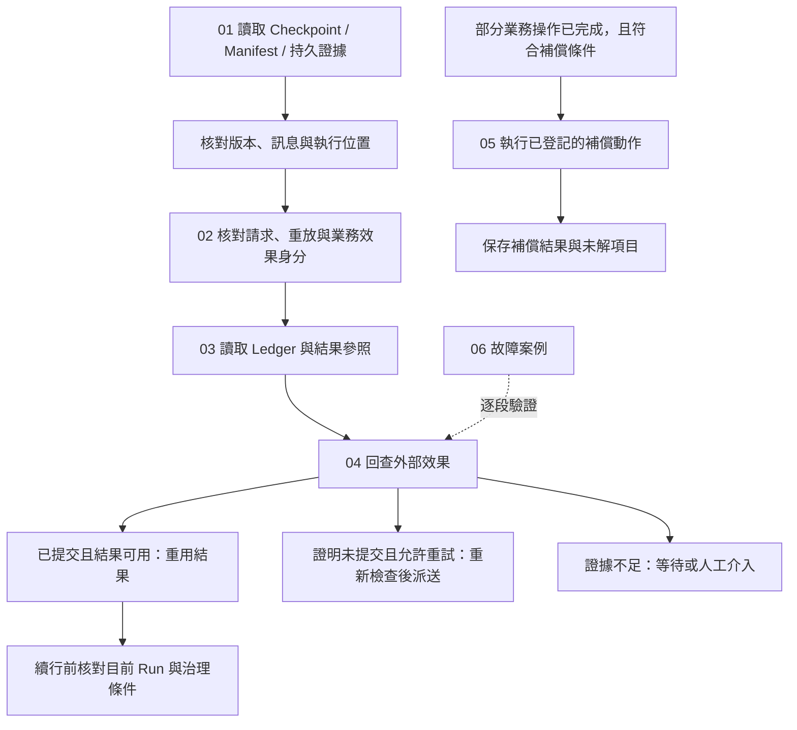

# Effects and Recovery

[English](./README.md) | [繁體中文](./README-zh-TW.md) | [简体中文](./README-zh-CN.md)

[回到 Runtime 總覽](../README-zh-TW.md) · [Foundations 導覽](../foundations/README-zh-TW.md) · [Model and Tool Execution](../model-and-tool-execution/README-zh-TW.md)

> 以下內容所提到的
> CCB 為 [claude-code-best](https://github.com/claude-code-best/claude-code) 的簡稱。
> Chat Gun 為 [chat-gun](https://github.com/HsienW/chat-gun)。

外部服務已經完成寫入，回應卻在抵達 Runtime 前遺失。程序重啟後，Checkpoint 還停在工具執行之前，使用者又送出相同要求。此時恢復 Graph、重送請求與重做外部操作各有不同條件；Runtime 要先找回執行關聯，再判讀效果證據，才能決定重用結果、重新嘗試、繼續等待或交由人工處理。

本區承接生命週期與工具呼叫的執行邊界，依序說明恢復資料、重放識別、效果帳本、回查及補償。本區從可續行的位置出發，追到提交不明時的恢復與後續處置。

## 閱讀順序

| 篇次 | 文章 | 要回答的問題 | 檔名 |
|---|---|---|---|
| 01 | [Checkpoint 與恢復資料](./01-checkpoints-and-recovery-state-zh-TW.md) · [English](./01-checkpoints-and-recovery-state.md) | 程序恢復時，需要哪些狀態、版本與訊息證據，才能找回可續行的位置？ | `01-checkpoints-and-recovery-state-zh-TW.md` |
| 02 | [冪等與重放識別](./02-idempotency-and-replay-identity-zh-TW.md) · [English](./02-idempotency-and-replay-identity.md) | 重複請求、相同 Tool Call 與同一業務效果如何分辨，何時可以重用結果？ | `02-idempotency-and-replay-identity-zh-TW.md` |
| 03 | [效果帳本與提交邊界](./03-effect-ledger-and-commit-boundaries-zh-TW.md) · [English](./03-effect-ledger-and-commit-boundaries.md) | 派送前後留下哪些紀錄，外部提交與本地保存之間有哪些故障窗口？ | `03-effect-ledger-and-commit-boundaries-zh-TW.md` |
| 04 | [效果回查與重試判斷](./04-reconciliation-and-safe-retry-zh-TW.md) · [English](./04-reconciliation-and-safe-retry.md) | 結果不明時如何查證，哪些證據與限制允許再次派送？ | `04-reconciliation-and-safe-retry-zh-TW.md` |
| 05 | [補償與人工介入](./05-compensation-and-manual-recovery-zh-TW.md) · [English](./05-compensation-and-manual-recovery.md) | 部分操作已完成後如何執行補償，補償失敗或不可逆時留下什麼？ | `05-compensation-and-manual-recovery-zh-TW.md` |
| 06 | [一次提交不明的恢復](./06-case-ambiguous-commit-recovery-zh-TW.md) · [English](./06-case-ambiguous-commit-recovery.md) | 能否沿外部提交、回應遺失、程序恢復與後續處置，核對每個決定的證據？ | `06-case-ambiguous-commit-recovery-zh-TW.md` |

## 架構與責任範圍

下圖是閱讀模型，箭頭表示需要核對的交接。它沒有指定兩個來源共用的 API，也不代表單一函式已完成全部恢復工作。

### 與其他分類的分工

| 分類 | 本區承接的內容 | 既有分類保留的內容 |
|---|---|---|
| Foundations | 展開 Checkpoint、效果證據與恢復的具體資料及失敗窗口。 | Runtime 名詞、基本狀態與設計原則。 |
| Execution Lifecycle | 讀取 Run／Task／Step、等待與終止證據，決定可採取的恢復動作。 | Admission、ownership、替換、取消要求與 Terminal 提交。 |
| Model and Tool Execution | 從 runner 已開始或已返回的位置，繼續追 Ledger、結果參照與效果判讀。 | 模型串流組裝、工具排程、容量與結果封套。 |
| Harness Action Governance | 消費可信授權、確認及操作關聯；再次派送仍需遵守治理條件。 | 政策制定、Resource scope 與人工批准契約。 |
| Events and Operations | 留下恢復分類、回查與補償的證據需求。 | 事件投遞、Trace、告警、維運介面與部署演練。 |

### 資料與證據

| 資料 | 可以支援的判斷 | 仍需其他證據的部分 |
|---|---|---|
| Graph Checkpoint | 訊息、節點位置及待處理工作。 | 外部操作是否提交、部署後是否能讀回。 |
| Interrupt／Execution Manifest | 等待身分、回覆契約、期限與版本相容性。 | Resume 消費後的執行是否成功接手。 |
| Task／Step／Ledger | 本地生命週期、執行嘗試與已保存的效果狀態。 | 遺失回應之後的外部提交真相。 |
| Result Reference | 在 scope、版本及 policy 允許時取得既有結果。 | 結果遺失是否允許重做原操作。 |
| 外部 Operation 證據 | 已提交、可證明未提交或仍未知。 | 目前是否允許重試、是否需要補償。 |

## 01. Checkpoint 與恢復資料

### 文章範圍

從程序停止後的資料讀取開始，整理 Checkpoint、Interrupt Manifest、Execution Manifest 與持久執行證據的關聯。沿用 Execution Lifecycle 的 Resume 消費規則，集中處理恢復資料是否足以使用，以及資料不一致時的出口。

重點如下：

1. Graph 狀態、Session transcript、Task／Step 與外部效果證據各自的保存用途。
2. `threadId`、`runId`、`taskId`、`interruptId` 與 scope 的交叉核對；不可只用 Thread 定位恢復責任。
3. Graph 設定雜湊、Schema 版本與 Manifest 相容性；`migratable` 分類仍需要具體遷移實作。
4. 未配對 Tool Call／Result、重複結果、不完整參數與部分 Assistant Message 的整理及停放條件。
5. `not_started`、`executing`、`committed`、`unknown`、`waiting_user` 與 `terminal` 的分類優先序。
6. Resume 消費、`updateState()` 與 `Command({ resume })` 之間的故障窗口，及 Checkpointer 的持久性要求。

### 已定位的來源與查證要求

Chat Gun 的 `conversation-recovery.ts` 先找 Manifest、核對關聯，再讀 Checkpoint、整理歷史並載入持久證據。`langgraph-checkpoint-adapter.ts` 將歷史更新與 Graph invoke 分成兩個呼叫；目前查讀的順序沒有證明它們與 Resume 消費共用 transaction。

`last-execution-point.ts` 先判 Terminal，再判 Ledger committed／unknown 與 waiting。分類器可接受無 Checkpoint 的輸入，但 `recover()` 在 Checkpoint 不存在時會先回傳人工介入；模組能力與這個 consumer 的實際可達路徑具有不同範圍。`execution-manifest.ts` 可區分 compatible、migratable、incompatible，不能由分類結果推論已有自動遷移器。

CCB `QueryEngine.ts` 可用 transcript 記錄與訊息鏈作對照。原始碼顯示 `sessionStorage.ts` 的 transcript 記錄與載入 helper，以及 `sessionRestore.ts` 的恢復資料組裝，並保留設定關閉與非同步寫入條件。Chat Gun 的 Deep Researcher 使用 `MemorySaver` 的位置亦需保留，不能由 Adapter 介面推論所有 Graph 已使用跨程序持久 Checkpointer。

## 02. 冪等與重放識別

### 文章範圍

將使用者重送、Runtime replay、實體 Attempt 與業務效果拆開，說明各種識別碼的作用範圍。從不同身分之間的關聯推導重用與衝突條件，避免把 TTL、雜湊或鎖當成外部效果冪等的完整保證。

重點如下：

1. Request Dedup Key、Replay Key、Tool Execution、Attempt ID 與 Business Effect Key 的用途。
2. 同一 Replay Key 搭配不同 `requestHash` 時的衝突處理。
3. 新 Run、不同 Tool Call ID 與相同業務操作如何關聯；業務鍵由 descriptor 與可信 scope 導出。
4. 本地唯一約束與外部服務的 idempotency 契約，以及兩者各自的保存期限。
5. TTL 過期、failed record 重取與仍在執行的舊呼叫；後續 owner／fencing 檢查要求。
6. 已提交結果在 scope、tool version、cache state 或 payload 失效時如何拒絕重用。

### 已定位的來源與查證要求

Chat Gun runner 先查 Replay Key，再核對 `requestHash`；既有紀錄未 committed 時會回傳需要回查，並非無條件重新執行。Ledger 的業務效果唯一範圍包含 tenant、scope 與業務鍵；外部 Operation namespace／ID 另有唯一約束。

`identity.ts` 與 `idempotency-key.ts` 已轉接 `@gun-ai/harness-kernel`／contracts。原始碼顯示安裝的 `0.1.0-alpha.1` 套件，並對照 Replay Key 在 `src/side-effect.ts` 與 export 使用的 `dist/side-effect.js` 的組成；鍵的欄位依這份實作描述。`PgIdempotencyGuard` 的 failed／expired 回收路徑與 runner 的 Ledger 是不同機制，不能互換其安全保證。

`result-reference-store.ts` 在 resolve 時核對 scope、工具版本、cache state 與 policy。結果不可取得時，「效果可能已提交但結果不可用」仍是獨立狀態，不能直接轉為重新派送。

## 03. 效果帳本與提交邊界

### 文章範圍

沿一次具 Side-effect Descriptor 的工具操作，追到 durable prepare、claim、Attempt、外部 I/O、Result Reference 與 Ledger commit。每個窗口都列出程序停止後留下的資料，讓後續回查有明確起點。

重點如下：

1. Tool Execution、Business Effect 與 Compensation Execution 的紀錄及狀態差異。
2. prepare 的 claimed、existing_committed、not_claimed、conflict 與 unavailable 出口。
3. 先取得執行資格、記錄 Attempt，再派送外部 I/O 的順序。
4. 外部提交、結果參照保存、Ledger commit 與 Task Step 保存的不同交易邊界。
5. 外部成功但保存失敗、結果驗證失敗、取消晚到與回應遺失的判讀。
6. Ledger 不可用或狀態條件不成立時停止派送；重啟後保留 unknown 的證據。

### 已定位的來源與查證要求

`PgBusinessEffectLedger.prepare()` 以資料庫 transaction 處理本地 claim，狀態轉移另使用 expected status／state。`commitExecutionAndBusinessEffect()` 可在本地 transaction 更新兩份紀錄；外部服務 I/O 與 Result Reference 保存不因此加入同一 transaction。

`persistCommittedResult()` 先保存 Result Reference，再提交 Ledger。即使輸出驗證失敗，程式仍可能保留已 committed 的效果紀錄並回傳 deferred。需要對照 `SIDE_EFFECT_OUTPUT_VALIDATION_FAILED` 與 `SIDE_EFFECT_PERSISTENCE_UNCERTAIN`，分清格式修復、結果補取與外部效果重做。

`pipeline.ts` 可依 Pool 建立 runner、Ledger 與補償物件；正式工具入口是否啟用 Pipeline、是否提供 descriptor，以及 adapter 的外部契約仍要逐一查證。CCB 的 tombstone／discard 可對照訊息與結果清理，不能推論已撤銷外部 I/O。

## 04. 效果回查與重試判斷

### 文章範圍

將 `committed`、`not_committed` 與 `unknown` 的證據轉成明確後續，並追到真正重新派送的位置。結果可重用、可以重試及仍需等待是不同決定，需各自保留理由與目前限制。

重點如下：

1. 由可信 scope、Business Effect Key 與可用的外部 Operation 關聯發出回查。
2. 已提交且結果可取得時補記並重用；已提交但沒有結果時停止盲目重做。
3. `not_committed` 的證據品質、外部查詢延遲與結果一致性要求。
4. retryable 分類、Retry Budget、Backoff、Retry-After、取消與派送前授權檢查。
5. 缺少 Reconciler、回查拋錯、unknown 或本地狀態轉移失敗時的出口。
6. 恢復服務回傳 commit／retry 決策與執行該決策的 consumer 分工。

### 已定位的來源與查證要求

`decideReconciliationAction()` 在 committed 時選 commit，只有 not_committed 且 `canRetry` 時選 retry，其餘 defer。Runner 的 retry 分支還要成功轉移 Tool Execution 與 Business Effect 狀態；回查已提交但未附結果時，回傳 `SIDE_EFFECT_COMMITTED_RESULT_UNAVAILABLE`。

Conversation Recovery 的 reconciled 結果可以攜帶 retry 決策，但該分支沒有直接呼叫工具 runner。另一方面，runner 對既有未 committed 紀錄的 replay 會先 deferred；不能把不同入口拼成一條無條件自動恢復流程。`routeRecoveryContinuation()` 對 executing 的路由亦需搭配證據可信度、實際接手位置與派送 consumer 查讀。

本文已續讀 production MCP descriptor，其 Reconciler 回傳 unknown，原因為 `MCP_RECONCILIATION_QUERY_UNAVAILABLE`；其他工具與外部服務仍需逐一查證，不能只根據通用介面宣稱端到端安全重試。跨服務查詢的「不存在」是否足以證明未提交，須列為 adapter 契約與故障測試項目。

## 05. 補償與人工介入

### 文章範圍

以部分業務動作已完成、後續步驟失敗的情境，整理補償對象、執行順序與自己的效果證據。補償需要描述它改變了什麼，以及哪些狀態仍無法恢復。

重點如下：

1. 回查確定原效果後，依業務規則選擇補償、保留或人工處理。
2. Task 狀態、已成功 Step 與已登記 Compensation Action 的適用條件。
3. 反向 Step／Action 順序、不可逆操作與無登記動作的範圍。
4. 補償自己的 Execution、授權需求、冪等、取消與重試契約。
5. 補償已執行但紀錄保存失敗，以及補償再次進入時的重複風險。
6. 原 Task 狀態、Compensation Result、未補償項目與人工處理證據的分別。

### 已定位的來源與查證要求

`SagaOrchestratorImpl.compensate()` 接受 partially_failed 或 cancelled Task，選取符合條件的 succeeded Steps，反向處理 Step 與 Action。不可逆 Action 被略過並要求人工介入；Registry 預設物件可以是空的，具體動作是否登記需續查。

有 committed execution 與 Ledger 時，程式會 prepare／transition Compensation Execution，再執行動作。補償成功但保存失敗可形成 `COMPENSATION_PERSISTENCE_UNCERTAIN`；補償完成後 Task 被設為 failed，`overallStatus` 另描述 all_compensated 或 manual_intervention_required。這些狀態需逐一保留，不能統稱「恢復成功」。

原始碼查讀尚未證明補償執行具備跨 Worker 單次保證、共同 transaction 或完整重試去重。需要將重入、動作已執行但補記失敗、找不到 committed reference，以及未知效果是否適合補償列成驗證情境。

## 06. 一次提交不明的恢復

### 文章範圍

使用一個外部寫入已提交、回應遺失並遇到程序重啟的教學案例，串起前文。主線選取外部服務能提供可信提交證據與結果的情況；未提交、仍未知、需要補償及人工介入各自成為獨立分支。

重點如下：

1. 列出 Run、Step、Tool Call、Replay Key、Business Effect 與外部 Operation 的教學關聯。
2. 原執行取得 claim、送出寫入、外部提交後失去回應；記錄停止位置。
3. 重啟後讀取持久狀態、核對 Manifest／版本並整理可用歷史。
4. 回查已提交且結果可用，補齊本地效果紀錄；再次確認續行資格。
5. 證明未提交時重新核對重試條件；未知或缺少結果時保留停放與人工分支。
6. 已完成的部分操作需要補償時，切換到獨立補償路徑並保存結果。

### 已定位的來源與查證要求

以 Chat Gun runner、Ledger、Conversation Recovery 與 Saga 模組建立責任泳道。圖表須清楚標記哪些是同一函式已執行的順序、哪些需要外部 consumer 補接。CCB 僅用來對照 transcript／discard 的恢復範圍，不建立一條跨兩個來源庫的共同執行流程。

案例驗證矩陣至少包含：派送前停止、外部提交後回應遺失、結果參照保存失敗、Ledger 保存失敗、已消費 Resume 但 Graph 未接手、相同重放鍵參數衝突，以及補償已執行但補記失敗。這些情境分別演練，避免畫成同一次正常流程全部發生。
