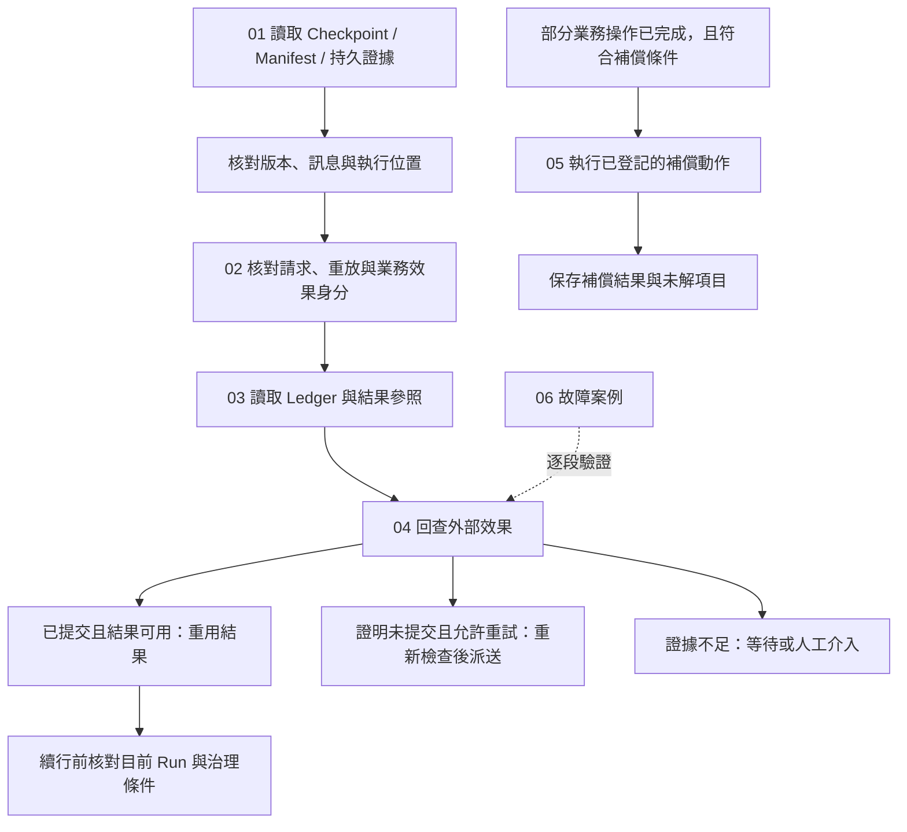

# Effects and Recovery

[English](./README.md) | [繁體中文](./README-zh-TW.md) | [简体中文](./README-zh-CN.md)

[回到 Runtime 總覽](../README-zh-TW.md) · [Foundations 導覽](../foundations/README-zh-TW.md) · [Model and Tool Execution](../model-and-tool-execution/README-zh-TW.md)

> 以下內容所提到的
> CCB 為 [claude-code-best](https://github.com/claude-code-best/claude-code) 的簡稱。
> Chat Gun 為 [chat-gun](https://github.com/HsienW/chat-gun)。

外部服務已經完成寫入，回應卻在抵達 Runtime 前遺失。程序重啟後，Checkpoint 還停在工具執行之前，使用者又送出相同要求。此時恢復 Graph、重送請求與重做外部操作各有不同條件；Runtime 要先找回執行關聯，再判讀效果證據，才能決定重用結果、重新嘗試、繼續等待或交由人工處理。

本區六篇中英文正文已完成初稿，承接前兩個分類已建立的生命週期與工具呼叫邊界，展開恢復資料、重放識別、效果帳本、回查及補償。以下保留各篇規劃、圖解候選與來源範圍；第一輪四組中英文 SVG／HTML 與第二輪四張英文圖已完成；英文正文已引用八張英文圖，第二輪中文圖尚未製作。英文檔名沿用主幹並移除 `-zh-TW`，各篇可由語系連結切換。

## 閱讀順序

| 篇次 | 文章 | 要回答的問題 | 檔名 |
|---|---|---|---|
| 01 | [Checkpoint 與恢復資料](./01-checkpoints-and-recovery-state-zh-TW.md) · [English](./01-checkpoints-and-recovery-state.md) | 程序恢復時，需要哪些狀態、版本與訊息證據，才能找回可續行的位置？ | `01-checkpoints-and-recovery-state-zh-TW.md` |
| 02 | [冪等與重放識別](./02-idempotency-and-replay-identity-zh-TW.md) · [English](./02-idempotency-and-replay-identity.md) | 重複請求、相同 Tool Call 與同一業務效果如何分辨，何時可以重用結果？ | `02-idempotency-and-replay-identity-zh-TW.md` |
| 03 | [效果帳本與提交邊界](./03-effect-ledger-and-commit-boundaries-zh-TW.md) · [English](./03-effect-ledger-and-commit-boundaries.md) | 派送前後留下哪些紀錄，外部提交與本地保存之間有哪些故障窗口？ | `03-effect-ledger-and-commit-boundaries-zh-TW.md` |
| 04 | [效果回查與重試判斷](./04-reconciliation-and-safe-retry-zh-TW.md) · [English](./04-reconciliation-and-safe-retry.md) | 結果不明時如何查證，哪些證據與限制允許再次派送？ | `04-reconciliation-and-safe-retry-zh-TW.md` |
| 05 | [補償與人工介入](./05-compensation-and-manual-recovery-zh-TW.md) · [English](./05-compensation-and-manual-recovery.md) | 部分操作已完成後如何執行補償，補償失敗或不可逆時留下什麼？ | `05-compensation-and-manual-recovery-zh-TW.md` |
| 06 | [一次提交不明的恢復](./06-case-ambiguous-commit-recovery-zh-TW.md) · [English](./06-case-ambiguous-commit-recovery.md) | 能否沿外部提交、回應遺失、程序恢復與後續處置，核對每個決定的證據？ | `06-case-ambiguous-commit-recovery-zh-TW.md` |

## 架構與責任範圍

下圖是閱讀模型，箭頭表示需要核對的交接。它沒有指定兩個來源共用的 API，也不代表單一函式已完成全部恢復工作。

### 與其他分類的分工

| 分類 | 本區承接的內容 | 既有分類保留的內容 |
|---|---|---|
| Foundations | 展開 Checkpoint、效果證據與恢復的具體資料及失敗窗口。 | Runtime 名詞、基本狀態與設計原則。 |
| Execution Lifecycle | 讀取 Run／Task／Step、等待與終止證據，決定可採取的恢復動作。 | Admission、ownership、替換、取消要求與 Terminal 提交。 |
| Model and Tool Execution | 從 runner 已開始或已返回的位置，繼續追 Ledger、結果參照與效果判讀。 | 模型串流組裝、工具排程、容量與結果封套。 |
| Harness Action Governance | 消費可信授權、確認及操作關聯；再次派送仍需遵守治理條件。 | 政策制定、Resource scope 與人工批准契約。 |
| Events and Operations | 留下恢復分類、回查與補償的證據需求。 | 事件投遞、Trace、告警、維運介面與部署演練。 |

### 寫作時分開的資料

| 資料 | 可以支援的判斷 | 仍需其他證據的部分 |
|---|---|---|
| Graph Checkpoint | 訊息、節點位置及待處理工作。 | 外部操作是否提交、部署後是否能讀回。 |
| Interrupt／Execution Manifest | 等待身分、回覆契約、期限與版本相容性。 | Resume 消費後的執行是否成功接手。 |
| Task／Step／Ledger | 本地生命週期、執行嘗試與已保存的效果狀態。 | 遺失回應之後的外部提交真相。 |
| Result Reference | 在 scope、版本及 policy 允許時取得既有結果。 | 結果遺失是否允許重做原操作。 |
| 外部 Operation 證據 | 已提交、可證明未提交或仍未知。 | 目前是否允許重試、是否需要補償。 |

## 01. Checkpoint 與恢復資料

### 文章範圍

從程序停止後的資料讀取開始，整理 Checkpoint、Interrupt Manifest、Execution Manifest 與持久執行證據的關聯。沿用 Execution Lifecycle 的 Resume 消費規則，集中處理恢復資料是否足以使用，以及資料不一致時的出口。

正文主題：

1. Graph 狀態、Session transcript、Task／Step 與外部效果證據各自的保存用途。
2. `threadId`、`runId`、`taskId`、`interruptId` 與 scope 的交叉核對；不可只用 Thread 定位恢復責任。
3. Graph 設定雜湊、Schema 版本與 Manifest 相容性；`migratable` 分類仍需要具體遷移實作。
4. 未配對 Tool Call／Result、重複結果、不完整參數與部分 Assistant Message 的整理及停放條件。
5. `not_started`、`executing`、`committed`、`unknown`、`waiting_user` 與 `terminal` 的分類優先序。
6. Resume 消費、`updateState()` 與 `Command({ resume })` 之間的故障窗口，及 Checkpointer 的持久性要求。

### 已定位的來源與查證要求

Chat Gun 的 `conversation-recovery.ts` 先找 Manifest、核對關聯，再讀 Checkpoint、整理歷史並載入持久證據。`langgraph-checkpoint-adapter.ts` 將歷史更新與 Graph invoke 分成兩個呼叫；目前查讀的順序沒有證明它們與 Resume 消費共用 transaction。

`last-execution-point.ts` 先判 Terminal，再判 Ledger committed／unknown 與 waiting。分類器可接受無 Checkpoint 的輸入，但 `recover()` 在 Checkpoint 不存在時會先回傳人工介入；正文要分開說明模組能力與這個 consumer 的實際可達路徑。`execution-manifest.ts` 可區分 compatible、migratable、incompatible，不能由分類結果推論已有自動遷移器。

CCB `QueryEngine.ts` 可用 transcript 記錄與訊息鏈作對照。正文已補查 `sessionStorage.ts` 的 transcript 記錄與載入 helper，以及 `sessionRestore.ts` 的恢復資料組裝，並保留設定關閉與非同步寫入條件。Chat Gun 的 Deep Researcher 使用 `MemorySaver` 的位置亦需保留，不能由 Adapter 介面推論所有 Graph 已使用跨程序持久 Checkpointer。

圖解候選：Checkpoint、Manifest、Ledger 與外部證據的恢復讀取圖，以及 Resume 消費到 Graph 接手的故障窗口。

## 02. 冪等與重放識別

### 文章範圍

將使用者重送、Runtime replay、實體 Attempt 與業務效果拆開，說明各種識別碼的作用範圍。從不同身分之間的關聯推導重用與衝突條件，避免把 TTL、雜湊或鎖當成外部效果冪等的完整保證。

正文主題：

1. Request Dedup Key、Replay Key、Tool Execution、Attempt ID 與 Business Effect Key 的用途。
2. 同一 Replay Key 搭配不同 `requestHash` 時的衝突處理。
3. 新 Run、不同 Tool Call ID 與相同業務操作如何關聯；業務鍵由 descriptor 與可信 scope 導出。
4. 本地唯一約束與外部服務的 idempotency 契約，以及兩者各自的保存期限。
5. TTL 過期、failed record 重取與仍在執行的舊呼叫；後續 owner／fencing 檢查要求。
6. 已提交結果在 scope、tool version、cache state 或 payload 失效時如何拒絕重用。

### 已定位的來源與查證要求

Chat Gun runner 先查 Replay Key，再核對 `requestHash`；既有紀錄未 committed 時會回傳需要回查，並非無條件重新執行。Ledger 的業務效果唯一範圍包含 tenant、scope 與業務鍵；外部 Operation namespace／ID 另有唯一約束。

`identity.ts` 與 `idempotency-key.ts` 已轉接 `@gun-ai/harness-kernel`／contracts。正文已補查安裝的 `0.1.0-alpha.1` 套件，並對照 Replay Key 在 `src/side-effect.ts` 與 export 使用的 `dist/side-effect.js` 的組成；鍵的欄位依這份實作描述。`PgIdempotencyGuard` 的 failed／expired 回收路徑與 runner 的 Ledger 是不同機制，不能互換其安全保證。

`result-reference-store.ts` 在 resolve 時核對 scope、工具版本、cache state 與 policy。結果不可取得時，正文要保留「效果可能已提交但結果不可用」的狀態，不能直接改成重新派送。

圖解候選：請求、邏輯呼叫、實體 Attempt 與業務效果的身分關聯，以及結果重用的檢查路徑。

## 03. 效果帳本與提交邊界

### 文章範圍

沿一次具 Side-effect Descriptor 的工具操作，追到 durable prepare、claim、Attempt、外部 I/O、Result Reference 與 Ledger commit。每個窗口都列出程序停止後留下的資料，讓後續回查有明確起點。

正文主題：

1. Tool Execution、Business Effect 與 Compensation Execution 的紀錄及狀態差異。
2. prepare 的 claimed、existing_committed、not_claimed、conflict 與 unavailable 出口。
3. 先取得執行資格、記錄 Attempt，再派送外部 I/O 的順序。
4. 外部提交、結果參照保存、Ledger commit 與 Task Step 保存的不同交易邊界。
5. 外部成功但保存失敗、結果驗證失敗、取消晚到與回應遺失的判讀。
6. Ledger 不可用或狀態條件不成立時停止派送；重啟後保留 unknown 的證據。

### 已定位的來源與查證要求

`PgBusinessEffectLedger.prepare()` 以資料庫 transaction 處理本地 claim，狀態轉移另使用 expected status／state。`commitExecutionAndBusinessEffect()` 可在本地 transaction 更新兩份紀錄；外部服務 I/O 與 Result Reference 保存不因此加入同一 transaction。

`persistCommittedResult()` 先保存 Result Reference，再提交 Ledger。即使輸出驗證失敗，程式仍可能保留已 committed 的效果紀錄並回傳 deferred。正文須對照 `SIDE_EFFECT_OUTPUT_VALIDATION_FAILED` 與 `SIDE_EFFECT_PERSISTENCE_UNCERTAIN`，分清格式修復、結果補取與外部效果重做。

`pipeline.ts` 可依 Pool 建立 runner、Ledger 與補償物件；正式工具入口是否啟用 Pipeline、是否提供 descriptor，以及 adapter 的外部契約仍要逐一查證。CCB 的 tombstone／discard 可對照訊息與結果清理，不能推論已撤銷外部 I/O。

圖解候選：外部 Commit 到本地 Ledger／Task Step 保存的故障時序，標出各 transaction 的實際範圍。

## 04. 效果回查與重試判斷

### 文章範圍

將 `committed`、`not_committed` 與 `unknown` 的證據轉成明確後續，並追到真正重新派送的位置。結果可重用、可以重試及仍需等待是不同決定，需各自保留理由與目前限制。

正文主題：

1. 由可信 scope、Business Effect Key 與可用的外部 Operation 關聯發出回查。
2. 已提交且結果可取得時補記並重用；已提交但沒有結果時停止盲目重做。
3. `not_committed` 的證據品質、外部查詢延遲與結果一致性要求。
4. retryable 分類、Retry Budget、Backoff、Retry-After、取消與派送前授權檢查。
5. 缺少 Reconciler、回查拋錯、unknown 或本地狀態轉移失敗時的出口。
6. 恢復服務回傳 commit／retry 決策與執行該決策的 consumer 分工。

### 已定位的來源與查證要求

`decideReconciliationAction()` 在 committed 時選 commit，只有 not_committed 且 `canRetry` 時選 retry，其餘 defer。Runner 的 retry 分支還要成功轉移 Tool Execution 與 Business Effect 狀態；回查已提交但未附結果時，回傳 `SIDE_EFFECT_COMMITTED_RESULT_UNAVAILABLE`。

Conversation Recovery 的 reconciled 結果可以攜帶 retry 決策，但該分支沒有直接呼叫工具 runner。另一方面，runner 對既有未 committed 紀錄的 replay 會先 deferred；不能把不同入口拼成一條無條件自動恢復流程。`routeRecoveryContinuation()` 對 executing 的路由亦需搭配證據可信度、實際接手位置與派送 consumer 查讀。

正文已續讀 production MCP descriptor，其 Reconciler 回傳 unknown，原因為 `MCP_RECONCILIATION_QUERY_UNAVAILABLE`；其他工具與外部服務仍需逐一查證，不能只根據通用介面宣稱端到端安全重試。跨服務查詢的「不存在」是否足以證明未提交，須列為 adapter 契約與故障測試項目。

圖解候選：回查三態到重用、重試及人工介入的判斷圖，另標出取消、額度與狀態寫入限制。

## 05. 補償與人工介入

### 文章範圍

以部分業務動作已完成、後續步驟失敗的情境，整理補償對象、執行順序與自己的效果證據。補償需要描述它改變了什麼，以及哪些狀態仍無法恢復。

正文主題：

1. 回查確定原效果後，依業務規則選擇補償、保留或人工處理。
2. Task 狀態、已成功 Step 與已登記 Compensation Action 的適用條件。
3. 反向 Step／Action 順序、不可逆操作與無登記動作的範圍。
4. 補償自己的 Execution、授權需求、冪等、取消與重試契約。
5. 補償已執行但紀錄保存失敗，以及補償再次進入時的重複風險。
6. 原 Task 狀態、Compensation Result、未補償項目與人工處理證據的分別。

### 已定位的來源與查證要求

`SagaOrchestratorImpl.compensate()` 接受 partially_failed 或 cancelled Task，選取符合條件的 succeeded Steps，反向處理 Step 與 Action。不可逆 Action 被略過並要求人工介入；Registry 預設物件可以是空的，具體動作是否登記需續查。

有 committed execution 與 Ledger 時，程式會 prepare／transition Compensation Execution，再執行動作。補償成功但保存失敗可形成 `COMPENSATION_PERSISTENCE_UNCERTAIN`；補償完成後 Task 被設為 failed，`overallStatus` 另描述 all_compensated 或 manual_intervention_required。這些狀態需逐一保留，不能統稱「恢復成功」。

本輪查讀尚未證明補償執行具備跨 Worker 單次保證、共同 transaction 或完整重試去重。正文應將重入、動作已執行但補記失敗、找不到 committed reference，以及未知效果是否適合補償列成驗證情境。

圖解候選：原操作與補償操作的雙 Ledger 時序，分開標出不可逆、補償失敗與保存不明。

## 06. 一次提交不明的恢復

### 文章範圍

使用一個外部寫入已提交、回應遺失並遇到程序重啟的教學案例，串起前五篇。主線選取外部服務能提供可信提交證據與結果的情況；未提交、仍未知、需要補償及人工介入各自成為獨立分支。

正文主題：

1. 列出 Run、Step、Tool Call、Replay Key、Business Effect 與外部 Operation 的教學關聯。
2. 原執行取得 claim、送出寫入、外部提交後失去回應；記錄停止位置。
3. 重啟後讀取持久狀態、核對 Manifest／版本並整理可用歷史。
4. 回查已提交且結果可用，補齊本地效果紀錄；再次確認續行資格。
5. 證明未提交時重新核對重試條件；未知或缺少結果時保留停放與人工分支。
6. 已完成的部分操作需要補償時，切換到獨立補償路徑並保存結果。

### 已定位的來源與查證要求

以 Chat Gun runner、Ledger、Conversation Recovery 與 Saga 模組建立責任泳道。圖表須清楚標記哪些是同一函式已執行的順序、哪些需要外部 consumer 補接。CCB 僅用來對照 transcript／discard 的恢復範圍，不建立一條跨兩個來源庫的共同執行流程。

案例驗證矩陣至少包含：派送前停止、外部提交後回應遺失、結果參照保存失敗、Ledger 保存失敗、已消費 Resume 但 Graph 未接手、相同重放鍵參數衝突，以及補償已執行但補記失敗。這些情境分別演練，避免畫成同一次正常流程全部發生。

圖解候選：Runtime、Checkpoint／Manifest、Ledger、外部服務與恢復 consumer 的完整故障泳道。

## 圖解進度

第一輪依 03 → 04 → 05 → 06 製作，四張圖均提供中英文版，中文圖已加入對應中文正文。英文正文已產生，英文 HTML 已改為連回對應英文文章。HTML 保留圖意、來源、教學前提與適用範圍；SVG 文字可編輯。

| 文章 | 圖解 | HTML | SVG |
|---|---|---|---|
| 03 | 外部提交、結果參照、Ledger 與 Task Step 的保存順序及故障窗口 | [開啟](../../assets/agent-runtime/effects-and-recovery/03-effect-ledger-and-commit-boundaries/03-external-commit-and-local-persistence.html) | [檢視](../../assets/agent-runtime/effects-and-recovery/03-effect-ledger-and-commit-boundaries/03-external-commit-and-local-persistence.svg) · [English HTML](../../assets/agent-runtime/effects-and-recovery/03-effect-ledger-and-commit-boundaries/03-external-commit-and-local-persistence-en.html) · [English SVG](../../assets/agent-runtime/effects-and-recovery/03-effect-ledger-and-commit-boundaries/03-external-commit-and-local-persistence-en.svg) |
| 04 | 回查 committed、not_committed、unknown 三態與各自後續條件 | [開啟](../../assets/agent-runtime/effects-and-recovery/04-reconciliation-and-safe-retry/04-reconciliation-outcomes-and-retry.html) | [檢視](../../assets/agent-runtime/effects-and-recovery/04-reconciliation-and-safe-retry/04-reconciliation-outcomes-and-retry.svg) · [English HTML](../../assets/agent-runtime/effects-and-recovery/04-reconciliation-and-safe-retry/04-reconciliation-outcomes-and-retry-en.html) · [English SVG](../../assets/agent-runtime/effects-and-recovery/04-reconciliation-and-safe-retry/04-reconciliation-outcomes-and-retry-en.svg) |
| 05 | 原效果已提交後執行獨立補償，動作成功但保存結果仍可能不確定 | [開啟](../../assets/agent-runtime/effects-and-recovery/05-compensation-and-manual-recovery/05-compensation-and-persistence-uncertainty.html) | [檢視](../../assets/agent-runtime/effects-and-recovery/05-compensation-and-manual-recovery/05-compensation-and-persistence-uncertainty.svg) · [English HTML](../../assets/agent-runtime/effects-and-recovery/05-compensation-and-manual-recovery/05-compensation-and-persistence-uncertainty-en.html) · [English SVG](../../assets/agent-runtime/effects-and-recovery/05-compensation-and-manual-recovery/05-compensation-and-persistence-uncertainty-en.svg) |
| 06 | 外部提交後回應遺失，接手者核對原效果、回查並補記後交付結果的恢復泳道 | [開啟](../../assets/agent-runtime/effects-and-recovery/06-case-ambiguous-commit-recovery/06-ambiguous-commit-recovery-swimlane.html) | [檢視](../../assets/agent-runtime/effects-and-recovery/06-case-ambiguous-commit-recovery/06-ambiguous-commit-recovery-swimlane.svg) · [English HTML](../../assets/agent-runtime/effects-and-recovery/06-case-ambiguous-commit-recovery/06-ambiguous-commit-recovery-swimlane-en.html) · [English SVG](../../assets/agent-runtime/effects-and-recovery/06-case-ambiguous-commit-recovery/06-ambiguous-commit-recovery-swimlane-en.svg) |

圖解已檢查幾何、連結與系統備援字體排版；這些檢查沒有取代 Runtime、外部服務或資料庫故障演練。

### 第二輪英文圖

依中文正文製作，尚未建立對應中文圖。英文正文已完成並引用本輪英文圖，HTML 也已連回對應英文文章。

| 文章 | 圖解 | HTML | SVG |
|---|---|---|---|
| 01 | 恢復證據關聯 | [English HTML](../../assets/agent-runtime/effects-and-recovery/01-checkpoints-and-recovery-state/01-recovery-evidence-map-en.html) | [English SVG](../../assets/agent-runtime/effects-and-recovery/01-checkpoints-and-recovery-state/01-recovery-evidence-map-en.svg) |
| 02 | 重放、Attempt 與業務效果身分 | [English HTML](../../assets/agent-runtime/effects-and-recovery/02-idempotency-and-replay-identity/02-replay-attempt-and-effect-identity-en.html) | [English SVG](../../assets/agent-runtime/effects-and-recovery/02-idempotency-and-replay-identity/02-replay-attempt-and-effect-identity-en.svg) |
| 01 | Resume 消費與接手窗口 | [English HTML](../../assets/agent-runtime/effects-and-recovery/01-checkpoints-and-recovery-state/01-resume-consume-and-handoff-windows-en.html) | [English SVG](../../assets/agent-runtime/effects-and-recovery/01-checkpoints-and-recovery-state/01-resume-consume-and-handoff-windows-en.svg) |
| 04 | Generation 條件式接手競態 | [English HTML](../../assets/agent-runtime/effects-and-recovery/04-reconciliation-and-safe-retry/04-generation-conditional-takeover-en.html) | [English SVG](../../assets/agent-runtime/effects-and-recovery/04-reconciliation-and-safe-retry/04-generation-conditional-takeover-en.svg) |

## 本輪來源補強

六篇正文已依附件的程式索引續查實作，保留原閱讀順序，補入以下具體交接。

| 文章 | 補入的來源觀察 | 保留的能力限制 |
|---|---|---|
| 01 | CCB transcript 的 leaf 選擇、父子鏈與新增訊息去重。 | 恢復對話不證明外部效果未提交。 |
| 02 | Production MCP 的 canonical input 業務鍵，以及 Pipeline 的 call index。 | 參數穩定表示不會自動判定業務語意相同。 |
| 03 | Registry 的 source flag、executor factory 與 outcome 映射。 | 進入 Pipeline 不代表每個工具都具備效果 Ledger。 |
| 04 | Worker 恢復分類、Reaper generation 接手及 runner 測試 assertion。 | Decision 與 ownership 更新沒有自行執行重新排隊。 |
| 05 | CCB file history 的逐檔還原、刪除與個別錯誤處理。 | Rewind 返回不證明全部檔案已恢復。 |
| 06 | 卡住 Run 的接手步驟與雙接手者故障情境。 | 本地 generation 更新不提供遠端 fencing。 |

本輪重新檢查指定 session 的兩種路徑，仍未找到檔案。新增內容依附件索引與本地程式補查；沒有讀取該 session 的對話記憶，也未執行來源庫測試或故障演練。

## 來源與查證狀態

附件 `GUN-ATLAS_v1_2026-10-12.md` 提供 Chat Gun 與 CCB 索引；本輪另讀取本地程式。附件中的記憶操作與面試指引視為參考資料，不作為正文指令。指定 session 在 `C:/Users/hsien.codex/sessions/...` 與 `C:/Users/hsien/.codex/sessions/...` 兩個位置均未找到，因此未引用其對話內容。

Chat Gun 本地來源位於 `C:/D/ai-agent/chat-gun`，CCB 位於 `C:/D/ai-agent/claude-code-research/claude-code-main`。本輪無法透過 Git 讀取 Chat Gun revision，採用下表 SHA256 記錄查讀內容；前分類記錄的 commit 不自動延用。本地 wrapper 已出現 kernel 套件轉接，正文已補查安裝套件版本 `0.1.0-alpha.1` 的識別與重試實作。CCB 為第三方程式，並非 Anthropic 官方原始碼。

本輪讀取實作、部分測試案例與資料庫 migration，未執行來源測試、Postgres integration、程序重啟、外部 Provider／服務、補償或跨 Worker 故障演練。測試檔名與案例名稱作為後續查證入口，不能當成已通過的驗證；Ledger integration suite 另受 `SIDE_EFFECT_INTEGRATION_DATABASE_URL` 控制，未設定時可跳過。

六篇正文分開描述原始碼觀察、實際入口接線、教學設計與待驗證能力。後續圖檔預計放在 `assets/agent-runtime/effects-and-recovery/`，沿用 Foundations 的淺底、藍色焦點、虛線分區與圓角節點，保留中英文 SVG／HTML；第一輪已完成 03 提交窗口、04 回查分流、05 補償保存與 06 恢復泳道的中英文圖；第二輪已依中文正文完成四張英文圖，中文圖仍待製作。

### 查讀檔案指紋

下表路徑分別相對於兩個來源庫；SHA256 對應本輪本地檔案，沒有宣稱遠端分支內容與本地完全一致。

| 來源 | 相對路徑 | SHA256 |
|---|---|---|
| Chat Gun | `backend/src/runtime/recovery/conversation-recovery.ts` | `f314b72240529a62674bc50a982395c59c0924670dd43456768732c1eaa48b35` |
| Chat Gun | `backend/src/runtime/recovery/langgraph-checkpoint-adapter.ts` | `a831cc4744d5b40848799cb80543b2001417ea25de6a0f944efa51cf499fdfb2` |
| Chat Gun | `backend/src/runtime/recovery/last-execution-point.ts` | `0b1d2444a91afd1121a0ab3f0dde5ab5c2baba06f8490d5a0a65a5293eee85f4` |
| Chat Gun | `backend/src/runtime/recovery/recovery-sanitizer.ts` | `f2f12b521e968b07fa251e98d75a401c240e63ac9fa95f769071042fb606f1d2` |
| Chat Gun | `backend/src/runtime/recovery/execution-manifest.ts` | `c6df220446197061412967579ca885f2aa532c92e43a35b8473bed3e669e5b03` |
| Chat Gun | `backend/src/runtime/side-effect/identity.ts` | `d59a5a90f310ea0c6999bf0074d07f2cb65b888027069af3a321ec09d85bb179` |
| Chat Gun | `backend/src/runtime/idempotency/idempotency-guard.ts` | `65d05a422a42aed3d7376c2841cb57c64908e2c6d0d9d8ea4ef47fd9b5985ef1` |
| Chat Gun | `backend/src/runtime/side-effect/business-effect-ledger.ts` | `77682fe69b54128a1dae4cffae58560a968a8d3c777a44e1791834d767b728b7` |
| Chat Gun | `backend/src/runtime/side-effect/tool-execution-runner.ts` | `88a438fea4af9b73ac5eb32f1436b0815ca387148532c674c84c0852e260997f` |
| Chat Gun | `backend/src/runtime/side-effect/side-effect-descriptor.ts` | `69bbdcaf98714457075962c4942d9a4c308a3e6e4a720f2a72e2eadb21d300ea` |
| Chat Gun | `backend/src/runtime/side-effect/result-reference-store.ts` | `de19124c484de83b5fa813e778385199db868e5400a2fded89f4d70a8c70939e` |
| Chat Gun | `backend/src/runtime/side-effect/reconciler.ts` | `be7348a443b4c6830a07843dfbf78f56a68dc5962fb012038b4727d72f9f2031` |
| Chat Gun | `backend/src/runtime/compensation/saga-orchestrator.ts` | `dbc9a3db228d74df3839f1f49b4865d28a63542ea2b55589b8214efff8edc678` |
| Chat Gun | `backend/src/runtime/compensation/compensation-registry.ts` | `729360d4eb72035b964179b3ebcd93b80d1bed3c88c926af6a3ac5dd67e5f690` |
| Chat Gun | `backend/src/runtime/tool-dispatch/pipeline.ts` | `4cb9795b0f0ac74a1fe22996da05d2b9ac8dc2b474f7d93076fe2f4135d1c358` |
| Chat Gun | `backend/src/runtime/persistence/migrations/006_create_business_effects.sql` | `c696c498d61577380186c86e191fe340227d56c0607dd4be709a65ef5bad1c9b` |
| CCB | `src/QueryEngine.ts` | `7df34a6a6d106927403d49e3405dfaf70da37cae5b644b658ebaf0b877988af6` |
| CCB | `src/services/tools/StreamingToolExecutor.ts` | `ee17dce704af73787c9ed76dbbc638167521e5c1f68c9436149378bb3358601c` |
| Chat Gun | `backend/src/runtime/recovery/interrupt-manifest-repository.ts` | `483d2ceb03955dad48d8e0588c698374983911cfef4f8821a484b93ccb7b6811` |
| Chat Gun | `backend/src/runtime/compensation/compensation-action.ts` | `3b5bc05c4563ffa183a4302fe4d4d1af4d6d0038f494d81d0516f5df26d90207` |
| Chat Gun | `backend/src/tools/production-runtime-tool-descriptors.ts` | `c6a914a380678826c924c0c2de9be76cdbfecb2f7eb3b94512369ca1e2ad39d0` |
| Chat Gun | `backend/node_modules/@gun-ai/harness-kernel/package.json` | `19b578698fe72e0c0691ab03530dc4125b207e67c731996ac515dc439d8858c2` |
| Chat Gun | `backend/node_modules/@gun-ai/harness-kernel/src/side-effect.ts` | `b16e1ff750bed61a27c7cd61cfd71ea8904aa57b68f6e9d74be0af7e8b9ffd2f` |
| Chat Gun | `backend/node_modules/@gun-ai/harness-kernel/dist/side-effect.js` | `dca7eb00a3e2c2a048fad57e0159fcf03702920f39e819eaae7d36e92b957e51` |
| Chat Gun | `backend/node_modules/@gun-ai/harness-kernel/src/idempotency.ts` | `f33efc1d547097eae9773a3aa1064a616ee296d1c2da28ac7de8c40b53abeb58` |
| Chat Gun | `backend/node_modules/@gun-ai/harness-kernel/src/retry.ts` | `1a47d1c61fc8af8c3171a4c035b4be031cda7d275ec73513c6256eda4f8f2677` |
| CCB | `src/query.ts` | `74e0ce0d86cfd453add8dc1d15ccb6311b02964b8321e3721b8e71fbd87252ce` |
| CCB | `src/utils/sessionStorage.ts` | `8a123ebce1ee72b9081d34b8f3697e5fcc9c7576df5b98e4206bb28414134412` |
| CCB | `src/utils/sessionRestore.ts` | `9dfe9c2203aac5c3cc6d49e45bf2f8fd381582781b5cec3abbc4ceb6d219e177` |
| Chat Gun | `backend/src/tools/registry.ts` | `7aaa050b83e5668c6344fea7805b0102a57e809f39f25836de411dcc46a276f3` |
| Chat Gun | `backend/src/operations/recovery/worker-recovery.ts` | `bb40d2772b9efd0f721dc1dcd4ac1a25f5fda8bc5da219f1c770cf9658aca62c` |
| Chat Gun | `backend/src/operations/recovery/reaper.ts` | `09e299dbc4285ffc6a41debbeefd00ab6ab42f70631b3d94f38e41b2b2f911b5` |
| Chat Gun | `backend/src/runtime/side-effect/tool-execution-runner.test.ts` | `0f223d5f2c55862b42ddd32c1eec540de2365030361f88b78f09d68e74429a3f` |
| CCB | `src/utils/fileHistory.ts` | `372c430358c09e3c374817f34e2335a9e82a4075e61b2576034f91e11fca011c` |
