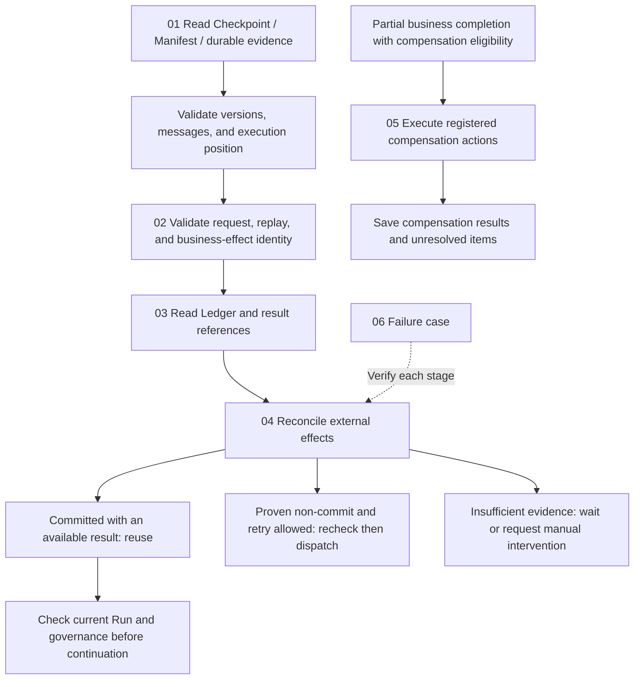

# Effects and Recovery

[English](./README.md) | [繁體中文](./README-zh-TW.md) | [简体中文](./README-zh-CN.md)

[Back to Runtime overview](../README.md) · [Foundations guide](../foundations/README.md) · [Model and Tool Execution](../model-and-tool-execution/README.md)

> In the following content:
> CCB is short for [claude-code-best](https://github.com/claude-code-best/claude-code).
> Chat Gun refers to [chat-gun](https://github.com/HsienW/chat-gun).

An external service completes a write, but its response is lost before reaching the Runtime. After restart, the Checkpoint still precedes tool execution and the user submits the same request again. Graph recovery, request redelivery, and external-operation repetition each have different conditions. The Runtime must first recover execution correlation and assess effect evidence before choosing result reuse, another attempt, continued waiting, or manual handling.

This section builds on lifecycle and tool-call execution boundaries, covering recovery state, replay identity, effect ledgers, reconciliation, and compensation in order. the articles follow the continuation point through ambiguous-commit recovery and subsequent handling.

## Reading order

| Part | Article | Question to answer | Filename |
|---|---|---|---|
| 01 | [Checkpoints and recovery state](./01-checkpoints-and-recovery-state.md) · [繁體中文](./01-checkpoints-and-recovery-state-zh-TW.md) | Which state, versions, and message evidence locate a safe continuation point after restart? | `01-checkpoints-and-recovery-state.md` |
| 02 | [Idempotency and replay identity](./02-idempotency-and-replay-identity.md) · [繁體中文](./02-idempotency-and-replay-identity-zh-TW.md) | How are duplicate requests, the same Tool Call, and the same business effect distinguished, and when may results be reused? | `02-idempotency-and-replay-identity.md` |
| 03 | [Effect ledgers and commit boundaries](./03-effect-ledger-and-commit-boundaries.md) · [繁體中文](./03-effect-ledger-and-commit-boundaries-zh-TW.md) | What records surround dispatch, and what failure windows separate external commit from local persistence? | `03-effect-ledger-and-commit-boundaries.md` |
| 04 | [Effect reconciliation and retry decisions](./04-reconciliation-and-safe-retry.md) · [繁體中文](./04-reconciliation-and-safe-retry-zh-TW.md) | How are ambiguous results verified, and which evidence and limits permit redispatch? | `04-reconciliation-and-safe-retry.md` |
| 05 | [Compensation and manual recovery](./05-compensation-and-manual-recovery.md) · [繁體中文](./05-compensation-and-manual-recovery-zh-TW.md) | How does compensation handle partially completed operations, and what remains after failed or irreversible compensation? | `05-compensation-and-manual-recovery.md` |
| 06 | [Recovering an ambiguous commit](./06-case-ambiguous-commit-recovery.md) · [繁體中文](./06-case-ambiguous-commit-recovery-zh-TW.md) | Can evidence support each decision from external commit through response loss, restart, and subsequent handling? | `06-case-ambiguous-commit-recovery.md` |

## Architecture and responsibilities

The diagram is a reading model whose arrows mark handoffs to inspect. It prescribes no shared API for the two sources and does not imply that one function performs all recovery work.

### Division of work with other sections

| Section | What this section takes on | What existing sections retain |
|---|---|---|
| Foundations | Expand concrete Checkpoint, effect-evidence, and recovery data and failure windows. | Runtime terms, basic states, and design principles. |
| Execution Lifecycle | Read Run/Task/Step, waiting, and terminal evidence to decide available recovery actions. | Admission, ownership, supersede, cancellation requests, and Terminal commits. |
| Model and Tool Execution | Continue from a started or returned runner through Ledger, result references, and effect interpretation. | Model-stream assembly, tool scheduling, capacity, and result envelopes. |
| Harness Action Governance | Consume trusted authorization, confirmation, and operation correlations; redispatch still follows governance conditions. | Policy definition, Resource scope, and human-approval contracts. |
| Events and Operations | Establish evidence requirements for recovery classification, reconciliation, and compensation. | Event delivery, Trace, alerts, operational interfaces, and deployment drills. |

### Data and evidence

| Data | Supported judgment | What still needs other evidence |
|---|---|---|
| Graph Checkpoint | Messages, node position, and pending work. | External-operation commit and readability after deployment. |
| Interrupt/Execution Manifest | Waiting identity, reply contract, expiry, and version compatibility. | Successful execution handoff after Resume consumption. |
| Task/Step/Ledger | Local lifecycle, execution attempts, and persisted effect states. | External commit truth after a lost response. |
| Result Reference | Retrieve an existing result when scope, version, and policy permit. | Whether a lost result permits repeating the original operation. |
| External Operation evidence | Committed, provably not committed, or still unknown. | Whether retry is currently allowed or compensation is required. |

## 01. Checkpoints and recovery state

### Article scope

Start with data reads after a process stops, relating Checkpoint, Interrupt Manifest, Execution Manifest, and durable execution evidence. Retain Execution Lifecycle's Resume consumption rules and focus on whether recovery data is usable and how inconsistent data exits.

Key topics:

1. Separate persistence purposes of Graph state, Session transcripts, Task/Step, and external-effect evidence.
2. Cross-check `threadId`, `runId`, `taskId`, `interruptId`, and scope; Thread alone cannot establish recovery responsibility.
3. Graph configuration hashes, Schema versions, and Manifest compatibility; `migratable` still requires an actual migration implementation.
4. Sanitization and parking conditions for unpaired Tool Calls/Results, duplicate results, incomplete arguments, and partial Assistant Messages.
5. Classification priority among `not_started`, `executing`, `committed`, `unknown`, `waiting_user`, and `terminal`.
6. Failure windows among Resume consumption, `updateState()`, and `Command({ resume })`, plus Checkpointer durability requirements.

### Located sources and verification requirements

Chat Gun `conversation-recovery.ts` finds the Manifest, validates correlation, then reads the Checkpoint, sanitizes history, and loads durable evidence. `langgraph-checkpoint-adapter.ts` separates history updates from Graph invoke into two calls; the inspected order does not establish a shared transaction with Resume consumption.

`last-execution-point.ts` checks Terminal before Ledger committed/unknown and waiting. The classifier accepts input without a Checkpoint, while `recover()` returns manual intervention first when the Checkpoint is missing. Separate module capability from paths reachable through this consumer. `execution-manifest.ts` distinguishes compatible, migratable, and incompatible; classification alone does not establish an automatic migrator.

CCB `QueryEngine.ts` provides a transcript-record and message-chain comparison. The article additionally inspects transcript recording/loading helpers in `sessionStorage.ts` and recovery-data assembly in `sessionRestore.ts`, retaining disabled-configuration and asynchronous-write conditions. Preserve the Deep Researcher `MemorySaver` usage in Chat Gun; an Adapter interface cannot establish cross-process persistent Checkpointers for every Graph.

## 02. Idempotency and replay identity

### Article scope

Separate user resubmission, Runtime replay, physical Attempts, and business effects to explain each identifier's scope. Derive reuse and conflict conditions from their relationships; TTL, hashes, or locks alone cannot establish external-effect idempotency.

Key topics:

1. Uses of Request Dedup Key, Replay Key, Tool Execution, Attempt ID, and Business Effect Key.
2. Conflict handling for the same Replay Key with a different `requestHash`.
3. Correlating a new Run, different Tool Call IDs, and the same business operation; derive business keys from descriptors and trusted scope.
4. Local unique constraints and external-service idempotency contracts, including their separate retention periods.
5. TTL expiry, failed-record reacquisition, and old calls still executing; subsequent owner/fencing requirements.
6. Rejecting committed-result reuse when scope, tool version, cache state, or payload is invalid.

### Located sources and verification requirements

The Chat Gun runner looks up the Replay Key before comparing `requestHash`. Existing non-committed records require reconciliation rather than unconditional reexecution. Ledger business-effect uniqueness includes tenant, scope, and business key; external Operation namespace/ID has a separate unique constraint.

`identity.ts` and `idempotency-key.ts` now delegate to `@gun-ai/harness-kernel`/contracts. The article inspects the installed `0.1.0-alpha.1` package and compares Replay Key construction in `src/side-effect.ts` with exported `dist/side-effect.js`; key fields follow that implementation. `PgIdempotencyGuard` failed/expired reclamation and the runner's Ledger are different mechanisms with distinct safety guarantees.

`result-reference-store.ts` checks scope, tool version, cache state, and policy during resolve. When retrieval fails, retain the possibility that the effect committed but its result is unavailable; do not turn that state directly into redispatch.

## 03. Effect ledgers and commit boundaries

### Article scope

Follow a tool operation with a Side-effect Descriptor through durable prepare, claim, Attempt, external I/O, Result Reference, and Ledger commit. List records remaining after a process stops in each window, giving reconciliation a concrete starting point.

Key topics:

1. Record and state differences among Tool Execution, Business Effect, and Compensation Execution.
2. Prepare exits: claimed, existing_committed, not_claimed, conflict, and unavailable.
3. Obtain execution eligibility and record the Attempt before external I/O dispatch.
4. Separate transaction boundaries for external commit, Result Reference persistence, Ledger commit, and Task Step persistence.
5. Interpreting external success with failed persistence, result-validation failure, late cancellation, and response loss.
6. Stop dispatch when the Ledger is unavailable or state conditions fail; retain unknown evidence after restart.

### Located sources and verification requirements

`PgBusinessEffectLedger.prepare()` uses a database transaction for local claim, while state transitions use expected status/state. `commitExecutionAndBusinessEffect()` can update two local records transactionally; external-service I/O and Result Reference persistence do not thereby join that transaction.

`persistCommittedResult()` saves the Result Reference before committing the Ledger. Even when output validation fails, the code may retain committed-effect records and return deferred. Compare `SIDE_EFFECT_OUTPUT_VALIDATION_FAILED` and `SIDE_EFFECT_PERSISTENCE_UNCERTAIN`, separating format repair, result recovery, and external-effect repetition.

`pipeline.ts` can construct the runner, Ledger, and compensation objects from a Pool. Verify each production tool entry's Pipeline enablement, descriptor provision, and adapter external contract. CCB tombstone/discard provides a comparison for message/result cleanup, not proof of external-I/O reversal.

## 04. Effect reconciliation and retry decisions

### Article scope

Turn `committed`, `not_committed`, and `unknown` evidence into explicit next actions, then follow actual redispatch. Result reuse, retry eligibility, and continued waiting are separate decisions with distinct reasons and current limits.

Key topics:

1. Query effects using trusted scope, Business Effect Key, and available external Operation correlations.
2. Record and reuse committed effects with available results; stop blind repetition when committed results are unavailable.
3. Evidence quality for `not_committed`, external-query lag, and consistency requirements.
4. Retryable classification, Retry Budget, Backoff, Retry-After, cancellation, and pre-dispatch authorization checks.
5. Exits for missing Reconcilers, query exceptions, unknown results, and failed local state transitions.
6. Separate recovery-service commit/retry decisions from consumers that execute them.

### Located sources and verification requirements

`decideReconciliationAction()` chooses commit for committed, retry only for not_committed with `canRetry`, and defer otherwise. The runner retry branch also requires successful Tool Execution and Business Effect transitions. Committed queries without results return `SIDE_EFFECT_COMMITTED_RESULT_UNAVAILABLE`.

Conversation Recovery reconciled results can carry retry decisions, but that branch does not directly call the tool runner. The runner separately defers replay of existing non-committed records. Do not combine those entry points into unconditional automatic recovery. Inspect `routeRecoveryContinuation()` executing routes alongside evidence trust, actual takeover points, and dispatch consumers.

Further inspection of production MCP descriptors finds a Reconciler returning unknown with `MCP_RECONCILIATION_QUERY_UNAVAILABLE`. Other tools and services require individual verification; a generic interface cannot establish end-to-end safe retry. Whether a cross-service not-found response proves non-commit belongs in adapter contracts and fault tests.

## 05. Compensation and manual recovery

### Article scope

Use partially completed business actions followed by failure to organize compensation targets, execution order, and compensation's own effect evidence. Describe what compensation changes and which states remain unrecoverable.

Key topics:

1. After establishing the original effect, select compensation, retention, or manual handling under business rules.
2. Eligibility based on Task state, successful Steps, and registered Compensation Actions.
3. Reverse Step/Action order, irreversible operations, and unregistered actions.
4. Compensation's own Execution, authorization requirements, idempotency, cancellation, and retry contract.
5. Executed compensation with failed persistence, plus duplicate risks on reentry.
6. Distinctions among original Task state, Compensation Result, uncompensated items, and manual-handling evidence.

### Located sources and verification requirements

`SagaOrchestratorImpl.compensate()` accepts partially_failed or cancelled Tasks, selects eligible succeeded Steps, and processes Steps and Actions in reverse. It skips irreversible Actions and requires manual intervention. The Registry default can be empty; inspect whether concrete actions are registered.

With committed execution and a Ledger, the code prepares/transitions Compensation Execution before executing actions. Successful compensation with failed persistence can yield `COMPENSATION_PERSISTENCE_UNCERTAIN`. After compensation, the Task becomes failed while `overallStatus` separately describes all_compensated or manual_intervention_required. Retain these states individually rather than calling all of them recovery success.

Inspection  does not establish cross-Worker single-execution guarantees, shared transactions, or full retry deduplication for compensation. Validate reentry, actions executed before record failure, missing committed references, and whether unknown effects are suitable compensation targets.

## 06. Recovering an ambiguous commit

### Article scope

A teaching case connects the preceding sections through an external write that committed, lost its response, and encountered process restart. The main path assumes the external service supplies trusted commit evidence and results. Non-commit, continued uncertainty, compensation, and manual intervention remain independent branches.

Key topics:

1. List teaching correlations for Run, Step, Tool Call, Replay Key, Business Effect, and external Operation.
2. Original execution claims, dispatches the write, and loses the response after external commit; record the stopping point.
3. After restart, load durable state, validate Manifest/version, and sanitize usable history.
4. Reconcile committed effects with available results, repair local records, and recheck continuation eligibility.
5. Recheck retry conditions after proving non-commit; retain parking/manual branches for unknown effects or missing results.
6. When completed partial operations require compensation, switch to an independent compensation path and retain its results.

### Located sources and verification requirements

Build responsibility lanes from Chat Gun runner, Ledger, Conversation Recovery, and Saga modules. Mark which sequences one function already executes and which require external consumer wiring. Use CCB only to compare transcript/discard recovery scope; do not create a common execution flow spanning both repositories.

The validation matrix includes stopping before dispatch, response loss after external commit, Result Reference persistence failure, Ledger persistence failure, consumed Resume without Graph handoff, parameter conflicts for one Replay Key, and executed compensation with failed recording. Drill each separately rather than drawing them all as one normal execution.
